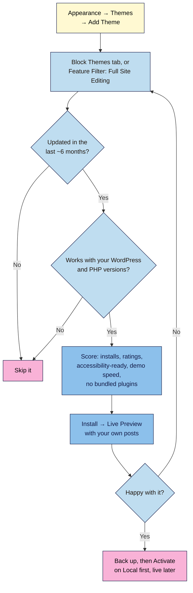

# M04.L01 — Block themes vs classic themes: choosing a lightweight, maintained theme
> After this lesson you can tell a block theme from a classic one, judge any theme in two minutes from its directory page, and switch themes safely without breaking your site.

**Time:** ~15 min reading + ~20 min exercise · **Level:** beginner · **Prereqs:** M01–M03
**Verified against:** WordPress 7.0 core source (Appearance menu logic, **Add Themes** screen tabs and filters, **Live Preview**), the WordPress.org theme directory and Themes Team accessibility guidelines on 2026-10-31

> ⚠️ **Freshness flag:** the theme numbers quoted below (versions, update dates, installs) are a snapshot from 2026-10-31 and change every week. Always check the theme's own page on the day you choose.

> Note: theme directory pages don't show a "tested up to" version (plugin pages do); they show **Last updated** and **Minimum WordPress/PHP version**, so this lesson uses those.

## Learning objectives
1. **Distinguish** block themes from classic themes, and explain why block themes suit creators.
2. **Vet** a theme in the directory: last updated, minimum WordPress and PHP version, active installs, and the accessibility-ready tag.
3. **Install and preview** a theme without breaking your live site.

## Why it matters
Maya picked the most beautiful theme in a marketplace demo. It came with 14 bundled plugins, a page builder and a 3 MB home page. A year later the developer stopped updating it, a security notice went out, and she couldn't switch without rebuilding every page. Her friend Sol picked a plain, well-maintained block theme and changed the colours, fonts and header in the Site Editor in an afternoon. When Sol later wanted a new look, she switched themes in an hour and her posts came through untouched. Your theme controls how every page looks and loads; choosing a maintained one is a decision you live with for years.

## Core concept
**Plain version:** a theme is your site's design: layout, colours, fonts, header and footer. Your **content** (posts, pages, media) stays the same when you change it. There are two kinds:
- **Block themes** are built entirely from blocks. You edit the header, footer, templates, colours and fonts visually in the **Site Editor** (**Appearance → Editor**), using the same blocks you write posts with.
- **Classic themes** are built with PHP templates. You customise them in the **Customizer** (**Appearance → Customize**), with separate **Menus** and **Widgets** screens, and often a theme options panel or page builder.

**Analogy:** a block theme is a house made of the same LEGO bricks you already know, so you can rearrange any room yourself. A classic theme is a furnished flat: often lovely, but moving a wall needs the landlord (the theme developer) or a builder (a page-builder plugin).

**Precise definitions:**
- **Block theme:** a theme whose templates are made of blocks (HTML template files plus `theme.json`). WordPress shows **Appearance → Editor** when one is active. Tag in the directory: **Full Site Editing**.
- **Classic theme:** a PHP-template theme. WordPress shows **Appearance → Customize**, and usually **Widgets** and **Menus**. Classic themes that add `theme.json` (or support editor styles) also get a limited **Appearance → Design** screen.
- **Hybrid / "block-ready" theme:** a classic theme that supports blocks in posts and some Site Editor features (e.g. patterns), but not full template editing.
- **`theme.json`:** the settings file that defines a theme's colours, fonts, spacing and layout widths. It's what powers **Styles** in the Site Editor (M04.L02).
- **Default theme:** the free "Twenty Twenty-X" theme made by WordPress contributors each year. **Twenty Twenty-Five** is a block theme, accessibility-ready and maintained by the WordPress project.
- **Accessibility-ready tag:** given only after a manual review against the Themes Team's accessibility requirements (keyboard navigation, skip links, colour contrast, headings and more). The Themes Team notes it does **not** mean the theme meets WCAG AA, and your own content and settings can still break accessibility (M03.L03, M04.L05).

| | Block theme | Classic theme |
|---|---|---|
| Edit header, footer, templates | **Site Editor**, visually, with blocks | Customizer options, widgets, or code |
| Colours and fonts | **Styles** (global, applies everywhere) | Customizer or theme options panel |
| Menus | **Navigation** block | **Appearance → Menus** |
| Speed (typical) | Light: loads styles only for blocks on the page | Varies a lot; page builders and bundled plugins add weight |
| Switching later | Content carries over; you redo design choices in the new theme | Content carries over; menus, widgets and builder layouts often don't |
| Best for | Creators who want to design without code | Sites tied to a specific page builder or a classic-only feature |

*Speed and switching notes are observed practice; measure your own theme in M04.L05.*

## How it works

**In words:** start with block themes only. Drop anything not updated recently or that needs a newer WordPress or PHP than you have. Score the rest, preview the best one with your own content, and only then back up and activate it, on your practice site first.

## Hands-on walkthrough
Work on your **Local** practice site. You'll shortlist three block themes, score them and activate one.

**Part A: find block themes (4 min)**
1. Go to **Appearance → Themes**. Note which theme is **Active** and whether your Appearance menu shows **Editor** (block theme) or **Customize** (classic theme).
2. Click **Add Theme**.
   **Expected:** the **Add Themes** screen with tabs **Popular**, **Latest**, **Block Themes** and **Favorites**, plus a search box and **Feature Filter**.
3. Click **Block Themes**. Optionally open **Feature Filter** and tick **Accessibility Ready**, then **Apply Filters**.
   > 🖼️ **Image prompt:** Screenshot of WordPress 7.0's Appearance → Themes → Add Themes screen with the "Block Themes" tab selected and the Feature Filter panel open, showing "Full Site Editing" and "Accessibility Ready" ticked and a grid of theme thumbnails below. Highlight the key element with a 3px #F9B2D7 outline; blur any personal details.
   > **Alt text:** The Add Themes screen filtered to block themes with Full Site Editing and Accessibility Ready ticked.

**Part B: vet three themes (8 min)**
1. For each candidate, open its page on **wordpress.org/themes/** (search for the theme name). **Details & Preview** on the Add Themes screen shows a quick preview and summary too.
2. Note what the directory shows:
   **Expected:** **Version**, **Last updated**, **Active installations**, **Minimum WordPress version**, **Minimum PHP version**, ratings, tags and a **Preview** button.
3. Check your own versions in **Tools → Site Health → Info** (**WordPress** and **Server → PHP version**).
4. Score each theme (0–2 per row, 12 max):

| Check | 2 | 1 | 0 |
|---|---|---|---|
| Last updated | ≤ 6 months ago | 6–12 months | > 12 months |
| Minimum WordPress / PHP | Both met by your site | — | Either not met (don't use) |
| Active installations | 10,000+ | 1,000–10,000 | < 1,000 |
| Ratings / support forum | 4★+, recent questions answered | Few ratings, some replies | Unanswered threads |
| Accessibility-ready tag | Yes | — | No |
| Weight and extras | No bundled/required plugins; demo loads quickly | Recommends one companion plugin | Requires a page builder or several plugins |

**Snapshot (2026-10-31, from the WordPress.org themes API; check the live pages yourself):**

| Theme | Type | Last updated | Min WP / PHP | Installs | Accessibility-ready |
|---|---|---|---|---|---|
| Twenty Twenty-Five (WordPress.org) | Block | 2026-05-20 (v1.5) | 6.7 / 7.2 | 1+ million | ✅ |
| Ollie (Mike McAlister) | Block | 2026-10-08 | not listed / 7.3 | 7,000+ | — |
| Blockbase (Automattic) | Block | 2026-09-15 | 6.1 / 5.7 | 2,000+ | — |
| Frost (WP Engine) | Block | 2025-03-12 | 6.7 / 7.2 | 3,000+ | — |
| Kadence, Astra | Classic (hybrid) | 2026-07 / 2026-10 | 6.3 / 7.4 · 5.3 / 5.3 | 500,000+ / 1+ million | Kadence ✅ / Astra — |

   If a theme lists no minimum WordPress version (like Ollie), score that row on PHP alone and lean on **Last updated** as your compatibility signal.

   Frost shows how quickly a good theme can drift: a well-known publisher, but no update for over 18 months at the time of checking.

**Part C: install and preview safely (6 min)**
1. On the Add Themes screen, hover your top theme → **Install**. Installing doesn't change your site.
2. Click **Live Preview**.
   **Expected:** for a block theme, the Site Editor opens a preview of your site in the new theme, with your real posts and pages, and an **Activate** button. Nothing changes for visitors until you activate. (Classic themes open a Customizer preview instead.)
   > 🖼️ **Image prompt:** Screenshot of the WordPress 7.0 Site Editor in Live Preview mode for a newly installed block theme, showing the practice site's home page with real posts, the left navigation panel, and the "Activate" button highlighted at the top. Highlight the key element with a 3px #F9B2D7 outline; blur any personal details.
   > **Alt text:** The Site Editor previewing an installed block theme with the practice site's posts and an Activate button.
3. Look at your **home page**, a **single post** with images (from M03), the **blog page** and a **page**. Open the **View** menu (desktop icon in the top bar) and pick **Mobile** to check the phone view, then **Desktop** to switch back.
4. If you're happy: back up (M01.L05), then **Activate**. On a live site, do this on a staging copy first (M07), or at a quiet time with a fresh backup.
5. Visit **Appearance → Themes** again.
   **Expected:** the new theme is **Active** and the Appearance menu shows **Editor**.
6. Keep one default theme (e.g. Twenty Twenty-Five) installed as a fallback, and **delete** the other themes you don't use (Theme Details → **Delete**). Unused themes still need updates and add security risk (M07).

## When to use / when not to
- **Choose a block theme** for a new creator site: you can change the header, footer, layout, colours and fonts yourself, and switching later is simpler.
- **Start with Twenty Twenty-Five** if you're unsure. It's maintained by the WordPress project, accessibility-ready and light; you can make it look like your brand in M04.L02.
- **A classic theme can still be right** if you already depend on a page builder or a classic-only feature, or your host's starter site uses one. Pick a well-maintained one and avoid stacking builders.
- **Avoid** themes that require several plugins, bundle a page builder you don't want, or haven't been updated in a year.
- **Be careful with "nulled" (pirated) premium themes:** they're a common way to get malware. Only download from WordPress.org or the developer's own site.
- **Trade-off:** premium themes and marketplace bundles offer more ready-made designs and support, but often more weight and lock-in. Free directory themes are reviewed, but support may be community-only.

## Use AI for this
**Example prompt:**
> "I'm starting a [niche] blog on WordPress 7.0 with PHP [version]. I want a free block theme that's lightweight, accessibility-ready and actively maintained. Here are three candidates with their directory details: [paste Version, Last updated, Installs, Minimum WordPress/PHP, tags for each]. Score them with this rubric: [paste rubric]. Explain the scores and what I should test in Live Preview."

**What AI does well here:** applying your rubric consistently, and suggesting what to check in a preview.
**Where it gets it wrong:** it often recommends themes from memory that are outdated, renamed or abandoned, invents install counts and update dates, and mixes up block and classic themes.
**How to check:** give it the details **you** copied from the directory pages today, and verify the theme type yourself (does **Appearance → Editor** appear after preview?).

## Common mistakes
- **Choosing from a demo screenshot.** Demos use perfect images and short text; preview with **your** posts.
- **Ignoring "Last updated".** A theme that hasn't been updated in a year may break with new WordPress versions or carry security issues.
- **Installing a "multipurpose" theme that requires a page builder and five plugins.** Heavier pages, more updates, harder to switch.
- **Activating on the live site without a backup.** Theme switches are reversible, but design settings and widgets may not come back as they were.
- **Keeping a dozen unused themes installed.** Keep the active theme plus one default fallback.
- **Treating "accessibility-ready" as a guarantee.** It's a minimum standard; your colours, images and content still matter.

## Troubleshooting
| Symptom | Likely cause | Fix |
|---|---|---|
| No **Appearance → Editor**, only **Customize** | The active theme is classic | Expected for classic themes; switch to a block theme for the Site Editor |
| "Requires a newer version of WordPress/PHP" on install | Theme's minimum version is above your site's | Update WordPress (and ask your host about PHP), or choose another theme |
| Menus or widgets disappeared after switching | Classic menu/widget locations don't map to the new theme | Rebuild navigation with the Navigation block (M04.L03) |
| Home page shows a different layout than the demo | Demos use custom pages and patterns | Set your home page in **Settings → Reading** (M01.L04) and use the theme's patterns |
| Site looks broken after activating | Theme conflicts with a plugin, or missing required plugin | Re-activate the previous theme from **Appearance → Themes**, then test on Local |
| Can't delete a theme | It's the active theme (or a parent of it) | Activate another theme first |

## Exercise
**Task:** shortlist three block themes for your niche, score each with the 12-point rubric using today's directory data, Live Preview the top two with your own M02/M03 posts, then activate the winner on your Local site and delete the themes you don't need (keeping one default theme).
**Expected outcome:** a scoring table (theme · last updated · min WP/PHP · installs · rating · accessibility-ready · weight · total) and two sentences on why you chose the winner.
**Stretch goal:** run Lighthouse (M03.L05) on the same post with your old theme and the new one, and compare Performance and transferred size.

## Key takeaways
- **Block themes** are edited in the **Site Editor** with blocks; **classic themes** use the Customizer, menus and widgets.
- Vet any theme on its directory page: **Last updated**, **Minimum WordPress/PHP version**, **Active installations**, ratings and the **accessibility-ready** tag.
- **Install** doesn't change your site; **Live Preview** shows your real content; **Activate** only after a backup, and on Local or staging first.
- Avoid themes that require page builders or bundles of plugins, and never use pirated premium themes.
- Keep your active theme plus **one default theme**; delete the rest.

## Teach it back
Explain to a friend in 3 sentences the difference between a block theme and a classic theme, and the three things you'd check before installing any theme.

## Glossary terms added
- Block theme — added to `wordpress-101/glossary.md`
- Classic theme — added to `wordpress-101/glossary.md`
- Hybrid theme — added to `wordpress-101/glossary.md`
- theme.json — added to `wordpress-101/glossary.md`
- Accessibility-ready tag — added to `wordpress-101/glossary.md`
- Live Preview — added to `wordpress-101/glossary.md`

## Further reading
*All checked 2026-10-31.*
- WordPress documentation — Block themes: https://wordpress.org/documentation/article/block-themes/
- WordPress documentation — Work with themes: https://wordpress.org/documentation/article/work-with-themes/
- WordPress documentation — Appearance Themes Screen: https://wordpress.org/documentation/article/appearance-themes-screen/
- WordPress.org theme directory — Full Site Editing tag: https://wordpress.org/themes/tags/full-site-editing/ · Accessibility Ready tag: https://wordpress.org/themes/tags/accessibility-ready/
- Make WordPress Themes — Accessibility-ready requirements: https://make.wordpress.org/themes/handbook/review/accessibility/
- WordPress Developer Resources — What is a theme?: https://developer.wordpress.org/themes/getting-started/what-is-a-theme/
- Twenty Twenty-Five in the theme directory: https://wordpress.org/themes/twentytwentyfive/
