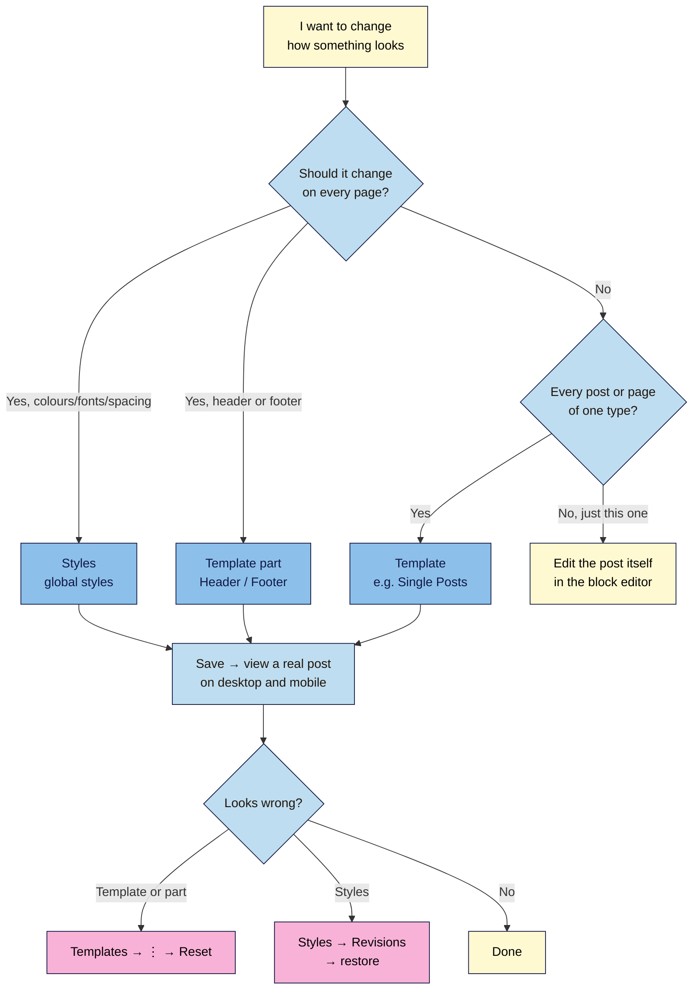

# M04.L02 — The Site Editor: templates, template parts and global styles
> After this lesson you can set your brand colours and fonts once for the whole site, change how every post is laid out, and undo a Site Editor change that went wrong.

**Time:** ~15 min reading + ~25 min exercise · **Level:** beginner · **Prereqs:** M04.L01
**Verified against:** WordPress 7.0 core (Site Editor and global styles UI strings, template reset action, Font Library, default template names) and Twenty Twenty-Five 1.5 on 2026-10-31

> Note: the walkthrough uses **Twenty Twenty-Five** names (its palette, header and footer parts, style variations). Any block theme has the same screens; only the theme's own names and colours differ.

## Learning objectives
1. **Edit** a template (Single Posts) and a template part (header or footer) in the Site Editor.
2. **Configure** brand colours and fonts once in global styles, and check that text colours pass a contrast check.
3. **Reset** a template to the theme default, and restore an earlier version of your styles, when an edit goes wrong.

## Why it matters
Hana runs a baking blog. To make it "on brand" she changed each post's heading colour by hand, and pasted her newsletter sign-up into the bottom of 60 posts. When she rebranded, she had to edit all 60 again. Kwame, who writes about cycling, set his colours and fonts once in **Styles** and put his sign-up in the **Single Posts** template. When he rebranded, he changed two colours and one template, and every post updated in a minute. The Site Editor lets you design **once**, in the right place, so the whole site follows.

## Core concept
**Plain version:** the Site Editor (**Appearance → Editor**) has three tools, and each one controls a different layer of your site:
- **Styles** (global styles): your brand's colours, fonts, sizes and spacing, applied everywhere.
- **Templates:** the layout for a *type* of content: every single post, every page, the blog home, archives, search results, the 404 page.
- **Template parts:** pieces shared by many templates, mainly the **Header** and **Footer**. Edit one once and every template that uses it updates.

Your posts and pages hold the *content*. Templates and styles hold the *design* around it.

**Analogy:** think of a magazine. **Styles** are the style guide (brand colours, typefaces). **Templates** are the page layouts (feature article, contents page). **Template parts** are the masthead and footer printed on every page. The articles themselves are your posts.

**Precise definitions:**
- **Site Editor:** the block editor for your whole site, opened at **Appearance → Editor** when a block theme is active. Its sidebar has **Navigation**, **Styles**, **Pages**, **Templates** and **Patterns**.
- **Template:** a block layout WordPress uses for a kind of request. Default names include **Single Posts**, **Pages**, **Blog Home**, **Archives**, **Search**, **404** and **Index**. If no specific template exists, WordPress falls back to a more general one, ending at **Index** (the *template hierarchy*).
- **Template part:** a reusable block area inside templates, assigned to an area such as Header or Footer. In the Site Editor they're listed under **Patterns → Template Parts**. Twenty Twenty-Five ships three headers (**Header**, **Vertical site header**, **Header with large title**) and three footers (**Footer**, **Footer Columns**, **Footer Newsletter**).
- **Global styles:** site-wide design settings in **Styles**: **Typography**, **Colors**, **Layout**, **Shadows** and per-block styles under **Blocks**. Your choices are saved on top of the theme's `theme.json` (M04.L01).
- **Style variation:** a ready-made alternative look shipped by the theme, under **Styles → Browse styles**. Twenty Twenty-Five has eight (Evening, Noon, Dusk, Afternoon, Twilight, Morning, Sunrise, Midnight), plus separate colour palettes and seven font pairings (**Typesets**).
- **Font Library:** the **Manage fonts** screen in **Styles → Typography**, with **Library**, **Upload** and **Install Fonts** tabs. Fonts you install are copied to your own site (`wp-content/uploads/fonts`), so visitors don't load them from Google.

**Where your changes live:** when you edit a template, part or style, WordPress saves *your copy* in the database and leaves the theme's files alone. That's why theme updates don't overwrite your edits, and why **Reset** can always bring back the theme's original: it deletes your copy. Your copies belong to that theme, so if you switch themes later, they don't come with you (M04.L01).

**Which wins?** The most specific setting wins: a colour you set on **one block** beats the **block-type style** in Styles → Blocks, which beats the **element style** (Text, Links, Headings, Buttons), which beats the **theme default**. So set brand styles globally and avoid one-off overrides; every override is a place a rebrand will miss.

## How it works

**In words:** if a change should appear everywhere, make it in **Styles** (looks) or a **template part** (header/footer). If it should appear on every post or every page, edit that **template**. Only edit a single post when the change is truly one-off. After saving, check a real post; if it's wrong, reset the template or restore a styles revision.

## Hands-on walkthrough
Work on your **Local** practice site with a block theme active (the steps use Twenty Twenty-Five). Take a backup first (M01.L05): you'll break something on purpose in Part D.

**Before you start:** pick 2–3 brand colours and up to 2 fonts. Example used below: navy `#1D3557`, cream `#F4F1DE`, terracotta `#E07A5F`; headings in **Literata**, body text in **Manrope**.

**Part A: tour the Site Editor (3 min)**
1. Go to **Appearance → Editor**.
   **Expected:** a preview of your home page with a sidebar: **Navigation**, **Styles**, **Pages**, **Templates**, **Patterns**.
2. Click **Templates**.
   **Expected:** a list including **Blog Home**, **Pages**, **Single Posts**, **Index**, **404**, **Search** and **Archives**.
3. Click **Patterns**. Under **Template parts**, click **All template parts** (or **Header** / **Footer**).
   **Expected:** **Header**, **Footer** and the theme's other headers and footers.

**Part B: set brand colours and fonts once (10 min)**
1. Click **Styles**. You'll see the current look plus **Browse styles**, **Typography**, **Colors**, **Layout** and **Blocks**.
2. *(Optional shortcut)* Open **Browse styles** and click a variation close to your brand. You'll fine-tune it next.
3. Open **Colors → Palette**. Under **Theme Colors** you'll see Twenty Twenty-Five's slots: **Base** (background), **Contrast** (main text) and **Accent 1–6**.
   Click a colour to change it: set **Base** to your light colour (`#F4F1DE`), **Contrast** to your dark colour (`#1D3557`) and one accent to your brand accent.
   > 🖼️ **Image prompt:** Screenshot of the WordPress 7.0 Site Editor with Styles → Colors → Palette open, showing the Theme Colors swatches (Base, Contrast, Accent 1–6) after editing Base to cream and Contrast to navy, with the site preview updating on the right. Highlight the key element with a 3px #F9B2D7 outline; blur any personal details.
   > **Alt text:** The Styles Palette panel with Base and Contrast colours changed and the site preview updated.

   **Why change the theme's slots instead of adding new colours?** Every block in the theme already uses these slots. Change **Contrast** once and every heading, paragraph and border that uses it changes too.
4. **Contrast check before you save.** Open the free WebAIM Contrast Checker and test each text/background pair you plan to use. Body text needs at least **4.5:1** (WCAG 2.2 AA); large text (24 px, or about 19 px bold) needs **3:1**.
   **Expected, for the example colours:** navy on cream = **10.9:1** ✅. Terracotta `#E07A5F` on white = **2.95:1** ❌, so it's fine for decorative shapes but not for links or button text. A darker terracotta, `#B5442A`, gives **5.5:1** ✅ against white.
   ⚠️ Twenty Twenty-Five's default **Accent 1** (yellow `#FFEE58`) on white is only **1.2:1**. Use it for backgrounds behind dark text (dark text on it is fine), never for text on white.
5. Open **Typography → Fonts → Manage fonts**.
   - To use a Google font: open **Install Fonts**. The first time, WordPress asks permission to connect to Google Fonts; click **Allow access to Google Fonts**. Search for your font, tick the styles you need (e.g. Regular 400 and Bold 700) and click **Install**.
   - To use a font file you have a licence for: open **Upload** → **Upload font** (.woff2, .woff, .ttf or .otf files).
   **Expected:** the font appears under **Library**. It's now stored on your site, not loaded from Google by visitors.
6. Back in **Typography**, open **Elements**: set **Text** to your body font and **Headings** to your heading font. Keep body text at the theme's default size unless you have a reason to change it; it's already set up to resize on phones.
7. Click **Save** (top right). A panel lists everything you changed (here, the global styles). Click **Save** again.
   **Expected:** open any post in a new tab: your colours and fonts are applied everywhere, without editing a single post.

**Part C: edit the Single Posts template and a template part (7 min)**
1. Go to **Templates → Single Posts**.
   **Expected:** a layout made of blocks: the header part, **Title**, **Featured Image**, a "Written by" line, **Content**, categories and tags, previous/next links, comments, more posts and the footer part. The **Content** block shows a placeholder; your actual post text goes there.
2. Add something every post should have. Two good options:
   - Below the **Content** block, insert your **synced author-box pattern** from M02.L02 (Inserter → **Patterns** → **My patterns**).
   - Or move the **Featured Image** above the **Title** with the block toolbar's arrows.
   ⚠️ Don't type post-specific text here; anything you add appears on *every* post.
3. Click the **header** at the top of the canvas, then **Edit** in its toolbar (or open **Patterns → Template Parts → Header**). Make one small change, such as adding a **Site Tagline** block next to the site title.
   **Expected:** the canvas shows only the header. This edit will change the header on every template that uses it.
4. Click **Save**. The panel now lists **two** items: the **Single Posts** template and the **Header** template part. Save both.
5. Open one of your M02/M03 posts on the front end.
   **Expected:** your author box (or the moved image) and the new tagline appear. Open another post: same layout, no per-post edits needed.
   > 🖼️ **Image prompt:** Screenshot of the WordPress 7.0 Site Editor save panel listing two changed items, the "Single Posts" template and the "Header" template part, with both checkboxes ticked and the Save button visible. Highlight the key element with a 3px #F9B2D7 outline; blur any personal details.
   > **Alt text:** The Site Editor save panel listing the Single Posts template and the Header template part ready to save.

**Part D: break it, then reset it (5 min)**
1. In **Templates → Single Posts**, select the **Title** block and delete it. Save.
   **Expected:** your posts now show no title. That's the kind of mistake that's easy to make and miss.
2. Go back to **Templates**. On **Single Posts**, open the **⋮** (actions) menu and choose **Reset**.
   **Expected:** a prompt: *"Reset to default and clear all customizations?"* Click **Reset**. A notice says **Template reset.** with an **Undo** link.
   Note: **Reset** only appears for templates and parts that come from the theme and that you've customised. A template you created from scratch has **Delete** instead.
3. View a post: the title is back. Your author box from Part C is gone too, because Reset throws away **all** your changes to that template, not just the last one. Re-add it (that's the trade-off).
   Shortcut: in the Site Editor, press **Ctrl+K** (**⌘K** on Mac) and type "Reset template" to find the same action.
4. **Styles have history too.** In **Styles**, open **Revisions** to see earlier saved versions of your global styles, click one to preview it, and **Apply** it to restore it. To go all the way back to the theme's defaults, use **Reset styles** from the Styles **⋮** menu.

## When to use / when not to
- **Use Styles** for anything brand-wide: colours, fonts, link and button looks, spacing. Set it once instead of styling blocks one by one.
- **Use a template** for things every post (or page) should share: author box, sign-up form, related-posts area, where the featured image sits.
- **Use a template part** for the header and footer. Pick one of the theme's variants first (e.g. **Footer Newsletter**) before building your own.
- **Edit the post itself** only for one-off content. If you find yourself making the same change in many posts, it belongs in a template or style.
- **Don't** use the Site Editor to fix content problems (a typo, a wrong image); those live in the post.
- **Trade-off:** once you customise a template, it's *your* copy. Theme updates that improve that template won't reach it until you **Reset**, which also throws away your changes. Customise the few templates you need, keep a note of what you changed, and leave the rest alone.

## Use AI for this
**Example prompt:**
> "My blog is about [niche]. My brand colours are [hex codes] and I like [fonts]. I'm using the WordPress block theme [theme] with palette slots Base, Contrast and Accent 1–6. Suggest which colour goes in each slot, a heading and body font pairing from Google Fonts, and which text/background pairs I must contrast-check."

**What AI does well here:** mapping brand colours to roles (background, text, accent), suggesting font pairings, and listing what to check.
**Where it gets it wrong:** it often states contrast ratios that are wrong, suggests fonts that aren't in Google Fonts or need a paid licence, and describes Site Editor menus from older WordPress versions (e.g. "Appearance → Customize → Colors" or "Global Styles" as a menu).
**How to check:** run every colour pair through a contrast checker yourself, search for the font in **Install Fonts**, and follow the labels you actually see in **Appearance → Editor**.

## Common mistakes
- **Styling block by block.** Colouring headings one at a time creates overrides that a rebrand won't update. Use **Styles**.
- **Typing post content into a template.** Text in the **Single Posts** template shows on every post. Content goes in posts.
- **Editing the header in one template and expecting it to stay local.** The header is a shared part; changes affect every template that uses it.
- **Choosing brand colours that fail contrast.** Light accents on white look stylish and are unreadable for many visitors. Check every text pair (4.5:1).
- **Installing five fonts.** Each font and weight adds download weight. Two families, two or three weights each, is plenty.
- **Forgetting Reset is all-or-nothing.** Note your template changes before resetting, so you can redo the good ones.

## Troubleshooting
| Symptom | Likely cause | Fix |
|---|---|---|
| No **Appearance → Editor**, only **Customize** | Classic theme active | Switch to a block theme (M04.L01) |
| Colour change in Styles doesn't show on some headings | Those blocks have their own colour set (an override) | Select the block → clear its colour in the block settings, so it follows Styles |
| Change shows in one post but not others | You edited the post, not the template | Make the change in **Templates → Single Posts** |
| No **Reset** in the template's ⋮ menu | Template wasn't customised, or it's one you created (has **Delete**) | Nothing to reset; delete a custom template if you don't need it |
| **Install Fonts** tab missing or empty | No connection to Google Fonts yet, or it was refused | Click **Allow access to Google Fonts**, or download the font and use **Upload** |
| Font looks right in the editor but not on the site | Not saved, or a caching plugin is serving old pages | Click **Save**, then clear the cache (M07.L04) |
| Edits vanished after switching themes | Template and style edits belong to the old theme | Switch back to see them, or redo them in the new theme |

## Exercise
**Task:** brand your Local site in the Site Editor:
1. Set your brand palette in **Styles → Colors** and your heading and body fonts in **Typography**.
2. Contrast-check every text/background pair you use, and fix any below 4.5:1.
3. Customise the **Single Posts** template with one element every post should have.
4. Make one change to the **Header** or **Footer** part.
5. Run the Part D break-and-reset drill, then re-apply your template change.

**Expected outcome:** a short "brand sheet" in your notes: colour hex codes and their slot (Base, Contrast, Accent), fonts and weights, a contrast table (pair · ratio · pass/fail), and a list of the templates and parts you customised. You'll reuse it in the M04 capstone.
**Stretch goal:** create a **custom template** for one special post (e.g. a "Start Here" style long-read with no sidebar): in **Templates**, **Add template** → **Custom template**, then assign it to a post from the post editor's **Template** setting.

## Key takeaways
- **Styles** = brand-wide looks; **templates** = layout per content type; **template parts** = shared header and footer; **posts** = content.
- Change the theme's palette slots (Base, Contrast, Accents) to rebrand everything at once, and contrast-check every text pair (4.5:1 for body text).
- Fonts installed from the **Font Library** are stored on your site, not loaded from Google by visitors.
- Your edits are saved as your own copy, so **Reset** can always restore the theme's original, but it removes all your changes to that template.
- **Styles → Revisions** restores an earlier version of your global styles.

## Teach it back
Explain to a friend in 3 sentences the difference between Styles, a template and a template part, and how you'd undo a template change that broke every post.

## Glossary terms added
- Site Editor — added to `wordpress-101/glossary.md`
- Template — added to `wordpress-101/glossary.md`
- Template part — added to `wordpress-101/glossary.md`
- Template hierarchy — added to `wordpress-101/glossary.md`
- Global styles — added to `wordpress-101/glossary.md`
- Style variation — added to `wordpress-101/glossary.md`
- Font Library — added to `wordpress-101/glossary.md`
- Contrast ratio — added to `wordpress-101/glossary.md`

## Further reading
*All checked 2026-10-31.*
- WordPress documentation — Site Editor: https://wordpress.org/documentation/article/site-editor/
- WordPress documentation — Styles overview: https://wordpress.org/documentation/article/styles-overview/
- WordPress documentation — Template editor: https://wordpress.org/documentation/article/template-editor/
- WordPress documentation — Template Part block: https://wordpress.org/documentation/article/template-part-block/
- WordPress Developer Resources — Templates (and the template hierarchy): https://developer.wordpress.org/themes/templates/
- WordPress Developer Resources — Global settings and styles (theme.json): https://developer.wordpress.org/themes/global-settings-and-styles/
- W3C — Understanding WCAG 2.2 Success Criterion 1.4.3 Contrast (Minimum): https://www.w3.org/WAI/WCAG22/Understanding/contrast-minimum.html
- WebAIM — Contrast Checker: https://webaim.org/resources/contrastchecker/
