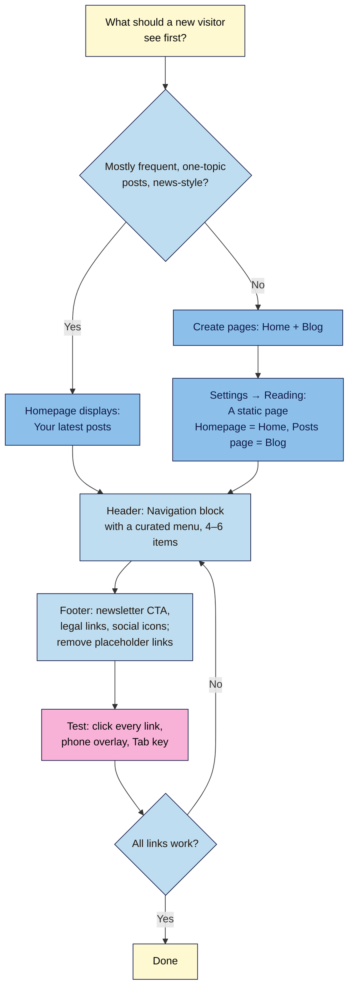

# M04.L03 — Navigation, header and footer, homepage vs blog index
> After this lesson you can choose what your homepage shows, give your blog its own page, build a short menu readers can use on any device, and turn your footer into a useful last stop.

**Time:** ~13 min reading + ~20 min exercise · **Level:** beginner · **Prereqs:** M04.L02, M01.L04
**Verified against:** WordPress 7.0 core (Settings → Reading, Site Editor **Set as homepage** / **Set as posts page** actions, Navigation and Social Icons blocks, navigation fallback) and Twenty Twenty-Five 1.5 on 2026-10-31

> Note: About, Start Here and Contact pages are built in M04.L04. In this lesson you add the menu items you already have (Blog, categories) and leave space for those pages.

## Learning objectives
1. **Choose** between a static homepage and a latest-posts homepage, and set up a separate blog index (posts page).
2. **Build** a primary navigation menu with the Navigation block that works on desktop and phone.
3. **Configure** a footer with a newsletter call to action, legal links and social links, replacing the theme's placeholder links.

## Why it matters
Yuki's homepage showed her ten latest posts. A new visitor landing there saw a recipe, a travel diary and a gear review, with no idea what the site was for or where to start, and most left. Her header menu listed every page she had ever published, including "Sample Page". Femi gave his homepage a clear welcome, his three best guides and a sign-up box, put his posts on a **Blog** page, and kept the menu to four items. His footer offered the newsletter again, plus Privacy and Contact links. The homepage, menu and footer are the signposts every reader sees, often before they read a single post.

## Core concept
**Plain version:** your site has three "always there" signposts:
- **The homepage** is the first page most new visitors see. It can show either **your latest posts** (a classic blog) or a **static page** you design (a front door).
- **The header menu** (built with the **Navigation** block) tells readers where they can go next.
- **The footer** is the last stop on every page: sign up, find legal pages, follow you elsewhere.

If you choose a static homepage, your posts need a new home: the **posts page** (blog index), an empty page such as **Blog** that WordPress fills with your latest posts.

**Analogy:** the homepage is a shop window, the posts page is the shop floor with everything on the shelves, the menu is the signs above the aisles, and the footer is the till where people sign up for the loyalty card.

**Precise definitions:**
- **Static homepage:** a normal page chosen in **Settings → Reading → Your homepage displays → A static page**, under **Homepage**. Twenty Twenty-Five shows it with the **Pages** template (a theme can provide a special **Front Page** template instead).
- **Posts page (blog index):** the page chosen under **Posts page** in the same setting. WordPress shows your latest posts there with the **Blog Home** template; anything you type into that page itself isn't shown.
- **Navigation block:** the block that displays a menu. Its menus are saved separately (listed under **Appearance → Editor → Navigation**), so the same menu can be reused in the header, the footer or the mobile overlay.
- **Navigation fallback:** if a Navigation block isn't set to a specific menu, WordPress shows your **most recently published** menu. If you have none yet, it creates one: it imports your old classic menu if there is one, otherwise it uses a **Page List** that shows **all** published pages. That's why new pages (even "Sample Page") suddenly appear in the header.
- **Overlay menu:** the menu button (☰) that opens the menu full-screen. The Navigation block's **Overlay Visibility** is **Mobile** by default (other options: **Off**, **Always**). New in WordPress 7.0, the overlay itself is a template part (**Navigation Overlay**) that you can design.
- **Social Icons block:** a row of icon links to your profiles. Core supports Bluesky, Threads, Instagram, TikTok, YouTube, Mastodon, LinkedIn, X, Facebook, Patreon, Spotify, Pinterest, Twitch, Discord, WhatsApp, Mail, RSS feed and more.

| | Latest posts homepage | Static homepage + posts page |
|---|---|---|
| What visitors see first | Your newest posts | A welcome, best content, sign-up |
| Effort | None: it updates itself | Build and refresh one page |
| Best for | News-style or very frequent posting; one clear topic | Most creators: several topics, a newsletter, products or services |
| Where posts live | Homepage | **Blog** page (posts page) |
| Template used (TT5) | **Blog Home** | Homepage: **Pages**; Blog: **Blog Home** |

## How it works

**In words:** decide whether new visitors should land on your newest posts or on a front door. If it's a front door, create **Home** and **Blog** pages and assign them in Settings → Reading. Then replace the automatic menu with a short curated one, clean up the footer, and test every link on a phone and with the keyboard.

## Hands-on walkthrough
Work on your **Local** practice site (Twenty Twenty-Five, branded in M04.L02). Have your M02 posts and categories ready.

**Part A: a static homepage and a blog page (6 min)**
1. Go to **Pages → Add Page**. Title it **Home**. Add a heading with a one-line promise (who the site is for and what they'll get), a short paragraph, and a **Latest Posts** block (or a Query Loop pattern) showing 3 posts. Publish.
2. Create a second page titled **Blog**. Leave it empty and publish it. WordPress will fill it with your posts.
3. Go to **Settings → Reading**. Under **Your homepage displays**, choose **A static page (select below)**. Set **Homepage:** to **Home** and **Posts page:** to **Blog**. Click **Save Changes**.
   **Expected:** visit your site's address: you see the Home page. Visit `/blog/`: you see your posts in a list.
   > 🖼️ **Image prompt:** Screenshot of WordPress 7.0 Settings → Reading with "A static page (select below)" selected, Homepage set to "Home" and Posts page set to "Blog", and the Save Changes button visible. Highlight the key element with a 3px #F9B2D7 outline; blur any personal details.
   > **Alt text:** Reading Settings with a static page chosen, Home as the homepage and Blog as the posts page.

   **Shortcut in the Site Editor:** **Appearance → Editor → Pages**, open a page's **⋮** menu and choose **Set as homepage** or **Set as posts page**. WordPress asks you to confirm (e.g. *"This will replace the current homepage which is set to display latest posts."*).
4. Your homepage probably shows a big "Home" title. Open the Home page in the editor, and in the page settings click the **Template** name, choose **Change template** and pick **Page No Title** (a Twenty Twenty-Five template). Save.
   **Expected:** the homepage starts with your heading, not the word "Home".

**Part B: a curated header menu (7 min)**
1. Go to **Appearance → Editor → Patterns → Header** (or click the header on any template and choose **Edit**).
2. Select the **Navigation** block (the menu links on the right). Look at what it shows.
   **Expected:** probably every published page, including old ones like "Sample Page". That's the automatic fallback menu.
3. In the block settings sidebar, open the menu's **⋮** options and choose **Create new Menu**. Then open the block settings' **Advanced** section and type **Main menu** in **Menu name**, so you can find it later.
4. Use **+** inside the Navigation block (or in the menu list in the sidebar) to add items:
   - **Add page** → **Blog**.
   - **Add link** → type the name of one of your main categories from M02.L03 and pick it from the results. Add a second category if you have one.
   - Leave room for **Start Here**, **About** and **Contact**; you'll add them in M04.L04.
   Aim for **4–6 top-level items** in the end. Use a submenu only when a group really needs one (**Add submenu**).
5. Check the mobile menu: in the block settings, **Overlay Visibility** should be **Mobile**. Then use **View → Mobile** (M04.L02) to preview.
   **Expected:** on a phone-sized preview, the links collapse into a menu button that opens the full list.
6. Click **Save**. The save panel lists the **Main menu** and the **Header** template part. Save both.
   > 🖼️ **Image prompt:** Screenshot of the WordPress 7.0 Site Editor with the Header template part open, the Navigation block selected, and the block settings sidebar showing the "Main menu" list with Blog and two category links. Highlight the key element with a 3px #F9B2D7 outline; blur any personal details.
   > **Alt text:** The Site Editor header with the Navigation block selected and a short Main menu in the settings sidebar.

**Part C: a footer that works (5 min)**
1. Go to **Patterns → Footer**.
   **Expected:** Twenty Twenty-Five's footer has two link lists (Blog, About, FAQs, Authors, Events, Shop and more). **They all point to `#`**, which means nowhere. Replace them with real links or delete them.
2. Turn one list into your **legal and help links**: **Privacy Policy**, **Contact**, and later **Disclosures** (M08.L04). WordPress created a draft **Privacy Policy** page when it was installed; you'll finish and publish it in M06.L03. Until then, leave that link out, or only add links to pages that are published.
3. Add your newsletter sign-up: insert your synced **Newsletter CTA** pattern from M02.L02 (Inserter → **Patterns** → **My patterns**). If you'd rather, select the footer and, in the block settings' **Design** panel, pick the theme's **Footer Newsletter** instead.
4. Add a **Social Icons** block. Click **+** inside it, choose each network you actually use (2–4 is plenty), and paste your **full profile URL** into each. Choose the **Logos Only** or **Pill Shape** style if you like. Leave **Open links in new tab** off unless you have a reason; links that open new tabs can surprise keyboard and screen-reader users (M04.L05).
5. Save.

**Part D: test like a visitor (2 min)**
1. Open your site in a private window. Click every header and footer link.
   **Expected:** no link goes to `#`, a 404 or a draft.
2. Shrink the window (or use your phone): open the menu button, tap a link, close the overlay.
3. Click in the address bar and press **Tab** repeatedly.
   **Expected:** the first stop is a **Skip to content** link (block themes add it automatically so keyboard users can jump past the menu), then a visible focus outline moves through the header links in order. (You'll do a fuller keyboard check in M04.L05.)

## When to use / when not to
- **Use a static homepage** if you cover several topics, want new readers to start with your best work, or have a newsletter, product or service to introduce. That's most creators.
- **Keep "Your latest posts"** if you publish often on one topic and readers come back for what's new (a news or daily-update site).
- **Use the menu for the 4–6 places most readers need**, not for every page. Put the rest in the footer or on your Start Here page.
- **Use the footer** for things people look for at the end: sign-up, Privacy, Contact, disclosures, social links. Keep it to what's useful; a footer with 40 links is a site map, not help.
- **Trade-off:** a static homepage gives you control but needs maintenance; if you never update it, it goes stale while your blog moves on. Including a Latest Posts block keeps one part fresh automatically.

## Use AI for this
**Example prompt:**
> "I run a [niche] blog for [audience]. My main categories are [list] and my goal is [newsletter sign-ups / selling X]. Suggest a header menu of no more than 6 items with short labels, a footer layout (newsletter, legal, social), and a 3-section homepage outline (headline promise, best content, sign-up). Use plain labels readers expect, not clever ones."

**What AI does well here:** suggesting clear labels, trimming long menus, and drafting a homepage promise line.
**Where it gets it wrong:** it invents pages you don't have, suggests clever labels ("The Kitchen Table") that hide what's behind them, and describes classic-theme menus (**Appearance → Menus**) that block themes don't use.
**How to check:** every suggested item must match a real, published page or category, labels should be understandable without context, and you build it in the Navigation block, not Appearance → Menus.

## Common mistakes
- **Setting a static homepage without a posts page.** Your posts then have no index page; set **Posts page** too.
- **Writing content on the Blog page.** WordPress replaces it with the posts list, so readers never see it.
- **Leaving the automatic menu.** Every new page (and "Sample Page") lands in your header. Create a curated menu.
- **Leaving placeholder `#` links in the footer.** Twenty Twenty-Five's footer ships with 8 of them.
- **Too many menu items or vague labels.** "Stuff", "Resources", "Explore" make readers guess.
- **Linking to drafts.** A link to an unpublished Privacy Policy gives visitors a "Page not found".

## Troubleshooting
| Symptom | Likely cause | Fix |
|---|---|---|
| Homepage still shows latest posts | Reading setting not saved, or Homepage left at "— Select —" | **Settings → Reading** → pick **Home** and **Save Changes** |
| `/blog/` shows a blank page | Blog isn't set as **Posts page**, or it isn't published | Publish it and set it as **Posts page** |
| Homepage shows a big "Home" title | The Pages template shows page titles | Page settings → **Template** → **Change template** → **Page No Title** |
| Every page appears in the menu | Navigation block is using the fallback Page List | **Create new Menu** and add items by hand |
| Menu changes don't show on some pages | You edited a different menu than the header uses | **Appearance → Editor → Navigation**: check which menu is in the Header, edit that one |
| Old classic menu items appeared after a theme switch | The fallback imported your classic menu | Edit the imported menu, or create a new one |
| Social icon goes to the wrong place | Only a username was entered | Paste the full profile URL (`https://…`) |

## Exercise
**Task:** set up your site's signposts:
1. A **Home** page (promise headline, short intro, 3 latest posts or 3 best guides, sign-up) set as the homepage, and a **Blog** page set as the posts page.
2. A curated **Main menu** in the header (Blog + your main categories for now; 4–6 items once M04.L04 is done).
3. A footer with your newsletter CTA, real legal/help links (published pages only) and 2–4 social icons; no `#` links left.
4. Test every link on desktop and phone, and Tab through the header.

**Expected outcome:** screenshots of the homepage (desktop and phone with the menu open) and the footer, plus a link checklist (link · goes to · works ✅/❌).
**Stretch goal:** design your mobile overlay: select the Navigation block, open the **Overlay** settings and create an overlay template part, then add your newsletter CTA under the menu links so phone readers can subscribe from the menu.

## Key takeaways
- Most creators should use a **static homepage** (Settings → Reading) plus a **Blog** posts page; keep "latest posts" for news-style sites.
- The posts page shows your posts automatically; don't write content on it.
- Replace the Navigation block's **fallback menu** (all pages) with a curated menu of 4–6 clear items.
- Twenty Twenty-Five's footer ships with placeholder `#` links: replace them with sign-up, legal and social links.
- Test every link on a phone and with the **Tab** key.

## Teach it back
Explain to a friend in 3 sentences when to use a static homepage instead of your latest posts, why you need a separate Blog page, and what belongs in a footer.

## Glossary terms added
- Static homepage — added to `wordpress-101/glossary.md`
- Posts page (blog index) — added to `wordpress-101/glossary.md`
- Navigation block — added to `wordpress-101/glossary.md`
- Navigation fallback — added to `wordpress-101/glossary.md`
- Overlay menu — added to `wordpress-101/glossary.md`
- Social Icons block — added to `wordpress-101/glossary.md`

## Further reading
*All checked 2026-10-31.*
- WordPress documentation — Reading Settings screen: https://wordpress.org/documentation/article/settings-reading-screen/
- WordPress documentation — Create a static front page: https://wordpress.org/documentation/article/create-a-static-front-page/
- WordPress documentation — Navigation block: https://wordpress.org/documentation/article/navigation-block/
- WordPress documentation — Site Editor Navigation: https://wordpress.org/documentation/article/site-editor-navigation/
- WordPress Developer Resources — Template hierarchy (front page and blog index): https://developer.wordpress.org/themes/basics/template-hierarchy/
- W3C — Understanding WCAG 2.2 Success Criterion 3.2.3 Consistent Navigation: https://www.w3.org/WAI/WCAG22/Understanding/consistent-navigation.html
- Nielsen Norman Group — Footers 101 (observed practice, not a WordPress source): https://www.nngroup.com/articles/footers/
