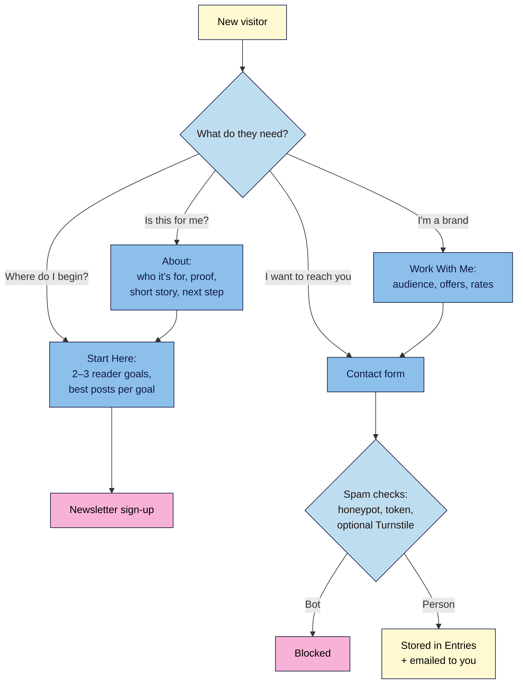

# M04.L04 — Key creator pages: About, Start Here, Contact and Work With Me
> After this lesson you can write an About page that makes readers stay, build a Start Here page that sends new readers to your best work, and add a contact form that reaches you and blocks most spam.

**Time:** ~14 min reading + ~25 min exercise · **Level:** beginner · **Prereqs:** M04.L03, M02.L02, M03.L03
**Verified against:** WordPress 7.0 and Twenty Twenty-Five 1.5; Fluent Forms 6.2.16 (plugin code and WordPress.org listing); WPForms Lite 2.0.3.1 and Jetpack 16.3.1 listings; Local's Mailpit docs, all on 2026-10-31

> Note: the walkthrough uses **Fluent Forms** because its free version stores every message in your dashboard as well as emailing you, so a sponsor's message isn't lost if an email fails. **WPForms Lite** works the same way on Local. **Jetpack Forms** (the third P8 option) is set up by connecting Jetpack to a WordPress.com account, which a Local practice site can't fully do (Jetpack runs in offline mode there), so try it on a live site instead. Install only **one** form plugin.

## Learning objectives
1. **Write** an About page that speaks to the reader first: who it's for, what they get, why to trust you, and what to do next.
2. **Build** a Start Here page that routes new readers to your best content by goal.
3. **Configure** a spam-protected contact form that emails you and stores messages, and **outline** a Work With Me / media kit page.

## Why it matters
Grace's About page began "I was born in 1991 and have always loved food." Readers left before reaching the part that mattered: she teaches busy parents to cook in 20 minutes. Her email address was printed on the Contact page, so bots harvested it and her inbox filled with spam, burying a brand that wanted to sponsor her. Mateo's About page opens with "Easy bike repairs for commuters, no garage needed", shows his workshop photo and links to his three best guides. His contact form has a "What's this about?" menu, and every message is saved in WordPress. The About, Start Here and Contact pages are where readers decide to trust you and where opportunities arrive.

## Core concept
**Plain version:** four pages do most of the trust-building on a creator site:
- **About:** answers the reader's question "Is this site for me, and why should I trust you?" It's about *them* first and *you* second.
- **Start Here:** a guided tour for new visitors: "If you want X, read these." It's linked from your menu and homepage.
- **Contact:** a form people can use without seeing your email address, with spam protection.
- **Work With Me (media kit):** what brands or clients can hire you for, your audience in numbers, and how to get in touch. You'll outline it now and publish it in M06.L06.

**Analogy:** your site is a bookshop. **About** is the sign over the door saying what kind of shop it is. **Start Here** is the friendly shop assistant who asks "What are you looking for?" **Contact** is the counter bell. **Work With Me** is the notice for publishers and suppliers.

**Precise definitions:**
- **Reader-first About page:** a page that opens with who the site helps and the outcome they get, then gives proof (experience, results, credentials), a short personal story and one clear next step. Google's guidance on helpful content asks whether it's "self-evident to your visitors who authored your content"; a clear About page (and author bylines) helps answer that.
- **Contact form:** a set of fields (name, email, message) that sends the message to you by email and, in most form plugins, stores it in WordPress. It hides your email address from bots.
- **Spam protection:** tools that stop automated submissions. Common free layers: a **honeypot** (a hidden field only bots fill in), **token-based protection** (a check that a real person interacted with the form), a **CAPTCHA** such as Cloudflare Turnstile, hCaptcha or reCAPTCHA, and **Akismet** (M06.L04).
- **Media kit:** a page or one-page PDF for brands: who your audience is, your reach with dates, your offers and rates (or "from" prices), past partners and how to enquire.

## How it works

**In words:** each page answers one visitor question. About and Start Here lead to your best posts and your newsletter. Contact goes through spam checks; real messages are saved in WordPress and emailed to you. Brands start at Work With Me and finish at the contact form.

## Hands-on walkthrough
Work on your **Local** practice site. Have your synced **Newsletter CTA** (M02.L02), your categories (M02.L03) and 6–9 of your posts ready.

**Part A: a reader-first About page (8 min)**
1. **Pages → Add Page**, title **About**.
2. Add a **Media & Text** block: your photo on one side (with alt text describing it, M03.L03), and on the other:
   - a heading that names the reader and the outcome, e.g. *"Easy bike repairs for commuters, no garage needed"*;
   - one paragraph: what readers get here and how often.
3. Add a heading **Why listen to me** and 3–4 bullet points of proof: years of experience, a result, a credential, "featured in" (only if true).
4. Add a heading **My story** and 2–3 short paragraphs: why you started and what you believe. Keep it about the reader's problem.
5. End with one next step: a **Buttons** block linking to **Start Here**, plus your synced **Newsletter CTA**.
   **Expected:** the first screen (without scrolling) tells a stranger who the site is for and what they'll get.
   > 🖼️ **Image prompt:** Screenshot of a finished About page on a Twenty Twenty-Five site, desktop width: Media & Text block with the creator's photo on the left and a reader-first headline and intro on the right, "Why listen to me" proof bullets below. Highlight the key element with a 3px #F9B2D7 outline; blur any personal details.
   > **Alt text:** An About page whose first screen shows the creator's photo, a reader-first headline and a short intro.
6. Publish.

**Part B: a Start Here page (7 min)**
1. **Pages → Add Page**, title **Start Here**. Open with one welcome sentence that repeats your promise.
2. Add a **Columns** block with 2–3 columns, one per **reader goal** (often matching your main categories). Example for a cycling site: *"I'm new to commuting"*, *"I want to fix my own bike"*, *"I'm choosing gear"*.
3. In each column: a heading (the goal), one sentence, and a list of your **3 best posts** for that goal (links), plus a link to the full category.
4. Add your synced **Newsletter CTA** at the end. Publish.
   **Expected:** a new reader can pick their goal and reach a great post in two clicks.
5. Add **Start Here** and **About** to your **Main menu** (M04.L03): **Appearance → Editor → Patterns → Header**, select the Navigation block, **+** → **Add page**. Save.

**Part C: a spam-protected contact form (8 min)**
1. **Plugins → Add Plugin**, search **Fluent Forms**, **Install Now**, **Activate**. Skip any optional setup or upsell screens.
2. **Fluent Forms → Global Settings**. Find and switch on **Enable Honeypot Security** and **Token Based Spam Protection** (both marked "Recommended Settings: Enabled", and both **off** on a new install). If you don't need visitors' IP addresses, also switch on **Disable IP Logging** (less personal data stored). Click **Save Settings**.
3. **Fluent Forms → New Form** (or **Add New Form**) and choose the **Contact Form** template.
   **Expected:** a form with Name, Email, Subject and Your Message fields.
4. Add a **Dropdown** field labelled *"What's this about?"* with options: *Reader question*, *Collaboration or sponsorship*, *Press*, *Other*. Make it required. Save the form.
5. Open **Settings & Integrations → Email Notifications**. ⚠️ The template's **Admin Notification Email** is **disabled** by default, so nothing would reach your inbox. Turn it on, check **Send To** (your admin email), set **Reply To** to the form's Email field so you can just hit reply, and save.
   > 🖼️ **Image prompt:** Screenshot of Fluent Forms' Settings & Integrations → Email Notifications screen showing the "Admin Notification Email" row with its status toggle switched on. Highlight the key element with a 3px #F9B2D7 outline; blur any personal details.
   > **Alt text:** The Fluent Forms Email Notifications list with the Admin Notification Email switched on.
6. In **Confirmation Settings**, change the thank-you message to something specific: *"Thanks! I reply within 3 working days. Meanwhile, here's my Start Here page."* with a link.
7. **Pages → Add Page**, title **Contact**. Write 2–3 lines: what to use the form for, your reply time, and where common questions are answered. Insert the form block (search the inserter for **Fluent Forms**, then **Select a Form**). Below it, add one line: *"I'll only use your details to reply to you. See my Privacy Policy."* (link it once the policy is published, M06.L03). Publish, and add **Contact** to the footer links (M04.L03).
8. Test it: open the Contact page in a private window and send a message.
   **Expected:** the thank-you message appears; the message is listed under **Fluent Forms → Entries**; and in Local, **Tools → Mailpit → Open Mailpit** shows the notification email.

**Part D: outline Work With Me (2 min)**
Create a page **Work With Me** and save it as a **draft** with these headings (you'll fill and publish it in M06.L06):
1. **Who I work with** (brands or clients that fit your audience).
2. **My audience** (monthly readers, newsletter subscribers, main countries, with the date: "as of October 2026").
3. **Ways to work together** (e.g. sponsored post, newsletter feature, workshop) with "from" prices or "rates on request".
4. **Past partners and results** (only real ones, with permission).
5. **How I disclose sponsorships** (M08.L04).
6. **Next step:** link to the Contact page and ask enquirers to choose *Collaboration or sponsorship*.

## When to use / when not to
- **Every creator site needs About and Contact.** Start Here becomes essential once you have ~15+ posts or more than one topic.
- **Use a form instead of printing your email** to avoid harvested-address spam. If you also want to show an address (some press contacts expect one), use a separate one you can filter.
- **Use a Work With Me page** once you're open to sponsors or clients; until then, keep it as a draft.
- **Don't add the contact form to every page or the footer.** One Contact page, linked from the footer, is enough; more forms mean more spam and more places to maintain.
- **Trade-off:** a CAPTCHA (Turnstile, hCaptcha, reCAPTCHA) blocks more bots, but adds a third-party service, keys to manage and possible privacy notice wording. Start with the honeypot and token protection; add Cloudflare Turnstile only if spam still gets through.

## Use AI for this
**Example prompt:**
> "Here are my notes about my site and me: [audience, topics, what readers get, my experience and results, why I started]. Draft an About page in this order: a headline naming the reader and the outcome, a 2-sentence intro, 4 proof bullets using only facts I gave you, a 3-paragraph story, and a call to action to my Start Here page. Plain language, no hype."

**What AI does well here:** turning messy notes into a clear structure, writing reader-first headlines, and suggesting Start Here groupings from a list of your post titles.
**Where it gets it wrong:** it invents credentials, numbers and "featured in" logos, writes generic hype ("passionate", "journey"), and suggests audience stats for your media kit that you don't have.
**How to check:** every claim and number must come from you and be true today; read it aloud to check it sounds like you; date every audience figure.

## Common mistakes
- **About page that starts with your birth year.** Lead with the reader and the outcome; your story comes after.
- **Start Here that lists every post.** Pick 3 per goal; the point is to choose for the reader.
- **Leaving the form's email notification off.** Fluent Forms' Contact Form template ships with it disabled; check, then send a test.
- **No spam protection.** Turn on the honeypot and token protection on day one.
- **Two form plugins.** One per job (P8); remove the one you're not using.
- **Media kit numbers with no date, or rounded up.** Brands check; date them and keep them honest.

## Troubleshooting
| Symptom | Likely cause | Fix |
|---|---|---|
| Form submits but no email arrives | **Admin Notification Email** is off | **Settings & Integrations → Email Notifications** → switch it on |
| Notification is on, still no email (live site) | Your host's mail isn't trusted, so it's blocked or sent to spam | Check **Entries** so nothing is lost; set up SMTP with your email provider (e.g. via an SMTP plugin; M07) |
| No email in Mailpit on Local | Mailpit only catches mail sent through PHP `mail()` | Check **Entries**; on Windows with Apache, see Local's Mailpit troubleshooting |
| Real people's messages are rejected as spam | A page cache is serving an old copy of the Contact page, so the anti-spam token has expired, or an optimisation plugin strips hidden fields | Exclude the Contact page from page caching (M07.L04), then retest |
| Lots of spam despite the honeypot | Smarter bots | Add Cloudflare Turnstile (free keys) in **Global Settings**, or Akismet (M06.L04) |
| Start Here links show "Page not found" | Linked to drafts, or post slugs changed | Link only published posts; re-pick links from the link search |

## Exercise
**Task:** publish **About**, **Start Here** and **Contact** on your Local site and save **Work With Me** as a draft:
1. About: reader-first headline, proof bullets, short story, one next step.
2. Start Here: 2–3 reader goals with 3 best posts each, plus the newsletter CTA.
3. Contact: one form plugin with honeypot and token protection on, email notification on, a specific thank-you message, and a privacy line.
4. Add Start Here, About and Contact to your menu or footer, then send yourself two test messages.

**Expected outcome:** the three page URLs, a screenshot of **Fluent Forms → Entries** showing your test messages, the Mailpit notification email, and your Work With Me outline.
**Stretch goal:** ask a friend who doesn't know your site to read the first screen of your About page for 10 seconds, then tell you who it's for. If they can't, rewrite the headline.

## Key takeaways
- **About** is for the reader: who it's for, what they get, why trust you, what to do next.
- **Start Here** routes new readers by goal to a few hand-picked posts and your newsletter.
- Use **one form plugin**; turn on its spam protection and **check that notifications are on**, then test.
- A form that also **stores entries** means no lost messages if email fails.
- Outline **Work With Me** now with dated, honest numbers; publish it when you're ready for sponsors.

## Teach it back
Explain to a friend in 3 sentences what an About page should say in its first screen, what a Start Here page is for, and why a contact form beats printing your email address.

## Glossary terms added
- Start Here page — added to `wordpress-101/glossary.md`
- Contact form — added to `wordpress-101/glossary.md`
- Honeypot — added to `wordpress-101/glossary.md`
- CAPTCHA — added to `wordpress-101/glossary.md`
- Media kit — added to `wordpress-101/glossary.md`
- Mailpit — added to `wordpress-101/glossary.md`

## Further reading
*All checked 2026-10-31.*
- Google Search Central — Creating helpful, reliable, people-first content (the "Who, How and Why" section): https://developers.google.com/search/docs/fundamentals/creating-helpful-content
- Fluent Forms on WordPress.org: https://wordpress.org/plugins/fluentform/
- WPForms Lite on WordPress.org: https://wordpress.org/plugins/wpforms-lite/
- Local — Mailpit (catching site emails on your practice site): https://localwp.com/help-docs/local-features/mailpit/
- W3C WAI — Forms tutorial: labelling controls: https://www.w3.org/WAI/tutorials/forms/labels/
- W3C — Understanding WCAG 2.2 Success Criterion 3.3.2 Labels or Instructions: https://www.w3.org/WAI/WCAG22/Understanding/labels-or-instructions.html
- FTC — Disclosures 101 for Social Media Influencers (for your Work With Me page; US): https://www.ftc.gov/business-guidance/resources/disclosures-101-social-media-influencers
