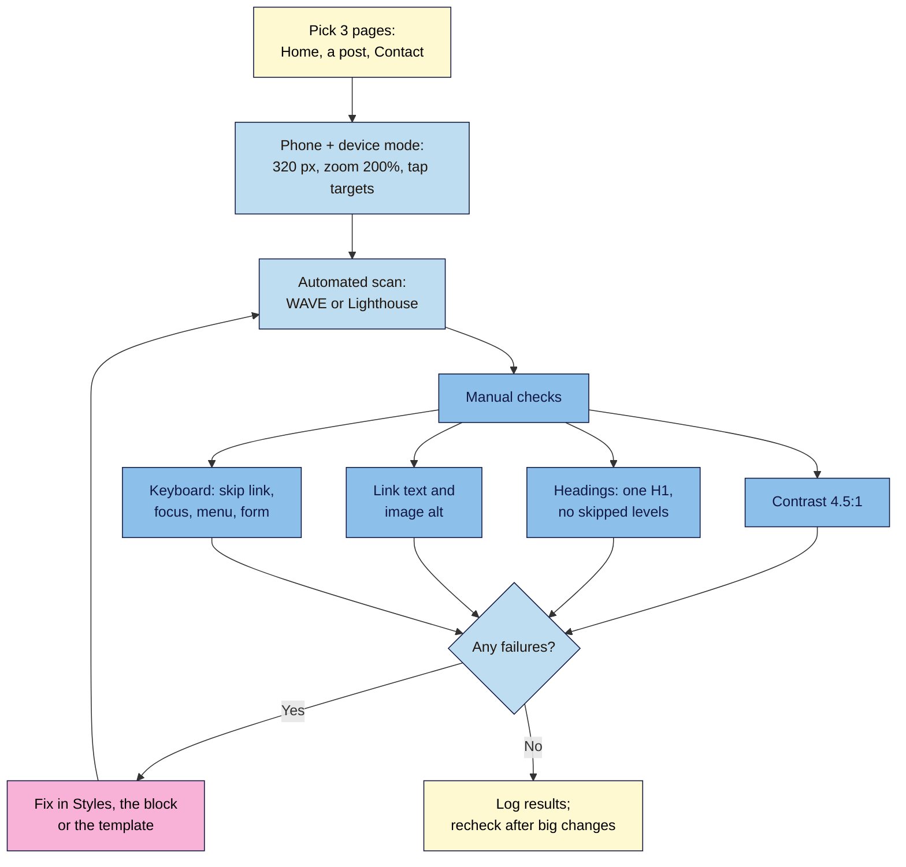

# M04.L05 — Mobile-first and accessibility checks
> After this lesson you can test your site the way phone users, keyboard users and screen-reader users experience it, and fix the failures that affect most creator sites.

**Time:** ~13 min reading + ~20 min exercise · **Level:** beginner · **Prereqs:** M04.L04, M03.L03
**Verified against:** WCAG 2.2 Understanding documents (W3C), The WebAIM Million 2026 report (updated 2026-03-30), Chrome DevTools device mode docs, Local Live Links docs, WordPress 7.0 editor (Document Overview → Outline) and Twenty Twenty-Five 1.5 templates, on 2026-10-31

> Note: automated checkers (WAVE, Lighthouse) only catch some problems. This lesson pairs them with quick manual checks; neither alone proves a site is accessible. For a formal WCAG audit, use a specialist.

## Learning objectives
1. **Test** your pages on a real phone and in browser device mode, including zoom and a narrow screen.
2. **Check** colour contrast, heading order, link text and keyboard navigation against WCAG 2.2 basics.
3. **Fix** the most common accessibility failures on creator sites: low-contrast text, missing alt text and unclear or empty links.

## Why it matters
Zainab's site looked perfect on her laptop. On a phone, her pale-grey captions were unreadable in sunlight, the menu button was a tiny icon that was hard to tap, and her "Click here" links meant nothing to a reader using a screen reader, who heard "click here, click here, click here". A reader who uses only a keyboard couldn't open the menu at all. Pete spent 20 minutes running the checks in this lesson and fixed four things, all in the Site Editor, without code. Most readers now arrive on phones, and about 1 in 6 people worldwide live with a significant disability (WHO, M03.L03). Accessibility problems are also the most common problems: in WebAIM's 2026 scan of the top million home pages, **95.9%** had detectable WCAG failures.

## Core concept
**Plain version:** "mobile-first" means checking your site on the smallest screen first, because that's where most readers are and where layouts break. "Accessible" means people can use your site whatever their eyesight, hearing, movement or device: they can **see** it (contrast, zoom), **understand** its structure (headings, link text), and **operate** it (keyboard, big enough tap targets).

**Analogy:** a shop with a step at the door, tiny price tags and a door handle only some people can reach. Fixing those helps wheelchair users, but also parents with buggies, people carrying boxes and everyone in a hurry. Accessible sites are easier for everyone.

**Precise definitions (WCAG 2.2, Level AA unless noted):**
- **WCAG 2.2:** the W3C's Web Content Accessibility Guidelines, the standard most accessibility laws refer to. **AA** is the usual target.
- **Contrast (1.4.3):** text needs **4.5:1** against its background; large text (24 px, or about 19 px bold) needs **3:1** (M04.L02).
- **Headings and structure (1.3.1, 2.4.6):** headings describe the sections and follow a logical order: one **H1** for the page title, then H2s for sections, H3s inside those. Screen-reader users jump between headings to skim.
- **Link purpose (2.4.4):** the link text (with its sentence) says where it goes. "Click here" and "Read more" alone fail; so do **empty links**, such as a linked image or icon with no text alternative.
- **Keyboard (2.1.1) and focus visible (2.4.7):** everything works with **Tab**, **Shift+Tab**, **Enter**, **Space** and **Esc**, and you can always see where you are.
- **Focus not obscured (2.4.11, new in 2.2):** the focused item isn't completely hidden, for example behind a sticky header or cookie banner.
- **Target size (2.5.8, new in 2.2):** tap targets are at least **24 × 24 CSS pixels**, or spaced so a 24 px circle around each doesn't overlap another.
- **Reflow (1.4.10):** content works at **320 CSS pixels** wide (a phone, or 400% zoom on a laptop) without scrolling sideways.

**The six most common failures** (WebAIM Million 2026, % of top 1,000,000 home pages): low-contrast text **83.9%**, missing image alt text **53.1%**, missing form labels **51%**, empty links **46.3%**, empty buttons **30.6%**, missing document language **13.5%**. Together they make up 96% of detected errors, and they've been the top six for seven years. WordPress and your theme handle the page language; your form plugin labels its fields (M04.L04). The other three are in **your** hands: contrast, alt text and links.

## How it works

**In words:** test three representative pages on a phone-sized screen, run an automated scan, then do four quick manual checks. Fix each failure where it lives (Styles for colours, the block for links and headings, the template for site-wide parts) and scan again.

## Hands-on walkthrough
Work on your **Local** site. Test three pages: **Home**, one **post** with images, and **Contact**. Keep a simple log: *page · check · pass/fail · fix*.

**Part A: phone and device mode (5 min)**
1. In Chrome, open your homepage, press **F12** (or right-click → **Inspect**) and click **Toggle device toolbar** (the phone-and-tablet icon). Leave **Dimensions** on **Responsive** and drag the width down to **320**.
   **Expected:** no sideways scrolling, text still readable, images shrink, the menu collapses into the menu button (M04.L03).
   Firefox: **Browser Tools → Responsive Design Mode**, or press **Ctrl+Shift+M** (**⌘⌥M** on Mac); it works the same way.
2. Tap targets: in device mode, look at the menu button, social icons, footer links and form buttons. Anything that looks smaller than a fingertip, or crammed against another link, needs a check (24 × 24 px minimum).
3. Zoom: close device mode and press **Ctrl +** (**⌘ +** on Mac) until 200%.
   **Expected:** everything still fits and nothing overlaps or gets cut off.
4. *(Recommended)* **A real phone.** In Local, sign in to a free Local account, open your site's **Overview** and click **Enable** next to **Live Link**. Open that link on your phone. Device mode is a "first-order approximation" (Chrome's words); a real phone shows real tap sizes, sunlight glare and the on-screen keyboard over your form.
   > 🖼️ **Image prompt:** Screenshot of Chrome DevTools with the device toolbar on, the Dimensions set to Responsive at 320 px wide, showing a Twenty Twenty-Five homepage with the menu collapsed into a menu button. Highlight the key element with a 3px #F9B2D7 outline; blur any personal details.
   > **Alt text:** Chrome device toolbar showing the homepage at 320 pixels wide with the menu collapsed.

**Part B: automated scan (4 min)**
1. Install the free **WAVE** browser extension from WebAIM (Chrome, Firefox or Edge) and run it on each of your three pages. It works on Local sites because it runs in your browser.
2. Read the summary: **Errors** and **Contrast Errors** are the ones to fix first; **Alerts** need a human decision (e.g. "redundant link", "suspicious alt text").
3. Alternatively, run **Lighthouse** (DevTools → **Lighthouse**, M03.L05) with the **Accessibility** category ticked and read the failed audits.
   **Expected:** a short list of issues per page. A score of 100 doesn't mean "accessible"; it means the automatic checks found nothing.

**Part C: contrast (3 min)**
1. In WAVE, open the **Contrast** panel, or test your text/background pairs in the WebAIM Contrast Checker (M04.L02).
2. Fix site-wide colours in **Appearance → Editor → Styles → Colors → Edit palette**. If one block fails (e.g. a pale caption or a button on a light accent), select it and clear its custom colour so it follows Styles, or pick a darker palette colour.
   **Expected:** every text pair at **4.5:1** or more (3:1 for large headings).

**Part D: headings, links and alt text (5 min)**
1. **Headings:** open each page in the editor and click **Document Overview** (the list icon in the top toolbar) → **Outline**.
   **Expected:** a tidy outline with no **(Incorrect heading level)** or **(Empty heading)** warnings. Twenty Twenty-Five makes post and page titles **H1**, so headings inside content start at **H2**.
   ⚠️ Your **Home** page uses **Page No Title** (M04.L03), so it has **no H1** unless you add one. Select your homepage headline and set it to **H1** with the block toolbar's heading-level control.
   > 🖼️ **Image prompt:** Screenshot of the WordPress 7.0 block editor with Document Overview open on the Outline tab, showing a heading list where one H4 is flagged "(Incorrect heading level)" after an H2. Highlight the key element with a 3px #F9B2D7 outline; blur any personal details.
   > **Alt text:** The editor's Document Overview Outline listing headings, with one flagged as an incorrect heading level.
2. **Link text:** scan for "click here", "read more", "this", bare URLs and icon-only links. Rewrite each so the words say where it goes: *"Download the packing checklist (PDF)"*, not *"Click here"*.
3. **Empty links and images:** WAVE flags **Empty link** and **Linked image missing alternative text**. A linked image's alt text should say where the link goes (functional image, M03.L03). Social Icons already include the network name for screen readers; don't remove it.
4. **Alt text:** WAVE's **Missing alternative text** errors point to images to fix in the Image block (M03.L03). Decorative images get empty alt on purpose.

**Part E: keyboard-only walk-through (3 min)**
Put your mouse aside. On the homepage at desktop width:
1. Click the address bar, then press **Tab**.
   **Expected:** the **Skip to content** link appears first (M04.L03). Press **Enter**: focus jumps to the main content.
2. Keep pressing **Tab** through the header, content and footer.
   **Expected:** a visible focus outline on every link and button, moving in a logical order, never hidden behind a sticky header.
3. Narrow the window until the menu button appears. **Tab** to it, press **Enter**.
   **Expected:** the menu opens; **Tab** moves through its links; **Esc** closes it.
4. On **Contact**, **Tab** through the form, type in each field, and submit with **Enter**.
   **Expected:** every field is reachable and labelled, error messages appear next to the right field, and you never get stuck.

## When to use / when not to
- **Run the full check** before launch, after changing theme or Styles, and after adding a new plugin that shows something on the front end (forms, pop-ups, cookie banners).
- **Run the quick check** (WAVE + Outline) on every new page template or landing page; individual posts mostly inherit a good structure.
- **Don't rely on an "accessibility overlay" plugin** (a widget that promises one-click compliance). They don't fix the underlying problems, and many disabled users and accessibility specialists report that they get in the way (see the Overlay Fact Sheet in Further reading). Fix the site itself.
- **Trade-off:** brand style vs readability. A pale brand colour may have to be reserved for backgrounds and decoration, with a darker shade for text. Readable beats stylish.

## Use AI for this
**Example prompt:**
> "Here is WAVE's list of errors and alerts for my WordPress page: [paste]. For each one, explain in plain language who it affects, whether it's a real problem, and how to fix it in the WordPress block editor or Site Editor without code. My theme is Twenty Twenty-Five."

**What AI does well here:** explaining jargon (ARIA, landmarks), ranking issues by impact, and rewriting vague link text and alt text.
**Where it gets it wrong:** it confidently states WCAG numbers and requirements that don't exist, says a page is "compliant" from a description alone, and often recommends overlay plugins or code changes.
**How to check:** look up each criterion it cites in W3C's "Understanding WCAG 2.2" pages, rerun WAVE after each fix, and repeat the keyboard walk-through yourself.

## Common mistakes
- **Testing only on a laptop.** Most readers are on phones; start at 320 px.
- **Trusting a 100 score.** Automated tools can't judge whether alt text or link text makes sense.
- **Choosing heading levels for size.** Use H2/H3 for structure; change the size in Styles.
- **"Click here" and "Read more" links.** Put the destination in the link text.
- **Removing focus outlines because they look "ugly".** Keyboard users need them; style them instead.
- **Installing an overlay plugin instead of fixing issues.** It adds weight and doesn't fix the cause.

## Troubleshooting
| Symptom | Likely cause | Fix |
|---|---|---|
| The whole page scrolls sideways at 320 px | A fixed-width element: an embed or HTML block with a set width, a very long URL, or a wide group | Remove fixed widths, replace long URLs with link text. (A wide **Table** block scrolling inside its own box is fine; the reflow rule allows that for tables.) |
| WAVE shows contrast errors in the header or footer | Palette colour or a block-level override | Fix in **Styles → Colors**, or clear the block's colour in the template part |
| "(Incorrect heading level)" in the Outline | A level was skipped (H2 → H4) | Change the heading level in the block toolbar |
| "Empty link" error | Linked image without alt, or an icon link with no text | Add alt text describing the destination, or a text label |
| Menu won't open with the keyboard | A plugin replaced the Navigation block's menu button, or custom code | Use the core Navigation block; retest after disabling the plugin |
| Focused link hidden under the header | Sticky header covers focused items | Make the header non-sticky, or test that focus scrolls into view |
| Live Link won't open on phone | Not signed in to a Local account, or link not enabled | Sign in in Local, then **Enable** on the site's Overview |

## Exercise
**Task:** audit and fix your **Home**, one **post** and **Contact** pages:
1. Device mode at 320 px and 200% zoom (and a real phone via Live Link if you can).
2. WAVE (or Lighthouse Accessibility) on each page.
3. Manual checks: contrast, heading Outline, link text and alt text, keyboard walk-through.
4. Fix everything you can, then rerun WAVE.

**Expected outcome:** an audit log table (page · check · result before · fix · result after) with at least three fixes, including an H1 on your homepage and any failing contrast pair.
**Stretch goal:** try your homepage with a screen reader for 5 minutes: **VoiceOver** (Mac: **⌘ F5**) or **NVDA** (free, Windows). Use the headings shortcut (VoiceOver rotor, or **H** in NVDA) to jump between headings. Does the outline make sense by ear?

## Key takeaways
- Check **phone first**: 320 px wide, 200% zoom, tap targets at least 24 × 24 px, and a real phone when you can.
- The most common failures are **low contrast, missing alt text and empty or unclear links**, and you can fix all three in WordPress without code.
- One **H1**, then H2/H3 in order; use the editor's **Document Overview → Outline** to check.
- Everything must work with the **keyboard**, with visible focus, starting with the **Skip to content** link.
- Automated tools find only some issues: pair them with manual checks, and never rely on overlay plugins.

## Teach it back
Explain to a friend in 3 sentences the three accessibility failures you'd check first on a creator site, and how you'd test a site without a mouse.

## Glossary terms added
- WCAG 2.2 — added to `wordpress-101/glossary.md`
- Device mode — added to `wordpress-101/glossary.md`
- Reflow — added to `wordpress-101/glossary.md`
- Target size — added to `wordpress-101/glossary.md`
- Focus indicator — added to `wordpress-101/glossary.md`
- Empty link — added to `wordpress-101/glossary.md`
- Accessibility overlay — added to `wordpress-101/glossary.md`

## Further reading
*All checked 2026-10-31. Accessibility law and tools change; check your region's requirements.*
- WebAIM — The WebAIM Million, 2026 report (updated 2026-03-30): https://webaim.org/projects/million/
- W3C WAI — What's new in WCAG 2.2: https://www.w3.org/WAI/standards-guidelines/wcag/new-in-22/
- W3C WAI — Easy Checks: a first review of web accessibility: https://www.w3.org/WAI/test-evaluate/preliminary/
- W3C — Understanding SC 1.4.10 Reflow: https://www.w3.org/WAI/WCAG22/Understanding/reflow.html
- W3C — Understanding SC 2.4.4 Link Purpose (In Context): https://www.w3.org/WAI/WCAG22/Understanding/link-purpose-in-context.html
- W3C — Understanding SC 2.4.7 Focus Visible: https://www.w3.org/WAI/WCAG22/Understanding/focus-visible.html
- W3C — Understanding SC 2.4.11 Focus Not Obscured (Minimum): https://www.w3.org/WAI/WCAG22/Understanding/focus-not-obscured-minimum.html
- W3C — Understanding SC 2.5.8 Target Size (Minimum): https://www.w3.org/WAI/WCAG22/Understanding/target-size-minimum.html
- Chrome for Developers — Simulate mobile devices with device mode: https://developer.chrome.com/docs/devtools/device-mode
- WebAIM — WAVE browser extensions: https://wave.webaim.org/extension/
- Local — Live Links: https://localwp.com/help-docs/local-features/live-links/
- Overlay Fact Sheet (signed by accessibility practitioners): https://overlayfactsheet.com/en/
