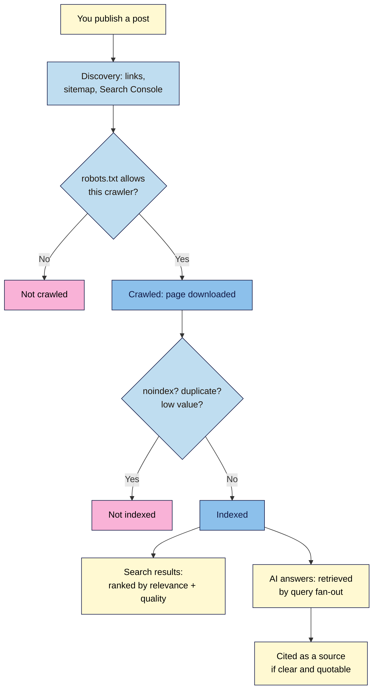

# M05.L01 — How search engines and AI answer engines find, index and cite your content
> After this lesson you can explain how a post gets from your WordPress site into Google, Bing and AI answers, see what your site tells crawlers, and check whether a page is indexed.

**Time:** ~14 min reading + ~15 min exercise · **Level:** beginner · **Prereqs:** M02
**Verified against:** Google Search Central ("How Search works", updated 2025-12-18; "AI features and your website" and "site: search operator", updated 2025-12-10; "Google's common crawlers"), Search Console Help (URL Inspection), OpenAI and Perplexity crawler docs, Bing Webmaster blog (AI Performance, 2026-02-10), WordPress 7.0 core (`robots.txt`, sitemaps, Search engine visibility), all on 2026-10-31

> ⚠️ **Freshness flag:** AI search features, crawler names and publisher controls change often. Google says it intends to support a shared AI-training preference signal (AIPREF) in early 2027. Check the linked docs before changing your robots.txt.

> Note: a **Local** site isn't on the internet, so search engines can't find it. You'll inspect what your Local site *tells* crawlers, run `site:` searches on a live site, and use **URL Inspection** if you already have a live site in Search Console; otherwise you'll do that part in M05.L05.

## Learning objectives
1. **Describe** crawling, indexing and ranking (serving) in plain language, and what WordPress does at each stage.
2. **Explain** how AI answer engines (Google AI Overviews and AI Mode, ChatGPT search, Perplexity, Microsoft Copilot) find, select and cite sources, and which crawler controls affect them.
3. **Check** whether a page is indexed with a `site:` search and the URL Inspection tool, and read the result correctly.

## Why it matters
Kemi published 40 recipes on her new site and waited for visitors. Three months later, Google showed none of them. Her site was still set to **Discourage search engines** from her setup days (M01.L04), so every page told Google "don't index me". Lior's site was indexed, but when people asked AI assistants about his niche, competitors were cited instead. He learned that AI answers mostly draw on pages that are already indexed and easy to quote, and that one robots.txt line copied from a forum was blocking an AI search crawler. Search and AI visibility start with the same basics: be **findable**, be **indexed**, and be **worth citing**.

## Core concept
**Plain version:** search engines work in three stages, and not every page makes it through each one:
1. **Crawling:** automated programs (crawlers or bots, such as **Googlebot** and **Bingbot**) discover your pages, mostly by following links and reading sitemaps, and download them.
2. **Indexing:** the search engine analyses the page (text, images, video, headings) and stores it in its **index**, a huge database. Pages that are blocked, marked `noindex`, duplicate or low value may be left out.
3. **Serving (ranking):** when someone searches, the engine picks the most relevant, helpful indexed pages and orders them.

Google says plainly that it **doesn't guarantee** it will crawl, index or show any page, even one that follows its guidelines.

**AI answer engines** add one more step. They **retrieve** pages from a search index (often running several related searches, which Google calls **query fan-out**), then write an answer and **cite** some of those pages as sources (called **grounding**). So the rule is: **no index, no citation.**

**Analogy:** crawling is a librarian walking the shelves to find new books; indexing is cataloguing them; ranking is choosing which books to hand a reader who asks a question. An AI answer engine is a research assistant who reads a few of those books and writes a summary with footnotes. If your book isn't in the catalogue, it can't be a footnote.

**What WordPress does for each stage:**
| Stage | WordPress (core) | Where you control it |
|---|---|---|
| Crawl | Serves a virtual **`/robots.txt`** (blocks only `/wp-admin/`) and an XML sitemap at **`/wp-sitemap.xml`**, listed in robots.txt | Your SEO plugin replaces the sitemap (M05.L02) |
| Index | **Settings → Reading → Discourage search engines** adds a `noindex, nofollow` robots meta tag to every page **and turns off the sitemap** | Untick it on a live site (M01.L04); per-page `noindex` via your SEO plugin |
| Rank / cite | Clean HTML, headings, fast pages from M02–M04 | Your content and structure (M05.L03–L04) |

**How each AI answer engine finds pages** (from each company's own docs):
| Engine | Gets pages from | Crawler / control | Notes |
|---|---|---|---|
| **Google AI Overviews / AI Mode** | Google's search index | **Googlebot** (normal robots.txt) | Must be indexed and eligible for a snippet; "no additional requirements" or special optimisations. Limit with `nosnippet`, `data-nosnippet`, `max-snippet` or `noindex`. Traffic counts in Search Console's Performance report (Web). |
| **Google-Extended** | — | robots.txt token only | Controls use for Gemini training/grounding in *other* Google products; **doesn't affect** Google Search or ranking. |
| **ChatGPT search** | OpenAI's search crawler | **OAI-SearchBot** | Allow it to appear in ChatGPT search answers (opted-out sites can still show as plain navigational links; robots.txt changes take ~24 hours). **GPTBot** is separate (training); blocking GPTBot doesn't remove you from search. **ChatGPT-User** fetches a page when a user asks. |
| **Perplexity** | Perplexity's index | **PerplexityBot** | Used to surface and link sites, not to train models. **Perplexity-User** fetches pages for live questions. |
| **Microsoft Copilot / Bing AI** | Bing's index | **Bingbot** | **Bing Webmaster Tools → AI Performance** shows how often your indexed pages are cited (public preview since 2026-02-10; M05.L05). Microsoft recommends **IndexNow** to keep updated pages fresh in AI answers (M05.L02). |

**What gets cited?** No engine publishes its full selection method. Google says the same SEO best practices apply. What practitioners observe (observed practice, not a guarantee): pages that answer a specific question clearly near the top, stay on one topic, show who wrote them and why they're credible, and are easy to quote get cited more often. You'll write that way in M05.L03.

## How it works



**In words:** a crawler has to find your post (links, sitemap), be allowed to fetch it (robots.txt), and be allowed to index it (no `noindex`). Once indexed, the page can rank in normal results and can be retrieved and cited in AI answers. A block at any step stops everything after it.

## Hands-on walkthrough

**Part A: what your site tells crawlers (5 min, on Local)**
1. In your browser, open `http://yoursite.local/robots.txt` (your Local site's address + `/robots.txt`).
   **Expected:**
   ```
   User-agent: *
   Disallow: /wp-admin/
   Allow: /wp-admin/admin-ajax.php

   Sitemap: http://yoursite.local/wp-sitemap.xml
   ```
   If there's **no Sitemap line**, **Discourage search engines** is ticked in **Settings → Reading** (WordPress turns the sitemap off when it is). On a live site, untick it.
2. Open `/wp-sitemap.xml`.
   **Expected:** a sitemap index listing sub-sitemaps for posts, pages, categories, tags and users. Click the posts sitemap: your published posts are listed (drafts aren't).
3. Open one of your posts, right-click → **View Page Source**, and search (Ctrl/⌘+F) for `name='robots'`.
   **Expected:** `max-image-preview:large` (WordPress's default). If you see `noindex`, the site or that page is set not to be indexed.
   > 🖼️ **Image prompt:** Screenshot of a browser showing a WordPress site's /robots.txt with the "Disallow: /wp-admin/" and "Sitemap: …/wp-sitemap.xml" lines, next to a second tab showing /wp-sitemap.xml listing posts, pages, categories and tags sitemaps. Highlight the key element with a 3px #F9B2D7 outline; blur any personal details.
   > **Alt text:** A WordPress robots.txt with a Sitemap line beside the wp-sitemap.xml index of sub-sitemaps.

**Part B: `site:` searches on a live site (5 min)**
Use your own live site if you have one; otherwise use a creator site you know.
1. In Google, search `site:example.com` (no space after the colon).
   **Expected:** a sample of indexed pages. Google warns that `site:` **doesn't necessarily return all** indexed URLs and doesn't rank them, so treat the number as rough.
2. Search for one specific post: `site:example.com/your-post-slug/`.
   **Expected:** if it appears, it's indexed. If it doesn't, that's **not proof** it isn't; check with URL Inspection.
3. Try the same `site:` search in **Bing**. Results often differ; Copilot draws on Bing's index, so it's worth knowing both.

**Part C: URL Inspection (5 min, live site in Search Console only)**
If your site is live and verified in Google Search Console, do this now; otherwise come back after M05.L05.
1. In Search Console, paste a post URL into the **Inspect any URL** box at the top.
   **Expected:** either **URL is on Google** or **URL is not on Google**, with details on discovery (sitemaps, referring page), crawl (last crawl, user agent) and indexing (whether indexing is allowed, the canonical URL).
2. Click **Test live URL** to see whether the current version *can* be indexed (useful after fixing something).
3. If the page is new or just fixed and isn't on Google, click **Request indexing**. It's a request, not a guarantee; don't click it repeatedly.
   Note: Google says **"URL is on Google" doesn't guarantee the page appears** for any search. It means it's eligible.
   > 🖼️ **Image prompt:** Screenshot of Google Search Console's URL Inspection result for a blog post showing "URL is on Google" with the Page indexing section expanded (Discovery, Crawl, Indexing) and the Test live URL and Request indexing buttons visible. Highlight the key element with a 3px #F9B2D7 outline; blur any personal details.
   > **Alt text:** Search Console URL Inspection showing a post is on Google, with the live test and request indexing buttons.

**Part D: see how an AI answer cites sources (optional, 5 min)**
1. Ask the same specific question in your niche in two answer engines (e.g. Google AI Mode, ChatGPT with search, Perplexity or Copilot).
2. For each answer, open 2–3 cited sources and note: Does the page answer the question in its first paragraph? Is it on one topic? Does it show who wrote it?
   **Expected:** a short list of patterns you'll use when writing in M05.L03. Don't copy their text; learn from their structure.

## When to use / when not to
- **Check indexing** after launch, after a theme or SEO plugin change, and whenever an important post doesn't show up.
- **Use `site:`** for a quick look; **use URL Inspection** for a definite answer on one URL.
- **Leave AI search crawlers allowed** (Googlebot, Bingbot, OAI-SearchBot, PerplexityBot) if you want to be cited. Blocking a search crawler removes you from that engine's answers.
- **Blocking AI training is a separate decision.** You can disallow **GPTBot** or **Google-Extended** in robots.txt without leaving Google Search or ChatGPT search. Decide based on your licensing and business goals (M08.L05 covers copyright and AI).
- **Trade-off:** `nosnippet`/`max-snippet` can keep your text out of AI Overviews, but they also shrink or remove your normal search snippet, which can cost clicks.

## Use AI for this
**Example prompt:**
> "Here's my site's robots.txt and the robots meta tag from one post: [paste]. In plain language, tell me which crawlers can crawl my site, whether the post can be indexed, and whether anything blocks Google Search, Bing, ChatGPT search or Perplexity. Name the crawler for each."

**What AI does well here:** reading robots.txt rules line by line and explaining what a meta tag does.
**Where it gets it wrong:** it mixes up crawlers (e.g. says blocking GPTBot removes you from ChatGPT search, or that Google-Extended controls AI Overviews), invents "AI SEO" requirements, and quotes outdated crawler names.
**How to check:** compare its answer with each company's crawler documentation (linked below) and confirm indexing with URL Inspection, not with the AI's opinion.

## Common mistakes
- **Leaving "Discourage search engines" ticked after launch.** Every page gets `noindex` and the sitemap disappears.
- **Treating `site:` as a full count.** It's a sample; use URL Inspection for one URL and the Page indexing report (M05.L05) for the site.
- **Blocking the wrong bot.** Blocking OAI-SearchBot or PerplexityBot removes you from those engines' answers; GPTBot and Google-Extended are about training.
- **Expecting a "special AI optimisation".** Google says there are no extra requirements for AI Overviews or AI Mode beyond being indexed and snippet-eligible.
- **Clicking Request indexing over and over.** There's a quota, and Google says repeat requests for the same URL won't get it crawled any faster.
- **Copying robots.txt rules from forums.** One wrong `Disallow: /` hides your whole site.

## Troubleshooting
| Symptom | Likely cause | Fix |
|---|---|---|
| No `Sitemap:` line in robots.txt, `/wp-sitemap.xml` empty or 404 | **Discourage search engines** ticked, or an SEO plugin replaced the sitemap | Untick in **Settings → Reading**; check the SEO plugin's sitemap URL (M05.L02) |
| Page source shows `noindex` | Site-wide setting or a per-page SEO plugin setting | Untick the setting, or switch the page to indexable in the SEO plugin |
| `site:` shows nothing for a new site | Not discovered yet | Verify in Search Console, submit the sitemap (M05.L05), link to it from somewhere public |
| URL Inspection: "Excluded by 'noindex' tag" | `noindex` in the robots meta tag | Remove it, then **Test live URL** → **Request indexing** |
| URL Inspection: "Blocked by robots.txt" | A `Disallow` rule matches the URL | Fix robots.txt (via your SEO plugin's editor or your host), retest |
| Indexed in Google but never cited by AI | Normal; no guarantee of citation | Make answers clear and specific (M05.L03); check Bing too |

## Exercise
**Task:**
1. Record your Local site's robots.txt, confirm the sitemap URL and the robots meta tag on one post.
2. On a live site (yours or one you know), run `site:` for the domain and for two specific posts, in Google and Bing.
3. If you have a verified live site, run **URL Inspection** on two posts and record the status and canonical URL; otherwise schedule it for M05.L05.
4. Write three sentences: crawling vs indexing vs ranking, in your own words.

**Expected outcome:** a short "Findability check" note: robots.txt ✅/❌, sitemap ✅/❌, robots meta tag, `site:` results for 2 posts in Google and Bing, URL Inspection results (or "scheduled for M05.L05").
**Stretch goal:** list which AI crawlers your site currently allows (read robots.txt for Googlebot, Bingbot, OAI-SearchBot, PerplexityBot, GPTBot, Google-Extended) and write one sentence on your training-vs-search choice.

## Key takeaways
- Search works in three stages: **crawl → index → rank (serve)**; none is guaranteed.
- AI answers retrieve and cite pages **from search indexes**: no index, no citation.
- WordPress core serves `robots.txt` and `/wp-sitemap.xml`; **Discourage search engines** adds `noindex` and turns the sitemap off.
- Search crawlers (Googlebot, Bingbot, OAI-SearchBot, PerplexityBot) are separate from training controls (GPTBot, Google-Extended).
- `site:` is a rough sample; **URL Inspection** is the definite check for one URL.

## Teach it back
Explain to a friend in 3 sentences how a blog post ends up cited in an AI answer, and the one WordPress setting that can stop it from happening.

## Glossary terms added
- Crawling — added to `wordpress-101/glossary.md`
- Indexing — added to `wordpress-101/glossary.md`
- Ranking (serving) — added to `wordpress-101/glossary.md`
- robots.txt — added to `wordpress-101/glossary.md`
- XML sitemap — added to `wordpress-101/glossary.md`
- noindex — added to `wordpress-101/glossary.md`
- AI Overviews and AI Mode — added to `wordpress-101/glossary.md`
- Grounding (AI citations) — added to `wordpress-101/glossary.md`
- URL Inspection — added to `wordpress-101/glossary.md`

## Further reading
*All checked 2026-10-31. Crawler names and AI features change; recheck before editing robots.txt.*
- Google Search Central — In-depth guide to how Google Search works: https://developers.google.com/search/docs/fundamentals/how-search-works
- Google Search Central — AI features and your website (AI Overviews, AI Mode): https://developers.google.com/search/docs/appearance/ai-features
- Google Search Central — Google's common crawlers (incl. Google-Extended): https://developers.google.com/search/docs/crawling-indexing/google-common-crawlers
- Google Search Central — site: search operator: https://developers.google.com/search/docs/monitor-debug/search-operators/all-search-site
- Search Console Help — URL Inspection tool: https://support.google.com/webmasters/answer/9012289
- OpenAI — Overview of OpenAI crawlers (OAI-SearchBot, GPTBot, ChatGPT-User): https://platform.openai.com/docs/bots
- Perplexity — Perplexity crawlers (PerplexityBot, Perplexity-User): https://docs.perplexity.ai/guides/bots
- Bing Webmaster Blog — Introducing AI Performance in Bing Webmaster Tools (2026-02-10): https://blogs.bing.com/webmaster/2026/2/Introducing-AI-Performance-in-Bing-Webmaster-Tools-Public-Preview/
