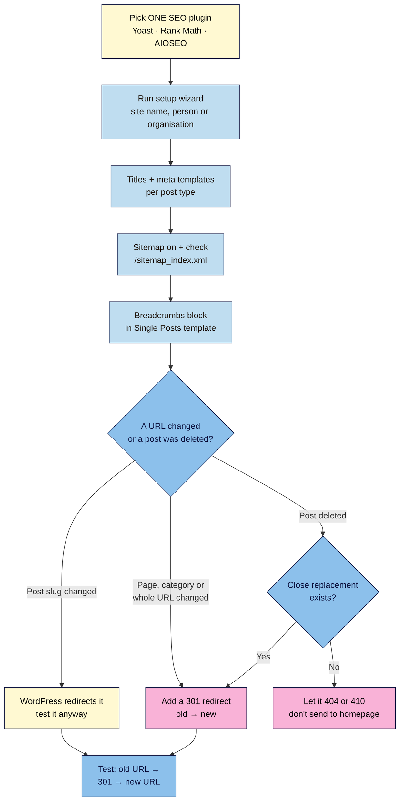

# M05.L02 — Configure one SEO plugin: titles, meta, sitemap, breadcrumbs and redirects
> After this lesson you can set up one SEO plugin so that every post gets a clean title, a description, a sitemap entry and breadcrumbs, and you can make sure old URLs land on the right new page.

**Time:** ~16 min reading + ~25 min exercise · **Level:** beginner · **Prereqs:** M05.L01, M01.L04
**Verified against:** WordPress 7.0 (core Breadcrumbs block, old-slug redirects), Yoast SEO 28.8 (updated 2026-10-27), Rank Math 1.0.280, All in One SEO 5.0.4, Redirection 5.10.1, IndexNow plugin 1.0.4; Search Console Help ("404 (Page Not Found) errors"); Google Search Central ("Influencing title links", updated 2025-12-10; "Control your snippets", 2026-04-20; "Breadcrumb structured data", 2026-09-08; "Redirects and Google Search", 2026-04-14; "Site moves with URL changes", 2026-08-20; "Learn about sitemaps", 2025-12-10), all on 2026-10-31

> ⚠️ **Freshness flag:** SEO plugins release updates every few weeks and rename screens often. This lesson's labels come from the plugin versions above. If a label differs, use the plugin's settings search box (Yoast has one at the top of **Settings**).

> Note: this lesson uses **Yoast SEO (free)** for the walkthrough, because it has the most installs and its free version covers titles, meta, the sitemap and breadcrumb schema. Yoast's redirect manager and IndexNow are Premium features, so you'll use the free **Redirection** plugin for redirects. If you choose **Rank Math** instead, use its built-in **Redirections** module and skip Redirection. The ideas and the checks are the same.

## Learning objectives
1. **Choose and install** one SEO plugin (Yoast SEO, Rank Math or All in One SEO), and only one, and complete its setup.
2. **Configure** title and meta description templates, the XML sitemap and breadcrumbs, and check each one in the page source or on the page.
3. **Create and test** a 301 redirect for a changed URL, and decide what to do with a deleted post.

## Why it matters
Ines installed Yoast SEO and Rank Math "to be safe". Her posts ended up with two sets of social tags, two sitemaps and a settings screen that kept changing her titles back. Tom's setup was tidy, but he renamed his popular page `/start/` to `/start-here/`. Every newsletter link and backlink to it now showed **Not Found**, and the page dropped out of search over the next few weeks. Neither problem needs code. You need **one** SEO plugin, configured once, and a habit: **when a URL changes, add a redirect**.

## Core concept
**Plain version:** WordPress core already gives you a page title, a basic sitemap (`/wp-sitemap.xml`, M05.L01) and a `robots.txt`. An **SEO plugin** adds the parts core doesn't:
- **Title templates:** a pattern for every post's `<title>`, e.g. *Post title – Site name*, plus a box to write a custom one per post.
- **Meta descriptions:** a short summary per post that search engines *may* use as the snippet under your title.
- **A better XML sitemap:** it replaces core's sitemap, leaves out pages you've hidden from search, and adds image and last-modified details.
- **Structured data (schema):** machine-readable facts about your site, author and pages, including **BreadcrumbList** (M06 goes deeper).
- **Social tags:** the Open Graph tags from M03.L04.

A **redirect** is a rule that says "this old address now lives here". A **301** means *moved permanently*: browsers go to the new URL, and Google moves the old URL's ranking signals to it and shows the new URL in results. A **302/307** means *moved for now*: Google keeps showing the old URL.

**What Google actually does with your title and description:**
- **Title:** Google builds the **title link** from several sources (your `<title>`, the main heading, `og:title`, prominent text). A unique, descriptive, concise `<title>` is the best way to influence it. There's no length limit, but Google truncates long titles to fit the screen.
- **Description:** Google creates snippets **primarily from the page content**. It *may* use your meta description when that describes the page better. Write one anyway for important pages; just don't expect it to show every time.

**Analogy:** the SEO plugin is the label maker and filing system for your library from M05.L01. It prints a clear spine label (title), a back-cover blurb (description) and an up-to-date catalogue (sitemap). A redirect is the note on an old shelf: *"Moved to aisle 4."*

**Precise definition:** an **SEO plugin** controls the `<title>`, `<meta name="description">`, robots meta tags, canonical URLs, Open Graph tags, JSON-LD structured data and XML sitemaps that your site sends to crawlers. A **301 redirect** is an HTTP response with status `301 Moved Permanently` and a `Location:` header pointing to the new URL.

## How it works



**In words:** install one SEO plugin and run its setup. Set a title and description template for posts and pages, switch the sitemap on and open it, and add breadcrumbs to your post template. From then on, whenever a URL changes or a post is deleted, decide: WordPress handles a changed **post** slug by itself (test it); for anything else, add a **301** to the closest matching page; if nothing matches, let the old URL return **404** (or **410**, "gone") rather than sending everyone to the homepage.

### Which plugin? (pick one)
| | Yoast SEO | Rank Math | All in One SEO |
|---|---|---|---|
| Active installs (WordPress.org, 2026-10-31) | 10+ million | 4+ million | 2+ million |
| Minimum WordPress / PHP | **7.0** / 7.4 | 6.7 / 7.4 | 5.7 / 7.4 |
| Redirects in the free version | ✗ (Premium) → add **Redirection** | ✓ Redirections + 404 monitor | ✗ (Pro) → add **Redirection** |
| IndexNow (tells Bing about updates) | Premium → or Microsoft's free **IndexNow** plugin | ✓ **Instant Indexing** module | Check its current docs |
| Free account or connection prompts | Optional | Asks you to connect a free Rank Math account (you can skip) | Optional |
| Good fit | Simple, widely documented | Most features free | Guided setup, many add-ons |

All three are mature and well rated. The choice matters far less than **using only one**. They all write the same tags, so two plugins give you duplicate titles, schema and sitemaps.

## Hands-on walkthrough
Work on your **Local** site. Take a backup or snapshot first (M01).

> **Using Rank Math instead?** The same jobs live in **Rank Math SEO → Titles & Meta** (title and description templates per post type), **Sitemap Settings**, **General Settings → Breadcrumbs**, **Redirections** and **Instant Indexing** (IndexNow). Turn on modules in **Rank Math SEO → Dashboard** first. Then run the same checks: page source, `/sitemap_index.xml`, `curl -I`.

### Part A — Install and set up Yoast SEO (~8 min)
1. Go to **Plugins → Add Plugin**, search for **Yoast SEO**, then click **Install Now** → **Activate**. Check the author is **Team Yoast**.
   **Expected:** a new **Yoast SEO** menu item appears in the dashboard sidebar.
2. Open **Yoast SEO → General → First-time configuration** and work through the steps:
   - **SEO data optimization:** builds Yoast's index of your content. On Local you may see *"SEO data optimization is disabled for non-production environments."* That's fine: it runs on your live site.
   - **Site representation:** choose **Person** (a creator site) or **Organization** (a brand or business). For Person, **Select a user**: your author account. For Organization, enter the **Organization name** and upload an **Organization logo** (a square version of your logo).
   - **Social profiles:** add your main profiles' full URLs (the same ones as your Social Icons in M04.L03).
   - **Personal preferences:** **Usage tracking** is your choice. Then **Finish configuration**.
   **Expected:** a message that the configuration is complete.
3. Open **Yoast SEO → Settings → Site basics**. Check **Site title** and **Tagline** (they're the same as **Settings → General**) and pick a **Title separator**. A dash (–) or pipe (|) is easy to read.

### Part B — Title and meta description templates (~5 min)
4. Go to **Settings → Content types → Posts**. You'll see:
   - **Show posts in search results:** On. (Turn this off only for content you want hidden, which is rare for a blog.)
   - **SEO title:** default `Title Page Separator Site title` (the variables `%%title%% %%page%% %%sep%% %%sitename%%`). **Page** only shows on page 2+ of a split post, so leave it.
   - **Meta description:** empty by default. Insert the **Excerpt** variable (type `%` and pick **Excerpt**). Your pre-publish checklist from M02.L04 already includes an excerpt, so every post gets a sensible description automatically. Yoast generates one from the content if a post has no excerpt.
   Click **Save changes**.

   > 🖼️ **Image prompt:** Screenshot of Yoast SEO → Settings → Content types → Posts in WordPress 7.0, showing the SEO title field (Title Page Separator Site title) and the Meta description field with the Excerpt variable, 1280 × 800. Highlight the Meta description field with a 3px #F9B2D7 outline; blur any personal details.
   > **Alt text:** Yoast SEO Posts settings with the default SEO title template and the Excerpt variable in the meta description template.

5. Repeat for **Content types → Pages** (description: write one by hand on key pages such as About and Start Here). Then open **Settings → Homepage** (or **Pages → Home → Yoast SEO** box if you use a static homepage, M04.L03) and write a homepage description: who it's for and what they get, in about 1–2 sentences.
6. Open one post in the editor. Click the **Yoast SEO** icon in the top toolbar (or scroll to the Yoast panel), then check **Search appearance**: the preview shows the title and description Google *might* use. Write a custom SEO title only when the template gives a poor result (e.g. a very long post title).
7. View the post on the front end, right-click → **View Page Source**, and search (Ctrl+F) for `<title>` and `description`.
   **Expected:**
   ```html
   <title>Easy Miso Ramen in 20 Minutes - Hira Cooks</title>
   <meta name="description" content="A weeknight miso ramen with pantry staples..." />
   ```
   One `<title>` and one meta description. If you see two of either, another plugin or the theme is adding them (see Troubleshooting).

### Part C — Sitemap, IndexNow and other settings (~4 min)
8. Open **Settings → Site features**. Check that **XML sitemaps** is on, then click **View the XML sitemap**.
   **Expected:** `/sitemap_index.xml` lists `post-sitemap.xml`, `page-sitemap.xml`, `category-sitemap.xml` and similar, each with a last-modified date. Yoast switches off core's `/wp-sitemap.xml` (visiting it redirects to Yoast's) and adds a `Sitemap:` line for the new address to your `robots.txt`. Open `/robots.txt` to confirm.
9. While you're in **Site features**, turn off features you won't use. For example, turn off **AI title & description generator** if you'd rather write your own. You'll also see an **IndexNow** card. IndexNow tells Bing and other IndexNow engines straight away when you publish, update or delete a post; it doesn't affect Google (M05.L01). In Yoast it only works with **Premium**. On the free version, you can add Microsoft's free **IndexNow** plugin (author: *bingwebmastertools*) on your live site, or skip it: Bing still finds updates through your sitemap. Rank Math's free **Instant Indexing** module does the same job.
10. In **Settings → Advanced → Author archives**: on a **single-author** site, your author archive duplicates your blog. Turn off **Show author archives in search results** (or disable author archives). Leave **Date archives** off in search results too.
    **Expected (sitemap check):** after saving, `author-sitemap.xml` no longer appears in `/sitemap_index.xml`.

### Part D — Breadcrumbs on a block theme (~4 min)
Breadcrumbs are the small trail above a post, like *Home / Blog / Recipes / Easy Miso Ramen*. They help readers move up a level and show search engines your structure. Google shows breadcrumbs in results **on desktop** (its doc lists the feature as desktop only).

11. WordPress 7.0 includes a core **Breadcrumbs** block. Go to **Appearance → Editor → Templates → Single Posts**, click above the post title, add the **Breadcrumbs** block, then **Save**.
    Defaults: separator `/`, **Home** item shown, the current post shown, and **hidden on the homepage**. On a post, the trail goes home → your **posts page** (if you set one in M04.L03) → the post's **category** → the post. (**Prefer taxonomy terms** only matters for hierarchical content such as pages, so leave it.)
    **Expected (on a post):** `Home / Blog / Recipes / Easy Miso Ramen`, each step a link except the last.

    > 🖼️ **Image prompt:** Screenshot of a published post in Twenty Twenty-Five at 1280 × 800, showing the breadcrumb trail "Home / Blog / Recipes / Easy Miso Ramen" above the post title. Highlight the breadcrumb trail with a 3px #F9B2D7 outline; blur any personal details.
    > **Alt text:** A post with a breadcrumb trail Home / Blog / Recipes / Easy Miso Ramen shown above the H1 title.

12. **Schema:** Yoast already adds **BreadcrumbList** structured data to its schema on every post, whether or not a trail is visible. The core block adds the visible trail and Yoast adds the schema, so you don't need Yoast's own **Yoast Breadcrumbs** block. (Yoast's **Settings → Advanced → Breadcrumbs** screen controls Yoast's own trail and its labels; **Enable breadcrumbs inserted in your theme's template** is for classic themes.) Use **one** visible trail per page.

### Part E — Redirects (~6 min)
13. **See what WordPress already does.** Open a published **post**, change its slug (sidebar → **Link**, e.g. `miso-ramen` → `easy-miso-ramen`) and click **Save**. Visit the **old** URL.
    **Expected:** you land on the new URL. WordPress stores the old slug and sends a 301. It does this only for **posts** (and other non-hierarchical post types) that are published. It doesn't do it for **pages**, categories or a changed permalink structure.
14. **Install Redirection.** **Plugins → Add Plugin** → search **Redirection** (by John Godley) → **Install Now** → **Activate**. Go to **Tools → Redirection**.
    - *Welcome to Redirection* → **Start Setup**.
    - **Basic Setup:** tick **Monitor permalink changes in WordPress posts and pages** (it auto-adds redirects when you change a slug, including pages) and **Keep a log of all redirects and 404 errors.** Leave **Store IP information…** off for privacy. **Continue**.
    - The REST API check should pass → **Finish Setup** → *Ready to begin! 🎉*
15. **Break it:** change a **page** slug. Go to **Pages**, open **Start Here** and change its slug to `start-here-new`, then **Save**. Look in **Tools → Redirection**: with monitoring on, a redirect from `/start-here/` was added for you. Delete that redirect (hover → **Delete**), then visit `/start-here/`.
    **Expected:** your theme's 404 page: **Page not found** (or similar). Every link to the old address is now broken.
16. **Fix it with a 301:** in **Tools → Redirection**, click **Add New** at the top of the Redirects screen and fill in:
    - **Source URL:** `/start-here/`
    - **Target URL:** `/start-here-new/`
    - **HTTP code** (open the gear icon for more options): **301 - Moved Permanently** (the default).
    Click **Add Redirect**.

    > 🖼️ **Image prompt:** Screenshot of Tools → Redirection → Add New in the Redirection plugin, with Source URL /start-here/ and Target URL /start-here-new/ filled in, 1280 × 800. Highlight the Add Redirect button with a 3px #F9B2D7 outline; blur any personal details.
    > **Alt text:** Redirection's Add New form with source /start-here/, target /start-here-new/ and the Add Redirect button.

17. **Test it** in a private window, or from a terminal (Local → **Open site shell**, or any terminal):
    ```bash
    curl -I http://yoursite.local/start-here/
    ```
    **Expected:**
    ```
    HTTP/1.1 301 Moved Permanently
    Location: http://yoursite.local/start-here-new/
    X-Redirect-By: redirection
    ```
    (A core old-slug redirect shows `X-Redirect-By: WordPress`.) Then change the page slug back to `start-here`, and **delete** the now-pointless redirect so it can't loop.
18. **Deleted posts:** if you delete a post that has a close replacement (an updated version, or a broader guide covering it), add a 301 to that page. If nothing matches, let it return 404, or 410 to say it's gone for good. Don't redirect everything to the homepage: Google's Search Console Help calls a redirect to another page, such as the homepage, instead of a 404 a **soft 404**: "confusing to both users and search engines". Google currently treats 410 the same as 404.

## When to use / when not to
- **Use** exactly one SEO plugin on every public site. Core's sitemap and titles work, but you can't set descriptions, hide thin archives from the sitemap, or add social tags and schema without one.
- **Use** a 301 for any **permanent** URL change: renamed page or category, merged posts, changed permalink structure (M01.L04), moving from `http` to `https`, or a new domain (M08). Keep redirects **for as long as possible**. Google's site-move guide says generally at least a year; for a small site, just keep them.
- **Use** a 302/307 only for something **temporary**: a page that's down for maintenance, or a seasonal page that will come back.
- **Don't** install a second SEO plugin "for one feature". Most of the time the feature is already in yours, and if not, use a single-purpose plugin that doesn't output titles or schema (like Redirection).
- **Trade-off:** Rank Math gives you redirects in one plugin, but its setup asks you to connect an account (skippable) and has more settings to understand. Yoast + Redirection is two plugins, each simple and focused.

## Use AI for this
**Example prompt:**
> "I'm a food blogger. Here are 5 posts with their titles and first paragraphs: [paste]. For each, suggest a meta description of about 140–155 characters that says who it's for and what they'll get, using plain language and no clickbait. Also flag any post title over about 60 characters that might be truncated in Google."

**What AI does well:** drafting descriptions quickly, spotting vague or repeated titles, and turning a list of changed URLs into a neat `old → new` redirect table.
**Where it gets it wrong:** it may invent plugin settings or old menu names (e.g. Yoast's former "Search Appearance" screen), claim a meta description is a ranking factor or always shown, or promise a fixed "character limit". It may also suggest redirecting all deleted posts to the homepage.
**How to check:** compare each description with the post; does it say what the post actually delivers? Check every setting name in your own dashboard. Test every redirect with `curl -I` or a private window before you trust it.

## Common mistakes
- **Two SEO plugins** (or an SEO plugin plus a theme or "all-in-one" plugin that also writes titles or schema). You get duplicate `<title>`, meta, Open Graph and JSON-LD. Keep one; deactivate the rest and check the page source.
- **Keyword-stuffed or identical titles**, like *Best Recipes | Easy Recipes | Hira Cooks* on every post. Google calls out keyword stuffing and boilerplate titles, and may rewrite them.
- **Writing descriptions only for SEO.** Write them for the reader deciding whether to click. Google uses them only when they describe the page better than its own snippet.
- **Changing a page or category slug without a redirect.** Only published posts get WordPress's automatic redirect.
- **Redirecting every deleted post to the homepage.** Point each one to the closest matching page, or let it 404.
- **Redirect chains and loops**: `/a/` → `/b/` → `/c/`, or `/a/` → `/b/` → `/a/`. Update old redirects to point straight at the final URL, and delete a redirect when you change a slug back.
- **Leaving the plugin's defaults for author archives on a one-person blog**, creating a duplicate of your blog page in search.
- **Thinking breadcrumbs or schema guarantee a rich result.** They make you eligible; Google decides what to show.

## Troubleshooting
| Symptom | Likely cause | Fix |
|---|---|---|
| Two `<title>` tags or two `og:title` tags in the source | Two SEO plugins, or a theme/plugin adding its own | Deactivate all but one SEO plugin; check the theme's settings; view source again |
| Google shows a different title from yours | Google built the title link from other sources (e.g. your H1), often because the `<title>` is long, vague or repeated | Make the `<title>` unique, descriptive and close to the H1; wait for a recrawl |
| `/sitemap_index.xml` shows **404** | Permalinks need refreshing, or **XML sitemaps** is off | **Settings → Permalinks → Save Changes**; turn sitemaps on in **Site features** |
| `/wp-sitemap.xml` still shows core's sitemap | The SEO plugin's sitemap is off, or another plugin re-enables core's | Turn on the plugin's sitemap; deactivate other sitemap plugins |
| `robots.txt` still shows `/wp-sitemap.xml` | Cached page or a physical `robots.txt` file in the site root | Clear the cache; edit or remove the physical file (WordPress then serves its virtual one) |
| Old URL still shows 404 after adding a redirect | Typo in **Source URL**, missing slash, a page cache, or a real page now uses the old URL | Check the source exactly; clear the cache; test with `curl -I` |
| Browser says **"too many redirects"** | A redirect loop | **Tools → Redirection** → search the URL → delete or fix the redirect that points back |
| Breadcrumbs skip the category or show **Uncategorized** | The post has no real category (M02.L03) | Give every post one main category; the trail follows it |
| Rank Math's setup keeps asking you to connect an account | Its first screen offers a free account connection | Use its skip option; the free features work without an account |

## Exercise
**Task:** On your Local site:
1. Install and configure **one** SEO plugin. Fill in Site representation, the Posts and Pages title templates, the Excerpt description template and a homepage description.
2. Confirm the sitemap index loads and is listed in `robots.txt`, and that author archives are hidden from search on a one-person site.
3. Add the **Breadcrumbs** block to your Single Posts template.
4. Create one **301 redirect** for a changed page slug and test it with `curl -I` or a private window.
5. Record your setup in a short **SEO settings log** (a note in your site docs): plugin and version, title templates, sitemap URL, which archives are hidden, and a **redirects table** (`old URL → new URL → code → date → reason`).

**Expected outcome:** one `<title>` and one meta description in each post's source; `/sitemap_index.xml` loads, with `post-sitemap.xml` and `page-sitemap.xml`; a breadcrumb trail on posts; `curl -I` on the old URL returns `301` with a `Location:` header pointing to the new one; a filled-in redirects table.

**Stretch goal (break it and fix it):** create a chain: redirect `/start-here/` → `/start-here-new/`, then change the slug again to `/start/` and add `/start-here-new/` → `/start/`. Run `curl -IL http://yoursite.local/start-here/` and count the `301` lines (two hops). Fix it so `/start-here/` points **directly** to `/start/` (one hop), then tidy up.

## Key takeaways
- Use **one** SEO plugin. Yoast, Rank Math and AIOSEO all do the essentials; two plugins duplicate tags.
- Set **templates once** (title, Excerpt-based description), then write custom titles and descriptions only for key pages. Google *may* rewrite both.
- The plugin's sitemap (`/sitemap_index.xml` in Yoast) replaces core's; check it, and hide thin archives.
- WordPress 7.0's **Breadcrumbs** block adds the visible trail; your SEO plugin adds the **BreadcrumbList** schema.
- **Changed URL → 301 to the closest match**, tested. Only published posts get WordPress's automatic redirect. Deleted with no match → 404/410, not the homepage.

## Teach it back
Explain to a friend, in 3 sentences, why they should use only one SEO plugin, and what happens to their old links if they rename a page without adding a redirect.

## Glossary terms added
- SEO plugin — added to `wordpress-101/glossary.md`
- Title template — added to `wordpress-101/glossary.md`
- Meta description — added to `wordpress-101/glossary.md`
- Breadcrumbs (BreadcrumbList) — added to `wordpress-101/glossary.md`
- 301 redirect — added to `wordpress-101/glossary.md`
- Redirect chain — added to `wordpress-101/glossary.md`
- Soft 404 — added to `wordpress-101/glossary.md`

## Further reading
*All checked 2026-10-31.*
- Google Search Central — [Influencing title links in Google Search](https://developers.google.com/search/docs/appearance/title-link) (updated 2025-12-10)
- Google Search Central — [Control your snippets in search results](https://developers.google.com/search/docs/appearance/snippet) (updated 2026-04-20)
- Google Search Central — [Learn about sitemaps](https://developers.google.com/search/docs/crawling-indexing/sitemaps/overview) (updated 2025-12-10)
- Google Search Central — [Breadcrumb (BreadcrumbList) structured data](https://developers.google.com/search/docs/appearance/structured-data/breadcrumb) (updated 2026-09-08; feature available on desktop)
- Google Search Central — [Redirects and Google Search](https://developers.google.com/search/docs/crawling-indexing/301-redirects) (updated 2026-04-14)
- Google Search Central — [Site moves with URL changes](https://developers.google.com/search/docs/crawling-indexing/site-move-with-url-changes) (updated 2026-08-20; "keep the redirects for as long as possible, generally at least 1 year")
- Search Console Help — [404 (Page Not Found) errors](https://support.google.com/webmasters/answer/2445990) (let deleted URLs return 404/410; redirecting to the homepage is a soft 404)
- Microsoft Bing — [IndexNow plugin](https://wordpress.org/plugins/indexnow/) and [IndexNow.org](https://www.indexnow.org/)
- WordPress.org plugin pages — [Yoast SEO](https://wordpress.org/plugins/wordpress-seo/) · [Rank Math](https://wordpress.org/plugins/seo-by-rank-math/) · [All in One SEO](https://wordpress.org/plugins/all-in-one-seo-pack/) · [Redirection](https://wordpress.org/plugins/redirection/)
- Yoast — [Yoast SEO help center](https://yoast.com/help/) (settings and first-time configuration)
- Rank Math — [Redirections module](https://rankmath.com/kb/setting-up-redirections/)
