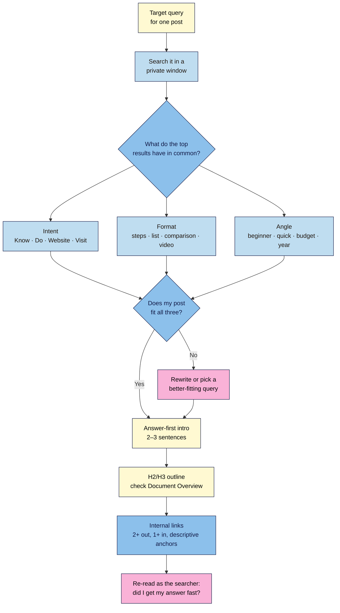

# M05.L03 — Writing for search intent: headings, internal links and answer-first paragraphs
> After this lesson you can read a results page to see what searchers want, then shape a post's opening, headings and links to give it to them, for both people and AI answers.

**Time:** ~14 min reading + ~25 min exercise · **Level:** beginner · **Prereqs:** M05.L02, M02.L03
**Verified against:** Google Search Central ("Creating helpful, reliable, people-first content", updated 2026-10-05; "Link best practices for Google", 2025-12-10; "SEO Starter Guide", 2025-12-10; "AI features and your website", 2025-12-10), Google Search Quality Rater Guidelines (2025-09-11), WordPress 7.0 block editor, Yoast SEO 28.8, all on 2026-10-31

> ⚠️ **Freshness flag:** results pages change constantly. What Google shows for a query today (videos, AI Overview, shopping, maps) may differ next month and in your country. Re-check the results page before rewriting an older post.

## Learning objectives
1. **Identify** the search intent behind a query by reading its results page.
2. **Structure** a post with an answer-first opening and a clear H2/H3 outline that matches that intent.
3. **Add** internal links with descriptive anchor text, both from the post to related posts and to it from older posts.

## Why it matters
Hira wrote a 2,000-word post titled *Miso Ramen*. It opened with three paragraphs about her trip to Sapporo, and the recipe started halfway down. People searching "easy miso ramen recipe" wanted ingredients and steps fast; they left. Google showed recipe pages that started with the recipe, and AI answers quoted sites whose first lines said "You need 20 minutes, these 8 ingredients…". Nothing was technically wrong with her site. The post simply didn't **answer the question the searcher asked, in the form they wanted**, and no other post on her site linked to it, so it looked unimportant. This lesson fixes all three: **intent, structure and links**.

## Core concept
**Plain version:** every search has a job behind it. **Search intent** is that job: *learn something*, *do something*, *go to a site* or *find a place*. Google's results page is the best clue to what most searchers want, because Google ranks what satisfies them. If the top results are step-by-step guides, a personal essay won't fit, however good it is.

Then shape the post for that job:
- **Answer first:** the first 2–3 sentences give the direct answer or the promise, before any story.
- **Headings as a map:** H2s for the main parts, H3s inside them, so a skimmer (and a crawler, and an AI system) can find each part.
- **Internal links:** links between your own posts, with words that say where they go, so readers and crawlers find related posts and see which ones matter.

**What Google says** (primary sources, not rumours):
- Google's systems aim to reward **people-first** content. Its own warning signs of "search engine-first" content include writing to a word count ("No, we don't" have a preferred one), and content that leaves readers needing to search again.
- Use headings and break content into sections "to help users navigate your pages" (SEO Starter Guide).
- Good **anchor text** is "descriptive, reasonably concise, and relevant to the page that it's on and to the page it links to". Google lists "Click here", "Read more" and "website" as too generic, says internal anchor text helps "both people and Google make sense of your site", and adds: "Every page you care about should have a link from at least one other page on your site."
- For AI Overviews and AI Mode, Google says the same SEO fundamentals apply, including "making your content easily findable through internal links".

**Four intents** (from Google's guidelines for its human quality raters. Google says their ratings "do not directly impact ranking", but the categories are a useful lens):
| Intent | Searcher wants to… | Example query | Format that usually fits |
|---|---|---|---|
| **Know** | learn or understand | *why is my sourdough flat* | Explainer: answer first, then causes and fixes |
| **Do** | accomplish something | *easy miso ramen recipe* | Recipe / steps / tool / download |
| **Website** | reach a specific site or page | *hira cooks ramen* | Your homepage or that exact page |
| **Visit-in-person** | find a place nearby | *ramen shop near me* | Business listing, map (not a blog post) |

Two practical rules come from *observed practice*, not Google statements: (1) match the **format** you see most in the top results (list, step-by-step, comparison, review, video), and (2) match the **angle** (beginner, quick, budget, year). Then add something they don't have: your experience, a photo of your result, a mistake you made.

**Analogy:** a reader at a shop counter asks, "Where are the batteries?" Answer-first is pointing: "Aisle 3, top shelf." Headings are the aisle signs. Internal links are a helpful clerk saying, "Chargers are next to them."

## How it works



**In words:** search your target query and look at what the top results share: the **intent**, the **format** and the **angle**. If your post doesn't fit, rewrite it, or target a query it *does* fit. Then put the answer in the first 2–3 sentences, organise the rest under H2/H3 headings, link out to related posts and in from older ones with descriptive words, and re-read it as the searcher.

## Hands-on walkthrough
Use one **published post** on your Local site (or a draft), and a real query someone might type to find it. We'll use Hira's *Miso Ramen* post and the query **easy miso ramen recipe**.

### Part A — Read the results page (~6 min)
1. Open a **private/incognito window** (so your search history doesn't shape the results) and search the query on Google. Results still vary by country, language and device, so check from where your readers are, on mobile too if most of them use it.
2. Look at the **top 5–8 results** and the features above them, and note in a small table:
   | Signal | What you see |
   |---|---|
   | Features | AI Overview? Recipe cards, videos, "People also ask"? |
   | Intent | Know / Do / Website / Visit |
   | Format | Recipe with ingredients + steps; listicle; video |
   | Angle | "easy", "20-minute", "vegan", "authentic"? |
   | What they all cover | e.g. broth base, noodles, toppings, timing |
   | What's missing | e.g. pantry swaps, a make-ahead tip, a beginner mistake |
   **Expected (example):** Do intent; recipe format with ingredient list and numbered steps; "quick/easy, under 30 minutes" angle; nobody explains what to do without fresh ramen noodles. That gap is your extra value.
3. Write down **"People also ask"** questions (if shown). They're good H2/H3 or FAQ ideas, because real people ask them.
4. **Decide:** does your post fit the intent and format? If the results are all recipes and yours is a travel story, either rewrite it as a recipe with the story kept short, or target a query the story fits (e.g. *best ramen in Sapporo*).

### Part B — Answer-first opening (~6 min)
5. Open the post in the editor. Rewrite the first paragraph so it gives the answer or the promise in **2–3 sentences**, then (optionally) one short line of story.
   **Before:**
   > *Last winter I spent a week in Sapporo, and the snow was unbelievable. Every night we ducked into a different ramen shop…*

   **After:**
   > *This easy miso ramen takes 20 minutes and uses 8 pantry ingredients: white miso, garlic, ginger, chicken stock, sesame, soy sauce, noodles and an egg. Make the broth while the noodles cook, then add toppings. I learned it in a Sapporo ramen shop and simplified it for weeknights.*

   **Expected:** someone who reads only those lines knows the time, what they need and the method, which is also a clean, quotable passage for AI answers.
6. Make the opening **self-contained**: avoid "As mentioned above" or "this" without a subject, so the passage still makes sense if quoted alone.

### Part C — H2/H3 outline (~6 min)
7. Turn the post's structure into headings that match the format the searcher expects. The title is already the **H1** (M04.L05), so start at **H2**:
   ```
   H1  Easy Miso Ramen in 20 Minutes          ← post title
   H2  Ingredients
   H2  How to make miso ramen
       H3  1. Make the miso broth
       H3  2. Cook the noodles
       H3  3. Add the toppings
   H2  Swaps if you don't have ramen noodles   ← your extra value
   H2  Common mistakes
   H2  Can you make the broth ahead?           ← a "People also ask" question
   ```
   Headings say what's in the section. "Ingredients" beats "Let's get started!"; questions people ask make good H2s.
8. In the editor, open **Document Overview** (the list icon at top left) → **Outline**.
   **Expected:** one H1, then H2s, with H3s only under an H2, and no "(Incorrect heading level)" warnings.

   > 🖼️ **Image prompt:** Screenshot of the WordPress 7.0 block editor with Document Overview → Outline open, showing the heading outline H1 Easy Miso Ramen in 20 Minutes, H2 Ingredients, H2 How to make miso ramen with three H3 steps, and further H2s, 1280 × 800. Highlight the Outline panel with a 3px #F9B2D7 outline; blur any personal details.
   > **Alt text:** The editor's Document Overview Outline showing an H1 title, H2 sections and three H3 steps in order, with no warnings.

9. Keep each section's **first sentence** a direct answer too (e.g. under "Can you make the broth ahead?": "Yes: the broth keeps for 3 days in the fridge."). Each section then works on its own, for skimmers and for AI answers.

### Part D — Internal links (~7 min)
10. **Links out (2+):** find two places in the post where a related post would genuinely help (a technique, an ingredient guide, your category page from M02.L03). Select the words that describe the target, press **Ctrl+K** (Cmd+K on Mac), and start typing the post's title in **Search or type URL**. Pick it from the suggestions, then press **Enter**.
    - **Good anchor:** *how to make a soft-boiled ramen egg*
    - **Too generic:** *click here*, *read more*, *this post*
    Leave **Open in new tab** off (M04.L03).

    > 🖼️ **Image prompt:** Screenshot of the WordPress 7.0 link popover after selecting the words "soft-boiled ramen egg" and pressing Ctrl+K, with "ramen egg" typed in Search or type URL and a matching post shown in the suggestions, 1280 × 800. Highlight the selected suggestion with a 3px #F9B2D7 outline; blur any personal details.
    > **Alt text:** The link popover's Search or type URL box suggesting a matching post for the selected anchor text "soft-boiled ramen egg".

11. **Links in (1+):** open an **older, related post** (e.g. *Japanese pantry staples*) and add a link **to** this post where it fits naturally, with descriptive anchor text (*a 20-minute miso ramen*). Update the older post.
    Your blog page and category archive link to a new post at first, but it slides to page 2, 3, 10 as you publish more. Links **in the content** of related posts stay put. They're how readers and crawlers keep finding a post, and they signal which posts matter most.
12. **Check:** view the post, hover each link (the status bar shows its URL), and click one.
    **Expected:** each link opens the right post in the same tab, and the anchor text alone tells you where it goes.
13. **Optional (live site with Yoast):** **Posts → All Posts** shows two link-count columns with icons; hover them to see *Number of outgoing internal links in this post* and *Number of internal links linking to this post*. Posts with **0** incoming links from other content are "orphans". Link to them from related posts. (Yoast fills these counts only after **SEO data optimization** has run, which it skips on Local, M05.L02. Yoast's automatic link suggestions are a Premium feature.)

## When to use / when not to
- **Use** this process for posts you want found in search: guides, recipes, how-tos, reviews, comparisons. Do it before writing a new post and when updating an old one.
- **Don't** force it onto posts that aren't meant for search: a personal update, a newsletter archive, a community announcement. Write those for your existing readers.
- **Don't** chase a query whose results show a format you can't make (e.g. a map pack for a local shop when you're a blogger) or a different intent (shopping pages for "buy …").
- **Trade-off:** answer-first openings can feel abrupt to long-time readers who enjoy your stories. Keep the story; just move it after the answer, or into its own section, rather than in front of what the searcher came for.

## Use AI for this
**Example prompt:**
> "Here is my post's draft: [paste]. My target query is 'easy miso ramen recipe'. Here are notes on the top Google results: [paste your Part A table]. (1) Rewrite my opening in 2–3 sentences that answer the query directly, in my voice, without inventing facts. (2) Suggest an H2/H3 outline that matches the format of the results. (3) List 3 places where I could link to these posts of mine: [paste titles + URLs], with descriptive anchor text from my existing sentences."

**What AI does well:** tightening a rambling opening, suggesting clear headings, spotting where existing sentences could carry a link.
**Where it gets it wrong:** it can't reliably see today's results page in your country, so don't ask it to "tell me the search intent" without your own notes. It may invent facts (times, quantities), stuff the keyword into every heading, or suggest links to posts you don't have.
**How to check:** compare its opening with your recipe (are the numbers yours?); read the headings aloud (would a person write them?); click every suggested link target to make sure it exists.

## Common mistakes
- **Story first, answer last.** Searchers leave before reaching it. Answer first; story second.
- **Guessing intent instead of looking.** "Ramen" might mean recipes, restaurants or history. The results page tells you which.
- **Keyword-stuffed headings** like *Easy Miso Ramen Recipe Ingredients for Easy Miso Ramen*. Write headings for people.
- **Skipping heading levels or using headings for styling** (an H4 because it "looks smaller"). Use the right level; change the look in Styles (M04.L02).
- **Writing to a word count.** Google says it has no preferred length. Cover what the searcher needs, then stop.
- **Generic anchors** ("click here", "this post") or **the same anchor for different pages**.
- **Orphan posts:** a post that no other post or page links to in its content, only the archives. Add at least one link from an older related post.
- **Too many links**, e.g. linking every other phrase. Link where it helps the reader take the next step.

## Troubleshooting
| Symptom | Likely cause | Fix |
|---|---|---|
| Results for your query are all a different format (videos, products, maps) | Your post doesn't match the dominant intent or format | Change the format, or target a query your post fits |
| Ctrl+K link search doesn't show your post | It's a draft, scheduled or private, or the title words don't match | Publish it first, or search by a word in its title; or paste the URL |
| Outline shows "(Incorrect heading level)" | A level was skipped (H2 → H4) | Change the heading level in the block toolbar |
| A link opens a 404 | The target's slug changed or it was deleted | Update the link; add a redirect (M05.L02) |
| Yoast link columns show nothing or "?" | SEO data optimization hasn't run (e.g. on Local) | Run it on the live site from **Yoast SEO → Tools**, or ignore on Local |
| Google shows a different snippet than your opening | Google picked the passage it found most relevant to that query | Normal; make sure each section starts with a clear answer |

## Exercise
**Task:** pick one post and its target query.
1. Fill in the Part A table from a private-window search, and decide: does the post fit the intent, format and angle?
2. Rewrite the post's **opening** answer-first (2–3 sentences).
3. Rewrite its **headings** into a clean H2/H3 outline and check **Document Overview → Outline**.
4. Add **three internal links**: at least two from this post to related posts and one to it from an older post, all with descriptive anchor text.
5. Save a before/after note in your site docs: query, intent, old first sentence, new first sentence, headings, and the three links (anchor → target).

**Expected outcome:** the first 2–3 sentences answer the query; the Outline shows one H1 and a logical H2/H3 structure with no warnings; three working internal links whose anchor text describes the target; a completed before/after note.

**Stretch goal:** choose a second query where your post *doesn't* fit the results (e.g. the results are videos or products). Write one sentence explaining why, and either a new post idea that would fit, or a reason to leave it alone.

## Key takeaways
- **Look before you write:** the results page shows the intent, format and angle searchers reward.
- **Answer first.** The first 2–3 sentences give the answer or promise; the story can follow.
- **Headings are a map:** one H1 (title), then H2s and H3s that say what each section contains.
- **Internal links with descriptive anchors** help readers, crawlers and AI features find and understand your posts. Link new posts *from* older ones.
- Google has **no preferred word count**: write for the searcher's need, not a length.

## Teach it back
Explain to a friend in 3 sentences how to tell what someone searching "easy miso ramen recipe" wants, and how that should change the first paragraph of their post.

## Glossary terms added
- Search intent — added to `wordpress-101/glossary.md`
- Answer-first paragraph — added to `wordpress-101/glossary.md`
- Internal link — added to `wordpress-101/glossary.md`
- Anchor text — added to `wordpress-101/glossary.md`
- Orphan post — added to `wordpress-101/glossary.md`

## Further reading
*All checked 2026-10-31.*
- Google Search Central — [Creating helpful, reliable, people-first content](https://developers.google.com/search/docs/fundamentals/creating-helpful-content) (updated 2026-10-05)
- Google Search Central — [Link best practices for Google](https://developers.google.com/search/docs/crawling-indexing/links-crawlable) (updated 2025-12-10; anchor text and internal links)
- Google Search Central — [SEO Starter Guide](https://developers.google.com/search/docs/fundamentals/seo-starter-guide) (updated 2025-12-10; headings, organising your site)
- Google Search Central — [AI features and your website](https://developers.google.com/search/docs/appearance/ai-features) (updated 2025-12-10; internal links among the fundamentals)
- Google — [Search Quality Rater Guidelines](https://guidelines.raterhub.com/searchqualityevaluatorguidelines.pdf) (2025-09-11; section 12.7, Know, Do, Website and Visit-in-person queries)
- Google — [How Search works: quality raters](https://www.google.com/search/howsearchworks/how-search-works/rigorous-testing/) ("These ratings do not directly impact ranking")
- WordPress — [Link control](https://wordpress.org/documentation/article/link/) (adding links in the block editor)
