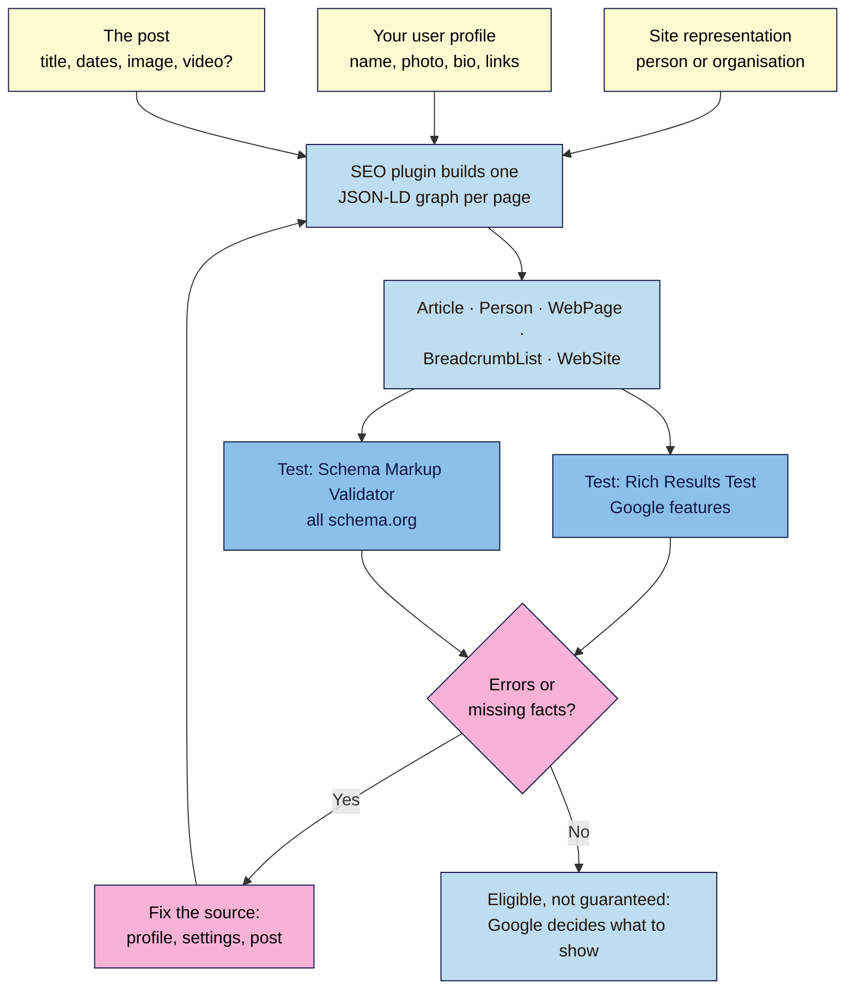

# M05.L04 — Schema basics for creators
> After this lesson you can explain what structured data does (and doesn't) do, make your SEO plugin describe your posts and you as the author correctly, and prove it with two free testing tools.

**Time:** ~13 min reading + ~20 min exercise · **Level:** beginner · **Prereqs:** M05.L02
**Verified against:** Google Search Central ("Introduction to structured data", updated 2025-12-10; "General structured data guidelines", 2026-07-10; "Search Gallery", 2026-10-16; "Article", 2026-09-08; "Video", 2026-09-24; "Profile page", 2026-09-08; "AI features and your website", 2025-12-10; "Latest documentation updates" for the FAQ deprecation), schema.org, Yoast SEO 28.8, Rank Math 1.0.280, all on 2026-10-31

> ⚠️ **Freshness flag:** Google adds and removes rich results often. **FAQ rich results stopped appearing in Google Search on 2026-05-07**, and Google removed the FAQ documentation on 2026-06-15. **How-to** rich results were removed in 2023. Check the Search Gallery before adding markup for a "rich result" you read about in an older guide.

## Learning objectives
1. **Explain** what structured data does and doesn't do for rankings, rich results and AI answers.
2. **Configure** Article and Person schema through your SEO plugin, and decide whether a post needs VideoObject or PodcastEpisode markup.
3. **Validate** a post's structured data with the Rich Results Test and the Schema Markup Validator, and read the results.

## Why it matters
Dev read that "schema is the secret to AI search" and pasted an FAQ markup generator's output into every post. Months later nothing had changed: Google had stopped showing FAQ rich results, and his questions weren't even visible on the page, which breaks Google's guidelines. Meanwhile, his posts' **author** in the markup was "admin", with no photo, bio or links, so nothing connected the posts to the real person behind them. Structured data isn't magic, but getting the basics right is easy: your SEO plugin already writes most of it. Your job is to **feed it correct facts about you**, **not add markup for things that aren't on the page**, and **check it**.

## Core concept
**Plain version:** **structured data** is a short, machine-readable description of a page, added to the page's code. It tells search engines in a fixed vocabulary: *this is an Article, its headline is X, it was published on this date, its author is this Person, who also has these profiles.* The shared vocabulary is **schema.org**; the format Google recommends is **JSON-LD**, a block of code in the page that readers don't see.

**What it does:**
- Helps Google **understand** the page and the entities on it (you, your site, your video).
- Makes a page **eligible** for some **rich results**, enhanced listings such as recipe cards, video thumbnails, review stars or breadcrumbs.

**What it doesn't do (Google's words):**
- It doesn't guarantee anything: "Google does not guarantee that your structured data will show up in search results, even if your page is marked up correctly."
- A structured data manual action (penalty) removes rich-result eligibility but "doesn't affect how the page ranks in Google web search". Markup is about **understanding and appearance**, not a ranking boost.
- **AI features:** for AI Overviews and AI Mode, Google says "there's also no special schema.org structured data that you need to add". What it does ask: "Making sure your structured data matches the visible text on the page."

**Analogy:** your post is a product in a shop; structured data is the label on the box (contents, maker, date). A clear, honest label helps the shop file it and maybe give it a special display. A label that lists things not in the box gets the product taken off the special display.

**The types a creator needs:**
| Type | Describes | Who adds it | Rich result in Google? |
|---|---|---|---|
| **Article** (BlogPosting) | A post: headline, dates, image, author | Your SEO plugin, automatically | Helps Google show the right title, image and date; no required properties |
| **Person** | You as author: name, photo, bio, profiles (`sameAs`) | SEO plugin, from your user profile | No separate rich result; linked from Article and ProfilePage |
| **Organization / Person (site)** | Who's behind the site: name, logo | SEO plugin, **Site representation** (M05.L02) | Can help Google show your logo and site name |
| **BreadcrumbList** | Where the page sits | SEO plugin (M05.L02) | Breadcrumbs in results (desktop) |
| **VideoObject** | A video *on the page*: name, thumbnail, upload date | Optional: Rank Math's free Schema Generator, Yoast's paid Video SEO add-on | Video features; Google also tries to detect videos automatically |
| **PodcastEpisode** | A podcast episode | Rarely needed (schema.org type) | **None** in Google Search; directories read your **RSS feed** |
| **Recipe, Product, Review, Event** | What they say | A recipe, shop or events plugin | Yes, each with its own requirements |
| ~~FAQ, How-to~~ | Q&A, step lists | — | **No longer shown** (FAQ from 2026-05-07; How-to from 2023) |

## How it works



**In words:** your SEO plugin combines three sources (who runs the site, your author profile, and the post itself) into one JSON-LD **graph** on every page. Test it in the **Rich Results Test** (which Google features it qualifies for) and the **Schema Markup Validator** (is the schema.org code valid). Fix problems **at the source**, such as your profile or plugin settings, not by hand-editing code. A clean result makes the page *eligible*; Google decides what to show.

## Hands-on walkthrough
Use your **Local** site with Yoast SEO from M05.L02 (Rank Math notes are at the end of each part).

### Part A — See what's already there (~3 min)
1. Open any published post, right-click → **View Page Source**, and search (Ctrl+F) for `yoast-schema-graph`.
   **Expected:** one `<script type="application/ld+json" class="yoast-schema-graph">` block containing a `"@graph"` list with items such as `"@type":"Article"`, `"WebPage"`, `"ImageObject"`, `"BreadcrumbList"`, `"WebSite"` and `"Person"` (or `"Organization"`). Each has an `"@id"`, and they point at each other: the Article's `author` points to the Person's `@id`.
   **If you see two or more ld+json blocks** describing the same Article, another plugin or the theme is adding schema too. Keep one source (the duplicate-plugin problem from M05.L02).
2. Find the **Article** item and note its `headline`, `datePublished`, `dateModified`, `image` and `author`. Find the **Person** item and note `name`, `image`, `description` and `sameAs`. On a fresh site, `description` and `sameAs` are often missing, and `name` may be a username. You'll fix that next.

### Part B — Make your Person (author) schema accurate (~6 min)
3. Go to **Users → Profile** (your own account):
   - **First Name**, **Last Name**, and **Display name publicly as**: your real or pen name, the same as your byline. Not "admin".
   - **Contact Info → Website:** your **About** page URL (M04.L04).
   - Yoast adds social fields here: **Facebook profile URL**, **Instagram profile URL**, **LinkedIn profile URL**, **X username (without @)**, **Wikipedia page about you** (only if one genuinely exists) and others. Fill in the ones you actively use. They become the Person's `sameAs` links, which tie your posts to your identity elsewhere.
   - **Biographical Info:** 1–2 sentences on who you are and why you know the topic (e.g. *Hira is a home cook in Leeds who has tested 200+ weeknight Japanese recipes.*). It becomes the Person's `description`.
   - **Profile Picture:** WordPress uses **Gravatar** for this, linked to your account email. Set a clear photo at gravatar.com if you haven't.
   Click **Update Profile**.

   > 🖼️ **Image prompt:** Screenshot of Users → Profile in WordPress 7.0 with Yoast SEO active, showing the Contact Info section (Website, Facebook profile URL, Instagram profile URL, LinkedIn profile URL, X username) and Biographical Info filled in, 1280 × 900. Highlight the Biographical Info field with a 3px #F9B2D7 outline; blur the email address and any personal details.
   > **Alt text:** The WordPress profile screen with website, social profile fields and a short biography filled in for author schema.

4. Check that your **byline is visible**: Google's guidance is that markup should describe what's on the page. Twenty Twenty-Five's Single Posts template shows *Written by [author] in [category]* (its **Written by** pattern). If you removed it in M04.L02, add the **Post Author Name** block back (or the **Author Biography** block below the post).
5. Optional but useful: Google recommends `author.url` points to a page that identifies the author. Yoast uses your **author archive** URL (`/author/your-name/`) and marks it up as a **ProfilePage**. Your About page is linked through **Website** → `sameAs`. That's enough for a creator site.
6. Reload the post's source and search for `"@type":"Person"`.
   **Expected:**
   ```json
   {"@type":"Person","@id":"https://hiracooks.local/#/schema/person/…",
    "name":"Hira Shah","image":{…},
    "description":"Hira is a home cook in Leeds who has tested 200+ weeknight Japanese recipes.",
    "sameAs":["https://hiracooks.local/about/","https://www.instagram.com/hiracooks/"],
    "url":"https://hiracooks.local/author/hira/"}
   ```

*Rank Math:* the same profile fields feed its Person schema; check **Rank Math SEO → Titles & Meta → Local SEO** (site Person/Organization) and **Authors**.

### Part C — Article type (~2 min)
7. **Yoast SEO → Settings → Content types → Posts** → **Schema** section: **Page type** *Web Page* and **Article type** *Article* are the defaults. Changing it to **Blog Post** is accurate for a blog but optional; Google's Article docs cover `Article`, `BlogPosting` and `NewsArticle` alike. For **Pages**, the Article type default is *None*, which is right for About and Contact pages.
8. Per post, the Yoast sidebar's **Schema** tab can override this. You rarely need to.

### Part D — Validate with two tools (~6 min)
Both tools are free, need no account, and give you different answers to different questions:

| Tool | Question it answers |
|---|---|
| **Rich Results Test** (search.google.com/test/rich-results) | Which **Google** rich results can this page get, and are there errors for them? |
| **Schema Markup Validator** (validator.schema.org) | Is all the **schema.org** markup valid, including types Google doesn't use? |

9. A Local site isn't on the internet, so neither tool can fetch its URL. Use the **code** option instead: open the post, **View Page Source**, select all (Ctrl+A), copy, then in the Rich Results Test choose **Code** and paste. Click **Test code**.
   **Expected:** a list of detected items with a green tick, typically **Articles** and **Breadcrumbs**, each "valid". Expand **Articles** to see the headline, image, dates and author name the test read. **Warnings** for optional missing fields are fine; **errors** (red) mean that item isn't eligible.

   > 🖼️ **Image prompt:** Screenshot of Google's Rich Results Test after testing pasted code, showing detected valid items Articles and Breadcrumbs with green ticks, 1280 × 800. Highlight the detected items list with a 3px #F9B2D7 outline; blur any personal details.
   > **Alt text:** The Rich Results Test result listing valid Articles and Breadcrumbs items detected from pasted page code.

10. Paste the same source into the **Schema Markup Validator** (**Code Snippet** tab → **Run test**).
    **Expected:** the full graph, with `Article`, `WebPage`, `Person`, `BreadcrumbList`, `WebSite`, `ImageObject`, and **0 errors, 0 warnings** (or only minor warnings). Click **Person** and check your name, bio and `sameAs` links.
11. On a **live** site, paste the post's URL instead, and later use Search Console's **Enhancements** reports (M05.L05) to see schema issues across all posts.

### Part E — Video and podcasts (~3 min)
12. **Video:** if a post's main content is a video you embed (M03.L05), Google "tries to automatically understand details about your video". Structured data lets you influence the thumbnail, description, upload date and duration. VideoObject needs at least **name**, **thumbnailUrl** and **uploadDate**. Options:
    - **Rank Math (free):** in the post, **Schema Generator** → **Video**, then fill in the fields.
    - **Yoast:** the paid **Video SEO** add-on.
    - **Or skip it:** if the video is on YouTube, its YouTube page usually ranks in video results anyway.
    Don't mark up a video that isn't on the page, or one that's only a minor part of it.
13. **Podcasts:** Google Search has **no podcast rich result**, and Google Podcasts closed in 2024. Podcast apps read your **RSS feed** (from your podcast host), not page schema. Writing good episode pages with show notes and a transcript (M03.L05) does more for search than PodcastEpisode markup. Add it only if a tool you use asks for it.

## When to use / when not to
- **Use** your SEO plugin's automatic schema on every site, and spend 5 minutes on your profile and Site representation: that's 90% of the value for a creator.
- **Use** specialist markup (Recipe, Video, Product, Event) only when the page **is** that thing and shows the details visibly. A dedicated recipe plugin handles recipe markup best.
- **Don't** add FAQ or How-to markup hoping for rich results: Google no longer shows them. Yoast's **Yoast FAQ** and **Yoast How-to** blocks still output that markup. They're harmless as visible content, but don't add them *for* the markup.
- **Don't** hand-paste JSON-LD from generators or AI into posts on top of your plugin's graph. You'll create duplicates and mismatches that are hard to maintain.
- **Trade-off:** more markup is more to keep accurate. A wrong price, an old date or a renamed author in schema is worse than none, so add only what you'll maintain.

## Use AI for this
**Example prompt:**
> "Here is the JSON-LD from one of my blog posts: [paste the yoast-schema-graph block]. In plain English, list what it says about the post and about me as the author. Then list anything that's missing or looks wrong compared with these facts: my name is ___, my About page is ___, my social profiles are ___. Don't write new markup; just tell me which WordPress or plugin setting to change."

**What AI does well:** translating a dense JSON-LD graph into plain language, spotting a username as `name`, missing `sameAs` or a wrong date.
**Where it gets it wrong:** it often recommends FAQ or How-to markup "for rich results" (outdated), invents properties, claims schema boosts rankings or "is required for AI Overviews", and happily writes JSON-LD that duplicates your plugin's.
**How to check:** compare its claims with the Search Gallery and the feature's Google doc (dated); fix things at the source (profile, plugin), then re-run both validators.

## Common mistakes
- **Thinking schema is a ranking factor or an AI-search requirement.** Google says neither; it's about understanding and eligibility.
- **Markup that doesn't match the page:** FAQs, reviews or ratings that readers can't see. This breaks Google's guidelines and can cost rich-result eligibility (a manual action).
- **"admin" as the author**, with no bio, photo or profile links. Fix your user profile.
- **Two schema sources** (two SEO plugins, or a plugin plus a theme's or a schema plugin's markup). Keep one.
- **Chasing deprecated rich results** (FAQ, How-to) from old guides or AI suggestions.
- **Only using one tool.** The Rich Results Test only shows Google features; the Schema Markup Validator shows everything but not Google eligibility. Use both.
- **Fixing errors by editing code by hand** instead of the setting that produces it. Your fix disappears on the next update.

## Troubleshooting
| Symptom | Likely cause | Fix |
|---|---|---|
| Rich Results Test says it can't reach the URL | It's a Local site (not on the internet) | Use **Code**: paste the page source |
| "No items detected" in the Rich Results Test | The page has no Google-eligible types, or schema is off | Check for `yoast-schema-graph` in the source; check the Schema Framework is on in Yoast's **Site features** |
| Person `name` is a username | **Display name publicly as** is the username | Set first/last name and change the display name in **Users → Profile** |
| No `sameAs` in Person | No social/Website fields filled in | Fill in **Contact Info** fields in your profile |
| Two `Article` items or two graphs | Two plugins or the theme output schema | Deactivate the extra source |
| Validator warns "missing field" for optional properties | Recommended, not required | Add it at the source if easy (e.g. featured image); otherwise ignore |
| FAQ markup "valid" but no FAQ in results | FAQ rich results no longer appear (from 2026-05-07) | Expected. Keep the visible FAQ if it helps readers; nothing to fix |

## Exercise
**Task:**
1. Update your user profile so your Person schema has your real or pen name, bio, photo (Gravatar), About page and 1–3 social profiles.
2. Confirm your byline is visible on posts.
3. Validate one post in **both** the Rich Results Test and the Schema Markup Validator (code option on Local).
4. Record in your site's SEO settings log (M05.L02): which items each tool detected, any errors or warnings, and what you changed to fix them.

**Expected outcome:** the Rich Results Test shows valid **Articles** (and **Breadcrumbs**) items with no errors; the Schema Markup Validator shows one graph with a **Person** whose name, description and `sameAs` match your profile; your log lists the results and fixes.

**Stretch goal (break it and fix it):** add a **Yoast FAQ** block with one question to a test post, validate it, and see that both tools detect **FAQPage** markup as valid. Write one sentence explaining why "valid" here doesn't mean "will get a rich result" (check the Search Gallery). Then delete the block, or keep it only if the Q&A genuinely helps readers.

## Key takeaways
- Structured data helps Google **understand** a page and makes it **eligible** for rich results. It isn't a ranking boost, and Google says AI features need **no special schema**.
- Your SEO plugin already outputs Article, Person, WebPage, BreadcrumbList and WebSite; **feed it accurate facts** through your profile and Site representation.
- Markup must **match visible content**; mismatches can cost rich-result eligibility.
- **FAQ and How-to rich results are gone**; VideoObject is optional and PodcastEpisode has no Google feature.
- Test with **both** the Rich Results Test (Google features) and the Schema Markup Validator (all schema.org).

## Teach it back
Explain to a friend in 3 sentences what structured data is, why it won't on its own make a post rank higher, and the two tools they'd use to check it.

## Glossary terms added
- Structured data (schema) — added to `wordpress-101/glossary.md`
- JSON-LD — added to `wordpress-101/glossary.md`
- Rich result — added to `wordpress-101/glossary.md`
- Rich Results Test — added to `wordpress-101/glossary.md`
- Schema Markup Validator — added to `wordpress-101/glossary.md`
- sameAs — added to `wordpress-101/glossary.md`

## Further reading
*All checked 2026-10-31.*
- Google Search Central — [Introduction to structured data](https://developers.google.com/search/docs/appearance/structured-data/intro-structured-data) (updated 2025-12-10)
- Google Search Central — [General structured data guidelines](https://developers.google.com/search/docs/appearance/structured-data/sd-policies) (updated 2026-07-10; no guarantee; manual actions don't affect ranking)
- Google Search Central — [Search Gallery](https://developers.google.com/search/docs/appearance/structured-data/search-gallery) (updated 2026-10-16; current list of supported features)
- Google Search Central — [Article structured data](https://developers.google.com/search/docs/appearance/structured-data/article) (updated 2026-09-08; no required properties; author best practices)
- Google Search Central — [Video structured data](https://developers.google.com/search/docs/appearance/structured-data/video) (updated 2026-09-24)
- Google Search Central — [Profile page structured data](https://developers.google.com/search/docs/appearance/structured-data/profile-page) (updated 2026-09-08)
- Google Search Central — [AI features and your website](https://developers.google.com/search/docs/appearance/ai-features) (updated 2025-12-10; "no special schema.org structured data")
- Google Search Central — [Latest documentation updates](https://developers.google.com/search/updates) (FAQ deprecation 2026-05-08; documentation removed 2026-06-15)
- Google — [Rich Results Test](https://search.google.com/test/rich-results) · schema.org — [Schema Markup Validator](https://validator.schema.org/) · [schema.org/Person](https://schema.org/Person) · [schema.org/PodcastEpisode](https://schema.org/PodcastEpisode)
