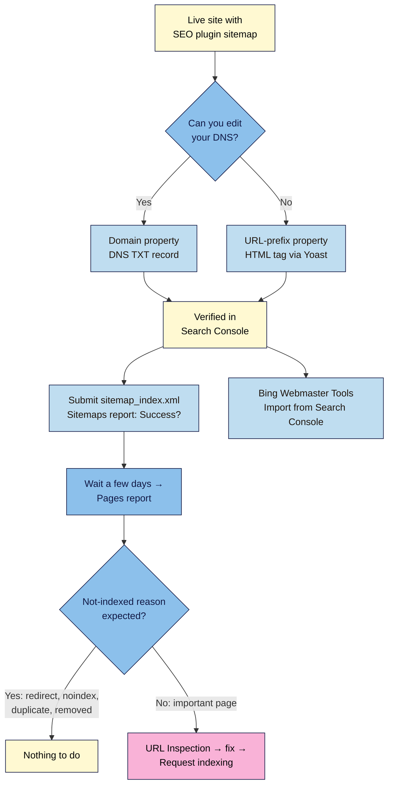

# M05.L05 — Connect Google Search Console and Bing Webmaster Tools
> After this lesson you can prove to Google and Bing that the site is yours, hand them your sitemap, read which pages are indexed (and why others aren't), and ask for a fresh crawl of a new or updated post.

**Time:** ~13 min reading + ~20 min exercise · **Level:** beginner · **Prereqs:** M05.L02 (and M01.L02 if you choose DNS verification)
**Verified against:** Search Console Help ("Add a website property", "Verify your site ownership", "Sitemaps report", "Page indexing report", "Managing owners, users, and permissions"), Google Search Central ("Ask Google to recrawl your URLs"), Bing Webmaster blog (Import from Google Search Console; AI Performance, 2026-02-10), Yoast SEO 28.8, all on 2026-10-31

> Note: both tools only work with a site that's **live on the internet**. A Local site can't be verified. If your site isn't live yet, read this lesson now and do the walkthrough on launch day (M09). It takes about 20 minutes.

> ⚠️ **Freshness flag:** Search Console and Bing Webmaster Tools change their menus and report names from time to time (Google renamed "Coverage" to **Pages** in 2022). If a label differs, search the tool's help for the report name.

## Learning objectives
1. **Verify** your site in Google Search Console and Bing Webmaster Tools.
2. **Submit** your XML sitemap and **read** the Pages (page indexing) report, telling real problems from normal exclusions.
3. **Request** indexing for a new or updated post with URL Inspection, and know when not to.

## Why it matters
Kemi from M05.L01 found out about her **Discourage search engines** mistake three months late, by noticing she had no visitors. Search Console would have shown it within days: a growing list of pages marked `noindex` in the Pages report. Search Console and Bing Webmaster Tools are the only places where Google and Bing tell you, for free, what they see on **your** site: which pages are indexed, which aren't and why, which searches show your posts, and when something breaks. Without them you're guessing.

## Core concept
**Plain version:** both tools are free dashboards from the search engines. To use one, you **add your site** (a "property") and **verify** that you control it, by putting a small code where only the owner could: your site's `<head>`, a file on your server, or your domain's DNS. Then you **submit your sitemap** (the list from M05.L02) and wait a few days for data.

**Google Search Console has two property types:**
| | **Domain property** (`example.com`) | **URL-prefix property** (`https://example.com/`) |
|---|---|---|
| Covers | All subdomains (www, m…) and both http and https | Only URLs starting with exactly that prefix |
| Verify with | **DNS record only** (a TXT record at your domain provider) | Several methods, including an **HTML tag** (easy with Yoast) |
| Choose if | You can edit your DNS (M01.L02) | You can't, or want the quickest route |

Either is fine for a creator site. Domain is more complete; URL-prefix with the HTML tag is quicker with your SEO plugin.

**Bing Webmaster Tools** can **import** sites you've already verified in Search Console, including their sitemaps, so you don't verify twice. Bing powers Microsoft Copilot's web answers (M05.L01), and its **AI Performance** report shows where you're cited.

**The reports you'll use most:**
- **Sitemaps:** whether Google could read your sitemap (*Success*, *Couldn't fetch*, *Sitemap had X errors*).
- **Pages** (page indexing): how many URLs are **Indexed** vs **Not indexed**, grouped by reason.
- **URL Inspection:** the status of one URL, a live test, and **Request indexing**.
- **Performance:** searches, clicks and impressions (M08 covers measuring).

**Not indexed isn't automatically bad.** Google: "Your goal is to get the canonical version of every important page indexed." Redirected URLs, duplicates, `noindex` pages and deleted posts **should** be excluded.

**Analogy:** verification is showing ID at the post office; the sitemap is your forwarding list; the Pages report is the mail carrier's notes on which addresses they delivered to and why some were skipped.

## How it works

**In words:** pick a property type (Domain if you can edit DNS, otherwise URL-prefix), verify, and submit your sitemap. Import the verified site into Bing. After a few days, read the Pages report: expected exclusions need nothing; an important page that's missing gets inspected, fixed, and then requested for indexing.

## Hands-on walkthrough
Use your **live** site, logged in as an administrator, and a Google account you'll keep (not a work account you might lose).

### Part A — Verify in Google Search Console (~7 min)
1. Go to **search.google.com/search-console**, sign in, and choose **Add property** (from the property menu at top left on later visits).
2. Choose your property type:
   - **Domain** (recommended if you can edit DNS): enter `example.com` with no `https://` or `www`. Google shows a **TXT record** (`google-site-verification=…`). In your domain provider's DNS settings (M01.L02), add a TXT record for the root (`@`) with that value, save, return and click **Verify**. DNS changes can take from minutes to a day; if it fails, wait and try again.
   - **URL prefix:** enter your exact homepage URL, e.g. `https://hiracooks.com/` (with https, and with or without www exactly as your site uses it). Expand **HTML tag** and copy the code inside `content="…"`.
3. **URL prefix only:** in WordPress, go to **Yoast SEO → Settings → Site connections**, paste the code into **Google**, and click **Save changes**. Back in Search Console, click **Verify**.
   **Expected:** *Ownership verified*. View your homepage source and you'll find `<meta name="google-site-verification" content="…" />`.
4. **Keep the verification in place.** Search Console checks it periodically; if you delete the TXT record, or the tag disappears (e.g. you change SEO plugins), you lose access after a grace period. Note in your site docs which method you used.
5. Optional: **Settings → Users and permissions** → add a second **Owner** (a second account of yours) or give a helper **Full** or **Restricted** access instead of sharing your password.

   > 🖼️ **Image prompt:** Screenshot of Google Search Console's Add property dialog with the two options Domain and URL prefix, with example.com typed in the Domain box, 1280 × 800. Highlight the Domain option with a 3px #F9B2D7 outline; blur any personal details.
   > **Alt text:** Search Console's Add property dialog showing the Domain and URL prefix choices with a domain typed in.

### Part B — Submit your sitemap (~3 min)
6. In Search Console, open **Indexing → Sitemaps**. Under **Add a new sitemap**, type `sitemap_index.xml` (Yoast/Rank Math) and click **Submit**.
   **Expected:** a row with your sitemap, **Status: Success** and a count of **Discovered pages**. *Couldn't fetch* right after submitting sometimes clears within a day. If it persists, open the sitemap URL in a private window: it should load without a login.
7. Submit **only** your sitemap index, not each child sitemap, and not core's `/wp-sitemap.xml` if your plugin replaced it (M05.L02).

### Part C — Bing Webmaster Tools (~4 min)
8. Go to **bing.com/webmasters** and sign in (a Microsoft or Google account works). On the welcome screen, choose **Import** from Google Search Console, allow access, select your site and **Import**.
   **Expected:** your site appears, verified, with its sitemap already listed.
   **Can't import?** (e.g. you used another Google account) Add the site manually and use **HTML meta tag** verification: copy the `msvalidate.01` code into **Yoast SEO → Settings → Site connections → Bing**, save, then verify.
9. Look at the left menu: **Sitemaps** (check yours is there), **URL Inspection**, **URL Submission**, **IndexNow** and **AI Performance** (where your pages are cited in Microsoft's AI answers, M05.L01). Data appears after a few days.

### Part D — Read the Pages report (~4 min, after a few days)
10. In Search Console, open **Indexing → Pages**.
    **Expected (a healthy small site):** a chart of **Indexed** vs **Not indexed**, and under it **Why pages aren't indexed**, a table of reasons with page counts.

    > 🖼️ **Image prompt:** Screenshot of Search Console's Pages (page indexing) report for a small site, showing the Indexed and Not indexed chart and the "Why pages aren't indexed" table with reasons such as Page with redirect and Excluded by noindex tag, 1280 × 900. Highlight the reasons table with a 3px #F9B2D7 outline; blur the site URL and any personal details.
    > **Alt text:** Search Console's Pages report with an indexed vs not indexed chart and a table of reasons pages aren't indexed.

11. Read each reason and decide whether it's **expected**:
    | Reason | Usually means | Action |
    |---|---|---|
    | **Page with redirect** | Old URLs you redirected (M05.L02), http → https, non-www → www | None; expected |
    | **Excluded by 'noindex' tag** (help page: *URL marked 'noindex'*) | Pages you hid (author/date archives, thank-you pages) | None, **unless an important post is listed** (then check **Settings → Reading** and the post's SEO settings) |
    | **Alternate page with proper canonical tag** / **Duplicate without user-selected canonical** | Variants of a page (e.g. URLs with `?` parameters) where Google picked the main URL | None; check one with URL Inspection if a key post is listed |
    | **Not found (404)** | Deleted or mistyped URLs | Redirect if a close match exists, otherwise leave it (M05.L02) |
    | **Redirect error** | A redirect chain that's too long, or a loop | Point the old URL straight at the final one (M05.L02 stretch goal) |
    | **Server error (5xx)** | Your server failed when Google visited | Check with your host if it keeps appearing (M07) |
    | **Crawled – currently not indexed** | Google crawled it but chose not to index it (often thin or similar to other pages) | Improve the content; no need to resubmit |
    | **Discovered – currently not indexed** | Google knows the URL but hasn't crawled it yet | Usually wait; add internal links (M05.L03) |
    | **Soft 404** | Page says "not found" (or is near-empty) but returns 200 | Return a real 404, or add real content |
12. Click a reason to see example URLs. Ask of each: **is this a page I want in search?** If yes, inspect it (Part E).

### Part E — Inspect a URL and request indexing (~3 min)
13. Paste a post's full URL into the **Inspect any URL** box at the top of Search Console.
    **Expected:** *URL is on Google* (indexed) or *URL is not on Google* with a reason, plus details on discovery, crawl and the canonical Google chose.
14. For a **new or significantly updated** post, click **Test live URL** to check Google can fetch it now, then **Request indexing**.
    **Expected:** *Indexing requested*. It can take from a day to a couple of weeks; Google says requesting doesn't guarantee indexing, and there's a quota: repeat requests for the same URL won't speed it up.
15. **Don't** request indexing for every post or every small edit. Your sitemap and internal links already tell Google about them. Save requests for important new posts and real fixes.
16. In **Bing**, use **URL Inspection** or **URL Submission** for the same job. (IndexNow, if you've set it up, does this automatically, M05.L02.)

## When to use / when not to
- **Use** both tools from day one of a live site. Check the Pages report and email alerts weekly at first, then monthly (M09's maintenance routine).
- **Use** URL Inspection whenever a specific important page seems missing or wrong; it's the definitive answer for one URL (M05.L01).
- **Don't** treat "Not indexed" as an emergency. Check the reason: most are expected.
- **Don't** re-submit the sitemap every time you publish; Google re-reads it on its own.
- **Trade-off:** Domain property gives complete data (all subdomains and protocols) but needs DNS access; URL-prefix with the HTML tag is quicker but tied to your SEO plugin and the exact URL format. Changing plugins later means re-adding the code.

## Use AI for this
**Example prompt:**
> "Here's my Search Console Pages report summary for my 40-post blog: [paste each reason and count, plus 3 example URLs per reason]. For each reason, tell me whether it's expected for a WordPress blog using Yoast SEO, and which ones I should act on, in priority order. Don't guess about URLs I haven't listed."

**What AI does well:** explaining report reasons in plain language, spotting patterns in example URLs (all `/tag/` pages, all `?replytocom=`), and suggesting a priority order.
**Where it gets it wrong:** it may treat every "Not indexed" URL as a problem, recommend requesting indexing for everything, invent reason names or old report names ("Coverage", "Excluded"), or tell you to delete your sitemap.
**How to check:** look each reason up in Google's Page indexing report help (linked below) and confirm the status of individual URLs with URL Inspection.

## Common mistakes
- **Verifying with a tag, then removing it** (switching SEO plugins, a theme change, or a cleanup). Search Console checks periodically, and you lose access after a grace period.
- **Wrong URL-prefix format:** `http://` when the site is `https://`, or `www` mismatch. Use the exact homepage URL, or a Domain property.
- **Submitting the wrong sitemap** (core's `/wp-sitemap.xml` after your plugin replaced it, or every child sitemap separately).
- **Panicking at "Not indexed"** when the reasons are redirects, noindex archives and duplicates.
- **Spamming Request indexing** for every post and edit. There's a quota, and it doesn't speed things up.
- **Only one owner on a personal Google account you might lose.** Add a second owner.
- **Ignoring Bing** because "nobody uses it": it feeds Microsoft Copilot and other services, and setup takes two minutes with Import.

## Troubleshooting
| Symptom | Likely cause | Fix |
|---|---|---|
| "Verification failed" for the HTML tag | Tag not saved, page cached, or wrong property URL | Save in **Site connections**, clear your cache, view source to confirm the tag, check http/https and www |
| Domain (DNS) verification fails | Record not live yet, or added to the wrong host/name | Wait a few hours; host `@` (root); check with your provider's DNS tool |
| Sitemap status **Couldn't fetch** | URL typo, sitemap disabled, blocked by a security plugin, or a temporary error | Open the sitemap URL in a private window; check **Site features → XML sitemaps**; wait a day |
| Important posts marked **noindex** in the Pages report | **Discourage search engines** is on, or the post/type is set to not show in search | **Settings → Reading**; Yoast **Content types**; the post's Yoast **Advanced** settings |
| Pages report says "processing data" / empty | New property | Wait a few days |
| Bing import shows no sites | You signed into a different Google account | Import with the account that owns the property, or verify manually with the meta tag |
| "Quota exceeded" when requesting indexing | Too many requests | Wait; rely on the sitemap and internal links |

## Exercise
**Task:** on your live site:
1. Verify it in **Google Search Console** (Domain or URL-prefix) and note the method in your site docs.
2. Submit `sitemap_index.xml` and confirm **Status: Success**.
3. Add it to **Bing Webmaster Tools** (Import or meta tag) and confirm the sitemap is listed.
4. Inspect your newest post's URL and, if it isn't on Google yet, **Request indexing**.
5. After a few days, take your own **screenshot of the Pages report**, then write one line per not-indexed reason: *expected* or *action needed* (and what).

**Expected outcome:** both tools verified; sitemap *Success* in Search Console and listed in Bing; one URL inspected (and requested if needed); a dated Pages report screenshot with a short note sorting each reason into expected or action.

**Stretch goal:** in Search Console's **Performance** report, filter by **Page** for your newest post after two weeks and note its first **impressions** and the queries showing it. Do they match the target query you chose in M05.L03?

## Key takeaways
- Verification proves you control the site: **Domain** (DNS, covers everything) or **URL-prefix** (HTML tag via your SEO plugin). Keep the code in place.
- Submit **one** sitemap index; *Success* means Google can read it, not that every URL is indexed.
- In the **Pages** report, "Not indexed" is often **expected** (redirects, noindex, duplicates). Act only on important pages.
- **URL Inspection** is the answer for one URL; **Request indexing** is for important new or fixed pages, not every edit.
- **Bing** takes two minutes with **Import** and adds Copilot visibility and the AI Performance report.

## Teach it back
Explain to a friend in 3 sentences why they should verify their site in Search Console, what submitting a sitemap does and doesn't do, and why "Not indexed" isn't always a problem.

## Glossary terms added
- Search Console property (Domain / URL-prefix) — added to `wordpress-101/glossary.md`
- Site verification — added to `wordpress-101/glossary.md`
- Pages report (page indexing) — added to `wordpress-101/glossary.md`
- Bing Webmaster Tools — added to `wordpress-101/glossary.md`

## Further reading
*All checked 2026-10-31.*
- Search Console Help — [Add a website property](https://support.google.com/webmasters/answer/34592) (Domain vs URL-prefix)
- Search Console Help — [Verify your site ownership](https://support.google.com/webmasters/answer/9008080) (methods; verification is checked periodically)
- Search Console Help — [Sitemaps report](https://support.google.com/webmasters/answer/7451001)
- Search Console Help — [Page indexing report](https://support.google.com/webmasters/answer/7440203) (every reason explained)
- Search Console Help — [Managing owners, users, and permissions](https://support.google.com/webmasters/answer/7687615)
- Google Search Central — [Ask Google to recrawl your URLs](https://developers.google.com/search/docs/crawling-indexing/ask-google-to-recrawl) (quota; repeat requests don't help)
- Bing Webmaster blog — [Import sites from Search Console to Bing Webmaster Tools](https://blogs.bing.com/webmaster/september-2019/Import-sites-from-Search-Console-to-Bing-Webmaster-Tools)
- Bing Webmaster Tools — [Help and how-to](https://www.bing.com/webmasters/help/)
