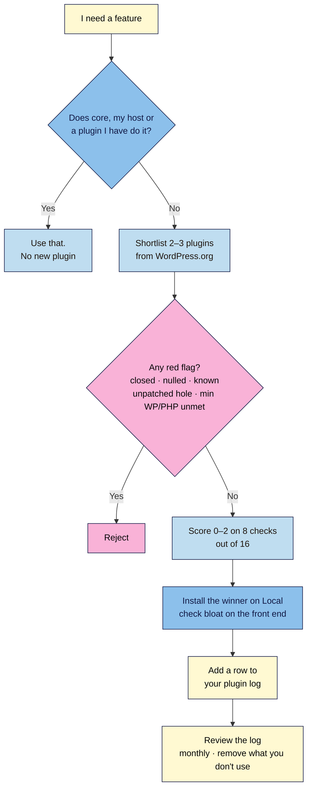

# M06.L01 — Choose plugins you can trust: the evaluation checklist
> After this lesson you can judge any plugin in five minutes from its directory page, decide whether you need it at all, and keep a log so you always know what's installed and why.

**Time:** ~12 min reading + ~20 min exercise · **Level:** beginner · **Prereqs:** M01–M05
**Verified against:** WordPress.org plugin directory and Plugins API (current WordPress release **7.1.4**), WordPress 7.0 Plugins screen, Fluent Forms 6.2.16, on 2026-10-31

> ⚠️ **Freshness flag:** the numbers in this lesson's tables (versions, installs, ratings, support replies) are a snapshot from 2026-10-31. They change every week. Always score from the live directory page.

## Learning objectives
1. **Evaluate** a plugin on last updated, tested-up-to version, active installs, ratings, support replies and bloat, using a 16-point checklist.
2. **Apply** the "one plugin per job" rule, and check whether WordPress core, your host or a plugin you already have does the job.
3. **Keep** a plugin log of what you installed, why and when.

## Why it matters
Sam needed a newsletter sign-up box. He installed the first plugin in the search results, then a second one "with nicer popups", then a third for a countdown timer. Six months later, one of them hadn't been updated in two years and was closed from the directory for a security issue, while the other two loaded their scripts on every page and slowed his site down. He couldn't remember which one actually connected to his email list. Plugins are the best and the riskiest part of WordPress: **each one is code from a stranger, running with full access to your site.** Choosing a few good ones, and writing down why, keeps your site fast, safe and easy to hand over.

## Core concept
**Plain version:** before you install a plugin, ask two questions:
1. **Do I need a new plugin at all?** WordPress core, your host or a plugin you already use may do the job. That's the **one plugin per job** rule from the course's plugin stack (M01): one plugin per job, and none if the job is already covered.
2. **Can I trust this one?** Its WordPress.org page tells you most of what you need: how recently it was updated, which WordPress version it's been tested with, how many sites use it, what users say, and whether support questions get answered.

**What the directory page shows** (right-hand **Details** box and below):
| Field | What it tells you |
|---|---|
| **Version** / **Last updated** | Is someone still working on it? |
| **Active installations** | How many sites use it (rounded: 500,000+) |
| **WordPress version** | The minimum it needs ("7.0 or higher") |
| **Tested up to** | The newest WordPress the developer says they've tested |
| **PHP version** | The minimum PHP it needs |
| **Ratings** | Average stars and how many reviews |
| **Support** | "Issues resolved in last two months: X out of Y" |

**Two warnings the directory shows for you** (exact wording, checked 2026-10-31):
- *"This plugin hasn't been tested with the latest 3 major releases of WordPress. It may no longer be maintained or supported and may have compatibility issues…"*
- *"This plugin has been closed as of [date] and is not available for download. Reason: …"* (e.g. **Security Issue**). If a plugin you use is closed, replace it.

**Analogy:** installing a plugin is like hiring a contractor who gets a key to your house. You'd check they're still in business (last updated), work to current building codes (tested up to), have lots of happy customers (installs, ratings) and return calls (support). You'd also keep a list of who has a key (your plugin log).

## How it works

**In words:** first check whether something you already have does the job. If not, shortlist two or three plugins, reject any with a red flag, score the rest, test the winner on Local (including what it loads on your pages), and log it. Review the log monthly and remove what you don't use.

## Hands-on walkthrough

### Part A — Does anything already do the job? (~3 min)
1. Write the **job** in one line, e.g. *"Add a newsletter sign-up form that sends subscribers to my email provider."*
2. Check, in this order:
   | Source | Already does (examples) |
   |---|---|
   | **WordPress core** | XML sitemap (M05), lazy-loading and responsive images (M03), Breadcrumbs block (M05.L04), Font Library (M04), Site Health, privacy policy page tool (M06), export/import, auto-updates, revisions |
   | **Your host** (check its dashboard and plan page) | Often: backups, caching/CDN, SSL, staging, malware scanning, sometimes email (SMTP) |
   | **Plugins you already have** | e.g. **Fluent Forms** (M04.L04) has a free **Mailchimp** integration, so a Mailchimp user can add sign-up forms with no new plugin. Your SEO plugin may already do breadcrumbs or redirects (M05.L02). |
3. **Expected:** either "already covered by ___" (stop here, no new plugin) or "not covered, shortlist plugins".

### Part B — Shortlist and check for red flags (~4 min)
4. On **Plugins → Add Plugin** (or wordpress.org/plugins), search the job (e.g. *newsletter*) and open 2–3 candidates' **WordPress.org pages** (click the plugin name, then **More Details**, or open the plugin page on wordpress.org).
5. Check your own versions in **Tools → Site Health → Info** (**WordPress** and **Server → PHP version**), as in M04.L01.
6. **Reject immediately** if any of these is true:
   - **Closed** ("This plugin has been closed…"), or downloaded from anywhere other than WordPress.org or the developer's own site. **Never** use "nulled" (pirated) premium plugins: they're a common way malware gets in.
   - A **known, unpatched vulnerability**: search the plugin's name in a free vulnerability database (Patchstack, Wordfence Intelligence or WPScan). A *fixed* past issue isn't a red flag if you'll run the fixed version.
   - Your site doesn't meet its minimum **WordPress** or **PHP** version.

### Part C — Score with the 16-point checklist (~6 min)
7. Score each remaining plugin (0–2 per row, **16 max**):

| Check | 2 | 1 | 0 |
|---|---|---|---|
| **Last updated** | ≤ 6 months ago | 6–12 months | > 12 months |
| **Tested up to** | Current major (7.1) | One major behind (7.0) | Two or more behind, or the "not tested" warning |
| **Active installations** | 10,000+ | 1,000–10,000 | < 1,000 |
| **Ratings** | 4★+ from 50+ reviews | 4★+ from fewer reviews, or 3–4★ | < 3★, or recent 1★ reviews about breakage/security |
| **Support** | Most recent issues resolved, with recent developer replies | Some replies | Mostly unanswered |
| **Bloat and upsells** | Loads files only where used; no nagging banners | Some extra files or notices | Loads scripts on every page, or constant upsell banners |
| **Security history** | No known issues, or past issues fixed quickly | Fixed, but slowly | Repeated or slow-to-fix issues |
| **Exit plan** | Easy to remove; your content and data stay usable | Leaves some leftovers (settings, shortcodes) | Removal breaks posts or loses data |

**Read the score:** **12–16** good choice · **8–11** use with care (note why) · **under 8** look for another.

**Worked example (2026-10-31, directory data only; check the live pages):**
| Plugin | Last updated | Tested up to | Installs | Rating | Support (last 2 months) |
|---|---|---|---|---|---|
| **MailPoet** (newsletters sent from WordPress) | 2026-10-27 | 7.1.4 | 500,000+ | 4.4★ (1,435) | 14 of 36 resolved |
| **Kit** (formerly ConvertKit; connects to Kit) | 2026-10-28 | 7.1.4 | 40,000+ | 4.8★ (90) | 1 of 1 resolved |
| **MC4WP: Mailchimp for WordPress** | 2026-09-16 | 7.1.4 | 1,000,000+ | 4.8★ (1,497) | 1 of 2 resolved |

From the directory alone, all three score 2 on Last updated, Tested up to, Installs and Ratings. Support needs a closer look: MailPoet has many open threads, so read a few to see whether they're real bugs or "how do I…" questions. The other three rows (bloat, security, exit) need your own checks in steps 8–9. The **job** decides the rest: if your list is on Kit, the Kit plugin fits; if you want to send email from WordPress itself, MailPoet; if you're on Mailchimp and already use Fluent Forms, you may need neither (Part A).

> **"Last updated" isn't everything:** on the same day, the official MailerLite plugin had been updated that week but was only **tested up to 6.8.12**, three majors behind. Score each row separately.

8. **Bloat check** (on Local, after installing): open a post that **doesn't** use the plugin, open your browser's DevTools (**F12**) → **Network**, reload, and filter by the plugin's folder name (e.g. `mailpoet`).
   **Expected (good):** no files, or one small file. **Bad:** several CSS/JS files on every page. Also look at the dashboard: new top-level menus, banners or "upgrade" notices count against it.

   > 🖼️ **Image prompt:** Screenshot of Chrome DevTools Network panel on a WordPress post, with the filter box containing a plugin folder name and the list showing the CSS and JS files that plugin loads, 1280 × 800. Highlight the filter box and file list with a 3px #F9B2D7 outline; blur any personal details.
   > **Alt text:** Browser DevTools Network panel filtered by a plugin's folder name, listing the files it loads on a post.

9. **Exit check:** read the plugin's FAQ or description for what happens on removal (are forms shortcodes or blocks? is subscriber data stored in WordPress or at the provider?). Deactivate it on Local and view a page that used it.
   **Expected (good):** the page still makes sense (the form disappears, but nothing else breaks), and your subscribers are safe at your provider or exportable.

### Part D — Start your plugin log (~4 min)
10. Create a **plugin log** in your site docs (a spreadsheet or Markdown table). One row per plugin, including the ones you already have:

| Plugin | Job | Why this one (score) | Version | Installed | Source | Auto-updates | Last reviewed | Notes / exit plan |
|---|---|---|---|---|---|---|---|---|
| Yoast SEO | SEO (titles, meta, sitemap, schema) | Most used; __/16 | 28.8 | 2026-10-31 | WordPress.org | On | 2026-10-31 | Settings stay in DB if removed |
| Redirection | Redirects + 404 log | Free redirects; __/16 | 5.10.1 | 2026-10-31 | WordPress.org | On | 2026-10-31 | Export redirects before removing |
| Fluent Forms | Contact form (+ Mailchimp) | M04.L04 | 6.2.16 | … | WordPress.org | On | … | Entries stored in WordPress |

(Fill in the scores and dates from your own checks.)

11. Go to **Plugins → Installed Plugins**. For each plugin, check that it's in your log and decide its **auto-updates** setting (**Enable auto-updates** / **Disable auto-updates** link in the **Automatic Updates** column). Auto-updates on is sensible for well-maintained plugins with good backups (M01); M07 covers update routines.
12. **Delete** any **inactive** plugin you don't need: inactive plugins still sit on your server and can still have vulnerabilities. Site Health flags this as *"You should remove inactive plugins"*.
    **Expected:** every installed plugin is active, has a job, and has a row in your log.

## When to use / when not to
- **Use** the checklist before **every** new plugin, including "quick tests". On Local, a test is fine; on a live site, only install what passed.
- **Use** the log whenever you install, update a major version, or remove a plugin, and review it monthly (M09's maintenance routine).
- **Don't** add a plugin for something you'll use once (a one-off import, a one-time image resize): use it on Local, or remove it straight after.
- **Don't** judge on installs alone: a huge plugin can still be the wrong fit for your job, and a small, well-maintained one can be perfect.
- **Trade-off:** an all-in-one plugin (e.g. Jetpack, which does many jobs) means fewer plugins to manage but more code and more features you don't use. Several focused plugins are lighter, but there are more things to update. Decide per job, and write the reason in your log.

## Use AI for this
**Example prompt:**
> "I need a WordPress plugin for this job: [one line]. My site runs WordPress [version] and PHP [version] and already uses [list from your plugin log]. Here are the WordPress.org details for three candidates: [paste Last updated, Tested up to, Installs, Rating, Support line for each]. Score each with this checklist: [paste the table]. Then tell me whether any plugin I already have might cover the job, and what I should check myself."

**What AI does well:** applying your checklist consistently, spotting overlap with plugins you already have, and drafting log rows.
**Where it gets it wrong:** it often recommends plugins from memory that are now closed, renamed or abandoned; it invents ratings and install counts; and it may not know about recent security issues.
**How to check:** use the numbers you pasted, not the AI's; open every suggested plugin's live WordPress.org page; search each name in a vulnerability database yourself.

## Common mistakes
- **Installing the first search result** without opening its page.
- **Trusting "Last updated" alone.** A plugin can be updated often yet not tested with recent WordPress versions, or tested but barely supported.
- **Two plugins for one job** (two form plugins, two SEO plugins, two caching plugins). They conflict and duplicate output.
- **Keeping inactive plugins "just in case".** Delete them; you can reinstall in a minute.
- **Nulled premium plugins** from "free download" sites. Malware risk, and no updates.
- **No record** of what each plugin does, so nobody dares remove anything later.
- **Ignoring the closed notice** on a plugin you already use. Closed plugins get no updates through WordPress.org; replace them.

## Troubleshooting
| Symptom | Likely cause | Fix |
|---|---|---|
| Plugin won't install: "requires a newer version of WordPress/PHP" | Your site is below its minimums | Update WordPress (M07) or ask your host to upgrade PHP; or choose another plugin |
| Site slower after installing | Plugin loads assets on every page | Check DevTools Network; look for a "load only where used" setting; or replace it |
| Dashboard full of banners | Upsell notices | Dismiss once; if they return constantly, count it against the plugin |
| A plugin's page says "closed" | Removed from the directory (often security) | Find a replacement, migrate, then delete it |
| White screen or errors after activating | Conflict or bug | Deactivate it (rename its folder via your host's file manager if you can't log in), restore your backup, report it (M07) |
| Can't remember why a plugin is installed | No log | Check its description and settings; if no job, deactivate on staging and test; log the result |

## Exercise
**Task:**
1. Write your email-capture **job** in one line, and check whether core, your host or a plugin you already have covers it.
2. Shortlist **two** email-capture plugins that fit your provider (e.g. Kit, MailPoet, MC4WP, Newsletter, MailerLite, Jetpack), check red flags, and **score both** with the 16-point checklist from today's live directory pages.
3. Install your winner on **Local**, run the bloat and exit checks, and adjust its score.
4. **Start your plugin log** with every plugin currently on your site, plus the winner. Delete any inactive plugins you don't need.

**Expected outcome:** a scoring table for two plugins (8 rows each, total /16) with the date you checked; a one-sentence decision (including "no new plugin needed" if Part A covered it); a plugin log with one row per installed plugin; no unused inactive plugins.

**Stretch goal:** look up one plugin from your log in a vulnerability database. Note any past issues, which version fixed them, and confirm you're on that version or newer.

## Key takeaways
- **First ask whether you need a plugin:** core, your host or a plugin you already have may do the job.
- Score candidates on **8 checks** (last updated, tested up to, installs, ratings, support, bloat, security history, exit plan). **12+/16** is a good choice.
- **Red flags mean no:** closed, nulled, a known unpatched vulnerability, or minimum WordPress/PHP not met.
- **One plugin per job**; delete inactive plugins.
- Keep a **plugin log** (job, why, version, dates, auto-updates, exit plan) and review it monthly.

## Teach it back
Explain to a friend in 3 sentences how to decide whether a plugin is safe to install, and why they should write down every plugin they add.

## Glossary terms added
- Tested up to — added to `wordpress-101/glossary.md`
- Closed plugin — added to `wordpress-101/glossary.md`
- Nulled plugin — added to `wordpress-101/glossary.md`
- Plugin bloat — added to `wordpress-101/glossary.md`
- Plugin log — added to `wordpress-101/glossary.md`

## Further reading
*All checked 2026-10-31.*
- WordPress.org — [Plugin directory](https://wordpress.org/plugins/) (details box, ratings, support forums, closed and untested notices)
- WordPress.org — [Managing plugins](https://wordpress.org/documentation/article/manage-plugins/) (install, activate, auto-updates, delete)
- WordPress.org Developer — [Detailed plugin guidelines](https://developer.wordpress.org/plugins/wordpress-org/detailed-plugin-guidelines/) (what directory plugins must follow, e.g. no tracking without consent)
- WordPress.org — [Site Health screen](https://wordpress.org/documentation/article/site-health-screen/)
- Vulnerability databases: [Patchstack](https://patchstack.com/database/) · [Wordfence Intelligence](https://www.wordfence.com/threat-intel/vulnerabilities/) · [WPScan](https://wpscan.com/plugins/)
