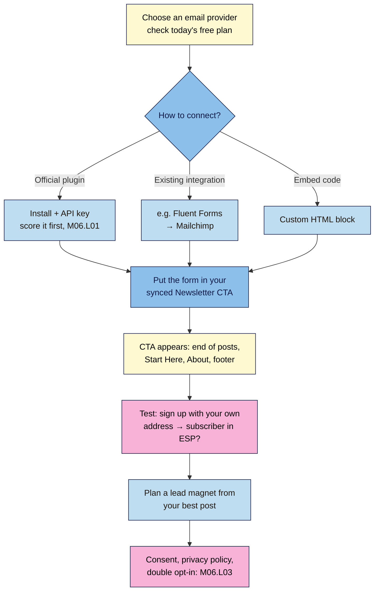

# M06.L02 — Email capture: forms, lead magnets and newsletter integrations
> After this lesson you can connect your email provider to WordPress, put a sign-up form in the places readers actually subscribe, and plan a small lead magnet that grows your list.

**Time:** ~13 min reading + ~25 min exercise · **Level:** beginner · **Prereqs:** M06.L01 (and the synced **Newsletter CTA** pattern from M02.L02)
**Verified against:** WordPress 7.0, Kit plugin 3.4.8, MailPoet 5.44.0, MC4WP 4.14.1, Fluent Forms 6.2.16 (Mailchimp integration); provider pricing pages (Kit, MailerLite, Mailchimp, Jetpack) and the MailPoet readme; Google Search Central "Avoid intrusive interstitials and dialogs" (updated 2025-12-10), all on 2026-10-31

> ⚠️ **Freshness flag:** email providers change free plans often. On 2026-10-31, MailerLite's and Mailchimp's free plans were smaller than many older guides say. Check the live pricing page before you choose.

> Note: this lesson connects a sign-up form; **consent wording, your privacy policy and double opt-in** are M06.L03. Don't launch a live form to real readers until you've done both lessons.

## Learning objectives
1. **Connect** your email provider to WordPress with its official plugin, an integration you already have, or embed code.
2. **Place** opt-in forms where readers are most likely to subscribe, without intrusive popups.
3. **Plan** a simple lead magnet that matches your best content.

## Why it matters
Ana had 20,000 monthly visitors from search and social, and almost no way to reach them again. When an algorithm change halved her traffic, she had nothing to fall back on. Jun had a tenth of the traffic but a sign-up box at the end of every post and a free "7-day meal-prep checklist" that matched his most popular post. His list grew every week, and each new post went straight to subscribers' inboxes. **Search and social traffic is rented; your email list is the audience you own.** The setup is a one-time job of about an hour.

## Core concept
**Plain version:** WordPress doesn't send newsletters well by itself. You use an **email service provider** (ESP: Kit, MailerLite, Mailchimp, MailPoet, Jetpack Newsletter…) that stores your subscribers, sends your emails and handles unsubscribes. WordPress's job is to **collect** sign-ups and pass them to the ESP.

**Three ways to connect them:**
| Method | How | Good when | Watch out |
|---|---|---|---|
| **Provider's plugin or block** | Install the official plugin, connect with an API key, add its block | Your ESP has a well-maintained plugin (score it, M06.L01) | One more plugin to keep updated |
| **An integration you already have** | e.g. **Fluent Forms** (M04.L04) → free **Mailchimp** integration | You already run a form plugin your ESP works with | Check the integration is in the free version |
| **Embed code** | Copy the ESP's HTML form into a **Custom HTML** block | No plugin wanted; any ESP works | Styling may not match your theme; test on mobile |

**Free plans on 2026-10-31 (from each provider's pricing page or readme):**
| Provider | Free plan | Notes |
|---|---|---|
| **Kit** | Up to **10,000** subscribers | Creator-focused; landing pages and forms |
| **MailPoet** | Up to **1,000** subscribers | Runs inside WordPress; free sending plan for small senders, or your own sending service |
| **MailerLite** | **250** subscribers, **2,500** emails/month | Forms, automations, landing page |
| **Mailchimp** | **250** contacts, max **500** sends/month | Paid plans for more |
| **Jetpack Newsletter** | Free to start | Sends your posts as emails; paid newsletters through a paid plan plus transaction fees; needs a WordPress.com connection |

**Where people subscribe** (*observed practice*, not Google statements): at the **end of a post** they found useful, **inline** in long guides, on your **Start Here**, **About** and **homepage**, and in the **footer**. A clear, specific promise ("One 10-minute recipe every Friday") converts better than "Subscribe to my newsletter".

**What Google says about popups:** intrusive interstitials and dialogs "make it hard for Google and other search engines to understand your content, which may lead to poor search performance", and frustrate readers. Google recommends **banners** that take a small part of the screen instead of full-page overlays. Inline forms avoid the problem entirely.

**A lead magnet** is a small, free, useful thing you give in exchange for an email address: a checklist, template, cheat sheet or short email course. The best ones are a **next step from your most popular post**, not a generic "free ebook".

**Analogy:** your blog is a shop on a busy street (search and social bring passers-by); your email list is the regulars' phone list. The sign-up form is the clipboard by the till, and the lead magnet is the free sample that makes people happy to write their number down.

## How it works

**In words:** choose a provider, connect it in one of three ways, and put the form inside your **synced Newsletter CTA**, so one edit updates every post, page and footer that uses it. Test a sign-up with your own address, then plan a lead magnet. Consent and double opt-in come next (M06.L03).

## Hands-on walkthrough
Work on your **Local** site. Have an account with one provider (a free plan is fine) and your synced **Newsletter CTA** pattern from M02.L02.

### Part A — Connect your provider (~8 min)
Pick **one** path:

**Path 1: Official plugin (Kit shown; others are similar)**
1. Score the plugin first (M06.L01). Then **Plugins → Add Plugin** → search **Kit** (formerly ConvertKit) → **Install Now** → **Activate**.
2. Follow its setup screen to connect your Kit account (sign in or paste your API key from your Kit account settings).
3. In Kit, create a simple **inline form** (email field + button) if you don't have one.
   **Expected:** the plugin shows your Kit forms in a dropdown; the editor now has a **Kit Form** block.
   *Other providers' blocks:* MailPoet → **MailPoet Subscription Form** (forms are built in MailPoet inside WordPress); MC4WP → **Mailchimp for WordPress Form**; Jetpack → **Subscribe** (needs a WordPress.com connection, so it won't work on Local).

**Path 2: Fluent Forms → Mailchimp (no new plugin)**
1. **Fluent Forms → Integrations** → enable **Mailchimp**, open its settings and paste your **Mailchimp API Key** (from your Mailchimp account's API keys page).
2. Create a new form with just **Email** (and optionally **First name**) and a button such as *Send me the Friday recipe*.
3. In the form's **Settings & Integrations → Configure Integrations**, click **Add New Integration** → **Mailchimp Feed**: choose your audience (list) and map the **Email** field.
   **Expected:** the feed shows as enabled; the form can be inserted with the **Fluent Forms** block.

**Path 3: Embed code**
1. In your provider, create an embedded (inline) form and copy its **HTML embed code**.
2. In WordPress you'll paste it into a **Custom HTML** block (Part B). Only administrators can save unfiltered HTML on a normal site, which is fine for you.
   **Expected:** in the editor, **Preview** in the Custom HTML block shows the form.

### Part B — Put the form in your synced Newsletter CTA (~6 min)
4. Open the pattern: **Appearance → Editor → Patterns** → **My patterns** → **Newsletter CTA** (or select it in any post and choose **Edit original**).
5. Rewrite the heading and one line as a **specific promise** (what, how often, for whom), e.g. *"One tested 20-minute dinner every Friday. Join 1,200 home cooks."* Use a real number only if it's true; otherwise leave it out.
6. Replace the old button or placeholder with your form: the provider's block (**Kit Form**, **MailPoet Subscription Form**, **Mailchimp for WordPress Form**), a **Fluent Forms** block, or a **Custom HTML** block with your embed code. Save.
   **Expected:** because the pattern is **synced**, every place you inserted it updates: the end of your posts (Single Posts template, M04 capstone), the footer (M04.L03), Start Here and About (M04.L04).

   > 🖼️ **Image prompt:** Screenshot of the end of a blog post in Twenty Twenty-Five showing the synced Newsletter CTA with a heading "One tested 20-minute dinner every Friday", one line of text, an email field and a "Send me the Friday recipe" button, 1280 × 800. Highlight the form with a 3px #F9B2D7 outline; blur any personal details.
   > **Alt text:** A newsletter sign-up box at the end of a post with a specific promise, an email field and a button.

7. For a **long guide** (like your M05 cornerstone post), also insert the pattern **once in the middle**, after a section where the reader has had a win. Don't add more than one inline form per post.
8. **Mobile check** (M04.L05): view a post at 320 px. The form is readable, the email field and button are big enough to tap, and nothing covers the content.

### Part C — Test a sign-up (~4 min)
9. In a private window, sign up with an address you own. Tip: many email services accept *you+test@example.com*, so you can test repeatedly with one inbox.
   **Expected:** the form shows a success message, and the address appears in your provider's subscriber list (and in **Fluent Forms → Entries** for Path 2). If your provider uses **double opt-in**, you'll get a confirmation email first (M06.L03).
10. Delete the test subscriber in your provider so it doesn't skew your numbers.

### Part D — Plan a lead magnet (~6 min)
11. Find your **best content**: your most-visited post (Search Console **Performance** on a live site, M05.L05, or your own judgement on Local) or your M05 cornerstone post.
12. Ask: *what would a reader of that post want next?* Pick a format you can make in an afternoon:
    | Your best post | Lead magnet idea | Format |
    |---|---|---|
    | *Easy miso ramen in 20 minutes* | 5 weeknight ramen variations + shopping list | 2-page PDF |
    | *How to repot a snake plant* | Seasonal houseplant care calendar | 1-page printable |
    | *Best budget podcast mics* | Podcast setup checklist (gear + settings) | Checklist |
    | *Freelance invoice tips* | Invoice and late-payment email templates | Doc template |
13. Write a **one-page outline**: title (a specific outcome), who it's for, 3–7 sections or items, format and length, how it's delivered (the provider's **welcome email** with a download link, or an **incentive/thank-you** setting in your ESP), and where you'll offer it (the post it came from, Start Here, the CTA).
    **Expected:** an outline you could hand to a friend to build. Don't promise the magnet on the live form until it exists and M06.L03 is done.

## When to use / when not to
- **Use** one email capture route for the whole site: one ESP, one form method, one synced CTA. Two newsletter plugins are two plugins for one job (M06.L01).
- **Use** inline and end-of-post forms first; they don't interrupt anyone.
- **Use** a popup only if it's small, delayed (e.g. after reading most of a post or on exit), easy to close and not on arrival on mobile. Google's guidance is to prefer banners over overlays.
- **Don't** pick an ESP on free-plan size alone. Check you can **export** your subscribers (CSV) if you move later, and that its WordPress connection scores well.
- **Trade-off:** MailPoet keeps everything inside WordPress (no extra account, but your site does more work and you handle sending reliability). A hosted ESP (Kit, MailerLite, Mailchimp) keeps WordPress light and handles delivery, but it's another service with its own pricing changes.

## Use AI for this
**Example prompt:**
> "My blog is about [niche] for [audience]. My most popular post is [title + one-line summary]. Suggest 5 lead magnet ideas a reader of that post would want next, each one I could make in an afternoon. For the best one, write a one-page outline: title, who it's for, 5 sections, format, and a one-sentence promise for my sign-up form. Use plain language and no hype."

**What AI does well:** brainstorming lead magnet angles, turning a post into a checklist outline, and sharpening a vague CTA into a specific promise.
**Where it gets it wrong:** it quotes out-of-date free-plan limits, invents subscriber numbers or conversion rates ("forms convert 5%"), suggests aggressive popups, and may write consent text that isn't right for your country (M06.L03).
**How to check:** confirm every provider fact on its live pricing page; keep only claims you can stand behind; use your own real numbers or none.

## Common mistakes
- **A vague promise** ("Subscribe for updates"). Say what readers get, how often, and for whom.
- **Two newsletter plugins** or forms from two providers. Pick one route.
- **Full-screen popups on arrival**, especially on mobile. Annoying, and Google says intrusive interstitials can hurt search performance.
- **Unsynced copies** of the CTA pasted into each post: one change then means editing every post. Use the synced pattern.
- **Never testing** the form, or testing only on desktop.
- **A generic lead magnet** ("my free ebook") that doesn't connect to what people came for.
- **Promising a lead magnet that doesn't exist yet**, or delivering it without a welcome email.
- **Ignoring consent and double opt-in** (M06.L03).

## Troubleshooting
| Symptom | Likely cause | Fix |
|---|---|---|
| Form submits but no subscriber appears | Wrong list/audience/form selected, API key wrong, or double opt-in waiting for confirmation | Check the plugin/integration settings and the provider's "unconfirmed" list; confirm the test email |
| Jetpack Subscribe block doesn't work on Local | Jetpack needs a WordPress.com connection (offline on Local) | Test on a live site, or use another route on Local |
| Custom HTML form shows as code or is stripped | Your account can't post unfiltered HTML, or the code was pasted into a Paragraph block | Use the **Custom HTML** block as an administrator; or use the provider's plugin |
| Form looks broken on mobile | Embed code with fixed widths | Use the provider's block or plugin, or edit the embed's style in your provider |
| CTA change didn't appear everywhere | Some copies aren't the synced pattern (detached) | Replace them with the synced **Newsletter CTA** |
| Spam sign-ups | Bots | Turn on the provider's/form's spam protection (honeypot, Turnstile/reCAPTCHA) and double opt-in (M06.L03) |

## Exercise
**Task:**
1. Choose your ESP (or confirm your current one) and record today's free-plan limits and its export option.
2. Connect it to WordPress with **one** route (official plugin, existing integration, or embed code), scoring any new plugin with M06.L01's checklist and adding it to your plugin log.
3. Add the form to your synced **Newsletter CTA** with a specific promise, and check it appears at the end of posts, on Start Here and in the footer.
4. Test one sign-up on mobile and desktop; delete the test subscriber.
5. Write a **one-page lead magnet outline** based on your best post.

**Expected outcome:** one working opt-in route; the synced CTA with a specific promise showing in at least three places; a successful test sign-up recorded in your provider; a plugin log row (if you added a plugin); a lead magnet outline (title, audience, sections, format, delivery, placement).

**Stretch goal:** set up the welcome email in your provider (one short email: thanks, what to expect, link to your Start Here page). Leave the lead magnet link out until the file exists.

## Key takeaways
- Your **email list is the audience you own**; search and social traffic can disappear.
- Connect your ESP with **one** route: official plugin, an integration you already have (e.g. Fluent Forms → Mailchimp), or embed code.
- Put the form in your **synced Newsletter CTA**, so it appears at the end of posts, on Start Here, About and the footer, and one edit updates all.
- Prefer **inline forms**; Google warns that intrusive interstitials can hurt search performance.
- A good **lead magnet** is a small next step from your most popular post, delivered by a welcome email.

## Teach it back
Explain to a friend in 3 sentences why a blogger needs an email list, where the sign-up form should go, and what makes a good lead magnet.

## Glossary terms added
- Email service provider (ESP) — added to `wordpress-101/glossary.md`
- Opt-in form — added to `wordpress-101/glossary.md`
- Lead magnet — added to `wordpress-101/glossary.md`
- Intrusive interstitial — added to `wordpress-101/glossary.md`
- Welcome email — added to `wordpress-101/glossary.md`

## Further reading
*All checked 2026-10-31.*
- Google Search Central — [Avoid intrusive interstitials and dialogs](https://developers.google.com/search/docs/appearance/avoid-intrusive-interstitials) (updated 2025-12-10)
- Pricing pages: [Kit](https://kit.com/pricing) · [MailerLite](https://www.mailerlite.com/pricing) · [Mailchimp](https://mailchimp.com/pricing/marketing/) · [Jetpack Newsletter](https://jetpack.com/newsletter/) · MailPoet free plan: [WordPress.org readme](https://wordpress.org/plugins/mailpoet/)
- WordPress.org plugin pages: [Kit](https://wordpress.org/plugins/convertkit/) · [MailPoet](https://wordpress.org/plugins/mailpoet/) · [MC4WP](https://wordpress.org/plugins/mailchimp-for-wp/) · [Fluent Forms](https://wordpress.org/plugins/fluentform/)
- WordPress.org — [Custom HTML block](https://wordpress.org/documentation/article/custom-html/) · [Patterns (synced)](https://wordpress.org/documentation/article/reusable-blocks/)
