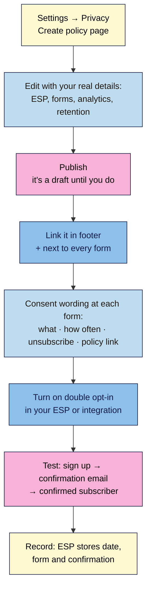

# M06.L03 — Lawful capture: privacy policy, consent wording and double opt-in
> After this lesson your sign-up form tells people exactly what they're signing up for, links to a real privacy policy, and confirms every new subscriber by email, so your list is clean and you can prove consent.

**Time:** ~12 min reading + ~20 min exercise · **Level:** beginner · **Prereqs:** M06.L02
**Verified against:** WordPress 7.0 (**Settings → Privacy**), Fluent Forms 6.2.16, MailPoet 5.44.0, MC4WP 4.14.1; GDPR Article 7, UK ICO electronic mail marketing guidance, FTC CAN-SPAM compliance guide, Canada's CASL guidance (CRTC/ISED), all on 2026-10-31

> ⚠️ **Not legal advice.** This lesson explains common rules for small creators in plain language. Laws differ by country and change (the UK added a new charity "soft opt-in" in February 2026, for example). If you sell to many countries, run a business with staff, or handle sensitive data, check your regulator's guidance or ask a lawyer.

## Learning objectives
1. **Generate and customise** a privacy policy page with WordPress's built-in privacy tools.
2. **Write** clear consent wording next to every form.
3. **Explain** when double opt-in is required or recommended (GDPR and similar laws).

## Why it matters
Lena added a sign-up box, imported 300 email addresses from her old work contacts, and sent her first newsletter. Within a week, a dozen people reported it as spam, her email provider paused her account, and someone asked "where did you get my email?". She had no privacy policy and no record of who had agreed to what. Ravi's form said exactly what he'd send and how often, linked to his privacy policy, and sent a "please confirm" email. His list was smaller at first, but everyone on it wanted to be there, and when a reader asked, he could show the date and time they confirmed. **An email address is personal data. Collecting it lawfully is also how you keep your emails out of spam folders.**

## Core concept
**Plain version:** three things make email capture lawful and trustworthy:
1. **A privacy policy page** that says what you collect, why, who processes it (e.g. your email provider), how long you keep it, and how people can see or delete their data.
2. **Clear consent wording** at the form: what they'll get, how often, that they can unsubscribe any time, and a link to the policy. No hidden extras, no pre-ticked boxes.
3. **Double opt-in (confirmed opt-in):** after signing up, the person gets an email and must click to confirm. Only then are they added. It proves the address is real and belongs to the person who signed up.

**What the main laws say** (*summary; check your own country*):
| Law | Where | Consent for newsletter email? | Key rules |
|---|---|---|---|
| **GDPR** (+ ePrivacy rules) | EU/EEA | Yes, for marketing to individuals (with a similar existing-customer exception to the UK's) | Consent must be a clear, informed choice; you "shall be able to demonstrate" consent (Art. 7); withdrawing must be "as easy" as giving it |
| **UK GDPR + PECR** | UK | Yes, for individuals (a "soft opt-in" exception covers people who gave you their details during a sale or negotiation, for your own similar products, if they could opt out then and in every email) | The ICO says no pre-ticked boxes, silence or inactivity as consent |
| **CAN-SPAM** | USA | No prior consent required | Accurate sender, honest subject, a valid **postal address**, a working unsubscribe, honour opt-outs within **10 business days** |
| **CASL** | Canada | Yes (express or limited implied consent) | You must be able to prove consent; unsubscribe works for 60 days and is processed within **10 business days** |

**So is double opt-in legally required?** GDPR and CASL don't name it, but both say **you must be able to prove consent**, and double opt-in is the most common way to do that. In some countries it's treated as the expected standard in practice (Germany is the example most often given; *observed practice, not a rule in the GDPR text*). Everywhere, it keeps fake and mistyped addresses off your list. **Recommendation for this course: turn it on.** The cost is that some people never click the confirmation email (so tell them to check their inbox).

**What WordPress gives you:** **Settings → Privacy** creates a starter **Privacy Policy** page with suggested headings (*Who we are, Comments, Media, Cookies, Embedded content from other websites, Who we share your data with, How long we retain your data, What rights you have over your data, Where your data is sent*) and a **Policy Guide** tab (the **Privacy Policy Guide**) with text suggested by WordPress and your plugins. **Tools → Export Personal Data** and **Tools → Erase Personal Data** help you answer data requests.

**Analogy:** a sign-up form is like a guest list at a private event. The consent wording is the invitation (what, when, how to leave), the privacy policy is the house rules on the door, and double opt-in is the RSVP: you only count people who actually replied.

## How it works

**In words:** create the policy page, fill in your real details and **publish** it, link it in your footer and beside every form, add consent wording to each form, turn on double opt-in, then test one sign-up end to end.

## Hands-on walkthrough
Work on **Local** first; repeat Parts A–C on your live site before you promote your form.

### Part A — Create and customise your privacy policy (~10 min)
1. Go to **Settings → Privacy**. Under **Create a new Privacy Policy page**, click **Create**. (If you already have one, choose it under **Change your Privacy Policy page** → **Use This Page**.)
   **Expected:** the editor opens a page called **Privacy Policy** with suggested headings and grey "Suggested text" notes. **It's saved as a draft**, so nobody can see it yet.
2. Open the **Policy Guide** tab at the top of **Settings → Privacy** (the **Privacy Policy Guide** screen) in another browser tab. It lists suggested text from WordPress and from plugins that add their own (forms, SEO, email plugins).
3. Edit each section with **your** facts, in plain language. Delete sections that don't apply and suggested-text notes once you've used them. Use this checklist:
   | Section | Write about |
   |---|---|
   | **Who we are** | Your name or brand, site address, how to contact you (email) |
   | **What you collect and why** | Newsletter: email (and first name), to send the newsletter you asked for. Contact form (M04.L04): name, email, message, to reply. Comments: what WordPress stores |
   | **Who we share your data with** | Your email provider by name (e.g. *Kit*, *Mailchimp*), your host, analytics (M08), anti-spam services |
   | **Where your data is sent** | Countries your providers store data in (check their privacy pages) |
   | **How long we retain your data** | e.g. subscribers until they unsubscribe; contact entries 12 months; comments indefinitely |
   | **What rights you have** | See, correct, export or delete your data; unsubscribe any time; how to ask; your right to complain to your regulator |
   | **Cookies** | What your site sets (login cookies, analytics, embeds). M08 covers cookie consent |
4. Add a **Last updated:** date at the top. Click **Publish**.
   **Expected:** **Settings → Privacy** now offers **Edit** or **view** links for your published page, and WordPress shows a **Privacy Policy** link on the login page automatically.

   > 🖼️ **Image prompt:** Screenshot of WordPress Settings → Privacy showing "Change your Privacy Policy page" with the dropdown set to "Privacy Policy" and the Use This Page button, plus the Edit/view links, 1280 × 800. Highlight the dropdown and button with a 3px #F9B2D7 outline; blur any personal details.
   > **Alt text:** WordPress Privacy settings with the Privacy Policy page selected and links to edit or view it.

5. **Link it in the footer** (M04.L03): **Appearance → Editor → Patterns → Footer** (or your footer template part), add a link to **Privacy Policy** next to your other legal links. Save.
   **Expected:** every page's footer shows **Privacy Policy**, and the link opens the published page (not a 404).

### Part B — Write consent wording for every form (~5 min)
6. Write wording that answers four questions: **what** they'll get, **how often**, that they can **unsubscribe** any time, and **where** to read more. Example for your Newsletter CTA:
   > *Get one tested 20-minute dinner every Friday. No spam; unsubscribe any time. Read our [Privacy Policy](/privacy-policy/).*
7. Put it **directly under the button** in your synced **Newsletter CTA** (M06.L02), so it updates everywhere.
8. If your form also offers a **lead magnet**, say both parts clearly: *"Get the free ramen shopping list and the Friday recipe email."* Don't hide the newsletter behind a "free download" button.
9. For **separate purposes** (e.g. newsletter *and* occasional product offers), use a separate, **unticked** checkbox for each. With Fluent Forms, add a **GDPR Agreement** or checkbox field; never pre-tick it.
10. Your **contact form** (M04.L04) isn't a newsletter sign-up: don't add people who contact you to your list unless they tick a separate box. Add a line such as *"We use your details only to reply. See our Privacy Policy."*
    **Expected:** every form on your site shows what happens to the data and links to the policy.

### Part C — Turn on double opt-in (~5 min)
11. Find the setting for your route from M06.L02:
    | Route | Where to turn it on |
    |---|---|
    | **Fluent Forms → Mailchimp** | In the form's **Mailchimp Feed**: tick **Enable Double Opt-in** ("Mailchimp will send a confirmation email … and will only add them … upon confirmation") |
    | **MC4WP** | **MC4WP** menu → your sign-up form → **Settings** tab: **Use double opt-in?** → **Yes** (it's on by default; make sure nobody switched it off) |
    | **MailPoet** | **MailPoet → Settings → Sign-up Confirmation**: **Enable sign-up confirmation** |
    | **Kit, MailerLite, others** | In the provider's form or list settings: look for "double opt-in", "confirmation email" or "incentive email" (names change; check the provider's help page) |
12. Edit the **confirmation email** if your provider allows it: say who you are, what they signed up for, and "click to confirm". Edit the form's **success message** too: *"Almost done! Check your inbox and click the link to confirm."*
13. **Test** in a private window with an address you own.
    **Expected:** the form shows your "check your inbox" message → a confirmation email arrives (check spam) → after clicking, the address shows as **subscribed/confirmed** in your provider. Before you click, it should show as **pending/unconfirmed** or not appear at all.
14. Look at the subscriber's record in your provider: most show the **sign-up date**, **form/source** and **confirmation time** (sometimes IP). That's your proof of consent. Delete the test subscriber.

## When to use / when not to
- **Use** double opt-in for every newsletter form; it's the simplest way to prove consent and keep your list clean.
- **Use** the policy link and consent line on **every** form, including popups, lead-magnet pages and comments (M06.L04).
- **Don't** import contacts who never signed up (old work contacts, business cards, a bought list). In the EU/UK/Canada that usually breaks the law; everywhere it hurts deliverability.
- **Don't** copy another site's privacy policy or an AI-written one without checking every line against what your site really does.
- **Trade-off:** double opt-in loses some sign-ups (people who don't click). Reduce it with a clear "check your inbox" message and a confirmation email with a plain subject line.

## Use AI for this
**Example prompt:**
> "Help me write a plain-language privacy policy for my blog. Facts: I'm [name], based in [country]. I collect: newsletter email and first name via [ESP], contact form name/email/message via Fluent Forms (stored in WordPress), comments, and [analytics]. My host is [host]. Subscribers are kept until they unsubscribe; contact entries for 12 months. Use these headings: [paste WordPress's headings]. Don't add anything I haven't listed; mark anything you're unsure about with [CHECK]."

**What AI does well:** turning your facts into readable sections, and drafting short consent lines and confirmation emails.
**Where it gets it wrong:** it invents services you don't use, claims legal compliance it can't guarantee, mixes up laws (e.g. says CAN-SPAM requires opt-in consent), and copies boilerplate that doesn't match your site.
**How to check:** compare every sentence to your plugin log (M06.L01) and your provider's settings; check legal points against your regulator's guidance; remove every [CHECK] before publishing.

## Common mistakes
- **Creating the privacy page but never publishing it.** **Create** saves a draft; footer links then go to a 404 for visitors.
- **Leaving the suggested-text notes and placeholders** in the published policy.
- **Pre-ticked boxes** or "by downloading you agree to our newsletter" hidden in small print.
- **Not naming your email provider** in the policy. Readers have a right to know who processes their data.
- **Turning off double opt-in** to grow faster, then getting spam complaints and bounces.
- **Adding contact-form senders or customers to the list** without a separate opt-in.
- **No postal address in your emails** (CAN-SPAM). Most ESPs require one in the footer; use a PO box or a virtual address if you don't want to show your home.
- **Never updating the policy** after adding a plugin, analytics or a new provider.

## Troubleshooting
| Symptom | Likely cause | Fix |
|---|---|---|
| Privacy Policy link gives a 404 | Page still a draft, or trashed | Publish it; **Settings → Privacy** warns if the page is missing or in the Trash |
| No confirmation email arrives | In spam/Promotions; wrong address; double opt-in not actually enabled | Check spam; re-check the setting from step 11; test with another inbox |
| Subscriber stuck as "pending" | They haven't clicked the confirmation link | Normal; the provider adds them only after they confirm. Don't add them manually |
| Lots of sign-ups that never confirm | Bots, or confirmation email looks like spam | Add spam protection (M06.L04); make the email's subject and sender clear |
| Policy lists plugins you've removed | Policy not updated | Review the policy each time you update your plugin log |
| Someone asks for their data or to be deleted | A data subject request | **Tools → Export Personal Data** / **Erase Personal Data** for WordPress data, plus your provider's own export/delete tools |

## Exercise
**Task:**
1. Create your privacy policy with **Settings → Privacy**, customise every section for your site (naming your email provider), add a "Last updated" date and **publish** it.
2. Link it in your footer and confirm it opens on desktop and mobile.
3. Add consent wording under your synced **Newsletter CTA** and a privacy line to your contact form.
4. Turn on **double opt-in** for your sign-up route, edit the success message, and test one sign-up from form to confirmed subscriber.

**Expected outcome:** a published Privacy Policy page linked in the footer and beside every form; consent wording that states what, how often, unsubscribe and the policy link; double opt-in on, with a test subscriber that went from pending to confirmed (then deleted); a note in your plugin log of where the double opt-in setting lives.

**Stretch goal:** look up your own country's email-marketing rule on your regulator's site (e.g. the ICO in the UK, the FTC in the US, the CRTC in Canada) and write one sentence in your site docs on what it requires.

## Key takeaways
- An email address is **personal data**: you need a published **privacy policy**, clear **consent wording** and a record of consent.
- **Settings → Privacy → Create** gives you a starter policy, but it's a **draft** until you customise and publish it.
- Consent wording says **what, how often, unsubscribe any time**, and links to the policy. No pre-ticked boxes.
- **Double opt-in** isn't named in most laws, but it's the easiest way to **prove** consent and keep your list clean. Turn it on.
- US law (CAN-SPAM) doesn't require prior consent, but does require honest emails, a postal address and fast unsubscribes; EU, UK and Canadian law require consent.

## Teach it back
Explain to a friend in 3 sentences what a sign-up form must say, why their site needs a privacy policy, and what double opt-in is for.

## Glossary terms added
- Privacy policy — added to `wordpress-101/glossary.md`
- Consent (email marketing) — added to `wordpress-101/glossary.md`
- Double opt-in (confirmed opt-in) — added to `wordpress-101/glossary.md`
- Soft opt-in — added to `wordpress-101/glossary.md`
- Personal data — added to `wordpress-101/glossary.md`

## Further reading
*All checked 2026-10-31. Laws change: read the current version on the regulator's site.*
- WordPress.org — [Privacy screen](https://wordpress.org/documentation/article/settings-privacy-screen/)
- EU — [GDPR Article 7: Conditions for consent](https://gdpr-info.eu/art-7-gdpr/) (unofficial consolidated text; the official text is on EUR-Lex)
- UK ICO — [Guidance on direct marketing using electronic mail](https://ico.org.uk/for-organisations/direct-marketing-and-privacy-and-electronic-communications/guidance-on-direct-marketing-using-electronic-mail/) · [Electronic mail marketing (PECR)](https://ico.org.uk/for-organisations/direct-marketing-and-privacy-and-electronic-communications/guide-to-pecr/electronic-and-telephone-marketing/electronic-mail-marketing/)
- US FTC — [CAN-SPAM Act: A Compliance Guide for Business](https://www.ftc.gov/business-guidance/resources/can-spam-act-compliance-guide-business)
- Canada — [CRTC: FAQ about Canada's Anti-Spam Legislation](https://crtc.gc.ca/eng/com500/faq500.htm) · [ISED: Getting consent to send email](https://ised-isde.canada.ca/site/canada-anti-spam-legislation/en/getting-consent-send-email)
