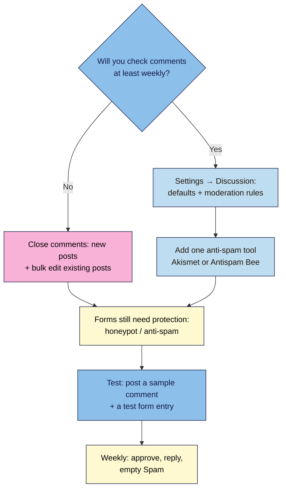

# M06.L04 — Comments, community and spam control
> After this lesson you've decided whether your site has comments, set moderation rules you can keep up with, and put one anti-spam tool in front of your comments and forms.

**Time:** ~11 min reading + ~15 min exercise · **Level:** beginner · **Prereqs:** M01.L04 (first Discussion settings), M06.L01 (plugin checklist)
**Verified against:** WordPress 7.0 (**Settings → Discussion**, Comments screen, bulk edit), Akismet 5.7.2, Antispam Bee 2.11.13, Fluent Forms 6.2.16; Google Search Central "Prevent user-generated spam" (updated 2026-10-26), all on 2026-11-01

> ⚠️ **Freshness flag:** anti-spam plugins change pricing and features. On 2026-11-01, Akismet's readme said keys are "free for personal blogs; paid subscriptions are available for businesses and commercial sites". Check the current terms if your site earns money (M06.L06).

## Learning objectives
1. **Decide** whether to enable comments based on your goals and moderation time.
2. **Configure** discussion settings and moderation rules.
3. **Set up** one anti-spam solution for comments and forms.

## Why it matters
Theo left comments open on his recipe blog and stopped checking them. A month later he had 2,000 comments waiting, almost all spam ("great post! visit my casino"), and three real questions from readers he'd never answered. A few spam comments had been approved by accident, with links to dodgy sites under his best post. Ines turned comments on only for her recipe posts, required approval for first-time commenters, added Akismet, and checked the queue every Monday for ten minutes. Her comment sections became a place where readers swapped tips, and those tips gave her ideas for new posts. **Comments are a community feature that needs a gardener. If you can't tend them, close them.**

## Core concept
**Plain version:** comments let readers talk to you and each other under a post. They can build loyalty, answer each other's questions and suggest new posts. But open comment forms attract automated spam, and anything you publish on your page reflects on you, including what visitors write.

**Three questions decide it:**
| Question | If yes | If no |
|---|---|---|
| Will readers have something to add (questions, tips, results)? | Comments can help | A contact form or email reply may be enough |
| Can you check the queue at least **once a week**? | Comments are workable | Close them, or only open them on chosen posts |
| Do you have another place for community (newsletter replies, a social group)? | Comments are optional | Comments may be your main community space |

**Your three tools in WordPress** (*Settings → Discussion*):
- **Defaults for new posts:** whether comments are allowed, pingbacks/trackbacks, name and email required, closing comments after N days.
- **Moderation:** **Comment must be manually approved**, or **Comment author must have a previously approved comment** (first-timers wait, regulars go straight through); hold comments with **N or more links**; **Comment Moderation** words (hold for review) and **Disallowed Comment Keys** (straight to Trash).
- **Per post:** each post's **Discussion** panel in the editor can allow or close comments for that post only.

**Anti-spam:** WordPress's settings slow spam down; an **anti-spam plugin** filters most of it automatically. Pick **one**:
| Tool | How it works | Cost (2026-11-01) | Privacy note |
|---|---|---|---|
| **Akismet** (by Automattic) | Sends each comment/form entry to Akismet's servers to check against a global spam database | Free for personal blogs; paid for commercial sites | Data goes to a third party; add it to your privacy policy (M06.L03) |
| **Antispam Bee** | Checks on your own server ("without captchas and without sending personal information to third party services") | Free | Nothing sent to an outside service |
| **Your form plugin's own protection** | e.g. Fluent Forms: **Enable Honeypot Security**, plus optional reCAPTCHA, hCaptcha or Turnstile | Free | CAPTCHA services are third parties; the honeypot isn't |

**What Google says:** Google's "Prevent user-generated spam" guidance recommends moderation ("a very effective way of fighting spam") and adding `nofollow` or `ugc` to links in untrusted content. **WordPress already adds `rel="nofollow ugc"` to links in comments**, so you don't need a plugin for that. The job left is keeping spam off your pages.

**Analogy:** comments are a guest book at your shop counter. Moderation is you glancing at each new entry before others see it; anti-spam is the doorman who stops the people handing out flyers before they reach the book.

## How it works

**In words:** decide honestly whether you'll check comments weekly. If not, close them on new and existing posts. If yes, set Discussion defaults and moderation rules and add one anti-spam tool. Either way, protect your forms, test once, and keep a weekly routine.

## Hands-on walkthrough
Work on your **Local** site.

### Part A — Decide and set your defaults (~4 min)
1. Answer the three questions above and write your decision in one line in your site docs, e.g. *"Comments on, recipe posts only, checked Mondays."*
2. Go to **Settings → Discussion** and check the defaults you set in M01.L04:
   - **Attempt to notify any blogs linked to from the post** and **Allow link notifications from other blogs (pingbacks and trackbacks) on new posts**: unticked.
   - **Allow people to submit comments on new posts**: ticked if your decision is "on"; unticked if "off".
   - **Comment author must fill out name and email**: ticked.
   - **Show comments cookies opt-in checkbox, allowing comment author cookies to be set**: ticked. It lets commenters choose whether their name and email are remembered, which fits the consent rules from M06.L03.
   - **Automatically close comments on old posts**: tick it and set **Close comments when post is how many days old** to 30–90 if older posts mostly attract spam. Leave it off if readers still ask useful questions on old posts.
3. Note the line under these settings: *"Individual posts may override these settings. Changes here will only be applied to new posts."* Existing posts keep their current setting (Part D fixes that).

### Part B — Moderation rules (~4 min)
4. Under **Before a comment appears**, choose **one**:
   - **Comment author must have a previously approved comment** (recommended): first-timers wait for you; people you've approved before go straight through.
   - **Comment must be manually approved**: everything waits. Safer, but more work.
5. **Comment Moderation:** keep **Hold a comment in the queue if it contains 2 or more links** (spam is mostly links). In the box, add a few words that should always be held for review, one per line (e.g. `casino`, `crypto`, `loan`).
6. **Disallowed Comment Keys:** add only words you're **sure** are never legitimate. Matching comments go **straight to Trash** with no notice, and WordPress matches inside words, so a short word like `ass` would also catch *class* and *passion*.
7. Under **Email me whenever**, tick **A comment is held for moderation** so you see new comments waiting.
8. **Save Changes.**
   **Expected:** "Settings saved."

   > 🖼️ **Image prompt:** Screenshot of WordPress Settings → Discussion showing "Before a comment appears" with "Comment author must have a previously approved comment" ticked and the Comment Moderation box with a few words and the "2 or more links" setting, 1280 × 800. Highlight these settings with a 3px #F9B2D7 outline; blur any personal details.
   > **Alt text:** Discussion settings with approval for first-time commenters and a comment moderation word list.

### Part C — Add one anti-spam tool (~4 min)
9. Score your choice with the M06.L01 checklist (snapshot 2026-11-01: **Akismet** 5,000,000+ installs, 4.7★; **Antispam Bee** 700,000+ installs, 4.8★; both tested up to 7.1.4). Add it to your **plugin log**.
10. **Akismet:** **Plugins → Add Plugin** → **Akismet Anti-spam** → **Install Now** → **Activate**. Go to **Settings → Akismet Anti-spam** → **Set up your Akismet account** (or **Manually enter an API key**). Choose the plan that fits your site (personal or commercial) and connect.
    Then set **Strictness** to **Always put spam in the Spam folder for review.** for your first weeks, and **Privacy** to **Display a privacy notice under your comment forms.**
    **Or Antispam Bee:** install and activate it, then go to **Settings → Antispam Bee** and keep the defaults; it works without an account.
11. **Forms:** Akismet can also check some form plugins: Fluent Forms has its own Akismet option in its global settings, which works once Akismet is active and connected. For Fluent Forms, open **Fluent Forms → Global Settings** and turn on **Enable Honeypot Security** (an invisible field that humans never fill in but bots do). If spam still gets through, add Turnstile, hCaptcha or reCAPTCHA under **Global Settings → Security**, and add that service to your privacy policy.
12. **Update your privacy policy** (M06.L03): if you use Akismet or a CAPTCHA service, name it under *Who we share your data with*. Akismet adds suggested wording to **Settings → Privacy → Policy Guide**.

### Part D — Close comments where you don't want them (~2 min)
13. If your decision is "off" or "only some posts": **Posts → All Posts** → select posts → **Bulk actions → Edit** → **Apply** → **Comments: Do not allow** → **Update**.
14. For a single post, open it and use the editor's **Discussion** panel (Post sidebar) to allow or close comments.
    **Expected:** closed posts show no comment form, and the theme shows "Comments are closed" or nothing, depending on the theme.

### Part E — Test (~2 min)
15. In a private window (logged out), open a post with comments on and leave a test comment with your own name and email.
    **Expected:** the comment says it's awaiting moderation and appears under **Comments → Pending** with an email to you. **Approve** it, then **Reply** from the Comments screen.
16. Leave a second comment with **3 links**. **Expected:** it's held for moderation (or caught as spam by your tool). Mark it **Spam**, then delete both test comments.
17. Submit one test entry on your contact or sign-up form. **Expected:** it arrives normally (the honeypot only blocks bots).

## When to use / when not to
- **Use** comments for posts that invite answers: recipes ("did you try it?"), tutorials, reviews, opinion pieces.
- **Use** **previously approved commenter** moderation for most creator sites: low effort, little spam.
- **Don't** leave comments open "just in case" if you never check them. Unanswered questions and visible spam make the site look abandoned.
- **Don't** run two anti-spam plugins for comments: they conflict and double-check every comment. One plugin per job (M06.L01).
- **Trade-off:** Akismet catches more spam using its global database but sends commenter data to a third party (and costs money for commercial sites); Antispam Bee keeps data on your server but may need more tuning.

## Use AI for this
**Example prompt:**
> "I run a [niche] blog and get about [N] comments a week. Here are 10 comments from my moderation queue (personal details removed): [paste]. For each, say: spam, low-value, or genuine, and why. For the genuine ones, draft a short, friendly reply in my voice: [describe your voice]."

**What AI does well:** sorting obvious spam from real comments, spotting patterns to add to your moderation list, and drafting friendly replies to answer later.
**Where it gets it wrong:** it can mark real but short or non-native-English comments as spam, and its replies can sound generic or invent facts about your recipe or product.
**How to check:** read every reply before posting and add your own detail; never let AI delete or approve comments automatically; remove names and emails before pasting comments.

## Common mistakes
- **Comments open, nobody checking.** Close them or set a weekly time.
- **Pingbacks and trackbacks on.** Today they're mostly spam; turn them off.
- **Over-broad Disallowed Comment Keys.** Short words match inside other words, and matches go straight to Trash without notice.
- **Approving without reading the links.** Spam often hides a link in the name or website field. Check them in the Comments screen.
- **Two anti-spam plugins**, or an anti-spam plugin plus a CAPTCHA on every form when a honeypot would do.
- **Forgetting forms.** Turning comments off doesn't stop contact and sign-up form spam.
- **Not mentioning Akismet or CAPTCHA services** in your privacy policy.
- **Never emptying Spam.** It fills your database. Akismet deletes spam older than **15 days** by itself; with Antispam Bee, turn on **Delete existing spam after n days**, or empty Spam weekly. Skim it before it goes, in case a real comment was caught.

## Troubleshooting
| Symptom | Likely cause | Fix |
|---|---|---|
| Real comments end up in Spam | Anti-spam false positive | Mark them **Not Spam** (this trains Akismet); check the Spam folder weekly at first |
| Comments still open on old posts after changing settings | Settings apply to new posts only | Bulk edit existing posts → **Comments: Do not allow** |
| No comment form on posts | Comments closed for that post, or the template has no Comments block | Check the post's **Discussion** panel; in the Site Editor, check the **Single Posts** template has the **Comments** block |
| No email when comments arrive | Email notifications off, or your site can't send email | Tick **A comment is held for moderation**; test site email (M07 covers SMTP) |
| Akismet shows "not connected" or no key | Setup not finished | **Settings → Akismet Anti-spam** → set up or enter the key |
| Form spam continues with honeypot on | Smarter bots | Add Turnstile or hCaptcha to that form; add it to your privacy policy |

## Exercise
**Task:**
1. Write your comments decision (on/off/some posts, and when you'll check them).
2. Set **Settings → Discussion** defaults and moderation (previously approved commenter, links rule, a short moderation word list).
3. Install and set up **one** anti-spam tool, turn on your form's honeypot, add both to your plugin log and update your privacy policy if a third-party service is involved.
4. Close comments on posts where you don't want them (bulk edit).
5. Test: one normal comment (approve and reply), one 3-link comment (held or spam), one form entry. Delete the test comments.

**Expected outcome:** a one-line comments policy; saved Discussion settings; one anti-spam tool active and logged; honeypot on; test results noted (held → approved → replied; links comment held or spam; form entry received); privacy policy updated if needed.

**Stretch goal:** write a 3–5 line **comment policy** for the bottom of your About page or near the comment form (e.g. "Be kind, stay on topic, no links to sell things; I approve first comments by hand").

## Key takeaways
- **Only open comments you'll check at least weekly**; close them on new posts and bulk-edit existing ones if not.
- **Previously approved commenter** + **hold 2+ links** + pingbacks off stops most spam with little work.
- **Disallowed Comment Keys** go straight to Trash: use only words you're sure about.
- Use **one** anti-spam tool: Akismet (global database, third party, free for personal) or Antispam Bee (local, free). Protect forms with a **honeypot** too.
- WordPress already adds `rel="nofollow ugc"` to comment links, as Google recommends; your job is keeping spam off the page.

## Teach it back
Explain to a friend in 3 sentences how to decide whether their blog should have comments, and the two settings plus one plugin that stop most spam.

## Glossary terms added
- Comment moderation — added to `wordpress-101/glossary.md`
- Disallowed Comment Keys — added to `wordpress-101/glossary.md`
- rel="ugc" — added to `wordpress-101/glossary.md`

## Further reading
*All checked 2026-11-01.*
- WordPress.org — [Discussion settings](https://wordpress.org/documentation/article/settings-discussion-screen/) · [Comments screen](https://wordpress.org/documentation/article/comments-screen/)
- Google Search Central — [Prevent user-generated spam on your site](https://developers.google.com/search/docs/monitor-debug/prevent-abuse) (updated 2026-10-26)
- Plugin pages: [Akismet Anti-spam](https://wordpress.org/plugins/akismet/) · [Antispam Bee](https://wordpress.org/plugins/antispam-bee/) · [Fluent Forms](https://wordpress.org/plugins/fluentform/)
- Akismet — [Pricing and plans](https://akismet.com/pricing/)
