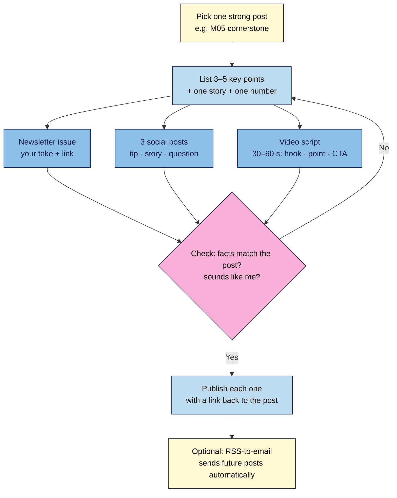

# M06.L05 — Repurposing workflow: one post into newsletter, social and video
> After this lesson you can turn one good post into a newsletter issue, three social posts and a short video script in under an hour, and let your RSS feed send new posts to subscribers and readers automatically.

**Time:** ~12 min reading + ~25 min exercise · **Level:** beginner · **Prereqs:** M06.L02 (your email provider connected); your M05 cornerstone post
**Verified against:** WordPress 7.0 (**Settings → Reading** feed settings, core feed URLs), MailPoet 5.44.0 (**Post Notifications**); Kit, MailerLite and Mailchimp RSS help pages; YouTube Help "three-minute Shorts"; Google Search Central canonicalization troubleshooting (syndication), all on 2026-11-01

> ⚠️ **Freshness flag:** social platforms change post length limits, video lengths and link rules often, and email providers move RSS-to-email between plans. Check each platform's help page before you rely on a number.

## Learning objectives
1. **Turn** one post into a newsletter issue, three social posts and a short video script.
2. **Use** your RSS feeds (site and category) to power newsletters and aggregators.
3. **Use** AI as a drafting assistant while keeping your voice and checking facts.

## Why it matters
Kai spent eight hours on a detailed post about budget podcast mics, shared one link on social media, and moved on. It got 40 visits. Mara wrote a similar post, then spent 45 minutes more: a newsletter issue with her personal take, three social posts (one tip, one story, one question), and a 45-second video showing the mic she uses. Each piece pointed back to the post. Within a month it was her most-visited page, and two of the social posts brought in new subscribers. **Writing the post is the hard part. Repurposing gets it in front of people who'll never find it by search alone.**

## Core concept
**Plain version:** **repurposing** means reshaping one piece of content for other places where your audience is, not copying the same text everywhere. Each format gets a different **job**:
| Format | Job | Shape |
|---|---|---|
| **Blog post** (the source) | Full answer; ranks in search; the place everything links to | Complete, structured (M05.L03) |
| **Newsletter issue** | Relationship: your personal take for people who already trust you | Short intro + key idea + link to the post |
| **Social posts** (3) | Reach: catch people scrolling | One idea each: a tip, a story, a question |
| **Short video script** | Reach + personality: show, don't tell | 30–60 seconds: hook, one point, call to action |

**One source, many cuts:** pick the **3–5 key points** from the post once, then reuse them. Each derivative should **stand on its own** (useful without clicking) and **point back** to the post for the full version.

**Your RSS feeds** are automatic lists of your newest posts that other tools can read:
| Feed | URL (with Post name permalinks) |
|---|---|
| Whole site | `yoursite.com/feed/` |
| One category | `yoursite.com/category/recipes/feed/` |
| One tag | `yoursite.com/tag/ramen/feed/` |
| Comments | `yoursite.com/comments/feed/` |

Email providers can watch a feed and email new posts to subscribers (**RSS-to-email**), and feed readers and aggregators can follow it. **Settings → Reading** controls how many posts the feed shows (**Syndication feeds show the most recent**) and whether it carries the **Full text** or an **Excerpt** (M01.L04).

**Don't republish whole posts elsewhere without care:** if you copy a full post to another site (Medium, LinkedIn articles, a partner blog), Google's current guidance is that the most effective way to keep the copy from competing with your original is for the other site to **block indexing** of it (noindex). A `rel="canonical"` link back is *not* recommended for syndication, because copies are often very different pages. Simpler for beginners: share a **summary** and link to the full post.

**Analogy:** your post is a roast chicken. The newsletter is Sunday's dinner for family, the social posts are sandwiches for people passing by, and the video is the 30-second "look how crispy this is" clip. Same chicken, different meals, all pointing to the kitchen.

## How it works

**In words:** start from one strong post, pull out the key points once, write each format from those points, check facts and voice, publish with a link back, and optionally let RSS-to-email handle future posts.

## Hands-on walkthrough
Use your **M05 cornerstone post** (or your best post). Have a plain document open for drafts.

### Part A — Extract the key points (~5 min)
1. Read your post and write a **repurposing sheet**:
   | Field | Your answer |
   |---|---|
   | Post title + URL | |
   | Who it's for (one line) | |
   | The one-sentence answer (your answer-first paragraph, M05.L03) | |
   | 3–5 key points | |
   | One personal story or example | |
   | One number or fact (with its source) | |
   | One question readers often ask | |
2. **Expected:** a half-page sheet. Every derivative below comes from it; nothing new is invented later.

### Part B — Newsletter issue (~6 min)
3. Draft a short issue (150–300 words) in your provider:
   - **Subject line:** specific, not clickbait (*"The $40 mic I'd buy again"*).
   - **Opening:** 2–3 personal sentences (why you wrote it, what surprised you). This is what subscribers get that searchers don't.
   - **The key idea:** one or two points from your sheet.
   - **Link:** *"Read the full guide →"* to the post.
   - **Sign-off** in your voice; your provider adds the unsubscribe link and postal address (M06.L03).
4. Send a **test email** to yourself and check it on your phone.
   **Expected:** a short, readable email that makes sense without clicking, and a working link to the post.

### Part C — Three social posts (~6 min)
5. Write three posts from your sheet, each with **one idea**:
   - **Tip:** one useful thing, stated plainly (*"Put the mic 10 cm from your mouth, slightly off to the side. It cuts the popping 'p' sounds."*).
   - **Story:** your example in 2–4 sentences.
   - **Question:** ask readers about their experience, and put the link in your reply or profile if the platform limits links.
6. Fit each to the platform (*observed practice; check each platform's current rules*): short and punchy on X, Threads and Bluesky; a bit longer with line breaks on LinkedIn and Facebook; visual-first on Instagram (the caption supports the image or video).
7. Add the post's **featured image** or a simple quote card where it helps. Check the link preview shows your title, description and image (your Open Graph tags from M05.L02).
   **Expected:** three posts that each work without the link, and one clean link to the post.

### Part D — Short video script (~5 min)
8. Write a **30–60 second script** in three beats:
   | Beat | Length | Example |
   |---|---|---|
   | **Hook** | 1–3 s | *"This $40 mic beat my $200 one."* |
   | **One point** | 20–45 s | Show the mic, say why, show the result (before/after audio) |
   | **Call to action** | 3–5 s | *"Full comparison on my blog, link in bio."* |
9. Note the **visuals** next to each line (what's on screen) and add on-screen text, since many people watch with the sound off (*observed practice*).
   **Expected:** a script you could read aloud in under a minute. YouTube now counts square or vertical videos up to **3 minutes** as Shorts, but shorter is usually easier to finish and watch (*observed practice*).

   > 🖼️ **Image prompt:** A two-column video script laid out in a document: left column "Say" with Hook, Point and Call to action lines; right column "Show" with shot notes, 1280 × 800. Highlight the three beat labels with a 3px #F9B2D7 outline; blur any personal details.
   > **Alt text:** A short video script in two columns, what to say and what to show, split into hook, point and call to action.

10. When you publish the video, **embed it in the post** too (YouTube embed block, M03.L05), so the post gains a video and the video gains a home.

### Part E — Connect your RSS feeds (~3 min)
11. Open `yoursite.com/feed/` in your browser. **Expected:** an XML page (or a download) listing your latest posts. Try a category feed: `yoursite.com/category/<your-category>/feed/`.
12. In **Settings → Reading**, check **For each post in a feed, include**: **Excerpt** sends readers to your site to read the rest; **Full text** lets them read everything in a feed reader. Many creators choose Excerpt (*observed practice*); either is fine.
13. **Optional: RSS-to-email.** Point your email provider at your feed so new posts are emailed automatically:
    | Provider | Feature (names change; check the help page) |
    |---|---|
    | **MailPoet** | **Post Notifications** (inside WordPress) |
    | **Kit** | Connect an RSS feed: **Single** (one email per post) or a digest. Emails are drafted as Broadcasts; with **Send automatically** on they go out 30 minutes later, otherwise they wait for you |
    | **MailerLite** | **RSS campaign** (paid plans) |
    | **Mailchimp** | RSS automation; check which plans include it |
    | **Jetpack Newsletter** | Sends posts as emails directly (no feed needed) |
    Start with **review-first** drafts or a weekly digest, so you can add a personal line. Use a **category feed** if only some posts should go out (e.g. only *Recipes*).
14. **Aggregators:** add your feed to a free feed reader (e.g. Feedly or Inoreader) to check it works, and submit it where your niche gathers (some communities and directories accept feeds).

## When to use / when not to
- **Use** the full workflow for your best posts (cornerstone and evergreen guides); for quick news posts, one social post is enough.
- **Use** RSS-to-email if you publish regularly and want subscribers to see every post; write manual issues if you publish rarely or want a more personal newsletter.
- **Don't** paste the same text on every platform. Each format has its own job.
- **Don't** republish full posts on other sites without a noindex agreement; share summaries and link back instead.
- **Trade-off:** RSS-to-email saves time but feels automatic; hand-written issues take longer but build more connection. Many creators do both: an automatic digest plus a short personal intro.

## Use AI for this
**Example prompt:**
> "Here is my repurposing sheet for a blog post: [paste sheet]. Here are two paragraphs of my writing so you can match my voice: [paste]. Draft: (1) a 200-word newsletter issue with a personal opening and a link placeholder; (2) three social posts: a tip, a story and a question; (3) a 45-second video script in a Say / Show table. Use only facts from the sheet. Don't add statistics, hashtags or emojis I didn't use."

**What AI does well:** reshaping one piece into several formats quickly, suggesting hooks and subject lines, and trimming text to length.
**Where it gets it wrong:** it adds facts, numbers and "studies" that aren't in your post; drifts into a generic, over-excited tone ("Game-changer! 🚀"); and invents personal stories you never told.
**How to check:** compare every fact to your sheet and post; read each draft aloud and rewrite anything you wouldn't say; never post an AI "personal story" as yours.

## Common mistakes
- **Copy-pasting the same text everywhere.** Each format needs its own shape.
- **Derivatives that only say "new post, link in bio".** Give something useful up front.
- **Inventing new claims** in social posts or videos that aren't in the post (and haven't been checked).
- **Forgetting the link back**, or linking to the homepage instead of the post.
- **Broken link previews**: missing featured image or Open Graph tags (M05.L02).
- **RSS-to-email on full auto with no review**, sending half-finished or tiny posts to everyone.
- **Republishing whole posts** on other sites that then outrank you.
- **Letting AI write in a voice that isn't yours.**

## Troubleshooting
| Symptom | Likely cause | Fix |
|---|---|---|
| `/feed/` shows an error or 404 | Permalinks need refreshing, or a plugin disabled feeds | **Settings → Permalinks → Save Changes**; check SEO/security plugin settings |
| Feed shows full posts but you wanted excerpts | **Full text** selected | **Settings → Reading → For each post in a feed, include: Excerpt** |
| RSS email didn't send | Nothing new, the post went out too close to send time, Kit's **Send automatically** is off (draft waiting), or the plan doesn't include RSS | Check the provider's RSS settings and plan; publish earlier (Mailchimp, for example, says to publish a few hours before send time) |
| Social link preview shows the wrong image or no image | Missing featured image or OG tags, or a cached preview | Set the featured image; check Yoast **Social** settings; use the platform's preview/debug tool if it has one |
| Category feed is empty | Wrong slug in the URL | Copy the category slug from **Posts → Categories** |
| A copy of your post outranks you | Full republication elsewhere | Ask the other site to noindex its copy, or replace it with a summary and link |

## Exercise
**Task:**
1. Fill in a **repurposing sheet** for your cornerstone post.
2. Write a **newsletter issue** (150–300 words) and send yourself a test.
3. Write **three social posts** (tip, story, question), each with one clean link to the post.
4. Write a **30–60 second video script** in a Say / Show table.
5. Open your site feed and one category feed; decide **Excerpt or Full text**; optionally set up RSS-to-email in review-first mode.

**Expected outcome:** one sheet and four drafts (newsletter, 3 social posts, video script) that each stand alone and link to the post; every fact traceable to the sheet; working site and category feed URLs noted in your site docs; your RSS-to-email decision written down.

**Stretch goal:** record the video on your phone, upload it as a Short or Reel, and embed it in the post.

## Key takeaways
- **One source, many cuts:** pull 3–5 key points once, then shape them for each format's job.
- **Newsletter = relationship, social = reach, video = personality, post = the full answer** everything links to.
- Your **RSS feeds** (`/feed/`, `/category/<slug>/feed/`) let email providers and readers pick up new posts automatically.
- Share **summaries and link back**; if a full copy must live elsewhere, Google recommends the copy be **noindexed**.
- Let **AI draft, you decide**: only facts from your sheet, only stories you actually lived, in your own voice.

## Teach it back
Explain to a friend in 3 sentences how to turn one blog post into a newsletter, social posts and a short video without copy-pasting, and what an RSS feed does for them.

## Glossary terms added
- Repurposing — added to `wordpress-101/glossary.md`
- RSS-to-email — added to `wordpress-101/glossary.md`
- Syndication — added to `wordpress-101/glossary.md`
- Hook (video) — added to `wordpress-101/glossary.md`

## Further reading
*All checked 2026-11-01.*
- WordPress.org — [WordPress Feeds](https://wordpress.org/documentation/article/wordpress-feeds/) · [Reading settings](https://wordpress.org/documentation/article/settings-reading-screen/)
- Google Search Central — [Fix canonicalization issues](https://developers.google.com/search/docs/crawling-indexing/canonicalization-troubleshooting) (syndicated content)
- YouTube Help — [Understand three-minute YouTube Shorts](https://support.google.com/youtube/answer/15424877)
- RSS-to-email help: [Kit](https://help.kit.com/en/articles/2502636-how-to-connect-your-rss-feed-to-kit) · [MailerLite](https://www.mailerlite.com/help/how-to-create-an-rss-campaign) · [Mailchimp](https://mailchimp.com/help/share-your-blog-posts-with-mailchimp/)
