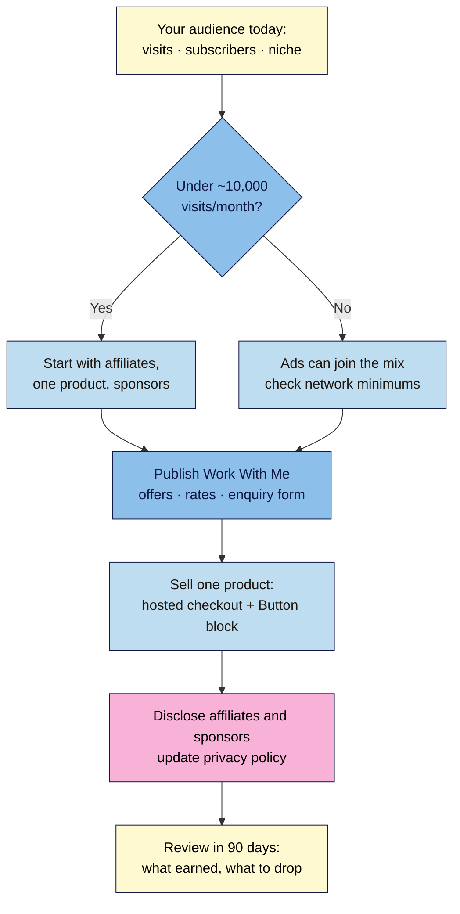

# M06.L06 — Monetization models and selling one digital product
> After this lesson you know which ways of earning fit your audience today, you've published a Work With Me page, and you have a simple way to sell one digital product without building a store.

**Time:** ~13 min reading + ~25 min exercise · **Level:** beginner · **Prereqs:** M04.L04 (Work With Me draft), M06.L02 (email list), M06.L03 (privacy policy)
**Verified against:** Raptive eligibility help page; Amazon Associates help (180-day rule); Jetpack "Monetize transaction fees"; Gumroad pricing and VAT help pages; WordPress 7.0, all on 2026-11-01

> ⚠️ **Freshness flag:** ad-network entry rules, affiliate terms and payment fees change often (Raptive cut its minimum from 100,000 to 25,000 pageviews in October 2025; Mediavine has changed its entry rules more than once). Check each provider's own page before you apply or price anything.

> **Not tax or legal advice.** Selling and sponsorships can create tax, VAT and disclosure duties that depend on your country. Disclosure rules (FTC, UK CAP Code) are covered properly in M08.L04.

## Learning objectives
1. **Compare** ads, affiliate links, sponsorships, digital products and memberships for your audience size.
2. **Build** a Work With Me page with offers, rates or an inquiry form.
3. **Sell** one simple digital product without installing a full store.

## Why it matters
Leo put display ads on his gardening blog at 2,000 visits a month. The ads slowed his pages, looked messy on mobile, and earned him $3 a month. Nia had the same traffic and 400 newsletter subscribers. She added honest affiliate links to the three tools she actually used, a Work With Me page for local garden centres, and a $12 seasonal planting guide sold through a checkout button. In the same month she earned $180, and none of it needed a big audience. **The right way to earn depends on your audience size and what they trust you for, not on what works for sites ten times bigger.**

## Core concept
**Plain version:** there are five common ways to earn from a content site. They suit different audience sizes:
| Model | How you earn | Works from about | Good for | Watch out |
|---|---|---|---|---|
| **Display ads** | Paid per view/click by an ad network | Free networks (e.g. Google AdSense): any size. Premium networks set minimums: **Raptive: 25,000 pageviews/month**; Mediavine has a smaller "Journey" programme (*third-party reports say ~1,000 sessions; check Mediavine's site*) | High-traffic, search-led sites | Low earnings at small traffic; slower pages; cookie consent in EU/UK (M08) |
| **Affiliate links** | Commission when readers buy through your link | Any size | Reviews, "what I use", tutorials | Must **disclose**; programme rules (e.g. Amazon Associates needs **3 qualifying sales within 180 days** of applying) |
| **Sponsorships** | Brands pay for a post, newsletter slot or video mention | Small but focused audiences (a few hundred engaged readers in a niche can be enough) | Niche experts, newsletters | Must **disclose**; only partners you'd recommend anyway |
| **Digital products** | You sell a guide, template, course or preset | ~100+ engaged subscribers | Anyone with a clear "next step" for readers | Taxes on digital sales; support requests |
| **Memberships / paid newsletter** | Recurring payments for extra content | A loyal audience that wants more from you | Deep expertise, community | Ongoing commitment to deliver |

**Rule of thumb:** with a small audience (under ~10,000 visits a month), **affiliate links, one digital product and sponsorships usually earn more than ads**, because they rely on trust rather than volume (*observed practice; results vary*). Add ads later, when traffic is big enough to meet a premium network's bar.

**The Work With Me page** (outlined in M04.L04) is where brands and clients find out how to pay you: who you work with, your audience in numbers (with a date), your offers with "from" prices or "rates on request", proof, how you disclose, and a clear next step.

**Selling one product without a store:** WooCommerce is a full shop (out of scope for this course). For **one** product, use a checkout that lives outside WordPress or a single block:
| Route | How | Cost (2026-11-01) | Taxes | Good when |
|---|---|---|---|---|
| **Hosted checkout with "merchant of record"** (e.g. **Gumroad**) | Create the product there; put a **Button** block on your site linking to it | Gumroad: **10% + 50¢** per direct sale | Gumroad's pricing page says it has been **merchant of record** since 2025-01-01 and handles sales tax "worldwide" (some older help pages describe narrower coverage, so check for your buyers' countries) | You want the simplest, tax-light start |
| **Your email provider's product feature** | Some ESPs sell digital products (MailerLite's free plan lists a digital product) | Varies by plan | Check the provider's terms | Your buyers are your subscribers |
| **Jetpack Payments block** | A payment button inside your post (Stripe) | Jetpack: **10%** on no paid plan, down to 2% on top plans, **plus Stripe's fee** | You handle taxes | You already use Jetpack and want everything on your site |

A **merchant of record** is the company legally selling to the buyer, so it deals with sales tax and VAT. That's why it's the beginner-friendly choice for digital products sold internationally.

**Analogy:** your site is a market stall. Ads are renting space on your awning to someone else's banner; affiliate links are recommending the baker next door for a small thank-you; sponsorships are a brand paying to put their sign on your stall for a day; a digital product is selling your own jam.

## How it works

**In words:** start from your real numbers. Small audiences start with affiliates, one product and sponsorships; bigger ones can add ads. Publish your Work With Me page, add one product with a hosted checkout, disclose everything, and review after 90 days.

## Hands-on walkthrough
Work on your **Local** site, then publish on your live site once your privacy policy (M06.L03) is live.

### Part A — Pick your first model (~5 min)
1. Write down today's numbers, with the date: monthly visits (Search Console clicks or your analytics; on Local, estimate), newsletter subscribers, and your niche in one line.
2. Answer for your audience: *What do readers trust me for? What do they buy already? What would they pay for?*
3. Pick **one** model to start (two at most), using the table above. Write one sentence: *"I'll start with ___ because ___."*
   **Expected:** a one-line decision, e.g. *"Affiliate links for the 3 mics I use, plus one $9 setup checklist, because my readers are beginners buying gear."*

### Part B — Finish and publish your Work With Me page (~10 min)
4. Open your **Work With Me** draft from M04.L04 (**Pages → All Pages → Drafts**).
5. Fill each heading with real details:
   | Section | What to write |
   |---|---|
   | **Who I work with** | 1–2 sentences on brands/clients that fit your audience, and who you don't work with |
   | **My audience** | Monthly readers, subscribers, main countries, **with a date** ("as of November 2026"). Real numbers only |
   | **Ways to work together** | 2–4 offers: e.g. sponsored post, newsletter feature, workshop, consulting, with **"from" prices** or "rates on request" |
   | **Past partners and results** | Only real ones, with permission. If none yet, leave the section out |
   | **How I disclose** | One line: *"Sponsored content is always labelled."* (details in M08.L04) |
   | **Next step** | A **Buttons** block to your Contact page (asking enquirers to choose *Collaboration or sponsorship* in the form, M04.L04), or embed the contact form on the page |
6. Add the page to your footer or main menu (M04.L03) and link it from your About page.
7. **Publish.**
   **Expected:** a published page that a brand could read in a minute and know what you offer, roughly what it costs, and how to start.

   > 🖼️ **Image prompt:** Screenshot of a published "Work With Me" page in Twenty Twenty-Five showing an audience-numbers section dated "as of November 2026", three offer cards with "from" prices, and a "Get in touch" button, 1280 × 800. Highlight the offers and button with a 3px #F9B2D7 outline; blur any personal details.
   > **Alt text:** A Work With Me page with dated audience numbers, three offers with starting prices and a get in touch button.

### Part C — Sell one digital product (~8 min)
8. **Choose the product:** your M06.L02 lead magnet's bigger sibling is a good start (e.g. the free shopping list → a $9 four-week meal plan). Write: title, who it's for, what's inside, format, price.
9. **Pick a route** from the table above. For most beginners: a hosted checkout that acts as merchant of record (e.g. Gumroad). Create an account, upload the file, set the price, and copy the product's link.
10. In WordPress, create a page (or a section on an existing post) for the product: what it is, who it's for, what's inside (a short list), the price, and a **Buttons** block linking to the checkout (*"Get the meal plan — $9"*).
11. Link the product page from the related post (where readers already want the next step), your Start Here page and your Work With Me page.
12. **Test** the purchase if the platform allows test mode, or buy it yourself and refund.
    **Expected:** a product page with a working button; a test purchase that delivers the file by email.
13. **Update your privacy policy** (M06.L03): name the checkout provider under *Who we share your data with*, and add it to your **plugin log** if you used a plugin (e.g. Jetpack).

### Part D — Affiliate links done right (~2 min)
14. If you chose affiliates: join the programme for a product you **actually use**, read its rules (e.g. Amazon's 180-day / 3-sale rule), and add links only where they help.
15. Add a clear disclosure **near the link**, before readers click: *"This post contains affiliate links: I earn a small commission if you buy, at no cost to you."* (Full rules in M08.L04.) Google asks for paid links (ads and paid placements) to be marked `rel="sponsored"`, and says `nofollow` is still acceptable; affiliate links are usually treated the same way (*common practice*). The quickest option is the block editor's link setting **Mark as nofollow**. For `sponsored`, use the block's **⋮ → Edit as HTML** and set `rel="sponsored"`, or your SEO plugin's link option if it shows one.

## When to use / when not to
- **Use** affiliates and one product early; they need trust, not traffic.
- **Use** sponsorships once you can show a focused audience (even a small one) and a media kit.
- **Use** ads when traffic is high and mostly from search; check premium networks' minimums and your site's speed (M07).
- **Don't** install WooCommerce for one product; it's a full shop with more to maintain and secure.
- **Don't** promote products you haven't used, or accept sponsors you wouldn't recommend: trust is what you're selling.
- **Trade-off:** hosted checkouts take a bigger cut per sale but handle delivery and (often) taxes; on-site payments keep more per sale but leave tax and delivery to you.

## Use AI for this
**Example prompt:**
> "I write about [niche] for [audience]. Numbers as of [date]: [visits/month], [subscribers]. My best posts: [titles]. Suggest the 2 monetization models that fit best, with reasons. Then draft my Work With Me page using these headings: [paste]. Use only the numbers I gave you; write 'rates on request' where I haven't given prices. Finally, suggest 3 digital product ideas that are a next step from my lead magnet [describe]."

**What AI does well:** matching models to your audience, drafting a clear Work With Me page, and brainstorming product ideas from your best posts.
**Where it gets it wrong:** it quotes outdated ad-network thresholds and fees, invents audience numbers or "typical rates", and promises earnings it can't know.
**How to check:** use only your own numbers; check every threshold and fee on the provider's page; price from what similar creators in your niche actually charge.

## Common mistakes
- **Ads first on a small site:** pennies in revenue, slower pages.
- **Too many models at once.** Start with one or two and do them well.
- **Undated or inflated audience numbers** on the Work With Me page. Brands check; date them and keep them honest.
- **Affiliate links without disclosure**, or with the disclosure at the bottom of the post.
- **Installing a full store for one PDF.**
- **Ignoring tax on digital sales**, especially to EU/UK buyers. A merchant-of-record checkout handles much of it.
- **Recommending products you've never used.**
- **Forgetting the privacy policy** when you add a checkout or ad network.

## Troubleshooting
| Symptom | Likely cause | Fix |
|---|---|---|
| Ad network rejected your application | Below its traffic minimum, or traffic mostly from outside its target countries | Check its current eligibility page; focus on affiliates/products until you qualify |
| Affiliate account closed after 6 months | Didn't reach the programme's minimum sales (e.g. Amazon: 3 within 180 days) | Reapply when your traffic is higher; add links only to posts that already get visits |
| No brand enquiries | Work With Me page hard to find, vague offers, no numbers | Link it in the footer and About page; add dated numbers and "from" prices |
| Buy button does nothing | Wrong or draft product link | Publish the product on the checkout platform; re-copy the public link |
| Jetpack Payments block won't work on Local | Needs a WordPress.com connection | Test on a live site, or use a hosted checkout link |
| Buyers ask about VAT invoices | Checkout isn't handling tax | Use a merchant-of-record platform, or get tax advice for your country |

## Exercise
**Task:**
1. Write today's audience numbers (dated) and pick **one** monetization model with a one-sentence reason.
2. Complete and **publish** your Work With Me page (all six sections, real numbers, "from" prices or "rates on request", a button to your contact form), and link it in your footer and About page.
3. Plan **one digital product** (title, audience, contents, format, price) and set it up with one route, with a product page and a working **Buttons** block. Test it if you can.
4. Update your privacy policy and plugin log for any new service.

**Expected outcome:** a dated one-line monetization decision; a published Work With Me page reachable from the footer and About page; a product page with a working checkout link (or a written plan if you're not ready to sell); an updated privacy policy.

**Stretch goal:** add one honest affiliate link to a post that already gets traffic, with a disclosure before the link, and check its `rel` attribute.

## Key takeaways
- **Match the model to your audience:** small audiences earn most from affiliates, one product and sponsorships; ads need volume.
- Premium ad networks have **minimums that change** (Raptive: 25,000 pageviews/month as of 2026-11-01); check before applying.
- Your **Work With Me** page needs dated real numbers, clear offers with "from" prices, and one obvious next step.
- **Sell one product without a store:** a hosted checkout (ideally a merchant of record for tax) plus a Button block.
- **Disclose** every affiliate link and sponsorship, and update your privacy policy for every new service.

## Teach it back
Explain to a friend in 3 sentences which way of earning suits a blog with 2,000 monthly visits, what goes on a Work With Me page, and how to sell one PDF without building a shop.

## Glossary terms added
- Affiliate link — added to `wordpress-101/glossary.md`
- Display ads — added to `wordpress-101/glossary.md`
- Merchant of record — added to `wordpress-101/glossary.md`
- Sponsorship — added to `wordpress-101/glossary.md`
- Digital product — added to `wordpress-101/glossary.md`

## Further reading
*All checked 2026-11-01. Fees and thresholds change; check the live pages.*
- Raptive — [Who is eligible for Raptive?](https://help.raptive.com/hc/en-us/articles/360032840891-How-do-I-apply-to-Raptive)
- Amazon Associates — [Help: qualifying sales and account closure](https://affiliate-program.amazon.com/help/node/topic/G7MJTPEP9NC3YKMG) · [Operating Agreement](https://affiliate-program.amazon.com/help/operating/agreement)
- Jetpack — [Monetize transaction fees](https://jetpack.com/support/jetpack-earn-transaction-fees/) · [Payments block](https://jetpack.com/support/jetpack-blocks/payments-block/)
- Gumroad — [Pricing](https://gumroad.com/pricing) · [EU & UK VAT on Gumroad](https://help.gumroad.com/article/10-dealing-with-vat)
- Google — [Qualify your outbound links (rel="sponsored")](https://developers.google.com/search/docs/crawling-indexing/qualify-outbound-links) (updated 2025-12-10)
