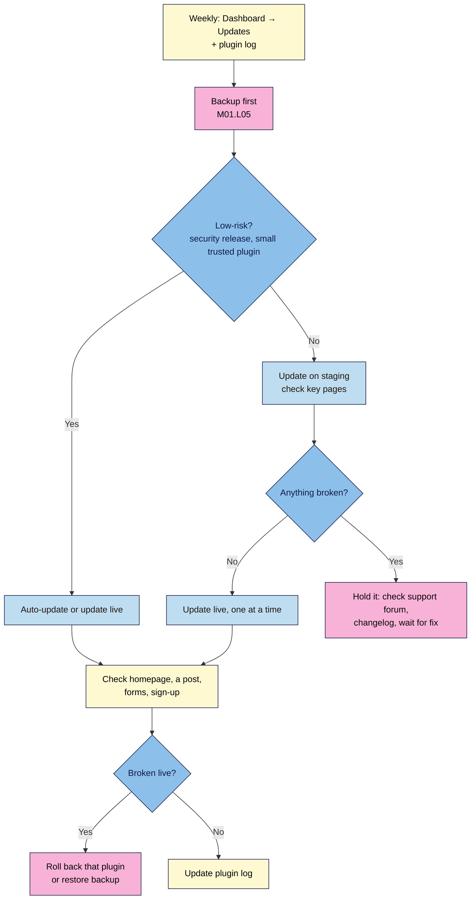

# M07.L01 — Updates: core, themes and plugins, auto vs manual, testing on staging
> After this lesson you know which parts of your site to auto-update, you can test risky updates on a staging copy first, and you can roll back a plugin update that breaks something.

**Time:** ~12 min reading + ~25 min exercise · **Level:** beginner · **Prereqs:** M01.L05 (backups), M06.L01 (plugin log)
**Verified against:** WordPress 7.0 core code (**Dashboard → Updates**, auto-update rollback, **Replace current with uploaded**) and the WordPress.org version API (current release **7.1.4**); WP Staging 4.19.0, WP Rollback 3.2.0 directory pages, all on 2026-11-01

> ⚠️ **Freshness flag:** on 2026-11-01 the WordPress.org API listed **7.1.4** as *latest*, **7.0.8** as *outdated* (the 7.0 branch's last security release), and every other 7.0.x and 7.1.x release as **insecure**. If your site says 7.0 or an older 7.1, update it. Check `api.wordpress.org/core/stable-check/1.0/` or **Dashboard → Updates** for today's status.

## Learning objectives
1. **Decide** which components to auto-update and which to update manually.
2. **Test** updates on a staging copy before applying them live.
3. **Roll back** a plugin update that breaks the site.

## Why it matters
Dev ignored the update badge for eight months because "the site works fine". A security hole in an old form plugin was being exploited widely, and one morning his homepage redirected to a scam site. Hana updated everything at once, live, on a Friday evening; a page-builder update broke her layout, and she spent the weekend guessing which of nine updates caused it. Ola auto-updates small, trusted plugins and security releases, tests the big ones on a staging copy on Monday mornings, and takes a backup first. When an update did break her contact form, she rolled back one plugin in five minutes. **Updates fix security holes; untested updates cause outages. A routine gives you both safety and calm.**

## Core concept
**Plain version:** your site has three kinds of code that get updates: **WordPress core**, your **theme(s)** and your **plugins**. Each can update **automatically** (in the background, via WP-Cron) or **manually** (you click Update).

**Kinds of core release:**
| Release | Example | What changes | Default in WordPress |
|---|---|---|---|
| **Maintenance / security** (minor) | 7.1.3 → 7.1.4 | Bug and security fixes | **Automatic** for everyone |
| **Major** | 7.0 → 7.1 | New features, editor changes | **On for sites installed fresh since WordPress 5.6** (most new sites, including Local ones); **off** for older sites that were upgraded. Either way you can change it: **Dashboard → Updates** shows *"This site is automatically kept up to date with each new version of WordPress"* or *"…with maintenance and security releases of WordPress only"* |

**Plugins and themes:** each one has an **Enable auto-updates / Disable auto-updates** link on **Plugins** and **Appearance → Themes** (M06.L01).

**Safety nets WordPress already has** (*verified in WordPress 7.0 code*):
- If a **plugin auto-update** causes a fatal error, WordPress checks the site after updating and **restores the previous version**, then emails you (*"The update for '…' contained a fatal error. The previously installed version has been restored."*).
- Failed **manual** plugin/theme updates are restored from a temporary backup.
- If a fatal error still gets through, WordPress shows *"There has been a critical error on this website"* and emails the admin a **recovery mode** link so you can log in and deactivate the culprit.
These catch **crashes**, not **broken layouts or features**. That's what staging and testing are for.

**A sensible split for creator sites** (*observed practice; adjust to your risk*):
| Component | Auto-update? | Why |
|---|---|---|
| Core maintenance/security | **Yes** (default) | Small, urgent fixes |
| Core major | Manual, within **1–2 weeks**, after a staging test | Bigger changes; let x.y.1 fix early bugs if you prefer |
| Small, well-maintained plugins (anti-spam, redirects, SEO) | **Yes** | Low risk, security fixes arrive fast |
| Plugins that shape the front end or take money (page builders, forms, checkout, caching) | **Manual**, test on staging | A bad update breaks visible things |
| Active theme (default block theme) | **Yes** for WordPress default themes; manual for complex third-party themes | Default themes change little |
| Inactive plugins/themes | **Delete them** (keep one default theme) | Unused code is still attack surface |

**Staging** is a private copy of your site where you test updates (and design changes) before doing them on the real site. Three ways to get one:
| Option | How | Notes |
|---|---|---|
| **Your host's staging** | Many hosts have a "Create staging" button and a "push to live" option | Easiest if included; check your plan |
| **Local** (from M01) | Make a copy of your site on your computer (import a backup, or Local's site cloning) | Free; you then repeat the update live |
| **A staging plugin** | e.g. **WP Staging** (100,000+ installs, 4.8★ on 2026-11-01) clones the site into a subfolder | Score it first (M06.L01); the copy uses your server's space |

**Analogy:** updates are like servicing your car. Small safety recalls happen automatically at the garage; a new engine part gets a test drive in the car park (staging) before the motorway (live).

## How it works

**In words:** once a week, look at what needs updating and take a backup. Let low-risk updates run automatically; test high-risk ones on staging. Update live one at a time, check your key pages, roll back anything that breaks, and record what you did in your plugin log.

## Hands-on walkthrough

### Part A — Set your auto-update policy (~6 min)
1. Go to **Dashboard → Updates**. Note your **current WordPress version** and the automatic-updates line.
   **Expected:** a line such as *"This site is automatically kept up to date with maintenance and security releases of WordPress only."* and a link to switch (*"Enable automatic updates for all new versions of WordPress."* or *"Switch to automatic updates for maintenance and security releases only."*). If it says *"This site appears to be under version control. Automatic updates are disabled."*, ask whoever set up the site.
2. Choose: **maintenance and security only** (recommended while you're learning; you update majors after a staging test) or **all versions** (fine for simple sites with good backups). Click the matching link. A freshly installed site is usually already on **all versions**, so this is a deliberate switch, not a check.
3. Go to **Plugins → Installed Plugins**. Using the table above and your **plugin log** (M06.L01), click **Enable auto-updates** for low-risk plugins and leave high-risk ones manual. Add an **Auto-updates** column value to every log row.
4. **Appearance → Themes**: enable auto-updates for your active default theme; delete themes you don't use (keep one default theme as a fallback).
   **Expected:** every plugin and theme has a deliberate auto-update choice recorded in your log.

   > 🖼️ **Image prompt:** Screenshot of WordPress Plugins → Installed Plugins showing the Automatic Updates column with "Enable auto-updates" and "Disable auto-updates" links on different plugins, 1280 × 800. Highlight the column with a 3px #F9B2D7 outline; blur any personal details.
   > **Alt text:** Installed Plugins screen with an Automatic Updates column showing enable and disable links for different plugins.

### Part B — Create a staging copy and test (~10 min)
5. **Back up** the live site first (M01.L05) and note the time.
6. Create staging with **one** option:
   - **Host:** in your hosting dashboard, look for **Staging** → create. Note the staging URL.
   - **Local:** restore your latest backup into a new Local site (your M01.L05 backup plugin's restore/migrate feature), or clone your existing Local practice site.
   - **Plugin:** score **WP Staging**, install it, and create a staging site; it appears at a subfolder URL with its own login.
   **Expected:** a working copy with your posts, theme and plugins, at a URL that isn't your live address. Staging copies should be hidden from search: check **Settings → Reading → Discourage search engines** is **ticked on staging only** (M05.L01).
7. On staging, go to **Dashboard → Updates** and update **one** high-risk item (e.g. your form plugin, or a major WordPress version).
8. Run your **5-minute check** on staging:
   | Check | What to look for |
   |---|---|
   | Homepage | Layout, menu, footer (privacy link visible, M06) |
   | One post | Images, embeds, Newsletter CTA, comments |
   | Contact and sign-up forms | Submit a test entry |
   | Editor | Open a post; blocks load without errors |
   | Dashboard | No new error notices |
   **Expected:** everything works, so you'll update live. If something breaks, don't update live: check the plugin's **Support** forum and changelog, and wait for a fix.

### Part C — Update live, one at a time (~4 min)
9. Back on the live site (backup already taken), update the item you tested. Update **one plugin at a time** for high-risk items, running the 5-minute check after each; low-risk ones can go together.
10. Update your **plugin log** (new version, date, any notes).

### Part D — Roll back a plugin update (~5 min, on Local or staging)
11. Practise on **Local or staging**, never live. Pick a plugin, open its WordPress.org page → **Advanced View** → **Previous Versions** (*"Previous versions of plugins may not be secure or stable"*), choose the version before the current one and **Download** the zip.
12. In WordPress: **Plugins → Add Plugin → Upload Plugin** → choose the zip → **Install Now**. WordPress notices *"This plugin is already installed."* and shows a comparison of the current and uploaded versions. Click **Replace current with uploaded**.
    **Expected:** the plugin now shows the older version number on **Plugins**, and the update notice reappears.
13. Before turning auto-updates back on, note in your log *why* you rolled back and which version fixes the problem. Re-update once the fix is released.
14. **Alternatives:** the **WP Rollback** plugin (200,000+ installs on 2026-11-01) adds a **Rollback** link to each plugin; or restore your pre-update **backup** (M01.L05), which rolls back everything, including content added since.
    **Expected:** you can name two ways to undo a bad plugin update and when you'd use each.

   > 🖼️ **Image prompt:** Screenshot of the WordPress "This plugin is already installed." screen after uploading an older plugin zip, showing the current vs uploaded version comparison and the "Replace current with uploaded" button, 1280 × 800. Highlight the button with a 3px #F9B2D7 outline; blur any personal details.
   > **Alt text:** WordPress plugin upload screen comparing current and uploaded versions with a Replace current with uploaded button.

## When to use / when not to
- **Use** auto-updates for security releases and small, trusted plugins; the safety nets catch crashes.
- **Use** staging for major WordPress versions, page builders, forms, checkout and caching plugins, and theme updates that change layout.
- **Use** a plugin rollback when one plugin update broke one thing; use a **backup restore** when you can't tell what broke or the site is down.
- **Don't** update everything at once on a live site without a backup.
- **Don't** leave updates for months. Old versions with known holes are how most WordPress sites get hacked (*widely reported by security vendors*).
- **Trade-off:** waiting a few days before major updates avoids early bugs, but waiting weeks leaves you exposed. One to two weeks with a staging test is a reasonable middle.

## Use AI for this
**Example prompt:**
> "Here's my plugin log: [paste name, job, version, auto-updates columns]. Here are today's available updates with version numbers: [paste]. For each update, say: low-risk (auto/update now) or high-risk (test on staging first), and why. Then write a 5-minute post-update checklist for my site, which has [homepage, blog, contact form, newsletter sign-up, product button]."

**What AI does well:** sorting updates into risk levels using your log, and turning your site's key features into a check routine.
**Where it gets it wrong:** it doesn't know today's changelogs or vulnerabilities, may claim an update is "safe" or "contains no breaking changes" without evidence, and may suggest editing files or disabling updates entirely.
**How to check:** read each plugin's changelog (**View details** on the Plugins screen) and support forum; trust your staging test over any prediction.

## Common mistakes
- **Ignoring the update badge** for months.
- **Updating everything at once, live**, then not knowing what broke.
- **No backup before a major update.**
- **Turning off all auto-updates** "to be safe", including security releases.
- **A staging site that's public and indexed** (duplicate content, and it may show your old site in search). Tick **Discourage search engines** on staging only, and never copy that setting to live.
- **Forgetting to repeat the update live** after testing on Local.
- **Rolling back and forgetting**: an old version stays installed with its known bugs or holes.
- **Keeping inactive plugins and themes** that still need updates.

## Troubleshooting
| Symptom | Likely cause | Fix |
|---|---|---|
| "There has been a critical error on this website" | A plugin or theme update fatal error | Use the **recovery mode** link in the admin email, deactivate the culprit, then roll back or wait for a fix |
| Email: "contained a fatal error. The previously installed version has been restored." | WordPress caught a bad plugin auto-update | Check the plugin's support forum; leave it on the old version until a fixed release |
| Site stuck in "Briefly unavailable for scheduled maintenance" | An update was interrupted | Delete the `.maintenance` file in your site's root folder (host file manager), then re-run the update |
| Auto-updates never happen | WP-Cron doesn't run (very low traffic, or disabled by the host) | Check **Tools → Site Health**; ask your host about a real cron job |
| Layout broken after a theme or builder update, no error | Visual change, not a crash | Roll back that plugin/theme on staging to confirm, then live; report it to the developer |
| "This site appears to be under version control" | A `.git`/`.svn` folder in the site | Ask your developer/host; core auto-updates are disabled on purpose |

## Exercise
**Task:**
1. Record your WordPress version and its status (latest / outdated / insecure) from **Dashboard → Updates** or the version API.
2. Set your core auto-update choice and an auto-update choice for every plugin and theme; record them in your plugin log. Delete unused themes and plugins.
3. Create a staging copy (host, Local or WP Staging), with **Discourage search engines** ticked there.
4. Update one high-risk item on staging, run the 5-minute check, then update it live.
5. On Local or staging, roll back one plugin to its previous version with **Replace current with uploaded**, then update it again.

**Expected outcome:** your site on the latest release (or a written plan to get there this week); an auto-update policy in your plugin log; a staging copy; one update tested then applied live with the 5-minute check passed; one practised rollback.

**Stretch goal:** write your **weekly update routine** as a five-line checklist (when, backup, what to auto/test, the check, the log) and add it to your site docs. M09's maintenance plan builds on it.

## Key takeaways
- **Security/maintenance releases auto-update by default**; decide on major versions in **Dashboard → Updates**.
- Auto-update **low-risk** plugins; test **high-risk** ones (builders, forms, checkout, caching, majors) on **staging** first.
- WordPress restores a plugin automatically if its auto-update causes a **fatal error**, but it can't catch broken layouts or features.
- Roll back one plugin with **Upload Plugin → Replace current with uploaded** (or WP Rollback); restore a backup when you can't tell what broke.
- **Backup first, one at a time, check key pages, log it.**

## Teach it back
Explain to a friend in 3 sentences which updates they can let run automatically, which ones to test first and where, and how to undo a plugin update that breaks their site.

## Glossary terms added
- Auto-update — added to `wordpress-101/glossary.md`
- Major vs minor (maintenance) release — added to `wordpress-101/glossary.md`
- Rollback — added to `wordpress-101/glossary.md`
- Recovery mode — added to `wordpress-101/glossary.md`

## Further reading
*All checked 2026-11-01.*
- WordPress.org — [Plugins & themes auto-updates](https://wordpress.org/documentation/article/plugins-themes-auto-updates/) · [Configuring automatic background updates](https://wordpress.org/documentation/article/configuring-automatic-background-updates/) · [Updating WordPress](https://wordpress.org/documentation/article/updating-wordpress/)
- WordPress.org — [Version status API](https://api.wordpress.org/core/stable-check/1.0/) · [Releases](https://wordpress.org/download/releases/)
- Plugin pages: [WP Staging](https://wordpress.org/plugins/wp-staging/) · [WP Rollback](https://wordpress.org/plugins/wp-rollback/)
