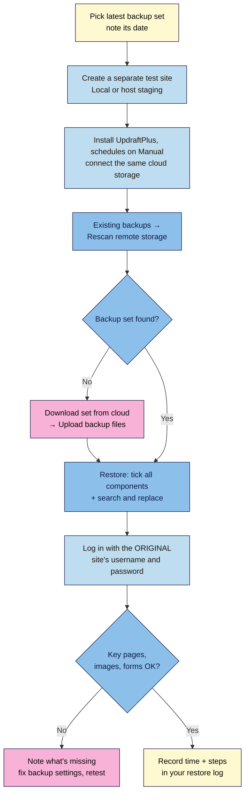

# M07.L02 — Backups in depth: retention, off-site storage and a tested restore
> After this lesson your backup schedule matches how often you publish, your copies live away from your host, and you've restored your site once, timed it, and written down how.

**Time:** ~14 min reading + ~30 min exercise · **Level:** beginner · **Prereqs:** M01.L05 (UpdraftPlus + cloud storage set up), M07.L01 (staging)
**Verified against:** WordPress 7.1.4; UpdraftPlus 1.26.14 (plugin code: Settings, Existing backups, Restore and migration screens, and which settings survive a migration); CISA *#StopRansomware Guide* backup advice; WordPress developer handbook *Backups* page (last modified 2026-10-28), all on 2026-11-01

> ⚠️ **Freshness flag:** backup plugins move features between free and paid tiers. On 2026-11-01 the **free** UpdraftPlus could schedule backups (every 2, 4, 8 or 12 hours, daily, weekly, fortnightly or monthly), send them to Google Drive, Dropbox, S3-compatible storage, FTP and others, restore them, and **migrate** a backup to a different address with a built-in search-and-replace. Incremental backups, extra storage destinations, finer retention rules and automatic backups before updates were **Premium**. Check the plugin's wordpress.org page before you rely on any of these.

## Learning objectives
1. **Set** backup frequency and retention to match how often you publish, and how long a problem could go unnoticed.
2. **Store** backups off-site, with a different company from your host, plus a copy that the WordPress dashboard can't delete.
3. **Perform** a full test restore to a separate site, time it and write it up as a restore log.

## Why it matters
Tomás had "daily backups" for two years. When a hacked plugin injected spam links, he found the problem three weeks later, but his plugin kept only seven database backups, so every one of them contained the spam. Priya's backups went to Google Drive faithfully, but when her server died she discovered the files backup had been failing silently for four months because her Drive was full. Kwame tested a restore on a quiet Sunday, which took 22 minutes and one confused moment over the login, and wrote the steps on a single page. When his host had an outage a month later, he was back online on a new host before lunch. **A backup you've never restored is a hope, not a plan.**

## Core concept
**Plain version:** M01.L05 got backups *running*. This lesson makes them *trustworthy* by answering three questions:
1. **How often?** That decides how much you could lose: everything since the last backup.
2. **How long do you keep them?** That decides how far back you can go. It must be longer than the time it might take you to notice a problem.
3. **Does a restore actually work, and how long does it take?** The only way to know is to do one.

**Analogy:** backups are like photos of your notebook. *Frequency* is how often you take a photo. *Retention* is how many old photos you keep in the album. A *restore test* is checking that the photos are in focus before you lose the notebook.

**Precise definitions:**
- **Backup set:** one database backup plus the files backups (plugins, themes, uploads, others) taken around the same time. UpdraftPlus shows each set as one row under **Existing backups**. **Others** means everything else in `wp-content` that isn't plugins, themes or uploads (for example, folders some plugins create).
- **Retention:** how many backup sets the plugin keeps before deleting the oldest. In UpdraftPlus, the **"and retain this many scheduled backups"** number next to each schedule. Old sets are pruned only after a new backup completes, so you may briefly see one more than you set.
- **Recovery point (RPO):** the most data you could lose. Daily database backups mean you could lose up to a day of posts and comments.
- **Recovery time (RTO):** how long it takes to get back online. Your restore test measures it. (Both terms come from NIST's contingency planning guide, SP 800-34.)
- **Off-site:** stored with a different company and a different login from your host, so one failure or one hacked account can't take out the site *and* its backups.
- **Restore vs migration:** restoring a backup onto the **same** site address is a *restore*. Restoring it onto a **different** address (a staging URL, a test site on Local, a new domain) is a *migration*. The site address stored in the database must be rewritten, which UpdraftPlus does with **"Search and replace site location in the database (migrate)"**.

### Frequency and retention by publishing rhythm
The database changes every time you publish, someone comments or something sells. Files change mostly when you upload media or update plugins. So back up the database more often than files. (*Observed practice. WordPress's own handbook suggests weekly for small sites and daily for busy ones, and keeping several recent copies in different places.*)

| You… | Database | Keep | Files | Keep | You can go back |
|---|---|---|---|---|---|
| Publish weekly or less, few comments | Daily | 14 | Weekly | 4 | 2 weeks (database), 4 weeks (files) |
| Publish several times a week | Daily | 30 | Weekly | 4–5 | ~1 month |
| Publish daily, busy comments, or sell products | Every 12 hours | 60 | Daily | 14 | ~1 month (consider real-time backups such as Jetpack VaultPress Backup, paid, for orders) |
| **Everyone, extra** | — | — | — | — | **Monthly:** download one full backup set to your computer or an external drive and keep the last 3 |

**Why the monthly copy?** Two reasons. First, hacks and silent mistakes are often noticed weeks later, so you need at least one copy older than the problem. Second, anyone with your WordPress admin login can delete backups from the dashboard, including from remote storage (UpdraftPlus's delete dialog has **"Also delete from remote storage"**). A copy on your own drive, unplugged, can't be deleted that way. This gives you the 3-2-1 rule from M01.L05: live site, cloud copy, offline copy. It matches the first recommendation in the US cybersecurity agency CISA's *#StopRansomware Guide*: *"Maintain offline, encrypted backups of critical data, and regularly test the availability and integrity of backups"*. The guide warns that attackers look for and delete backups they can reach.

**Check your storage space:** a backup set's size × how many you keep must fit in your cloud storage. A free Google account has 15 GB, shared across Gmail, Drive and Photos. 1.5 GB of uploads kept 4 times is 6 GB before you count the database.

## How it works

**In words:** pick your latest backup set and make a separate, empty site to restore it onto, never your live site. Install UpdraftPlus there, connect the same cloud storage and let it find your backups (or upload them by hand). Restore everything with search-and-replace ticked, then log in with your **original** site's login, because the restored database brings its users with it. Check your key pages, and write down how long it took and anything that surprised you.

## Hands-on walkthrough
Use your **Local** practice site (the "source") from M01.L05. If you work on a live site, do the same steps with your host's staging site as the test site, and **never** restore a test onto your live site.

### Part A — Tune frequency and retention (~6 min)
1. On the source site, open **Settings → UpdraftPlus Backups → Settings**.
2. Pick your row from the table above and set **Files backup schedule** and **Database backup schedule**, each with its **"and retain this many scheduled backups"** number. Click **Save Changes**.
   **Expected:** the **Backup / Restore** tab shows *Next scheduled backups* for files and database at the times you chose.
3. Open your cloud storage (Google Drive or Dropbox) and check free space against *backup set size × files retention*. You'll find the set size by adding up today's files in the cloud **UpdraftPlus** folder.
   **Expected:** enough room for every backup you've told it to keep, plus at least one more.

   > 🖼️ **Image prompt:** Screenshot of UpdraftPlus Settings showing Files backup schedule "Weekly" with "and retain this many scheduled backups" set to 4, and Database backup schedule "Daily" with 30, 1280 × 800. Highlight both retention boxes with a 3px #F9B2D7 outline; blur any personal details.
   > **Alt text:** UpdraftPlus settings with weekly file backups kept 4 times and daily database backups kept 30 times.

### Part B — Make your backups truly off-site (~4 min)
4. Confirm the cloud account that receives your backups:
   - belongs to a **different company** from your host (Google, Dropbox or an S3-compatible provider, not your host's own backup space);
   - has its **own strong password and 2FA** (M01.L05). Your backups contain your whole site, including user emails, so treat this account like your admin login.
5. If your host also keeps backups, find out in its documentation: **where** they're stored (same server or separate?), **how long** they're kept, and whether **you** can restore or download them without opening a ticket. Write the answers down; they're your second safety net, not your only one.
6. Take your first **monthly offline copy**: in **Existing backups**, open the newest set and click each component button (Database, Plugins, Themes, Uploads, Others) → **Download to your computer**. Put the files in a dated folder (e.g. `backups/2026-11-01/`) on an external drive or a second cloud account.
   **Expected:** one folder holding a `…-db.gz` file and the `…-plugins.zip`, `…-themes.zip`, `…-uploads.zip` and `…-others.zip` files with today's date.

### Part C — Run a full test restore and time it (~20 min)
7. **Start a timer.** Note the date and time of the backup set you'll restore.
8. Create an **empty test site**: in Local, **+ → Create a new site**, name it `restore-test`, keep the defaults. (Live site? Use your host's staging, or a fresh test install your host gives you.)
   **Expected:** a brand-new WordPress site with the default theme and the "Hello world!" post.
9. On `restore-test`, install and activate **UpdraftPlus**, open **Settings → UpdraftPlus Backups → Settings**, choose the **same remote storage** as your source site, **Save Changes** and authenticate. Leave both schedules on **Manual**: this test site must never run its own scheduled backups into your real backup folder.
   **Using host staging instead?** A staging copy is a clone of live, so its UpdraftPlus already has your live site's schedule, storage and backup list. Set both schedules to **Manual** on staging *before anything else*. Otherwise staging runs backups into the same folder and its retention can prune your live backups.
10. Go to **Backup / Restore** → **Existing backups** → **Rescan remote storage**. It looks inside your remote storage *"for any existing backup sets (from any site, if they are stored in the same folder)"*.
    **Expected:** your source site's backup set appears with *(backup set imported from remote location)*.
    **Not found?** Use the files from Part B: **Upload backup files** and drag in all five files from your dated folder.
11. Click **Restore** on that row. Under **Choose the components to restore**, tick **Plugins, Themes, Uploads, Others** and **Database**, then **Next**.
    **Expected:** a notice that *"This backup set is from a different site … this is not a restoration, but a migration."*, with **Search and replace site location in the database (migrate)** ticked. Leave it ticked. It rewrites your source site's address to `restore-test`'s address.

    > 🖼️ **Image prompt:** Screenshot of the UpdraftPlus restore dialog on the test site showing "Choose the components to restore" with all five components ticked and the "Search and replace site location in the database (migrate)" option checked, 1280 × 800. Highlight the search-and-replace checkbox with a 3px #F9B2D7 outline; blur any personal details.
    > **Alt text:** UpdraftPlus restore dialog with all components ticked and the search and replace site location option checked.
12. Click **Next**, then **Restore**. Watch **Restoration progress:** until you see **Restore successful!** Then click **Return to UpdraftPlus configuration**.
13. You'll probably be asked to log in. Use your **source site's** username and password (and its 2FA), not the ones you made for `restore-test`, because the database you just restored replaced the users. UpdraftPlus's own settings on `restore-test` stay as you set them in step 9 (*on a migration it keeps the destination's backup settings; checked in UpdraftPlus 1.26.14 code*).
14. **Stop the timer** after this check:
    | Check | Pass if |
    |---|---|
    | Homepage | Your theme, menu and footer, not "Hello world!" |
    | Newest post from before the backup | Present, with images loading |
    | A post's images | Load from `restore-test`'s address (right-click → open image) |
    | Pages and categories | All present |
    | Plugins | Same list as the source; forms show up |
    | Anything published *after* the backup | **Missing**. That's your recovery point in action |
    **Expected:** a working copy of your site at the test address, and a time (e.g. "26 min").

### Part D — Write your restore log (~4 min)
15. Add a **Restore log** page to your site docs (next to your plugin log from M06.L01):
    | Field | Example |
    |---|---|
    | Date of test | 2026-11-01 |
    | Backup set used | 2026-11-01 06:00, files + database |
    | Where it came from | Google Drive, folder *UpdraftPlus* |
    | Restored to | Local `restore-test` (migration, search-and-replace on) |
    | Time to restore (RTO) | 26 min, including site creation |
    | Data lost (RPO) | Anything after 06:00 |
    | Surprises | Had to log in with the old site's login and 2FA |
    | Next test due | 2027-02-01 (every 3 months, and after changing hosts or backup tools) |
16. Delete the `restore-test` site when you're done (in Local: right-click → **Delete**), or keep it as a staging copy for M07.L03. Deleting the Local site leaves your cloud backups alone. Don't use **Delete this backup set** on the test site: its rows point at your real backups, and **Also delete from remote storage** would remove them.

## When to use / when not to
- **Do a full test restore** every **3 months**, after switching backup plugin, storage or host, and before anything risky like a redesign or migration (*observed practice*).
- **Restore in place** (onto the live site) only in a real emergency, and only after you've proved the backup works in a test. Restoring the database in place overwrites everything published since that backup.
- **Restore only the database** when content went wrong (spam injected, posts deleted). **Restore only files** when a plugin or theme broke. Use the full set when you can't tell, or the site is gone.
- **Don't** treat host backups you can't download or restore yourself as your only copy.
- **Trade-off:** more frequent backups and longer retention mean less to lose and further to go back, but cost more storage and some server load. Keep the database frequent (small) and files less frequent (big).

## Use AI for this
**Example prompt:**
> "I publish [how often], get about [N] comments a day, and [do/don't] sell products. My uploads folder is [X] GB and my database backup is [Y] MB. My cloud storage has [Z] GB free. Suggest a database and files backup schedule with retention numbers for UpdraftPlus (free), check it fits my storage, and draft a one-page restore log template."

**What AI does well here:** the storage maths, turning your publishing rhythm into numbers, and drafting a clear restore checklist.
**Where it gets it wrong:** it may claim features are free when they're Premium (incremental backups, extra storage destinations), invent menu labels, or say a backup "should work" without a test. It can't see whether your backups are actually arriving.
**How to check:** compare labels with your own UpdraftPlus screens and features with the plugin's wordpress.org page; open your cloud folder to see real dates and sizes; and trust only the restore test.

## Common mistakes
- **Retention shorter than the time to notice a problem.** Seven daily copies can't undo a hack you find in week three.
- **Never checking the cloud folder.** Backups can fail silently when storage is full or authentication expires.
- **Testing a restore on the live site.** Always use a separate test site or staging.
- **Unticking search-and-replace** on a migration: the test site then sends you back to the original address, or images point at the old site.
- **Expecting the test site's login to work** after the restore. The database brought your original users along.
- **Only keeping copies you can delete from the dashboard.** Keep one recent copy offline.
- **Scheduled backups running on a test or staging copy.** It writes into the same cloud folder, and its retention can prune your live site's backups. Set staging schedules to **Manual**.
- **Two backup plugins** "for safety". They double the server load and storage, and confuse restores. Use one plugin and one offline copy.

## Troubleshooting
| Symptom | Likely cause | Fix |
|---|---|---|
| **Rescan remote storage** finds nothing | Test site connected to a different account or folder | Re-authenticate with the same account; otherwise use **Upload backup files** with your downloaded set |
| Restore stops partway or times out | Large uploads, low PHP time or memory limits | Run the restore again; restore components in two passes (database first, then uploads); on hosting, ask support to raise limits |
| After restore, the site redirects to the old address | Search-and-replace was unticked | Restore the **Database** again with **Search and replace site location** ticked |
| Images missing, posts present | **Uploads** component not restored, or the uploads backup failed | Check the set has an uploads file; restore **Uploads** |
| Can't log in after restore | Using the test site's login | Use the source site's username, password and 2FA (or backup codes) |
| Fewer old backups than expected in the cloud | Retention number lower than you thought, storage full, or a staging copy running scheduled backups into the same folder | Raise retention, free up space, set staging schedules to **Manual**, run **Backup Now** and recheck |

## Exercise
**Task:**
1. Set your database and files schedules and retention from the table, and check they fit your cloud storage.
2. Confirm your backups are off-site (different company, own 2FA) and write down what your host keeps.
3. Download one full backup set to an offline folder named with today's date.
4. Restore your latest backup set to a fresh Local `restore-test` site (or host staging). Time it from start to the final page check.
5. Fill in a restore log with the date, backup set, time to restore, data lost and next test date.

**Expected outcome:** schedules and retention that cover at least a month; one offline copy; a working restored copy of your site at a test address; and a restore log with a real time in minutes.

**Stretch goal (break it and fix it):** on `restore-test`, delete two posts and empty the trash. Restore **only the Database** from the same set (search-and-replace ticked) and confirm the posts come back. Then explain in one sentence why this would also delete any comment made after the backup.

## Key takeaways
- **Frequency** sets how much you can lose; **retention** sets how far back you can go, and it must outlast the time you'd take to notice a problem.
- Back up the **database often** (it's small and changes daily) and **files less often**.
- **Off-site** means a different company and login from your host. Add a **monthly offline copy** that the dashboard can't delete.
- Test restores go onto a **separate site**: tick **search-and-replace**, then log in with the **original** site's login.
- Time it, write it down, and **retest every 3 months**.

## Teach it back
Explain to a friend in 3 sentences why "I have daily backups" isn't enough, what retention and a test restore add, and where they should restore to when testing.

## Glossary terms added
- Backup set — added to `wordpress-101/glossary.md`
- Retention — added to `wordpress-101/glossary.md`
- Recovery point (RPO) — added to `wordpress-101/glossary.md`
- Recovery time (RTO) — added to `wordpress-101/glossary.md`
- Restore test — added to `wordpress-101/glossary.md`
- Migration (search and replace) — added to `wordpress-101/glossary.md`

## Further reading
*All checked 2026-11-01.*
- WordPress developer handbook — [Backups](https://developer.wordpress.org/advanced-administration/security/backup/) (how often, how many copies, database vs files, backup and restore order) · [Backing up your database](https://developer.wordpress.org/advanced-administration/security/backup/database/)
- UpdraftPlus on wordpress.org: [plugin page, free vs Premium features, changelog](https://wordpress.org/plugins/updraftplus/)
- NIST SP 800-34 Rev. 1 — [Contingency Planning Guide for Federal Information Systems](https://csrc.nist.gov/pubs/sp/800/34/r1/upd1/final) (recovery point and recovery time definitions)
- CISA — [#StopRansomware Guide](https://www.cisa.gov/stopransomware/ransomware-guide) ([PDF, October 2023 edition](https://www.cisa.gov/sites/default/files/2025-03/StopRansomware-Guide%20508.pdf)): offline, encrypted backups, tested regularly
