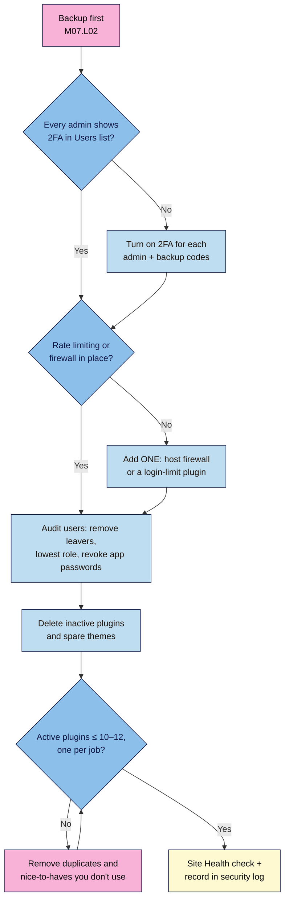

# M07.L03 — Security hardening: login protection, least privilege and pruning
> After this lesson every admin on your site logs in with 2FA, password-guessing bots get locked out, every account has only the access it needs, and no unused plugins or themes are left lying around.

**Time:** ~13 min reading + ~20 min exercise · **Level:** beginner · **Prereqs:** M01.L05 (2FA, roles), M06.L01 (plugin log), M07.L01 (updates), M07.L02 (backups)
**Verified against:** WordPress 7.1.4 core code (Users screen, **Change role to…**, delete-user options, Application Passwords, **Log Out Everywhere Else**, **Settings → General → Membership** incl. the 7.0+ default-role dropdown, Site Health inactive plugin/theme checks); Two Factor 0.17.0 and Limit Login Attempts Reloaded 3.3.10 plugin code; WP 2FA 4.2.1, Wordfence 9.0.2 and Kadence Security 10.0.6 directory listings, all on 2026-11-01

> ⚠️ **Freshness flag:** security plugins change names, menus and free features often. On 2026-11-01 the plugin the course outline calls **Solid Security** was listed on WordPress.org as **Kadence Security** (same plugin, slug `better-wp-security`). Check each plugin's wordpress.org page (last updated, tested-up-to) before installing, and score it with your M06.L01 checklist.

## Learning objectives
1. **Add** login protection: 2FA for every admin, plus rate limiting or a firewall.
2. **Audit** user accounts and downgrade each one to the least privilege it needs.
3. **Delete** unused plugins and themes, and **explain** why deactivated plugins are still a risk.

## Why it matters
Mei's food blog was taken over through an Editor account belonging to a guest writer who had left a year earlier. The writer had reused that password elsewhere, it leaked, and nobody had removed the account. Joon had 31 plugins, 9 of them deactivated "in case I need them again". One of the deactivated ones had a known hole, and attackers used it to plant a fake login page, even though it was switched off. Farah's site gets thousands of password guesses a day from bots, like almost every WordPress site. She has 2FA on every admin account and a lockout after four failed tries, so the bots get nowhere. **Most break-ins aren't clever. They use a forgotten account, a guessed password or old code nobody removed.**

## Core concept
**Plain version:** think of your site as a building with three things to secure:
1. **The front door (login):** a strong password isn't enough on its own. Add **2FA** so a stolen password doesn't open the door, and **rate limiting** so bots can't try millions of passwords.
2. **The keys (user accounts):** everyone with a login has a key. Fewer keys, and keys that open fewer rooms, mean less damage when one is lost. That's **least privilege** (M01.L05).
3. **The rooms nobody uses (plugins and themes):** every plugin and theme is code on your server. Code you don't use can still be attacked, so remove it.

**Precise definitions:**
- **Rate limiting:** after a few failed logins from the same address, the login is blocked for a while. WordPress core allows **unlimited** attempts, so you add it with a plugin or your host.
- **Brute-force attack:** bots guessing passwords over and over, usually from lists of leaked passwords.
- **Web application firewall (WAF):** a filter that blocks known-bad requests before they reach WordPress. It can run at your host or a CDN, or in a plugin such as Wordfence.
- **Attack surface:** all the code and accounts an attacker could try. Pruning shrinks it.
- **Application password:** a separate password WordPress can create for apps (e.g. a mobile app or an automation tool) to use your account through the REST API. It skips 2FA, so revoke any you don't use.

### Login protection: pick one tool per job
| Job | WordPress core? | Free option | Notes |
|---|---|---|---|
| **2FA** | No | **Two Factor** (from M01.L05) | Has **no setting to force 2FA**: each admin turns it on in their own profile, and you check the **Two-Factor** column on **Users**. If you have several writers and want to *require* 2FA by role, **WP 2FA** (free) can enforce it with a grace period. Swap to it rather than running both. |
| **Rate limiting** | No | **Limit Login Attempts Reloaded** | Defaults (*checked in 3.3.10 code*): **4** allowed retries, **20** minutes lockout, and after **4** lockouts the lockout grows to **24** hours |
| **Firewall** | No | Your **host's or CDN's** firewall · **Wordfence** (firewall, login limiting and 2FA in one) | If you use Wordfence's login limiting, don't add Limit Login Attempts Reloaded too. **One plugin per job.** |

### Why deactivated plugins are still a risk
Deactivating a plugin stops WordPress from **running** it, but its files stay on your server and can still be **requested directly by URL**. If a vulnerable file in it can do something when it's called on its own, the hole is still open (*widely reported by WordPress security researchers*). Deactivated plugins also stop showing up in your routine: you're less likely to update them, and auto-updates don't help code you've forgotten about. WordPress's own **Site Health** says it plainly: *"Inactive plugins are tempting targets for attackers. If you are not going to use a plugin, you should consider removing it."* The same goes for themes: keep your active theme plus **one default theme** as a fallback, and delete the rest.

### How many plugins is "lean"?
There's no magic number. Risk comes from each plugin's quality and how well it's maintained, not just the count. But the course's plugin stack (P1–P11, one per job) fits in about **10–12** active plugins for most creator sites, so that's a good ceiling to aim for. Every plugin above it should have a clear job in your plugin log (*observed practice*).

**Analogy:** you change the locks (2FA), put a "three strikes" rule on the doorbell (rate limiting), take keys back from people who've left (account audit), and brick up the rooms nobody uses (pruning).

## How it works

**In words:** take a backup first. Make sure every administrator has 2FA, then add **one** form of login rate limiting or a firewall. Audit every account: remove people who've left, downgrade the rest to the lowest role that works, and revoke unused application passwords. Delete inactive plugins and spare themes, cut any duplicate or unused plugins until you're at about 10–12, then confirm in Site Health and write it down.

## Hands-on walkthrough
Work on your **Local** practice site first. Then repeat on your live site (or do it on live with a fresh backup from M07.L02).

### Part A — Lock the front door (~7 min)
1. Go to **Users → All Users** and click the **Administrator** filter above the list.
   **Expected:** only admins are listed. With the Two Factor plugin active there's a **Two-Factor** column. Each admin shows a method name (e.g. *Authenticator App*) or **Disabled**.

   > 🖼️ **Image prompt:** Screenshot of WordPress Users → All Users filtered to Administrator, showing the Two-Factor column with one admin on "Authenticator App" and one "Disabled", 1280 × 800. Highlight the Two-Factor column with a 3px #F9B2D7 outline; blur any personal details (names, emails).
   > **Alt text:** Users list filtered to administrators, with a Two-Factor column showing one admin protected and one disabled.
2. For every admin showing **Disabled**: if it's you, set up 2FA now (M01.L05 Part B). If it's someone else, ask them to set it up today, or downgrade them in Part B. Do the same for **Editors**, who can publish and change anyone's posts.
3. Add rate limiting, **unless** your host's firewall or a security plugin you already use (e.g. Wordfence) does it. Check your plugin log first.
   - Score **Limit Login Attempts Reloaded** with the M06.L01 checklist, then **Plugins → Add Plugin → Install Now → Activate**.
   - A **Welcome** pop-up offers the paid cloud service and an email sign-up. Click **Skip**: the free **Local App** does the rate limiting on your own site.
   - Open the new **Limit Login Attempts** menu → **Settings** tab. Leave the defaults (4 allowed retries, 20 minutes lockout, 4 lockouts increase lockout time to 24 hours) and turn on **Notify on lockout** if you want emails.
   - **Live site:** add your own IP address to the **Safelist** only if it's fixed. Most home connections change their IP, so rely on your password manager instead.
4. **Test it on Local:** open a private window, go to `/wp-login.php`, and enter a wrong password until you're blocked.
   **Expected:** *"ERROR: Too many failed login attempts."* Wait out the lockout (or close the private window and use your normal, logged-in window), then add a row to your plugin log: **Login protection** · Limit Login Attempts Reloaded · version · auto-updates **on**.

### Part B — Audit every key (~6 min)
5. Go to **Users → All Users**, clear the filter, and list every account in a **user audit** table:
   | User | Role now | Still needed? | Lowest role that works | 2FA? | Action |
   |---|---|---|---|---|---|
   | you | Administrator | Yes | Administrator | Yes | — |
   | guest-writer-2025 | Editor | No (left in March) | — | No | Delete, attribute posts to you |
   | va-sam | Administrator | Yes, schedules posts | Editor | No | Downgrade + ask for 2FA |
6. **Downgrade:** tick the user, choose **Change role to…** → the new role → **Change**.
   **Expected:** the user's **Role** column updates. Log in as them in a private window if you want to confirm what they can see (M01.L05 Part C).
7. **Remove leavers:** hover the user → **Delete**. When asked what to do with their content, choose **Attribute all content to another user.** and pick yourself. **Don't** pick **Delete all content.** unless you mean it: that deletes their posts.
8. **Revoke stray app access:** for each admin, open **Users → Profile** (or **Edit** on the user) → **Application Passwords**. **Revoke** any password you don't recognise or no longer use. Then, at **Sessions**, click **Log Out Everywhere Else** if you've ever logged in on a shared or lost device.
9. **Close the side door:** **Settings → General → Membership**. Leave **Anyone can register** **unticked** unless you really run a membership site, and keep **New User Default Role** on **Subscriber**. Since WordPress 7.0 the dropdown no longer offers Administrator or Editor, **but** an older site that already had one selected keeps it, and it still shows. If yours says Administrator or Editor, change it now: with registration open, anyone could sign up with that role.
   **Expected:** every account in your audit table has an action done, no leavers remain, and no one has more than their job needs.

### Part C — Prune (~5 min)
10. **Plugins → Installed Plugins** → click **Inactive**. For each one, check your plugin log: if you'd really reinstall it next month, note why. Otherwise tick it → **Bulk actions → Delete** → confirm.
    **Before deleting**, export anything it stores that you need (e.g. Redirection's redirects, M06.L01). Deleting some plugins also deletes their data.
11. Click **Active**. Compare against your log's **Job** column:
    - **Two plugins for one job** (two SEO, two caching, two security, two forms)? Keep the better-scored one and delete the other.
    - **No job, or a job you no longer need** (a countdown timer from last year's launch, a social feed you removed)? Delete it.
    - Aim for **10–12 active or fewer.**
12. **Appearance → Themes:** keep your **active** theme and **one default** WordPress theme (e.g. the newest Twenty-something). For every other theme: **Theme Details → Delete**.
13. **Tools → Site Health → Status.**
    **Expected:** none of these recommendations: *"You should remove inactive plugins"*, *"You should remove inactive themes"* or *"Have a default theme available"*. Under **Passed tests** you'll see *"Your plugins are all up to date"* and *"Your themes are all up to date"* (if any updates are waiting, install them first, M07.L01).

   > 🖼️ **Image prompt:** Screenshot of Tools → Site Health → Status with "Passed tests" expanded, showing "Your plugins are all up to date" and "Your themes are all up to date", 1280 × 800. Highlight those two items with a 3px #F9B2D7 outline; blur any personal details.
   > **Alt text:** Site Health passed tests showing all plugins and all themes up to date, with no inactive plugin or theme warnings.

### Part D — Write your security log (~2 min)
14. Add a **Security log** section to your site docs:
    | Date | 2FA on all admins/editors | Rate limiting / firewall | Users removed / downgraded | Plugins: before → after | Themes deleted | Next audit |
    |---|---|---|---|---|---|---|
    | 2026-11-01 | Yes (2/2) | Limit Login Attempts Reloaded | 1 removed, 1 → Editor | 17 → 11 | 3 | 2027-02-01 |

## When to use / when not to
- **Run this audit** every **3 months**, whenever someone stops working with you, and right after any security scare (*observed practice*). Pair it with your M07.L02 restore test.
- **Use your host's firewall** if it has one. It blocks bad traffic before it reaches WordPress. **Add a security plugin** when your host offers no firewall or login protection.
- **Use one all-in-one security plugin** (Wordfence or Kadence Security) **or** single-job plugins (Two Factor + Limit Login Attempts Reloaded), not both: overlapping login and firewall features conflict.
- **Don't** give a helper Administrator "just for a day" and forget it. Create the account, do the job, then downgrade or delete it, and record it in your security log.
- **Trade-off:** stricter lockouts block more bots but can lock out real people (you, a writer on hotel Wi-Fi). Keep the defaults and make sure everyone has backup codes.

## Use AI for this
**Example prompt:**
> "Here's my plugin log with each plugin's job: [paste]. And my user list with roles and what each person does: [paste, using first names only, no emails]. Flag any plugins doing the same job, plugins with no clear job, and users whose role is higher than their tasks need. Suggest a target list of 10–12 active plugins. Don't recommend adding anything new."

**What AI does well:** spotting duplicate jobs and over-powered roles in a list, and drafting a checklist.
**Where it gets it wrong:** it may recommend stacking several security plugins, suggest editing `.htaccess` or `wp-config.php` without warning you, or claim a plugin is "safe" or "vulnerable" from outdated memory.
**How to check:** confirm plugin status on its wordpress.org page (closed? last updated?), check each role against the Roles and Capabilities page, and keep the decision to delete with you. Never paste passwords, application passwords or user emails into an AI tool.

## Common mistakes
- **2FA for you, not for the other admins and editors.** Attackers pick the weakest account.
- **Stacking security plugins** (Wordfence + Kadence Security + a login limiter). Overlapping features conflict and can lock everyone out.
- **Keeping leavers' accounts** "in case they come back". You can always create a new one.
- **Deleting a user and choosing "Delete all content."** That removes their posts. Attribute them to yourself.
- **Leaving plugins deactivated instead of deleted.** Their files are still on the server.
- **Deleting a plugin without exporting its data** (redirects, form entries, settings you need).
- **Deleting every inactive theme,** including the default one WordPress falls back to.
- **Leaving "Anyone can register" ticked** from an old experiment, especially on an older site whose **New User Default Role** is still Editor or Administrator.

## Troubleshooting
| Symptom | Likely cause | Fix |
|---|---|---|
| *"ERROR: Too many failed login attempts."* when you log in | You (or someone on your network) hit the retry limit | Wait out the lockout; use your password manager. Locked out for 24 hours? Ask your host to rename the plugin's folder to deactivate it, or log in from your own still-open session |
| Users list has no Two-Factor column | Two Factor plugin not active, or you use another 2FA plugin | Check **Plugins**; with WP 2FA or Wordfence, check 2FA status in that plugin's screens |
| A downgraded helper says they can't do their job | Role too low (e.g. Author can't edit others' posts) | Go up one role (Author → Editor), not straight to Administrator |
| Site breaks after deleting a plugin | Something depended on it (a block, shortcode or form) | Restore from your backup or reinstall it, then plan a proper replacement on staging |
| Site Health still says "You should remove inactive themes" | A spare theme left (child themes count) | Keep only the active theme (plus its parent, if it's a child theme) and one default theme |
| Spam sign-ups in Users | **Anyone can register** is ticked | Untick it in **Settings → General**; delete the spam accounts |

## Exercise
**Task:**
1. Confirm every Administrator and Editor has 2FA (Two-Factor column), with backup codes saved.
2. Add **one** form of login rate limiting (or confirm your host/firewall does it), and test the lockout on Local.
3. Complete a user audit table; remove leavers, downgrade over-powered accounts, revoke unused application passwords, and confirm **Anyone can register** is off.
4. Delete all inactive plugins and spare themes (keep one default theme), remove duplicates, and get to **10–12 active plugins or fewer**.
5. Check Site Health and fill in your security log.

**Expected outcome:** 2FA on every admin and editor; one rate-limiting or firewall layer; a user audit table with every action done; a plugin count before → after; Site Health with no inactive plugin or theme warnings; and a dated security log row.

**Stretch goal (break it and fix it):** on Local, create a user `old-intern` with the **Editor** role and write one post as them. Then deactivate (don't delete) one plugin. Run your audit from scratch as if you'd never seen the site: did your checklist catch both? Fix both, deleting `old-intern` and attributing their post to yourself.

## Key takeaways
- WordPress allows **unlimited login attempts** by default. Add **2FA for every admin and editor** plus **one** rate-limiting or firewall layer.
- **One security tool per job**; never stack overlapping security plugins.
- Audit users every 3 months: **remove leavers, lowest role that works**, revoke unused application passwords, keep registration closed.
- **Deactivated isn't deleted:** inactive plugin files stay on the server and can still be attacked.
- Keep **10–12 active plugins or fewer**, each with a job in your log, plus your active theme and one default theme.

## Teach it back
Explain to a friend in 3 sentences why they should delete, not just deactivate, plugins they don't use, and what two things protect their login page.

## Glossary terms added
- Rate limiting — added to `wordpress-101/glossary.md`
- Brute-force attack — added to `wordpress-101/glossary.md`
- Web application firewall (WAF) — added to `wordpress-101/glossary.md`
- Attack surface — added to `wordpress-101/glossary.md`
- Application password — added to `wordpress-101/glossary.md`

## Further reading
*All checked 2026-11-01.*
- WordPress developer handbook — [Hardening WordPress](https://developer.wordpress.org/advanced-administration/security/hardening/) · [Brute force attacks](https://developer.wordpress.org/advanced-administration/security/brute-force/)
- WordPress.org documentation — [Roles and Capabilities](https://wordpress.org/documentation/article/roles-and-capabilities/) · [Site Health screen](https://wordpress.org/documentation/article/site-health-screen/) · [Application Passwords](https://make.wordpress.org/core/2020/11/05/application-passwords-integration-guide/) (core integration guide)
- Plugin pages: [Two Factor](https://wordpress.org/plugins/two-factor/) · [WP 2FA](https://wordpress.org/plugins/wp-2fa/) · [Limit Login Attempts Reloaded](https://wordpress.org/plugins/limit-login-attempts-reloaded/) · [Wordfence Security](https://wordpress.org/plugins/wordfence/) · [Kadence Security](https://wordpress.org/plugins/better-wp-security/)
