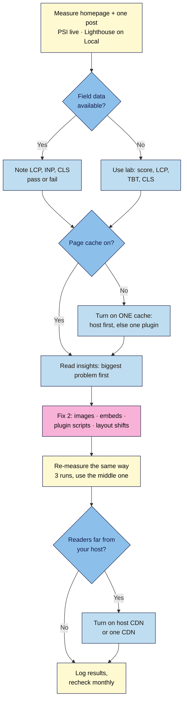

# M07.L04 — Performance: caching, CDN, lazy loading and Core Web Vitals
> After this lesson you can read a PageSpeed Insights report, turn on page caching with one tool, decide whether you need a CDN, and fix the usual reasons a creator's page is slow.

**Time:** ~18 min reading + ~25 min exercise · **Level:** beginner · **Prereqs:** M03 (images, embeds, facades), M07.L03 (lean plugins)
**Verified against:** web.dev Core Web Vitals pages (thresholds); Chrome for Developers *Lighthouse 13* post and *Performance insights* reference; WordPress 7.1.4 core code (lazy loading, `fetchpriority`, speculative loading, Site Health **Page cache** test); WP Super Cache 3.1.4 plugin code (menu under **Settings**, Easy tab, Cache Tester); PSI section headings checked against published PSI reports; LiteSpeed Cache 7.9.2 and Performance Lab 4.2.0 directory listings, all on 2026-11-01

> ⚠️ **Freshness flag:** Google's thresholds have been stable since INP replaced FID in March 2024, but PageSpeed Insights and Lighthouse regroup and rename their advice often. Lighthouse 13 (October 2025) replaced older audits such as "Properly size images" with **insights** such as **Improve image delivery**. If your report's headings differ from this lesson, look for the same idea under a new name. Claims about rankings change too. On 2026-11-01 Google Search Central said good Core Web Vitals, along with other page experience aspects, *"aligns with what our core ranking systems seek to reward"*: a reason to fix real problems, not a ranking shortcut. Search Console also has a **Core Web Vitals** report, which M08 covers.

## Learning objectives
1. **Read** a PageSpeed Insights report and **explain** LCP, INP and CLS in plain words.
2. **Turn on** page caching with one tool (your host's cache or a single plugin) and **decide** whether you need a CDN.
3. **Fix** the most common causes of slow creator pages: oversized images, heavy embeds and too many plugins.

## Why it matters
Noor's recipe posts took six seconds to show the main photo on a phone, and two out of three mobile visitors left before it appeared. Ben installed three "speed" plugins at once; his site got slower, and his comment form broke because two of them cached the same pages differently. Aiko measured first, found that a 4 MB hero photo and an auto-loading video embed were most of the problem, fixed just those two things and turned on her host's cache. Her main image now appears in under two seconds. **Speed work is measuring, fixing the biggest problem, and measuring again. It isn't installing more plugins.**

## Core concept
**Plain version:** a page feels fast when three things happen:
1. **The main content shows up quickly** (loading).
2. **The page reacts quickly when you tap or click** (responsiveness).
3. **Nothing jumps around while it loads** (stability).
Google measures each of these with one number. Together they are the **Core Web Vitals**.

| Metric | What it measures | Good | Needs improvement | Poor |
|---|---|---|---|---|
| **LCP** — Largest Contentful Paint | How long until the biggest image or text block on screen appears | **≤ 2.5 s** | 2.5–4 s | > 4 s |
| **INP** — Interaction to Next Paint | How long the page takes to respond visibly after a tap, click or key press, across the visit | **≤ 200 ms** | 200–500 ms | > 500 ms |
| **CLS** — Cumulative Layout Shift | How much the content jumps around unexpectedly (a score, not seconds) | **≤ 0.1** | 0.1–0.25 | > 0.25 |

A page **passes** when **75%** of real visits are "good" on all three (*web.dev*).

**Field data vs lab data:** PageSpeed Insights (PSI) shows two kinds of results, and mixing them up is the most common mistake.
- **Field data** (top of the report, *"Discover what your real users are experiencing"*) comes from real Chrome users over the last **28 days** (the Chrome UX Report). This is what Google uses. New or low-traffic sites often have **no field data** yet.
- **Lab data** (lower down, *"Diagnose performance issues"*) is one test run by **Lighthouse** on a simulated mid-range phone. It gives the **Performance score** (0–100) and the list of things to fix. The lab can't tap your page, so instead of INP it shows **Total Blocking Time (TBT)**: how long scripts kept the page too busy to respond. High TBT usually means poor INP.

**What WordPress already does for you** (*checked in WordPress 7.1.4 code*):
- **Lazy loading:** images and iframes get `loading="lazy"`, except the first three in the content, so the top of the page isn't delayed (M03).
- **Priority for the main image:** the first large image (at least 50,000 square pixels, e.g. 250 × 200) gets `fetchpriority="high"`, so the browser fetches your likely LCP image first.
- **Image sizes:** `width`, `height` and `srcset` are added to images, which prevents layout shifts and lets phones download smaller files (M03.L01).
- **Speculative loading** (since WordPress 6.8): for logged-out visitors on sites with pretty permalinks, WordPress tells the browser to **prefetch** a link the moment the reader presses down on it, before they let go (*"conservative"* mode), so the next page opens faster.

**What you add:**
- **Page caching:** WordPress normally builds each page from PHP and the database on every visit. A **page cache** saves the finished HTML and hands that copy to the next visitor, which is much faster. It's usually the biggest single win on ordinary hosting (*observed practice*).
- **A CDN (content delivery network)** keeps copies of your images, CSS and JavaScript (and sometimes whole pages) on servers around the world, so each reader downloads them from somewhere nearby.

**Analogy:** your site is a café. Without caching, every customer's coffee is ground, brewed and poured from scratch. With a page cache, the popular orders are ready on the counter. A CDN opens small counters in other cities so nobody has to travel to the main shop.

### Do you need a CDN? (*observed practice*)
| Situation | CDN? |
|---|---|
| Most readers are in one country, near your host's data centre | **Optional.** Page caching matters more |
| Readers on several continents, or image-heavy posts | **Yes.** Use your host's built-in CDN if it has one, or a free CDN plan |
| Your host already includes a CDN (many managed WordPress hosts do) | **Turn it on**; don't add a second |
| You're on Local | **Not applicable.** Decide when you go live |

## How it works

**In words:** measure your homepage and one typical post. Use field data if PSI has it, and lab data if not. Make sure **one** page cache is on, then work through the report's insights, biggest problem first, and fix two things. Re-measure exactly the same way (three runs, use the middle result). Add a CDN if your readers are far from your server. Write the numbers down and check again monthly.

## Hands-on walkthrough
**Live site:** use **PageSpeed Insights** (pagespeed.web.dev). **Local site:** PSI can't reach your computer, so use **Lighthouse** in Chrome DevTools. Local runs on your own machine, so its numbers look better than real hosting. Compare your before and after, not your score with other sites.

### Part A — Measure a baseline (~7 min)
1. Pick two URLs: your **homepage** and your **most-visited post** (or a typical post with images and an embed).
2. **Live:** open pagespeed.web.dev, paste the URL, **Analyze**. Stay on the **Mobile** tab.
   **Local:** open the page in a Chrome **Incognito** window, **F12 → Lighthouse** → **Mode: Navigation**, **Device: Mobile**, **Performance** only → **Analyze page load**.
3. Read the report top to bottom:
   - **Field data** (PSI only): *Core Web Vitals Assessment:* **Passed** or **Failed**, with LCP, INP and CLS bars. If it says there isn't enough real-user data, skip to the lab section; that's normal for new sites.
   - **Lab data:** the **Performance** score, then **LCP**, **TBT**, **CLS** (plus First Contentful Paint and Speed Index).
   - **Insights:** expandable items such as **Improve image delivery**, **LCP breakdown**, **Render-blocking requests**, **Layout shift culprits**, **Third parties** and **Use efficient cache lifetimes**, each with an estimated saving.
   - **The LCP element:** open **LCP breakdown** to see *which* element is your LCP (usually your featured or hero image, sometimes a heading).

   > 🖼️ **Image prompt:** Screenshot of a PageSpeed Insights mobile report for a blog post: the Core Web Vitals Assessment (field data) at the top and, below, the lab Performance score with LCP, TBT and CLS values, 1280 × 900. Highlight the field-data block and the lab-metrics block with a 3px #F9B2D7 outline each; blur the site URL if it's personal.
   > **Alt text:** PageSpeed Insights report with real-user Core Web Vitals at the top and lab metrics with the Performance score below.
4. Run each test **three times** and record the **middle** result (lab numbers vary from run to run):
   | Page | Field CWV (pass/fail) | Score | LCP | TBT | CLS | LCP element | Top 3 insights |
   |---|---|---|---|---|---|---|---|
   | Homepage — before | | | | | | | |
   | Post — before | | | | | | | |

### Part B — Turn on one page cache (~7 min)
5. **Check what you already have** (one cache only, M07.L03):
   - **Host:** look in your hosting dashboard for **Cache**, **Performance** or **Speed**. Many managed hosts cache pages at the server and may block caching plugins.
   - **Plugins:** in your plugin log, is anything already doing **caching / performance** (P6)?
   - **Live site:** **Tools → Site Health → Status** runs a **Page cache** test on production sites. *"Page cache is detected and the server response time is good"* means you're done. (*"Good"* means under 600 ms. Local and staging sites usually skip this test.)
6. **No cache yet?** Choose **one**:
   - **Your host's cache** (best when available): switch it on in the dashboard.
   - **LiteSpeed Cache**, but **only** if your host runs a LiteSpeed server (your host's docs will say so).
   - **WP Super Cache** (free, by Automattic) for everything else. Score it with your M06.L01 checklist first.
7. **WP Super Cache setup:** install and activate, then **Settings → WP Super Cache → Easy** → **Caching On** → **Update Status**.
   **Expected:** a status showing caching is on.

   > 🖼️ **Image prompt:** Screenshot of Settings → WP Super Cache → Easy tab with "Caching On" selected, the Update Status button, and the Cache Tester section with the Test Cache button, 1280 × 800. Highlight "Caching On" and "Test Cache" with a 3px #F9B2D7 outline; blur any personal details.
   > **Alt text:** WP Super Cache Easy tab with Caching On selected and the Cache Tester's Test Cache button.
8. In **Cache Tester**, click **Test Cache**.
   **Expected:** *"The timestamps on both pages match!"* If you see *"The pages do not match! Timestamps differ or were not found!"*, see Troubleshooting.
9. **Test it as a reader would:** open the homepage in a **logged-out** private window. Logged-in users always see fresh, uncached pages (*"Caching disabled for logged in visitors."*), so caching seems to "do nothing" if you only test while logged in.
10. **When you change something** (theme, menu, a widget) and the public site doesn't show it, use **Delete Cache** on the plugin's screen. Most caches clear a post's page automatically when you update the post.
11. Add a plugin-log row: **Caching** · WP Super Cache (or "host cache") · version · auto-updates **off** (test caching plugin updates on staging, M07.L01).

### Part C — Apply two fixes (~8 min)
12. Use your Part A insights to pick the **two** biggest problems. Most creator sites have these:
   | Insight / symptom | Usual cause on creator sites | Fix |
   |---|---|---|
   | **Improve image delivery**; LCP is your hero/featured image and slow | Image uploaded at 4000 px and several MB, or in JPEG/PNG when WebP/AVIF would do | Resize and compress before uploading, or convert with your image plugin (M03.L02). Re-upload the hero image following your M03.L02 image rule (e.g. 1600 px wide, WebP) |
   | **LCP request discovery** says the LCP image is lazy-loaded | A theme, builder or plugin lazy-loads everything, overriding core | Turn off that plugin's lazy-load for the first image / above-the-fold area. Let WordPress core handle it |
   | **Third parties**; high TBT | Video embeds, social feeds, chat widgets or ad scripts near the top | Swap the top embed for a facade (M03.L05); remove social feed widgets you don't need; move embeds lower |
   | **Render-blocking requests**; many CSS/JS files from plugins | Plugins loading their scripts on every page (sliders, form plugins, icon packs) | Delete plugins you don't need (M07.L03); in the plugin's settings, load it only where it's used, if it offers that |
   | **Layout shift culprits**; CLS > 0.1 | Ads, embeds or cookie banners pushing content down; images without dimensions in custom HTML | Reserve space for ads and embeds; use the Image block (it adds width/height); use a cookie banner that overlays rather than pushes |
   | High server time (**Document request latency**) | No page cache, or slow hosting | Part B; if it's still slow with caching on, talk to your host or consider upgrading (M01.L02) |
13. Apply your two fixes. If a fix involves a plugin change, do it on staging first if it's a front-end plugin (M07.L01).

### Part D — Re-measure and decide on a CDN (~3 min)
14. Re-test the same two URLs **the same way** (same tool, Mobile, three runs, middle result). Clear your cache first if you changed images.
   | Page | Score | LCP | TBT | CLS | What changed |
   |---|---|---|---|---|---|
   | Homepage — after | | | | | |
   | Post — after | | | | | |
   **Expected:** lab LCP and/or TBT drop noticeably after your fixes. **Field data won't change for days to weeks**, because it's a 28-day rolling window of real visits. Check PSI again in a month.
15. Use the CDN table above to decide, and write your decision in your site docs ("No CDN: 85% of readers in the UK, host in London" or "Turned on host CDN").

## When to use / when not to
- **Use field data** to judge whether you have a real problem; **use lab data** to find and test fixes.
- **Use your host's cache** when it has one; add a caching plugin only when it doesn't. **Never run two caching plugins** (or a plugin on top of a host cache that says not to).
- **Use a CDN** for readers far from your server or very image-heavy sites; skip it if your audience is local and pages are cached.
- **Don't chase 100.** A score in the 90s on a simulated phone isn't required. Aim to **pass Core Web Vitals in the field**, and spend the rest of your time on content.
- **Trade-off:** aggressive optimisation options (combining or delaying all JavaScript, removing "unused" CSS) can break menus, forms and checkouts. Turn on one option at a time and check your key pages, just like updates.

## Use AI for this
**Example prompt:**
> "Here are my PageSpeed Insights results for a WordPress blog post (mobile). Field data: [paste or 'none']. Lab: score [x], LCP [x] s, TBT [x] ms, CLS [x]. LCP element: [paste]. Top insights with savings: [paste names and numbers]. My plugins: [paste plugin log]. Rank the three fixes most likely to improve LCP and TBT, explain each in one sentence, and say which plugin or setting to change. Don't suggest installing new plugins unless nothing I have can do it."

**What AI does well:** translating insight names into plain-English causes and ranking fixes by likely impact.
**Where it gets it wrong:** it often recommends stacking optimisation plugins, uses audit names from older Lighthouse versions, quotes outdated thresholds (FID instead of INP), or promises a specific score.
**How to check:** compare the advice with the insight descriptions in your own report, check thresholds on web.dev, and trust only your before/after measurements.

## Common mistakes
- **Testing only while logged in.** You bypass the cache and see admin-bar scripts.
- **Comparing one run with another run.** Lab results vary. Use the middle of three, same tool and device.
- **Treating the lab score as the Google verdict.** Field data (when available) is what reflects real readers.
- **Two caching or optimisation plugins**, or a plugin fighting your host's cache.
- **Lazy-loading the hero image** with a plugin, which delays LCP. Core already skips the first images.
- **Turning on every "advanced" optimisation** (combine/defer/delay JS, remove unused CSS) at once, then not knowing what broke the menu.
- **Expecting field data to improve the next day.** It's a 28-day rolling window.
- **Uploading full-resolution photos straight from the camera or phone.**

## Troubleshooting
| Symptom | Likely cause | Fix |
|---|---|---|
| PSI says there isn't enough real-user data | New or low-traffic page | Use the lab section; field data appears once enough Chrome users visit |
| WP Super Cache: *"The pages do not match! Timestamps differ or were not found!"* | Testing while another cache or CDN rewrites pages, a plugin disables caching, or the host blocks it | Check for a host cache or second caching plugin (use only one); ask your host whether caching plugins are allowed |
| Changes don't show on the live site | You're seeing the cached copy | **Delete Cache** in the plugin (and purge your host or CDN cache) |
| Menu, form or checkout broke after enabling an optimisation option | JavaScript combined, deferred or delayed | Turn that option off; exclude the affected script or page; re-test on staging |
| Lab score jumps 15 points between runs | Normal lab variation, network or server load | Use the middle of three runs; compare like with like |
| Site Health: *"Page cache is not detected and the server response time is slow"* | No page cache on a production site, or slow hosting | Turn on your host cache or one plugin (Part B); if still slow, ask your host |
| CLS is high only on mobile | Ads, embeds or a cookie banner pushing content on small screens | Reserve space; use an overlay banner; check **Layout shift culprits** |

## Exercise
**Task:**
1. Measure your homepage and one typical post (PSI for live, Lighthouse for Local), three runs each, recording field CWV if available, plus score, LCP, TBT, CLS, the LCP element and the top three insights.
2. Confirm **one** page cache is on (host or plugin). On a plugin, pass **Test Cache**, and confirm a logged-out view loads the cached page.
3. Apply **two** fixes from the Part C table that match your top insights.
4. Re-measure the same way and fill in the after table.
5. Write your CDN decision with one sentence of reasoning.

**Expected outcome:** a before/after table for two pages showing a measurable change in lab LCP or TBT; one cache confirmed working; two fixes named and applied; a CDN decision in your site docs.

**Stretch goal (break it and fix it):** on Local, upload a 4000-pixel, multi-megabyte photo as the featured image of your test post and measure it. Then replace it with a resized, compressed WebP version (M03.L02) and measure again. How much did LCP and the page weight change?

## Key takeaways
- **LCP** (main content appears, ≤ 2.5 s), **INP** (reacts to taps, ≤ 200 ms) and **CLS** (doesn't jump, ≤ 0.1) are the Core Web Vitals. Pass at 75% of real visits.
- **Field data** shows real readers over 28 days; **lab data** (Lighthouse) helps you find and test fixes. TBT is the lab's stand-in for INP.
- WordPress core already lazy-loads, prioritises the main image and prefetches links. **Add one page cache**: your host's, or a single plugin.
- The usual culprits are **oversized images, embeds near the top and plugin scripts on every page**. Fix the biggest first.
- Measure → fix two things → re-measure the same way. A CDN helps when readers are far from your server.

## Teach it back
Explain to a friend in 3 sentences what LCP, INP and CLS measure, and why their PageSpeed score can differ from the "real users" result at the top of the report.

## Glossary terms added
- Core Web Vitals — added to `wordpress-101/glossary.md`
- Largest Contentful Paint (LCP) — added to `wordpress-101/glossary.md`
- Interaction to Next Paint (INP) — added to `wordpress-101/glossary.md`
- Cumulative Layout Shift (CLS) — added to `wordpress-101/glossary.md`
- Field data vs lab data — added to `wordpress-101/glossary.md`
- Total Blocking Time (TBT) — added to `wordpress-101/glossary.md`
- Page cache — added to `wordpress-101/glossary.md`
- CDN (content delivery network) — added to `wordpress-101/glossary.md`
- Speculative loading — added to `wordpress-101/glossary.md`

## Further reading
*All checked 2026-11-01.*
- web.dev — [Web Vitals](https://web.dev/articles/vitals) · [LCP](https://web.dev/articles/lcp) · [INP](https://web.dev/articles/inp) · [CLS](https://web.dev/articles/cls) · [How the thresholds were defined](https://web.dev/articles/defining-core-web-vitals-thresholds) · [Why lab and field data can be different](https://web.dev/articles/lab-and-field-data-differences)
- Google for Developers — [About PageSpeed Insights](https://developers.google.com/speed/docs/insights/v5/about)
- Google Search Central — [Understanding Core Web Vitals and Google search results](https://developers.google.com/search/docs/appearance/core-web-vitals) (how Google uses them; may change)
- Chrome for Developers — [What's new in Lighthouse 13](https://developer.chrome.com/blog/lighthouse-13-0) · [Performance insights reference](https://developer.chrome.com/docs/performance/insights) · [Lighthouse performance scoring](https://developer.chrome.com/docs/lighthouse/performance/performance-scoring)
- WordPress — [Speculative loading in 6.8](https://make.wordpress.org/core/2025/03/06/speculative-loading-in-6-8/) (Make Core) · [WordPress Performance Team](https://make.wordpress.org/performance/)
- Plugin pages: [WP Super Cache](https://wordpress.org/plugins/wp-super-cache/) · [LiteSpeed Cache](https://wordpress.org/plugins/litespeed-cache/) · [Performance Lab](https://wordpress.org/plugins/performance-lab/)
