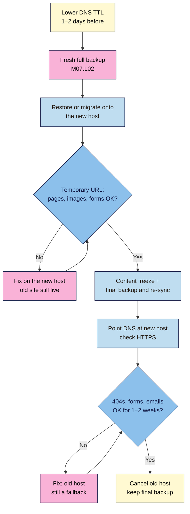

# M07.L05 — Own your content: export and moving to a new host
> After this lesson you can export everything you've written, know exactly what that export leaves behind, plan a move to a new host without downtime or broken links, and keep your email list and media safe outside WordPress.

**Time:** ~15 min reading + ~20 min exercise · **Level:** beginner · **Prereqs:** M07.L02 (backups and migration restore), M01.L02 (DNS and TTL), M06.L02–L03 (email list and consent)
**Verified against:** WordPress 7.1.4 core code (**Tools → Export** labels, WXR 1.2 contents, which post types are exportable, **Tools → Import**); WordPress Importer 0.9.7 plugin code; Google Search Central site-move guides, all on 2026-11-01

> ⚠️ **Freshness flag:** on 2026-11-01 the official **WordPress Importer** plugin (by WordPress.org contributors, last updated 2026-10-20) was listed as *tested up to* WordPress 6.8, so the directory may show its "hasn't been tested with the latest 3 major releases" warning. It's still the standard importer and worked with WordPress 7.1 in these steps. Check its page before relying on it, and use a full-site migration (M07.L02) for real moves.

## Learning objectives
1. **Export** all content with **Tools → Export** and **explain** what the file does and doesn't include.
2. **Plan** a host migration with minimal downtime and no broken links.
3. **Keep** a copy of your email list and media outside WordPress.

## Why it matters
Dele's host went out of business with two weeks' notice. Because he had a recent full backup (M07.L02), he restored it on a new host and switched his domain over in an evening, and his readers never noticed. Grace moved hosts by importing her Tools → Export file into a fresh install. Her posts arrived, but her theme design, SEO titles, 300 redirects and newsletter sign-ups didn't, and she spent a month finding out what was missing. Paul's 6,000-subscriber list lived only in a WordPress plugin, and when his site was hacked he couldn't email anyone to explain. **Owning your platform (non-negotiable #1) means you can leave at any time with everything you've built, and that you've tested it.**

## Core concept
**Plain version:** WordPress gives you two ways to take your site with you, and they do different jobs:
1. **A content export (Tools → Export):** an XML file of your writing: posts, pages, comments and so on. It's small, portable and readable by other platforms. It's a **content** copy, **not** a backup.
2. **A full-site copy** (your backup plugin's restore/migration from M07.L02, or your new host's migration tool): files **and** database, so the whole site arrives looking and working the same. This is what you use to **move hosts**.

**What Tools → Export ("All content") includes** (*checked in WordPress 7.1.4 code*): the file uses a format called **WXR** (WordPress eXtended RSS). WordPress describes it as *"all of your posts, pages, comments, custom fields, terms, navigation menus, and custom posts"*. In practice that means:
| Included | Not included |
|---|---|
| Posts, pages, comments, categories, tags | **Media files themselves.** Only their records and web addresses are included; the importer downloads the files from the old site **if it's still online** |
| Custom fields (e.g. many SEO plugins' per-post titles and descriptions) | **Themes and plugins** (the code) |
| Navigation menus, synced patterns, and Site Editor templates, template parts and styles (all exportable post types) | **Site settings**: Settings screens, permalinks, plugin settings |
| Authors' names and emails | **User passwords and roles.** Only authors of content come along, as new users or assigned to existing ones |
| Media library entries (title, alt text, caption) | **Data plugins keep in their own tables**: redirects (Redirection), form entries, subscriber lists in MailPoet, shop orders |
| | **Revisions** (not exportable) |

**Rule of thumb:** use **Tools → Export** to keep a portable copy of your writing, to move to another platform, or to rebuild cleanly. Use a **full-site migration** to move hosts.

**Analogy:** Tools → Export is a box of your manuscripts. A full-site backup is the whole house, with furniture, wiring and the address book.

### Moving hosts without downtime or broken links
If you keep the **same domain**, every URL stays the same, so you need **no redirects**. Google calls this a move *"without URL changes"*. The risk is downtime and missing pieces, not lost links.
If you **change domain** too, every old URL needs a **301 redirect** to its new one (M05.L02), plus Google Search Console's **Change of Address** tool. That's a bigger job, so do it separately from a host move if you can.

The safe order (*Google Search Central's site-move guide, adapted for WordPress*):
1. **Prepare:** lower your DNS **TTL** a day or two ahead (M01.L02), so the switch spreads faster. Pick a quiet day.
2. **Copy:** take a fresh full backup and restore it on the new host (migration tool, your backup plugin's migrate option, or the host's free migration service).
3. **Check before switching:** view the new copy on the host's **temporary URL** or preview link. Check key pages, images, forms, sign-up and checkout.
4. **Freeze, then switch:** don't publish or change anything (comments can be paused) from the final backup until the switch. Point your DNS at the new host and confirm HTTPS works there (M01.L03).
5. **Watch:** keep the old host running for **at least 1–2 weeks** while DNS caches expire. Watch for 404s (Redirection log or Search Console) and form and email delivery.
6. **Cancel the old host** only when everything (and everyone, including Googlebot) is reaching the new one.

### What lives outside WordPress (and should)
- **Your email list** belongs in your email provider (M06.L02), *and* in an **export (CSV) on your own drive**, refreshed monthly. Include the consent fields (date, source, form) from M06.L03, because you may need to prove consent after a move.
- **Your media originals** (full-resolution photos, video masters, audio) live in a folder or photo library you control, not only in `wp-content/uploads`. Your backup's **Uploads** zip (M07.L02) is a second copy.
- **Your accounts list:** registrar, host, DNS, CDN, email provider and analytics logins (in your password manager, with 2FA). You can't move a site you can't log in to.

## How it works

**In words:** lower your TTL ahead of time and take a fresh full backup. Restore it on the new host and check it on the temporary URL while the old site is still live. Freeze changes, re-sync if needed, then point DNS at the new host and confirm HTTPS. Keep the old host as a fallback for a week or two, fix anything that turns up, and only then cancel it.

## Hands-on walkthrough
You'll export your **Local** practice site and import it into a fresh Local site, then write down what didn't come across. (You can use **WordPress Playground** instead for the import site, but Playground runs in your browser and usually can't fetch images from a `.local` address, so only text content will arrive.)

### Part A — Export all content (~3 min)
1. On your practice site, go to **Tools → Export**.
   **Expected:** *"Choose what to export"*, with **All content** selected, the note *"This will contain all of your posts, pages, comments, custom fields, terms, navigation menus, and custom posts."*, and the options **Posts**, **Pages** and **Media**.
2. Keep **All content** and click **Download Export File**.
   **Expected:** an `.xml` file named after your site and today's date (e.g. `mysite.WordPress.2026-11-01.xml`) in your Downloads folder.
3. Open it in a text editor and skim: you'll see `<wp:wxr_version>1.2</wp:wxr_version>`, your post titles inside `<item>` blocks, and `<wp:attachment_url>` lines pointing at image addresses on your site. That's the proof that images are **referenced**, not included.
4. Move the file to your offline backup folder from M07.L02 (e.g. `backups/2026-11-01/`).

   > 🖼️ **Image prompt:** Screenshot of WordPress Tools → Export with "All content" selected, its description text, and the Download Export File button, 1280 × 800. Highlight the "All content" option and the button with a 3px #F9B2D7 outline; blur any personal details.
   > **Alt text:** Tools → Export screen with All content selected and the Download Export File button.

### Part B — Import into a fresh site (~10 min)
5. Keep your practice site **running** in Local (the importer downloads images from it). Create a new site: **+ → Create a new site**, name it `import-test`, default settings.
6. On `import-test`, go to **Tools → Import**. Under **WordPress** (*"Import posts, pages, comments, custom fields, categories, and tags from a WordPress export file."*) click **Install Now**, then **Run Importer**.
7. *"Choose a WXR (.xml) file to upload, then click Upload file and import."* Choose your export file → **Upload file and import**.
8. On **Assign Authors**, for each author choose **or assign posts to an existing user:** → your `import-test` admin (simplest), or create a new user. Under **Import Attachments**, tick **Download and import file attachments**. Click **Submit**.
   **Expected:** a list of what was imported, ending with **All done.** **Have fun!** and possibly *"Remember to update the passwords and roles of imported users."* Some *"Failed to import…"* lines for media are common if the source site wasn't reachable.

   > 🖼️ **Image prompt:** Screenshot of the WordPress Importer's Assign Authors step showing one author mapped with "or assign posts to an existing user:" set to the admin, and the "Download and import file attachments" checkbox ticked, 1280 × 800. Highlight the checkbox with a 3px #F9B2D7 outline; blur any personal details.
   > **Alt text:** WordPress Importer Assign Authors screen with the existing-user dropdown and the download attachments option ticked.

### Part C — Find what didn't come across (~5 min)
9. Compare the two sites side by side and fill in:
   | Item | Practice site | import-test | Came across? |
   |---|---|---|---|
   | Number of posts / pages (**Posts**, **Pages** counts) | | | |
   | Featured images and in-post images | | | |
   | Categories, tags, comments | | | |
   | Navigation menu | | | |
   | Theme and its design (fonts, colours, homepage layout) | | | |
   | Plugins (SEO, forms, redirects, caching) | | | |
   | SEO titles/descriptions per post | | | Stored, but only work once the same SEO plugin is installed |
   | Redirects | | | |
   | Settings: site title, permalinks, reading settings | | | |
   | Email subscribers | | | |
   **Expected:** writing, comments, terms, menus and (if downloads worked) images came across. Themes, plugins, settings, redirects, and anything kept in plugin tables didn't. That gap is why moving hosts uses a **full-site migration**, not an export.
10. Delete `import-test` when you're done, or keep it as a scratch site.

### Part D — Keep your list and media outside WordPress (~2 min)
11. In your email provider (M06.L02), find **Export** for your subscribers (usually CSV) and download the full list **with** status and consent fields. If your list lives in a WordPress plugin such as MailPoet, use the plugin's own export, because Tools → Export doesn't include it.
12. Save the CSV in your offline backup folder. It contains personal data: keep it on an encrypted drive or in a password-protected cloud account, and delete old copies you don't need (M06.L03).
13. Write a one-page **move-out kit** note in your site docs: where your latest full backup, WXR export, subscriber CSV and media originals are; your accounts list (registrar, DNS, host, email provider), with logins kept in your password manager; and the date each was last refreshed.

## When to use / when not to
- **Use Tools → Export** monthly as a portable copy of your writing, before trying another platform, or to rebuild a messy site from clean content.
- **Use a full-site migration** (backup plugin restore with search-and-replace, or the new host's migration tool) to **move hosts**. Many hosts migrate for free. Still check the result yourself on the temporary URL.
- **Don't change domain and host on the same day** if you can avoid it. Two changes at once make problems hard to trace.
- **Don't cancel the old host** the day you switch DNS.
- **Trade-off:** WXR is portable and tiny but incomplete; a full-site copy is complete but WordPress-only and large. Keep both.

## Use AI for this
**Example prompt:**
> "I'm moving my WordPress site from [old host] to [new host], keeping the same domain [example.com]. DNS is managed at [registrar/Cloudflare]. My site has [N] posts, a contact form, a newsletter sign-up, and [Redirection / an SEO plugin]. Write a dated migration checklist from one week before to two weeks after, with what to check on the new host's temporary URL and what to watch after switching DNS."

**What AI does well:** turning the move into a timeline and checklist that fits your site's features.
**Where it gets it wrong:** it may say Tools → Export is a full backup, give your registrar's or host's menus from memory, suggest changing the domain at the same time, or tell you to cancel the old host immediately.
**How to check:** compare it with this lesson's "included / not included" table, follow your host's and DNS provider's own documentation for their screens, and test the new copy before you switch.

## Common mistakes
- **Treating Tools → Export as a backup.** It leaves out media files, themes, plugins, settings and plugin data.
- **Shutting down the old site before importing**, so the importer can't download images.
- **Moving hosts with a WXR import** and losing design, SEO settings, redirects and forms.
- **Switching DNS before checking the new copy** on a temporary URL.
- **Publishing during the move**, so new posts or comments exist only on the old host.
- **Cancelling the old host on day one**, with no fallback while DNS caches expire.
- **An email list that exists only inside a plugin**, with no CSV export anywhere.
- **Changing domain without 301 redirects** for every old URL.

## Troubleshooting
| Symptom | Likely cause | Fix |
|---|---|---|
| Imported posts have no images (*"Failed to import"* media lines) | Source site offline or unreachable (e.g. Playground can't reach `.local`) | Keep the source running and re-run the import (existing posts are skipped), or move media with a full-site migration |
| Import stops or times out | Large export file or low server limits | Export by **Posts** and **Pages** separately, or split by date range, and import each |
| New host shows an old version of the site | DNS still cached, or the content freeze was skipped | Wait for the TTL to expire; re-sync the final changes from the old host |
| "Not secure" warning after switching | No SSL certificate yet on the new host | Issue the certificate in the new host's dashboard (M01.L03); some need DNS to point there first |
| 404s appear after the move | Permalink settings or redirects didn't move | Re-save **Settings → Permalinks**; import your Redirection export (M06.L01) |
| Contact form emails stop arriving | Email sending set up differently on the new host | Send a test; set up SMTP or your form plugin's email settings on the new host |

## Exercise
**Task:**
1. Export **All content** from your practice site and store it in your offline backup folder.
2. Import it into a fresh `import-test` site with **Download and import file attachments** ticked.
3. Fill in the "came across?" table and list three things that didn't move.
4. Export your email list (CSV with consent fields) and store it safely.
5. Write a dated migration checklist for moving your live site to a new host on the same domain, using the six steps above.

**Expected outcome:** a WXR file and subscriber CSV in your offline folder; an `import-test` site showing your posts and images; a completed table naming at least three things a content export doesn't carry; and a written six-step migration checklist with dates.

**Stretch goal:** do a real rehearsal. Use UpdraftPlus's migration (M07.L02) to move your Local site to a second Local site, as if it were a new host. Then compare the result with the `import-test` site. Which would you use to move hosts, and why?

## Key takeaways
- **Tools → Export (WXR)** copies your writing (posts, pages, comments, terms, menus and custom fields) but **not** media files, themes, plugins, settings, passwords or plugin tables.
- To **move hosts**, use a **full-site migration**, check it on a temporary URL, then switch DNS.
- **Same domain = no redirects needed.** A domain change needs 301s for every URL plus Search Console's Change of Address.
- Lower TTL first, freeze content during the switch, and **keep the old host 1–2 weeks** as a fallback.
- Keep a **move-out kit** outside WordPress: full backup, WXR export, subscriber CSV with consent, media originals, accounts list.

## Teach it back
Explain to a friend in 3 sentences the difference between Tools → Export and a full backup, and which one they'd use to move to a new host.

## Glossary terms added
- Content export vs full-site backup — added to `wordpress-101/glossary.md`
- Site migration (host move) — added to `wordpress-101/glossary.md`
- Temporary URL (preview link) — added to `wordpress-101/glossary.md`
- Content freeze — added to `wordpress-101/glossary.md`
- Move-out kit — added to `wordpress-101/glossary.md`

## Further reading
*All checked 2026-11-01.*
- WordPress.org documentation — [Tools Export Screen](https://wordpress.org/documentation/article/tools-export-screen/) · [Importing content](https://wordpress.org/documentation/article/importing-content/)
- WordPress developer handbook — [Moving WordPress (migrating)](https://developer.wordpress.org/advanced-administration/upgrade/migrating/)
- Plugin page: [WordPress Importer](https://wordpress.org/plugins/wordpress-importer/)
- Google Search Central — [Moving a site without URL changes](https://developers.google.com/search/docs/crawling-indexing/site-move-no-url-changes) (hosting moves, TTL, monitoring) · [Site moves with URL changes](https://developers.google.com/search/docs/crawling-indexing/site-move-with-url-changes) (domain changes, 301s) · [Change of Address tool](https://support.google.com/webmasters/answer/9370220)
