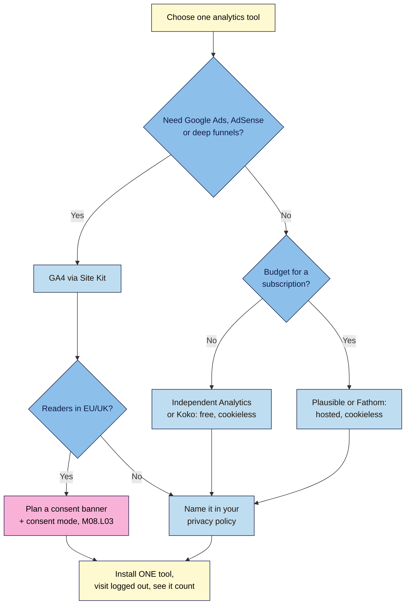

# M08.L01 — Choose your analytics: GA4 via Site Kit or a privacy-friendly alternative
> After this lesson you've picked one analytics tool that fits your site, you know whether that choice means you need a cookie banner, and you've seen it count a real visit.

**Time:** ~14 min reading + ~20 min exercise · **Level:** beginner · **Prereqs:** M05.L05 (Search Console), M06.L03 (privacy policy), M06.L01 (plugin log)
**Verified against:** Site Kit by Google 1.190.0 (plugin code: setup labels, **Exclude Analytics** default, **Admin Settings → Consent mode** card and its WP Consent API requirement), Independent Analytics 2.16.2 (plugin code: **Ignore User Roles** default), WordPress.org listings for Jetpack 16.3.1, Plausible Analytics 2.6.4, Fathom Analytics for WP 3.3.1 and Koko Analytics 2.5.3; Jetpack, Plausible and Fathom pricing pages; ICO and CNIL analytics-cookie guidance, all on 2026-11-01

> ⚠️ **Freshness flag:** analytics prices, free tiers and cookie rules change. Prices below are as listed on 2026-11-01. In the UK, the Data (Use and Access) Act 2025 added a **narrow** consent exception for some statistics cookies; EU rules differ by country. This lesson only covers how your *choice* affects consent. M08.L03 covers the rules. Not legal advice.

## Learning objectives
1. **Compare** GA4 (via Site Kit), Jetpack Stats, Independent Analytics, Plausible and Fathom on privacy, cost and depth.
2. **Explain** how your analytics choice affects cookie-consent requirements.
3. **Install** one analytics tool and **confirm** it records visits.

## Why it matters
Lucía installed GA4, Jetpack Stats *and* a third stats plugin "to compare". Three tools gave three different numbers, her pages got slower, and her cookie banner had to list all of them. Arjun picked GA4 for its depth, then never opened it because the reports overwhelmed him. Sophie writes for readers in France and Germany. She chose a cookieless tool, which means no analytics banner, and checks one simple dashboard every month. **The best analytics tool is the one you'll actually look at, and that doesn't create privacy work you can't keep up with.**

## Core concept
**Plain version:** analytics answers three questions: **how many people came**, **where they came from**, and **what they read or did**. Every tool answers those. They differ on:
1. **Where the data lives:** with a big company (Google, Automattic), a small analytics company, or inside your own WordPress database.
2. **Whether it uses cookies** (or similar storage on the reader's device). This decides whether you may need a consent banner (objective 2).
3. **Depth vs simplicity:** GA4 can track almost anything but has a steep learning curve. Privacy-friendly tools show the essentials on one page.
4. **Cost:** free, free for personal use only, or a monthly subscription.

**Search Console isn't analytics, but you need both.** Search Console (M05.L05) shows what happens **in Google Search** before the click: queries, impressions, clicks. Analytics shows what happens **on your site** after it. M08.L02 combines them into a monthly dashboard.

**Analogy:** analytics is a visitor counter for your shop. GA4 is a full CCTV and loyalty-card system: powerful, but it records a lot about each person and needs a sign on the door. A cookieless counter just clicks once per visitor and notes which door they came in by.

### The five options (as listed on 2026-11-01)
| Tool | Data lives | Cookies? | Cost | Depth | Works on Local? |
|---|---|---|---|---|---|
| **GA4 via Site Kit by Google** | Google | **Yes** (GA4 sets `_ga` cookies) | Free | Deepest: events, conversions, audiences, Google Ads links; Site Kit also shows Search Console and PageSpeed in WordPress | **No.** Needs a live site |
| **Jetpack Stats** | WordPress.com (Automattic) | **Mostly no.** Jetpack's support page says the only cookie is a preference for visitors who ask to view stats without JavaScript; visit data, including IP addresses, goes to Automattic (kept 28 days) | **Free for non-commercial sites**; commercial sites need a paid plan (Jetpack listed from $8.33/month, billed yearly) | Simple: views, top posts, referrers, countries | No. Needs a live site and a WordPress.com connection |
| **Independent Analytics** | **Your WordPress database** | **No** (per the plugin) | Free; Pro adds real-time, campaigns, click tracking | Good for creators: pages, referrers, countries, devices | **Yes** |
| **Plausible** | Plausible (or self-hosted) | **No** | Paid subscription by monthly pageviews (Starter, Growth, Business), 30-day free trial | Simple one-page dashboard, goals, Search Console keyword integration | No. Needs a live domain |
| **Fathom** | Fathom | **No** | From **$15/month** (up to 100,000 pageviews), 7-day trial | Simple dashboard, goals | No. Its WordPress plugin was last updated 2025-11 (tested up to 6.8), so you can paste its script instead |

*Also worth knowing:* **Koko Analytics** (free, cookieless, stores data in your WordPress database) is a lighter alternative to Independent Analytics.

### How your choice affects cookie consent
This is a summary, not the rules (M08.L03):
| If you choose… | Readers in the EU/EEA | Readers in the UK | Elsewhere (e.g. US) |
|---|---|---|---|
| **GA4** (cookies, third party) | Consent **before** the cookies are set is generally required. Site Kit's **consent mode** works *with* a consent banner plugin that supports the **WP Consent API**; it doesn't replace one | Don't assume GA4 fits the new UK statistics exception. The ICO says it isn't for tracking people or for advertising. Plan on consent | No general prior-consent rule; still name it in your privacy policy. Some US states have opt-out rights for ad tracking |
| **A cookieless tool** (Independent Analytics, Plausible, Fathom, Koko) | Usually **no analytics banner** needed. You still name the tool in your privacy policy | Same | Same |
| **Either** | Other things can still need consent: ad networks, affiliate or social pixels, some embeds (M08.L03) | | |

**Rule of thumb for creators:** if most readers are in Europe and you don't need GA4's ad features, a cookieless tool saves you a banner and a lot of explaining. If you need Google Ads, AdSense or deep funnels, GA4 is the standard, and you budget time for consent.

### One analytics tool, not three
Analytics is job **P10** in the course plugin stack: **one tool, reviewed monthly**. Two tools count differently (bots, ad blockers, consent refusals), so you'll get two sets of numbers and trust neither. They also add page weight (M07.L04) and privacy policy entries.

## How it works

**In words:** if you need Google's advertising tools or deep funnel reports, use GA4 through Site Kit, and plan a consent banner if you have European readers. Otherwise choose a cookieless tool: free inside WordPress, or a paid hosted service if you want it off your server. Either way, name it in your privacy policy, install only one, and prove it works with a logged-out visit.

## Hands-on walkthrough

### Part A — Decide (~5 min)
1. Answer these in your site docs:
   | Question | Your answer |
   |---|---|
   | Is the site commercial (ads, affiliate links, sponsors, products)? | |
   | Where are most of your readers (EU/EEA, UK, US, elsewhere)? | |
   | Do you need Google Ads, AdSense or detailed conversion funnels? | |
   | Budget per month for analytics? | |
   | Will you look at it monthly? Which tool would you actually open? | |
2. Use the flowchart to pick **one** tool, and write one sentence: *"I chose ___ because ___."*
3. Score a new plugin with your M06.L01 checklist before installing.

### Part B — Install and see a visit (~12 min)
Pick the path that matches your choice. **Local practice site:** use **Path 1**. The others need a live site, so if that's your final choice, note it as a launch-day card item for M09.

**Path 1 — Independent Analytics (works on Local)**
4. **Plugins → Add Plugin**, search **Independent Analytics**, **Install Now → Activate**. A new **Analytics** menu appears.
5. Check **Analytics → Settings**. Under **Ignore User Roles**, **Administrator** is ignored by default (*"Ignored user roles can still access the site, but their activity will not show up in the analytics."*). That's what you want: your own visits shouldn't count.
6. Open your site in a **private/Incognito window** (logged out). Visit the homepage and two posts.
7. Back in **Analytics**, refresh.
   **Expected:** today's **Views** count includes your test visits, and the pages you opened appear in the **Pages** table (with your site under **Referrers** if you clicked between pages). If nothing shows, see Troubleshooting.

   > 🖼️ **Image prompt:** Screenshot of the Independent Analytics dashboard in WordPress showing today's Views total and the Pages table listing the homepage and two posts, 1280 × 800. Highlight the Views total with a 3px #F9B2D7 outline; blur any personal details.
   > **Alt text:** Independent Analytics dashboard with today's Views total and a table of the pages just visited.

**Path 2 — GA4 via Site Kit (live site)**
8. Install and activate **Site Kit by Google**, then click **Start setup** and **Sign in with Google** using the Google account you used for Search Console (M05.L05). Allow the permissions it asks for.
   **Expected:** Site Kit connects to your existing Search Console property (or verifies the site for you).
9. Click **Set up Analytics**, create a new GA4 account and property (or choose an existing one), and click **Complete setup**.
10. Site Kit **excludes all logged-in users** from Analytics by default (**Exclude Analytics: All logged-in users**), so test from a logged-out private window or your phone. Open two pages.
11. In Google Analytics (analytics.google.com), open **Reports → Realtime**.
    **Expected:** at least one active user in the last 30 minutes, with your page titles. Site Kit's own dashboard and GA4's standard reports can take **a day or two** to show data, so use Realtime to check.

    > 🖼️ **Image prompt:** Screenshot of Google Analytics 4 Realtime overview showing 1 active user in the last 30 minutes and the post title in "Views by page title", 1280 × 800. Highlight the active-users card with a 3px #F9B2D7 outline; blur any personal details.
    > **Alt text:** GA4 Realtime overview with one active user and the visited post listed by page title.
12. **European readers?** Note it for M08.L03: you'll add a consent banner plugin that supports the **WP Consent API**, then go to Site Kit → **Settings → Admin Settings** → **Consent mode** and switch on **Enable consent mode**. (If you later switch it off, Site Kit warns: *"Disabling consent mode may affect your ability in the European Economic Area, the UK and Switzerland to:"* track how visitors interact with your site, among other things.)
13. **Privacy setting:** in GA4 go to **Admin → Data Settings → Data Retention** (Google's help wording; the menu may be grouped differently in your account). User-level data can be kept for **2 or 14 months**. Choose one, and say the same in your privacy policy.

**Path 3 — Plausible or Fathom (live site)**
14. Start the free trial on the provider's site and add your domain.
15. Install the provider's official WordPress plugin (Plausible: **Plausible Analytics**) or paste the script it gives you (Fathom), following the provider's own setup page.
16. Visit your site logged out and open the provider's dashboard.
    **Expected:** a **current visitors** count of at least 1 within a minute.

### Part C — Record it (~3 min)
17. **Plugin log:** add a row: **Analytics (P10)** · tool · version · score · auto-updates · exit plan (e.g. *"Plausible: export CSV before cancelling"*, *"GA4: data stays in Google"*).
18. **Privacy policy** (M06.L03): name your analytics tool, what it collects, whether it uses cookies, and where data is stored. Update **Last updated**.
19. **Site docs:** your one-sentence choice, whether you need consent (yes / no / to check in M08.L03), and the date of your first monthly review.

## When to use / when not to
- **Use GA4 via Site Kit** if you run Google Ads or AdSense, need conversion funnels or audiences, or want Search Console and Analytics side by side in WordPress, and you're ready to handle consent.
- **Use Independent Analytics or Koko** for a free, cookieless, in-WordPress tool, ideal for personal blogs and Local practice. **Trade-off:** data lives in your database, so it grows (and backups grow) over time; it isn't in a separate service if your site goes down.
- **Use Plausible or Fathom** for a cookieless tool hosted off your server, with simple sharing and no database growth, if you have a budget.
- **Use Jetpack Stats** if you already use Jetpack and your site is non-commercial; commercial creator sites need a paid plan.
- **Don't** run two analytics tools to "compare", and don't install GA4 you'll never open.

## Use AI for this
**Example prompt:**
> "I run a [niche] blog, [commercial/non-commercial], about [N] visits a month, readers mostly in [countries]. I [do/don't] use Google Ads or AdSense. Budget [x]/month. Compare GA4 via Site Kit, Independent Analytics, Plausible and Fathom for me in a table (cost, cookies, what I'd see each month), recommend one, and list what I must add to my privacy policy for it."

**What AI does well:** matching your situation to a shortlist and drafting the privacy-policy paragraph.
**Where it gets it wrong:** prices and free tiers (often outdated), claiming a tool is "GDPR compliant, no banner ever" without context, and mixing up EU and UK rules after 2025.
**How to check:** confirm prices on each provider's pricing page, cookie behaviour in the tool's own docs, and the rules in M08.L03's ICO/EDPB/CNIL sources.

## Common mistakes
- **Two or three analytics tools at once.** Conflicting numbers, slower pages, longer privacy policy.
- **Testing while logged in.** Site Kit excludes logged-in users and Independent Analytics ignores Administrators by default, so you'll see zero and think it's broken.
- **Judging GA4 the next morning.** Use **Realtime** to test; standard reports take a day or two.
- **Adding GA4 for European readers with no consent plan.**
- **Forgetting the privacy policy.** Every tool must be named, cookieless or not.
- **Choosing the deepest tool and never opening it.** Pick what you'll review monthly (M08.L02).
- **Using Jetpack Stats' free tier on a commercial site** without checking its terms.

## Troubleshooting
| Symptom | Likely cause | Fix |
|---|---|---|
| Analytics shows 0 after your test | You were logged in (excluded by default), or an ad blocker blocked the script | Test in a private window with extensions off, or from your phone on mobile data |
| Independent Analytics shows nothing on Local | Your role is ignored, or a caching plugin served a cached page before the plugin was active | Use a logged-out window; **Delete Cache** (M07.L04); visit again |
| Site Kit setup won't finish, or Search Console can't verify the site | Local, staging or a password-protected site isn't reachable by Google | Set it up on the live site (launch-day card) |
| GA4 Realtime shows visits but Site Kit's dashboard is empty | Normal processing delay | Wait 24–48 hours |
| Numbers differ from Search Console clicks | Different things measured: search clicks vs on-site visits; consent refusals and ad blockers reduce analytics counts | Expected; compare trends, not exact totals (M08.L02) |
| Page speed dropped after adding analytics | Extra script, or two tools | Keep one tool; re-measure (M07.L04) |

## Exercise
**Task:**
1. Fill in the Part A decision table and write your one-sentence choice.
2. Install **one** analytics tool (Path 1 on Local, or your live choice) and confirm a logged-out visit is counted, with a screenshot of the result.
3. Add the plugin-log row and update your privacy policy with the tool's name, cookies (yes/no) and data location.
4. Write whether your choice means you need cookie consent: yes / no / check in M08.L03, and why, in one sentence.

**Expected outcome:** one analytics tool installed and showing a test visit; a decision sentence; a plugin-log row; an updated privacy policy; and a one-sentence consent conclusion.

**Stretch goal:** if your site is live, connect Site Kit for **Search Console only** (even if you use a cookieless analytics tool), so you can see search queries inside WordPress. Note that this adds no tracking to your pages.

## Key takeaways
- Analytics shows what happens **on your site**; Search Console shows what happens **in Google Search**. You need both.
- **GA4 via Site Kit** is free and deepest, but sets cookies, so plan for consent with European readers.
- **Cookieless tools** (Independent Analytics, Koko, Plausible, Fathom) usually mean no analytics banner; you still name them in your privacy policy.
- **One analytics tool**, chosen for what you'll actually review monthly.
- **Test logged out**: Site Kit and Independent Analytics ignore you by default.

## Teach it back
Explain to a friend in 3 sentences the difference between GA4 and a cookieless analytics tool, and why that difference matters for cookie banners.

## Glossary terms added
- Web analytics — added to `wordpress-101/glossary.md`
- Google Analytics 4 (GA4) — added to `wordpress-101/glossary.md`
- Site Kit by Google — added to `wordpress-101/glossary.md`
- Cookieless analytics — added to `wordpress-101/glossary.md`
- Consent mode — added to `wordpress-101/glossary.md`
- Realtime report — added to `wordpress-101/glossary.md`

## Further reading
*All checked 2026-11-01.*
- Plugin pages: [Site Kit by Google](https://wordpress.org/plugins/google-site-kit/) · [Independent Analytics](https://wordpress.org/plugins/independent-analytics/) · [Koko Analytics](https://wordpress.org/plugins/koko-analytics/) · [Plausible Analytics](https://wordpress.org/plugins/plausible-analytics/) · [Fathom Analytics for WP](https://wordpress.org/plugins/fathom-analytics/) · [Jetpack](https://wordpress.org/plugins/jetpack/)
- Pricing (changes often): [Jetpack Stats: free or paid](https://jetpack.com/support/jetpack-stats/free-or-paid/) · [Plausible subscription plans](https://plausible.io/docs/subscription-plans) · [Fathom pricing](https://usefathom.com/pricing)
- Google — [Analytics Help: data retention](https://support.google.com/analytics/answer/7667196) · [Realtime report](https://support.google.com/analytics/answer/9271392)
- UK ICO — [What are the exceptions? (storage and access technologies)](https://ico.org.uk/for-organisations/direct-marketing-and-privacy-and-electronic-communications/guidance-on-the-use-of-storage-and-access-technologies/what-are-the-exceptions/) · [DUAA 2025: changes to PECR](https://ico.org.uk/about-the-ico/what-we-do/legislation-we-cover/data-use-and-access-act-2025/the-data-use-and-access-act-2025-duaa-summary-of-the-changes/privacy-and-electronic-communications/)
- France CNIL — [Use analytics on your websites and applications (sheet 16)](https://www.cnil.fr/en/sheet-ndeg16-use-analytics-your-websites-and-applications) (audience-measurement exemption conditions)
