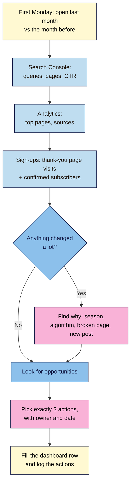

# M08.L02 — Reading the data: top content, traffic sources, queries and sign-ups
> After this lesson you can find your best posts, where readers come from and what they searched, count email sign-ups as a conversion, and turn 30 minutes a month into three concrete actions.

**Time:** ~15 min reading + ~30 min exercise · **Level:** beginner · **Prereqs:** M08.L01 (one analytics tool installed), M06.L02 (sign-up form), M05.L05 (Search Console)
**Verified against:** Search Console Help (Performance report, Generative AI performance report, branded queries filter), GA4 Analytics Help (key events, create events, reports), Site Kit by Google 1.190.0 (plugin code: plugin conversion tracking providers), Independent Analytics 2.16.2 (plugin code: **Forms** report requires Pro), Fluent Forms (plugin code: **Confirmation Type**), Kit Help (form **Redirect to another page**), all on 2026-11-01

> ⚠️ **Freshness flag:** Search Console added a **Generative AI performance report** (AI Overviews and AI Mode impressions, rolled out to all sites on 2026-08-31) and a **Branded queries** filter (2025-11). Menu names in GA4 and Search Console move often; if a label below differs, search the tool's help for the report name.

## Learning objectives
1. **Find** your top content, traffic sources and search queries.
2. **Track** email sign-ups as a conversion.
3. **Run** a 30-minute monthly review and turn it into three actions.

## Why it matters
Ama checked her stats every morning, felt good or bad about the number, and changed nothing. Kenji ignored his for six months, then found his best post had dropped off page one in April. Sophie spends 30 minutes on the first Monday of each month with one page of numbers. Last month it told her that a post getting 4,000 search impressions had a 0.8% click rate (so she rewrote its title), and that her most-read post had no sign-up form (so she added one). **Data only matters when it changes what you do next.**

## Core concept
**Plain version:** every month you answer four questions, and each one has one place to look:
| Question | Where to look | What it tells you |
|---|---|---|
| **What did people search to find me?** | Search Console → **Performance → Search results** → **Queries** | Topics people want from you; titles that don't earn clicks |
| **Which posts do readers actually read?** | Your analytics → top pages (GA4: **Reports → Engagement → Pages and screens**) | What to update, link to and add sign-up forms to |
| **Where do readers come from?** | Your analytics → sources (GA4: **Reports → Acquisition → Traffic acquisition**) | Which channels are worth your time |
| **Did readers become subscribers?** | Thank-you page visits in analytics + confirmed subscribers in your email provider | Whether your content builds the asset you own (M06) |

**Four terms you need:**
- **Impressions:** how often your page appeared in Google results. **Clicks:** how often someone clicked through. **CTR** (click-through rate) = clicks ÷ impressions. **Average position:** your typical rank.
- **Conversion** (GA4 calls it a **key event**): an action you care about, here an email sign-up. **Conversion rate** = sign-ups ÷ visitors.

**Analogy:** your monthly review is a shop owner's stock-take. Search Console is the window (who stopped to look, who came in), analytics is the shop floor (which shelves people browsed), and sign-ups are the tills. You count all three, then move a few things around.

### Why sign-ups need a thank-you page
Site Kit can track form sign-ups by itself, but only for certain plugins: **Contact Form 7, Mailchimp for WP, Ninja Forms, OptinMonster, Popup Maker and WPForms** (plus WooCommerce and Easy Digital Downloads for sales), checked in Site Kit 1.190.0. The routes from M06.L02 (Kit's plugin, Fluent Forms → Mailchimp, embed code) aren't on that list, and Independent Analytics' form tracking (which does cover Fluent Forms) is a Pro feature. **The method that works with every tool:** send sign-ups to a **thank-you page** (for example `/thanks/`) and count visits to it.

**Two numbers, both useful:**
- **Thank-you page visits** = form submissions. They show *which page and source* produced the sign-up.
- **Confirmed subscribers** in your email provider = people who clicked the double opt-in link (M06.L03). This is the number that counts. The gap between the two is people who never confirmed.

### Search Console's newer views (2025–2026)
- **Branded queries filter:** splits queries into **Branded** (your name or site name) and **Non-branded**. Non-branded growth means new people are finding you. Google labels queries with an AI-assisted system, so a few may be misfiled, and the filter isn't available for sites with few impressions.
- **Generative AI performance report:** shows **impressions** for your pages in AI Overviews and AI Mode, by page, country and device. This data is **also included** in the main Search results report (under **Web**), so don't add the two together. Use it to see which pages get used in AI answers.

## How it works

**In words:** once a month, compare last month with the one before in Search Console, your analytics and your email provider. If something changed a lot, find out why first. Then look for opportunities, choose exactly three actions, and write the numbers and actions into your one-page dashboard.

## Hands-on walkthrough

### Part A — Set up sign-up tracking (~10 min, once)
1. **Create the thank-you page.** **Pages → Add Page**, title *"Thanks — check your inbox"*, slug `thanks`. Say what happens next (*"I've sent you a confirmation email. Click the link to get [lead magnet]. Check spam if it's not there in 5 minutes."*) and link to your Start Here page. **Publish.**
2. **Keep it out of search and menus.** In your SEO plugin's settings for this page (M05), set it to **noindex** so it's left out of the sitemap. Don't add it to any menu. (Search Console then won't count it, and it won't be visited by people who never signed up.)
3. **Point your form at it:**
   | Your M06.L02 route | Setting |
   |---|---|
   | **Fluent Forms → Mailchimp** | Edit the form → **Settings & Integrations → Confirmation Settings** → **Confirmation Type: To a Page** → choose **Thanks** → save |
   | **Kit (plugin or embed)** | In Kit's form builder: **Settings → General → Redirect to another page** → paste `https://yoursite.com/thanks/` → **Save**. Leave **Send subscriber data to thank you page** **off**, or the reader's email lands in the URL and in your analytics |
   | **Other providers** | Look for "redirect", "after submit" or "thank-you URL" in the form settings |

   **Expected:** after a test sign-up (logged out, private window), the browser lands on `/thanks/`.

   > 🖼️ **Image prompt:** Screenshot of the Fluent Forms Confirmation Settings panel with Confirmation Type set to "To a Page" and the Thanks page selected, 1280 × 720. Highlight the Confirmation Type option with a 3px #F9B2D7 outline; blur any personal details.
   > **Alt text:** Fluent Forms Confirmation Settings with Confirmation Type "To a Page" and the Thanks page chosen.

4. **Count it in your analytics tool:**
   - **GA4:** go to **Admin → Data display → Events → + Create event**. Name it `generate_lead` (the name Google's tutorial suggests for leads), switch on **Mark as key event**, and set the conditions to `event_name` **equals** `page_view` **and** `page_location` **contains** `/thanks`. Save. Marking it here matters: a new event can take a day to appear in the events list, so you couldn't tick it there yet. *Don't mark `page_view` itself as a key event, or every page view counts as a conversion.*
   - **Independent Analytics, Koko:** nothing to set up. Your sign-ups are the views of **Thanks** in the pages table.
   - **Plausible, Fathom:** add a **pageview goal** for `/thanks/` (see the provider's goals docs).
5. Do one more logged-out test sign-up. **Expected:** GA4 **Realtime** shows a `generate_lead` event, or your cookieless tool shows a view of **Thanks**. Then confirm it from the email so your provider shows a confirmed subscriber.

### Part B — Find the numbers (~12 min)
6. **Search Console → Performance → Search results.** Set the date to **Compare → Last 28 days vs previous period**. Tick all four boxes: **Total clicks, Total impressions, Average CTR, Average position**.
   - **Queries** tab: sort by **Impressions**. Note your top 5 queries and any query with **high impressions but CTR under ~2%**. Those are titles and meta descriptions to rewrite.
   - **Pages** tab: note your top 5 pages by clicks, and any page whose clicks dropped by a lot.
   - If available, add the **Non-branded** filter and note non-branded clicks.

   > 🖼️ **Image prompt:** Screenshot of the Search Console Performance report, Queries tab, comparing last 28 days with the previous period, all four metrics ticked, sorted by impressions, 1280 × 800. Highlight a row with high impressions and low CTR with a 3px #F9B2D7 outline; blur any personal details.
   > **Alt text:** Search Console Queries table with a high-impression, low-CTR query highlighted.

7. **Generative AI report** (Performance section of the Search Console sidebar): note which pages get AI Overview or AI Mode impressions. Remember they're already inside the totals from step 6.
8. **Analytics, top content.** GA4: **Reports → Engagement → Pages and screens** (views by page title). Independent Analytics: the **Pages** table. Note the top 5 and whether each has a sign-up form.
9. **Analytics, sources.** GA4: **Reports → Acquisition → Traffic acquisition** (Organic Search, Direct, Referral, Organic Social, Email…). Independent Analytics: **Referrers**. Note the top 3 sources and their share.
10. **Sign-ups.** Analytics: thank-you page views or `generate_lead` count for the month. To see which source drove them, GA4's Traffic acquisition table has a **Key events** column; pick `generate_lead`. Email provider: **new confirmed subscribers** and **unsubscribes** this month.

### Part C — The 30-minute monthly review (~8 min to set up)
11. Copy this dashboard into your site docs (a spreadsheet works too, one row per month):

    | Month | Clicks (GSC) | Impressions | CTR | Non-branded clicks | Visitors | Top 3 posts | Top source (%) | Thank-you views | Confirmed subs (net) | Sign-up rate |
    |---|---|---|---|---|---|---|---|---|---|---|
    | 2026-10 | | | | | | | | | | thank-you views ÷ visitors |

12. Use the same timings every month:
    | Minutes | Do |
    |---|---|
    | 0–5 | Search Console: clicks, impressions, CTR; top queries; low-CTR queries |
    | 5–15 | Analytics: top posts, sources, anything up or down by more than ~30% |
    | 15–20 | Sign-ups: thank-you views, confirmed subscribers, sign-up rate on top posts |
    | 20–30 | Pick **three actions**, add owner and date, fill the dashboard row |
13. **Turn numbers into actions.** Each pattern has a standard move:
    | You see | Action | Course link |
    |---|---|---|
    | High impressions, low CTR | Rewrite the title tag and meta description to match the query | M05 |
    | Position 8–20 for a good query | Update the post: answer the query in the first paragraph, add depth, add internal links | M04, M05 |
    | Top post with no or low sign-ups | Add a relevant content upgrade or in-post form | M06 |
    | A query you don't cover | Add it to your content calendar as a new post | M04 |
    | Page's clicks fell sharply | Check it loads, is indexed (URL Inspection), and isn't outdated; refresh it | M05, M07 |
    | One source dominates (e.g. 90% Google) | Plan one post a month for a second channel (email, Pinterest, a community) | M06 |
14. Write the three actions as *"[Action] on [page] by [date]"*. Next month, check whether last month's actions moved the numbers **before** picking new ones.

## When to use / when not to
- **Use the monthly review** from the first month your site is live, even with small numbers; trends start showing after 3 months.
- **Compare like with like:** last 28 days vs the 28 before, and, once you have a year of data, vs the same month last year (seasonal topics).
- **Don't** check daily or react to one bad week: small sites swing a lot. **Don't** compare Search Console clicks with analytics visitors exactly. They measure different things, and consent refusals and ad blockers lower analytics counts.
- **Trade-off:** a thank-you page adds one page to maintain and a redirect, but it works with any form and any analytics tool. If your form plugin is on Site Kit's list (e.g. WPForms), you can use its built-in tracking instead. Don't use both, or each sign-up counts twice.

## Use AI for this
**Example prompt:**
> "Here is my monthly dashboard (last 3 months) and my Search Console top 20 queries with impressions, clicks, CTR and position: [paste]. My niche is [x], my goal is email sign-ups. Suggest exactly three actions for this month, each with the page, the change and why, using only the data I gave you."

**What AI does well:** spotting low-CTR queries, grouping queries into topics, and drafting new titles for them.
**Where it gets it wrong:** inventing reasons ("an algorithm update hit you") without evidence, treating a 10-visit change as a trend, and confusing impressions with visits.
**How to check:** every suggested action must point to a number in your data; check algorithm claims against the [Google Search Status Dashboard](https://status.search.google.com/).
**Privacy:** paste aggregated numbers only, never subscriber emails or names.

## Common mistakes
- **Checking every day** and reacting to noise. Once a month, with a comparison.
- **Counting form submissions as subscribers.** With double opt-in, confirmed subscribers are the real number.
- **Turning on Kit's "Send subscriber data to thank you page".** It puts the reader's email in the URL, which ends up in analytics reports (Google's terms forbid sending personal data to GA4).
- **Leaving the thank-you page indexed or in a menu.** People land on it from Google or by browsing, which inflates your sign-up count.
- **Marking `page_view` as a key event** instead of a thank-you-page event.
- **Adding AI-report impressions to the main total.** They're already included.
- **Reviewing without acting.** No three actions, no review.

## Troubleshooting
| Symptom | Likely cause | Fix |
|---|---|---|
| Form doesn't go to `/thanks/` | Kit block has its own **Redirect** field overriding the form, or Fluent Forms still on **Same Page** | Check the block's Redirect field in the editor; re-save the confirmation setting |
| `generate_lead` never appears in GA4 | Condition typo (e.g. `/thank` vs `/thanks`), logged-in test (Site Kit excludes you), or not yet processed | Check the condition; test logged out; use Realtime; wait 24–48 h for reports |
| Sign-ups in analytics far higher than new subscribers | Double opt-in unconfirmed, or thank-you page reachable from search/menus | Compare with confirmed count; noindex it and remove menu links |
| Search Console shows no data for last 2 days | Normal processing delay | Use complete months; review on the first Monday |
| No **Branded** filter option | Site has too few impressions, or you're in a sub-property | Skip it until the site grows |
| Generative AI report empty | Your pages haven't appeared in AI features yet, or low volume | Normal for new sites; check again next month |

## Exercise
**Task:**
1. Create a noindex `/thanks/` page, point your sign-up form at it, and set up counting in your analytics tool (GA4 key event or cookieless page view). Prove it with one logged-out test sign-up.
2. Fill in the first row of the dashboard from Part C with last month's numbers (on Local, fill the analytics and sign-up columns from your test data, and mark the Search Console columns "launch").
3. Write **three actions** in the form *"[Action] on [page] by [date]"*, each linked to a number in your row.
4. Put a recurring 30-minute event on the first Monday of each month in your calendar.

**Expected outcome:** a working thank-you page that your analytics counts; one dashboard row; three dated actions tied to your data; a recurring review slot.

**Stretch goal:** in Search Console, filter **Queries** to those containing *how*, *what* or *best*, and list three questions you could answer in a new post or a FAQ section.

## Key takeaways
- Four questions, four places: **queries** (Search Console), **top content** and **sources** (analytics), **sign-ups** (thank-you page plus email provider).
- **A noindex thank-you page** makes sign-ups countable in any analytics tool. Keep personal data out of the URL.
- **Confirmed subscribers** are the number that counts; thank-you views show where sign-ups came from.
- **Monthly, compared with the previous period**: not daily, not raw totals.
- **Every review ends with exactly three dated actions**, and checks last month's.

## Teach it back
In 3 sentences, explain to a friend why a post with lots of impressions but few clicks is an easy win, and what you'd change first.

## Glossary terms added
- Impressions — added to `wordpress-101/glossary.md`
- Click-through rate (CTR) — added to `wordpress-101/glossary.md`
- Key event (conversion) — added to `wordpress-101/glossary.md`
- Conversion rate — added to `wordpress-101/glossary.md`
- Thank-you page — added to `wordpress-101/glossary.md`
- Traffic source (channel) — added to `wordpress-101/glossary.md`
- Branded query — added to `wordpress-101/glossary.md`

## Further reading
*All checked 2026-11-01.*
- Google Search Console Help — [Performance report (Search results)](https://support.google.com/webmasters/answer/7576553) · [Generative AI performance report](https://support.google.com/webmasters/answer/16984139) · [Dimensions and data groupings](https://support.google.com/webmasters/answer/17011259)
- Google Search Central Blog — [Introducing the Branded queries filter (2025-11)](https://developers.google.com/search/blog/2025/11/search-console-branded-filter) · [Search Generative AI performance reports (2026-06)](https://developers.google.com/search/blog/2026/06/gen-ai-performance-reports)
- Google Analytics Help — [Create or modify key events](https://support.google.com/analytics/answer/12844695) · [Tutorial: Set up a key event](https://support.google.com/analytics/answer/12966437) · [Best practices to avoid sending PII](https://support.google.com/analytics/answer/6366371)
- Kit Help — [The Kit Form builder](https://help.kit.com/en/articles/2502640-the-kit-form-builder) · [Displaying Kit Forms on WordPress](https://help.kit.com/en/articles/7896755-displaying-kit-forms-and-other-content-on-your-wordpress-website)
- [Google Search Status Dashboard](https://status.search.google.com/) (ranking updates and incidents)
