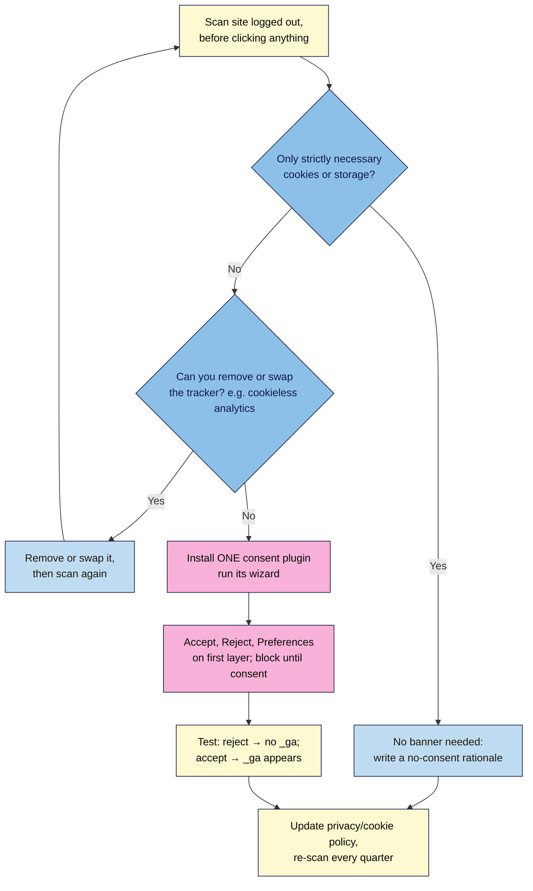

# M08.L03 — Cookie consent where required
> After this lesson you know whether your site needs a cookie banner, you've listed every cookie it sets, and you've either set up one consent plugin properly or written down why you don't need one.

**Time:** ~15 min reading + ~20 min exercise · **Level:** beginner · **Prereqs:** M08.L01 (your analytics choice), M06.L03 (privacy policy), M04/M06 (embeds, forms, affiliate links)
**Verified against:** WordPress 7.1.4 (core code: comment cookie opt-in), Complianz 7.5.6 (plugin code: **Wizard** steps, **Website Scan**, banner buttons, Site Kit integration), CookieYes 3.5.8 and WP Consent API 2.1.0 (WordPress.org listings), EU ePrivacy Directive Art. 5(3), EDPB Guidelines 2/2023 and Cookie Banner Taskforce report, UK ICO storage and access guidance, California AG CCPA page (applicability thresholds), Council of the EU Digital Omnibus press release, all on 2026-11-01

> ⚠️ **Freshness flag:** cookie rules are changing. The EU's **Digital Omnibus** would add some consent-free purposes, such as audience measurement and device security. The Council agreed its negotiating position on 2026-10-21; talks with the Parliament haven't started yet. As of 2026-11-01 this is **a proposal, not law**, and the final wording may differ. The UK added a narrow statistics exception in the Data (Use and Access) Act 2025. Re-check both before relying on an exception. **This is not legal advice.** For a business with real risk, ask a privacy professional.

## Learning objectives
1. **Explain** when GDPR/ePrivacy (and similar laws) require cookie consent.
2. **Audit** which cookies your site sets.
3. **Configure** one consent plugin, or **document** why you don't need one.

## Why it matters
Hana added a free banner that said *"This site uses cookies. OK"*, with no reject button, and GA4 loaded before anyone clicked. That banner gave her the layout shift (M07.L04) and none of the legal cover. Jonas uses Independent Analytics, no ads and no YouTube embeds. His audit found only WordPress's own cookies, so he wrote a three-line rationale and skipped the banner. **A banner is either set up correctly or it does nothing. Many creator sites need no banner at all.**

## Core concept
**Plain version:** the EU's ePrivacy rule (Article 5(3)), and the UK's PECR, say you may only **store or read information on a visitor's device** (cookies, local storage, tracking pixels, fingerprinting) if either:
1. it's **strictly necessary** for a service the visitor asked for (login, shopping cart, remembering their banner choice, security), or
2. the visitor has **consented first**.

The UK also has a narrow exception for some statistics cookies (M08.L01). Everything else (analytics with cookies, advertising, social pixels, many embeds) needs **consent before it runs**.

**What counts as valid consent (EU/UK regulators):**
- **Before:** nothing non-essential runs until the visitor chooses. A banner that shows while GA4 is already running doesn't count.
- **A real choice:** **Reject** is as easy as **Accept**, on the first layer. The EDPB's Cookie Banner Taskforce found that most authorities treat a banner with no reject option as invalid, and the same goes for a reject *link* hidden in the text.
- **No pre-ticked boxes, no "by continuing to browse you accept".**
- **Specific and informed:** grouped by purpose (statistics, marketing), with a cookie policy listing each cookie.
- **Withdrawable:** a "Manage consent" link stays available on every page.

**Elsewhere (short version):** in the **US** there's generally no prior-consent rule for cookies. California's CCPA instead gives visitors the right to **opt out of the "sale" or "sharing"** of their data, which covers ad pixels used for cross-site advertising. It only applies to for-profit businesses above a size threshold: over $25 million revenue (adjusted for inflation), buying, selling or sharing data on **100,000+** California residents or households, or earning half their revenue from selling data. Most small creator sites fall below it. If you're covered, you need a "Do Not Sell or Share" link and must honour **Global Privacy Control** browser signals. Many other US states have similar laws with their own thresholds. Canada, Brazil and others have their own rules. If your readers are mostly in the EU or UK, set up for those rules. They're the strictest, and one setup covers most visitors.

**Analogy:** strictly necessary cookies are the shop's door handle and till: nobody asks permission for them. Everything else is someone with a clipboard at the door. They must ask first, accept "no" just as easily, and leave once you've said no.

### What typically sets cookies on a creator site
| Source | Sets cookies/storage? | Needs consent (EU/UK)? |
|---|---|---|
| WordPress login (`wordpress_logged_in_…`, `wordpress_test_cookie`) | Only for people who log in | **No.** Strictly necessary |
| Comment cookies (`comment_author_…`) | Only if the commenter ticks *"Save my name, email, and website in this browser for the next time I comment."* (core checkbox on by default) | **No.** That checkbox is the consent |
| The consent plugin's own "choice" cookie | Yes | **No.** It remembers the choice |
| GA4 (Site Kit) | Yes (`_ga`, `_ga_…`) | **Yes** |
| Cookieless analytics (Independent Analytics, Koko, Plausible, Fathom) | No (per each tool) | Usually no |
| YouTube / Vimeo embeds | Yes, when loaded. YouTube's **privacy-enhanced mode** (`youtube-nocookie.com`) reduces personalisation but still uses device storage | **Usually yes.** Use click-to-load placeholders |
| Ad networks, Meta/TikTok pixels, affiliate scripts that drop cookies on your page | Yes | **Yes** |
| Plain affiliate *links* (cookie set on the merchant's site after the click) | Not on your site | Not on your site; disclose them (M08.L04) |
| Google Fonts loaded from Google's servers | No cookies, but sends each visitor's IP address to Google (a GDPR issue, not a cookie one; a German court fined a site for it in 2022) | Host fonts locally instead of asking for consent |
| reCAPTCHA, Google Maps embeds | Yes, usually | **Usually yes.** Prefer consent-friendly spam protection (M06.L04) and click-to-load maps |

## How it works

**In words:** scan your site as a new visitor. If it sets only strictly necessary cookies, you don't need a banner. Write down why. If it sets others, first ask whether you can remove or replace them (often the cheapest fix). If not, install one consent plugin, make Reject as easy as Accept, block trackers until consent, and test both choices. Either way, update your policy and re-scan every quarter.

## Hands-on walkthrough

### Part A — Audit your cookies (~8 min)
1. Open your site logged out in a fresh window (logged-in cookies would confuse the results). Don't click anything yet. Use a Chrome **Incognito** window, but note that Incognito **blocks third-party cookies by default**, which hides embed and ad cookies. Click the **eye icon** in the address bar and **allow third-party cookies** for your site for this session (Google's help: *Delete, allow and manage cookies in Chrome*). Your duty still applies to browsers that allow those cookies.
2. Open DevTools (**F12**, or right-click → **Inspect**) → **Application** tab (Chrome/Edge; in Firefox it's **Storage**) → **Storage → Cookies** → your domain. Also check **Local storage** and **Session storage**.
3. Load the homepage, a post with an embed, and the page with your sign-up form. For each cookie or storage item, write a row:

   | Name | Domain (yours or third party?) | Set by (plugin/service) | Purpose | Strictly necessary? |
   |---|---|---|---|---|
   | `_ga` | yoursite.com (set by Google's script) | GA4 via Site Kit | Analytics | No |

   Not sure who sets a cookie? Search its name together with "cookie". For third-party cookies, the **Domain** column usually tells you (e.g. `.youtube.com`).

   > 🖼️ **Image prompt:** Screenshot of Chrome DevTools, Application tab, Storage → Cookies for a WordPress site in an Incognito window, showing a `_ga` cookie row with Name, Domain and Expires columns, 1280 × 720. Highlight the `_ga` row with a 3px #F9B2D7 outline; blur any personal details.
   > **Alt text:** Chrome DevTools Cookies table listing a _ga cookie set before any consent choice.
4. **Expected:** a short list. On a site with Independent Analytics and no embeds you may see **nothing at all** as a logged-out visitor. That's a valid result.

### Part B — Decide (~2 min)
5. If **every** item is strictly necessary, go to **Path 1**. Otherwise, look at each non-necessary item and ask: *can I remove it or swap it?* Common swaps are GA4 → a cookieless tool (M08.L01), YouTube embed → click-to-load or a thumbnail link, Google Fonts → host locally, unused social pixel → delete. Then re-scan. Still left with non-necessary cookies? Go to **Path 2**.

**Path 1 — No banner needed (document it)**
6. Add this to your site docs and summarise it in your privacy policy's **Cookies** section (M06.L03):
   > *Cookie rationale (checked [date]): As a logged-out visitor, this site sets [none / only the cookies listed]. Analytics: [tool], cookieless. No ads, social pixels or third-party embeds that load before a click. Logged-in and comment cookies are strictly necessary or set by the commenter's choice. Re-check: quarterly and after adding any plugin, embed or ad.*

**Path 2 — Set up one consent plugin (Complianz shown)**
7. **Plugins → Add Plugin**, search **Complianz**, **Install Now → Activate** (Complianz 7.5.6, 1M+ installs, supports the WP Consent API). CookieYes is a good alternative with a similar setup; pick **one**.
8. Open **Complianz → Wizard** and work through it:
   - **General → Visitors:** *"Which privacy law or guideline do you want to use as the default for your worldwide visitors?"*: choose **EU (GDPR)** or **United Kingdom (UK-GDPR, PECR, Data Protection Act)** to match most of your readers. (Targeting several regions at once is a Premium feature.)
   - **Consent → Website Scan:** let it scan. Complianz checks several pages for cookies and known third-party scripts, and repeats the scan monthly. Compare its list with your Part A table.
   - **Consent → Statistics:** answer *"Do you compile statistics of this website?"* truthfully, naming your tool. If you use Site Kit, Complianz's Site Kit integration explains which plugin inserts the snippet and how consent mode works.
   - **Consent → Services / Plugins / Advertising:** tick what you use (YouTube, Vimeo, Google Fonts, ad networks). Complianz then blocks those scripts until the visitor consents and shows placeholders.
   - **Documents:** let it generate the **Cookie Policy** page and add it to your footer menu next to the Privacy Policy.
   - **Finish:** enable the banner.
9. **Complianz → Consent Banner:** check that the first layer shows **Accept**, **Deny** and **View preferences** with equal weight. Don't style Deny as a faint link. Keep the banner as an **overlay** or bottom bar that doesn't push content down (CLS, M07.L04).
10. **If you use GA4 via Site Kit:** in Site Kit → **Settings → Admin Settings → Consent mode**, switch on **Enable consent mode** (M08.L01). Complianz passes the visitor's choice on through the WP Consent API. Don't insert GA4 through both plugins.

    > 🖼️ **Image prompt:** Screenshot of a WordPress site in an Incognito window with the Complianz consent banner showing equal Accept, Deny and View preferences buttons as a bottom overlay, 1280 × 800. Highlight the three buttons with a 3px #F9B2D7 outline; blur any personal details.
    > **Alt text:** Consent banner with equally prominent Accept, Deny and View preferences buttons at the bottom of the page.

11. **Test both choices** (new private window each time, DevTools open):
    - Click **Deny**, reload. **Expected:** no `_ga` or other non-necessary cookies; YouTube shows a placeholder.
    - New window, click **Accept**, reload. **Expected:** `_ga` appears and embeds load.
    - Open your **Cookie Policy** page and use its consent section (Complianz inserts it with the `[cmplz-manage-consent]` shortcode; you can also place that shortcode in a footer widget) to change your choice. **Expected:** your choice updates and non-necessary cookies follow it.

### Part C — Record it (~3 min)
12. **Plugin log:** add **Cookie consent (P11)**, or *"P11 not needed: see cookie rationale"*.
13. **Privacy policy:** update the Cookies section (list or link the Cookie Policy) and **Last updated**.
14. **Calendar:** re-scan quarterly, and whenever you add a plugin, embed, ad network or pixel.

## When to use / when not to
- **Use a consent plugin** if, after removing what you can, your site still sets non-essential cookies for EU/UK visitors: GA4, ads, social pixels, embeds that load on page view.
- **Don't add a banner "just in case"** to a site that sets only necessary cookies. It adds clutter and layout shift, and it implies tracking that isn't there. Write the rationale instead.
- **Prefer removing trackers over managing them.** Every tracker you drop is one fewer banner category, cookie policy row and consent bug.
- **Trade-off:** a correctly set up banner means fewer analytics visits (people who click Deny aren't counted) in exchange for staying within the law. Cookieless analytics avoids that trade-off for analytics, though not for ads.
- **One consent plugin only.** Two banners give conflicting choices and double blocking.

## Use AI for this
**Example prompt:**
> "Here's my cookie audit table from DevTools (logged-out visitor, before consent): [paste]. My readers are mostly in [EU/UK/US]. For each item, tell me whether it's likely strictly necessary, what sets it, and whether I could remove or replace it. Then draft a short Cookies section for my privacy policy. Flag anything you're unsure about."

**What AI does well:** identifying common cookie names (`_ga`, `_fbp`, `VISITOR_INFO1_LIVE`), suggesting swaps, and drafting plain-language policy text.
**Where it gets it wrong:** saying "you're GDPR compliant" or "no banner needed" with confidence, mixing EU, UK and US rules, and describing Digital Omnibus proposals as if they were law.
**How to check:** your own DevTools test (reject → no `_ga`) is the evidence; check rules against the ICO, EDPB or your national regulator.

## Common mistakes
- **A banner that only says "OK"** or hides Reject behind "Settings". The EDPB taskforce and ICO expect a reject option as easy as accept.
- **Trackers that run before the choice.** The banner shows, but GA4 has already set `_ga`. Always test with **Deny**.
- **Auditing while logged in.** You'll see login cookies and miss what visitors get.
- **Two consent plugins, or GA4 inserted by both Site Kit and the consent plugin.**
- **A banner on a cookieless site** "to be safe", instead of a written rationale.
- **No Manage consent link,** so visitors can't change their mind.
- **Never re-scanning.** A new embed or plugin quietly adds cookies.

## Troubleshooting
| Symptom | Likely cause | Fix |
|---|---|---|
| `_ga` appears even after **Deny** | GA4 inserted outside the consent plugin (theme header, second plugin), or the service isn't ticked in the wizard | Remove duplicates; let one plugin insert GA4; re-run the **Consent** step; test again |
| Banner never appears | Page cache served an old page (M07.L04), or you're logged in and dismissed it before | **Delete Cache**; test in a new private window |
| Banner pushes content down (CLS) | Banner set as a top bar inside the page | Use an overlay/bottom position |
| YouTube placeholder never loads after Accept | Caching or a script-optimisation plugin delaying the consent script | Exclude the consent plugin's scripts from optimisation; clear cache |
| Analytics visits dropped after the banner | Visitors clicking Deny are no longer counted | Expected; compare trends (M08.L02), or switch to cookieless analytics |
| Scan finds cookies you don't recognise | A plugin, embed or font service | Look up the name; trace it to a plugin by deactivating one at a time on staging |

## Exercise
**Task:**
1. Audit your site as a logged-out visitor in DevTools and fill in the cookie table (Name, Domain, Set by, Purpose, Strictly necessary?).
2. Remove or swap at least one non-essential tracker if you can, and re-scan.
3. Then **either** write and file the no-consent rationale (Path 1), **or** set up one consent plugin and record the Deny and Accept test results (Path 2).
4. Update your privacy policy's Cookies section and plugin log, and add a quarterly re-scan to your calendar.

**Expected outcome:** a cookie table; either a dated no-consent rationale or a working banner that passes the Deny test (no `_ga` after Deny); an updated privacy policy; a re-scan reminder.

**Stretch goal:** replace one YouTube embed with a click-to-load thumbnail or a privacy-enhanced embed behind a consent placeholder, then re-run the Deny test and compare cookie counts before and after.

## Key takeaways
- EU/UK rules: anything **not strictly necessary** that's stored or read on the device needs **consent first**.
- **Valid consent:** before the tracker runs, Reject as easy as Accept, no pre-ticked boxes, changeable later.
- **Audit logged out in DevTools.** Your evidence is what the browser actually stores.
- **Removing trackers beats managing them;** a cookieless site can document why it needs no banner.
- **One consent plugin, tested with Deny,** re-scanned quarterly.

## Teach it back
In 3 sentences, explain to a friend why a banner that only says "OK" isn't enough, and what they'd check in DevTools to prove their banner works.

## Glossary terms added
- Cookie — added to `wordpress-101/glossary.md`
- Strictly necessary cookie — added to `wordpress-101/glossary.md`
- Consent banner (consent management platform) — added to `wordpress-101/glossary.md`
- Cookie policy — added to `wordpress-101/glossary.md`
- WP Consent API — added to `wordpress-101/glossary.md`
- Global Privacy Control (GPC) — added to `wordpress-101/glossary.md`

## Further reading
*All checked 2026-11-01. Laws and guidance change; check the regulator for your readers' country.*
- EU — [ePrivacy Directive 2002/58/EC, Art. 5(3)](https://eur-lex.europa.eu/eli/dir/2002/58/oj) · [EDPB Guidelines 2/2023 on the technical scope of Art. 5(3)](https://www.edpb.europa.eu/our-work-tools/our-documents/guidelines/guidelines-22023-technical-scope-art-53-eprivacy-directive_en) (pixels, local storage, fingerprinting) · [EDPB Cookie Banner Taskforce report (2023)](https://www.edpb.europa.eu/system/files/2023-01/edpb_20230118_report_cookie_banner_taskforce_en.pdf)
- UK ICO — [Storage and access technologies: what are the exceptions?](https://ico.org.uk/for-organisations/direct-marketing-and-privacy-and-electronic-communications/guidance-on-the-use-of-storage-and-access-technologies/what-are-the-exceptions/)
- France CNIL — [Use analytics on your websites and applications](https://www.cnil.fr/en/sheet-ndeg16-use-analytics-your-websites-and-applications)
- US — [California Attorney General: CCPA](https://oag.ca.gov/privacy/ccpa) (opt-out of sale/sharing, Global Privacy Control)
- Tools — [Complianz](https://wordpress.org/plugins/complianz-gdpr/) · [CookieYes](https://wordpress.org/plugins/cookie-law-info/) · [WP Consent API](https://wordpress.org/plugins/wp-consent-api/) · [Chrome DevTools: view and edit cookies](https://developer.chrome.com/docs/devtools/application/cookies) · [YouTube: embed videos (privacy-enhanced mode)](https://support.google.com/youtube/answer/171780)
- Pending EU change — [Council press release: position on the digital rulebook (2026-10-21)](https://www.consilium.europa.eu/en/press/press-releases/2026/10/21/digital-rulebook-council-agrees-position-to-simplify-data-protection-privacy-and-cyber-reporting-rules/) · [Council mandate text ST 14756/26](https://data.consilium.europa.eu/doc/document/ST-14756-2026-INIT/en/pdf) · plain-English summary: [Osborne Clarke](https://www.osborneclarke.com/insights/digital-omnibus-reshapes-eu-cookie-rules-leaves-banner-fatigue-largely-intact)
