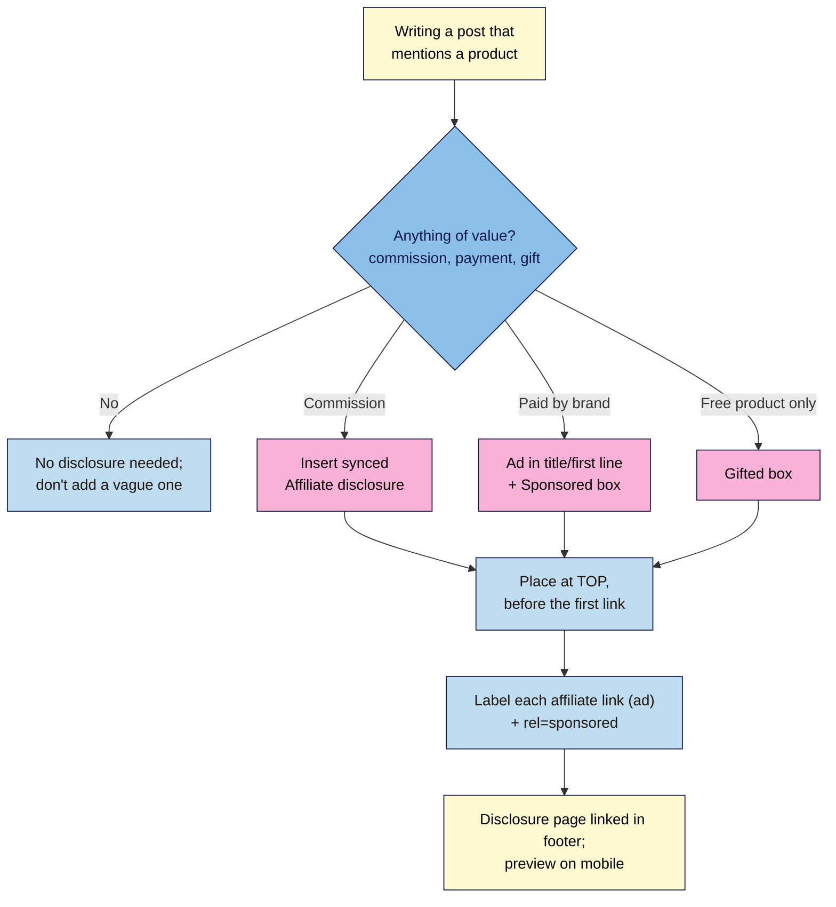

# M08.L04 — Affiliate and sponsorship disclosures
> After this lesson every affiliate link and sponsored post on your site is clearly disclosed where readers see it first, using one synced pattern you can update everywhere, plus a site-wide disclosure page.

**Time:** ~13 min reading + ~15 min exercise · **Level:** beginner · **Prereqs:** M02.L02 (synced patterns), M06.L06 (affiliate links, sponsorships, `rel="sponsored"`)
**Verified against:** FTC Endorsement Guides (16 CFR Part 255, 2023 revision) and *"FTC's Endorsement Guides: What People Are Asking"*; ASA/CAP *Influencers' guide to making clear that ads are ads* (2023) and ASA affiliate marketing guidance; CMA guidance on the DMCC Act 2024 (in force 2025-04-06) and *Social media endorsements: guidance for content creators*; Amazon Associates Operating Agreement and help; WordPress 7.1.4 (core code: **Create pattern**, **Synced**, **Enable overrides**), all on 2026-11-01

> ⚠️ **Freshness flag:** disclosure rules are stable in principle but enforcement is rising. The UK's CMA can fine directly since 6 April 2025. Affiliate programmes update their required wording (Amazon's agreement changed in April 2026). Re-read your programmes' terms yearly. **Not legal advice.**

## Learning objectives
1. **Apply** the FTC Endorsement Guides and UK CAP Code to affiliate links and sponsored posts.
2. **Place** clear disclosures where readers see them before the link.
3. **Build** a synced disclosure pattern and a site-wide disclosure page.

## Why it matters
Priya put *"Some links may be affiliate links"* in her footer. Under both FTC and UK guidance, a vague line at the bottom of the page isn't a disclosure. Marcus wrote a paid review for a coffee grinder and labelled it *"In collaboration with"* at the end. A UK reader complained, and the ASA expects **"Ad"** upfront. Readers who later find out a recommendation was paid trust everything else you say less. **A clear disclosure costs one sentence; a missing one costs trust, programme accounts and, in some places, fines.**

## Core concept
**Plain version:** if you get **anything of value** for mentioning a product (commission, payment, a free product, a discount, a trip), that's a **material connection**. Readers must be told, **clearly, before they act**, in the post itself.

### The rules side by side
| | US: FTC Endorsement Guides | UK: CAP Code (ASA) + consumer law (CMA) |
|---|---|---|
| **Applies when** | You have a material connection the reader wouldn't expect (pay, commission, free product, family/business tie) | **CAP Code (ASA):** you're paid (money, commission or a gift) **and** the brand has some control, or the content has affiliate links. **Consumer law (CMA)** covers paid or gifted content even with no brand control |
| **Where** | **Clear and conspicuous**, close to the recommendation, hard to miss. Not only on an About page, at the end of a post, behind "more", or mixed into hashtags | **Upfront**, before people engage. Bios or past posts don't count, and each piece of content needs its own label |
| **Wording** | Plain: *"I earn a commission if you buy through these links."* | **"Ad"** (or "Advert", "Advertisement", "#ad") for paid, affiliate **and gifted** content. The ASA has ruled "#gifted", "aff"/"affiliate" and "I work with them" inadequate as labels; avoid "sponsored", "spon" or "in collaboration with" as the only label too |
| **Affiliate links** | Disclose on the post, near the links | Treated as advertising. Label the affiliate parts as ads; *"some links **might** earn commission"* isn't enough |
| **Who's responsible** | You and the brand | You and the brand (jointly) |
| **Enforcement** | FTC warning letters and orders | ASA rulings (named publicly); **CMA** can fine directly since 2025-04-06 (DMCC Act) |

**Rule of thumb that satisfies both:** a short, specific line **at the top of the post**, before the first link, that uses the word **"Ad"** for UK readers, plus a label next to each affiliate link or block.

### Three disclosure types you'll actually use
| Situation | Where | Example wording |
|---|---|---|
| **Post with affiliate links** | Top of the post (synced pattern) + label beside each link or product box | *"**Ad — affiliate links.** I earn a commission if you buy through the links marked (ad) below, at no extra cost to you. I only recommend things I've used."* Each link: *"[Product] (ad)"* |
| **Sponsored post** | Start of the title or first line, plus top-of-post box | Title: *"Ad: 5 ways I use the X grinder"*. Box: *"**Ad.** This post is sponsored by X, who paid me to write it and reviewed it before publishing. Opinions are my own."* |
| **Gifted product, no payment or control** | Top of the post | *"**Ad — gifted.** X sent me this grinder free. They didn't pay for or review this post."* (The CMA treats gifts as payment, so UK readers still need "Ad"; "gifted" alone isn't enough) |

**Also required:**
- **Amazon Associates** requires the statement *"As an Amazon Associate I earn from qualifying purchases"* (or substantially similar) on your site, **and** a link-level disclosure such as *"(paid link)"* near the link. Other programmes have their own wording; check your agreements.
- **Links:** add `rel="sponsored"` to affiliate and paid links (M06.L06). That's for Google, not readers. It never replaces the visible disclosure.

**Analogy:** a disclosure is the "advertisement" banner at the top of a newspaper's paid page. You put it where the reader starts reading, not in the small print on the back.

## How it works

**In words:** for every post, ask whether you got anything of value. If not, add nothing. If yes, pick the matching label (affiliate, sponsored, gifted), put it at the top before the first link, label each affiliate link and add `rel="sponsored"`, and keep a full disclosure page in your footer. Check it on mobile, where the top of the post is all readers see first.

## Hands-on walkthrough

### Part A — The synced affiliate disclosure (~6 min)
1. Open a post that has affiliate links (or a test post). Directly **below the title, before the first paragraph**, add a **Group** containing one **Paragraph**:
   > ***Ad — affiliate links.*** *I earn a commission if you buy through the links marked (ad) below, at no extra cost to you. I only recommend things I've used. [How I make money](/disclosure/)*

   Give the Group a light background colour from your palette so it stands out without looking like an ad unit.
2. Select the Group → **⋮ Options → Create pattern**. Name it *Affiliate disclosure*, category *Text*, keep **Synced** on (*"Sync this pattern across multiple locations."*) → **Create**.
   **Expected:** the box becomes a synced pattern block (purple outline).

   > 🖼️ **Image prompt:** Screenshot of the WordPress 7.1 block editor showing a post title followed directly by a highlighted "Ad — affiliate links" disclosure box as a synced pattern (purple outline), before the first paragraph and link, 1280 × 800. Highlight the disclosure box with a 3px #F9B2D7 outline; blur any personal details.
   > **Alt text:** Post editor with a synced affiliate disclosure box placed directly under the title, before any links.
3. Insert *Affiliate disclosure* at the top of every existing post with affiliate links (**+ → Patterns → My patterns**).
4. Next to each affiliate link, add **(ad)** in the link text or right after it (Amazon: *(paid link)*). In product boxes or buttons, put it on the button or right next to it: *"Check price (ad)"*.
5. Check each affiliate link has `rel="sponsored"` (**⋮ → Edit as HTML**, M06.L06).

### Part B — Sponsored and gifted posts (~4 min)
6. Build an **unsynced** pattern for sponsored posts, because each one names a different brand: Group + Paragraph *"**Ad.** This post is sponsored by [Brand], who paid me to write it [and reviewed it before publishing]. Opinions are my own."* → **Create pattern** → name *Sponsored disclosure*, **Synced off**.
7. Repeat for *Gifted disclosure* (Synced off): *"**Ad — gifted.** [Brand] sent me [product] free. They didn't pay for or review this post."*
8. For a sponsored post, also start the **title** with **"Ad:"** and make the post's excerpt/social description start with "Ad" too, so it's labelled wherever it's shared.
   **Expected:** in the inserter you now have three disclosure patterns: one synced, two unsynced templates.

### Part C — The disclosure page (~5 min)
9. **Pages → Add Page**, title **"How I make money"** (slug `disclosure`). Include:
   | Section | Content |
   |---|---|
   | **Affiliate links** | Which programmes (e.g. Amazon, a course platform); how links are marked *(ad)*; *"As an Amazon Associate I earn from qualifying purchases."* if you're in it |
   | **Sponsored posts** | Always labelled "Ad" in the title and at the top; what sponsors can and can't control |
   | **Gifted products** | Labelled "Ad — gifted"; when you accept them |
   | **Ads** | If you show display ads, which network (and the cookie policy link, M08.L03) |
   | **Editorial promise** | *"I only recommend things I've used. Negative findings stay in."* |
   | **Last updated** | Date |
10. **Publish**, then add it to your **footer menu** next to Privacy Policy and Cookie Policy, and link it from your Work With Me page (M06.L06).
    **Expected:** the footer shows *Privacy Policy · Cookie Policy · How I make money*.

    > 🖼️ **Image prompt:** Screenshot of a WordPress site footer on mobile showing links "Privacy Policy", "Cookie Policy" and "How I make money", 390 × 600. Highlight the "How I make money" link with a 3px #F9B2D7 outline; blur any personal details.
    > **Alt text:** Mobile site footer with Privacy Policy, Cookie Policy and How I make money links.
11. **Mobile check:** open an affiliate post on your phone. **Expected:** the disclosure is visible on the first screen, before any affiliate link.
12. **Test the sync:** **Edit original** on *Affiliate disclosure*, change "I only recommend things I've used" to "I only recommend things I've tested myself", save, and view two posts. **Expected:** both show the new wording.

## When to use / when not to
- **Use the synced affiliate pattern** on every post with affiliate links. One edit updates the wording everywhere when rules or programmes change.
- **Use the unsynced sponsored/gifted patterns** as templates, because each needs the brand's name and terms. (Advanced: **Enable overrides** in a synced pattern lets you vary one paragraph per post, but plain unsynced templates are simpler.)
- **Don't** rely on the disclosure page alone. It explains the details; it doesn't replace the label on each post.
- **Don't** disclose things that aren't material connections (a product you bought yourself with no affiliate link). Vague "may contain" lines everywhere teach readers to ignore your disclosures.
- **Trade-off:** a prominent "Ad" at the top may lower clicks a little. In exchange you keep reader trust, programme accounts and compliance; ASA rulings name the creator publicly.

## Use AI for this
**Example prompt:**
> "Here's my post's first 200 words and the list of links in it, marked affiliate, sponsored, gifted or none: [paste]. My readers are in [US/UK/both]. Tell me which disclosure type I need, draft the top-of-post line using 'Ad' where UK rules expect it, and list which links need an (ad) label and rel=sponsored."

**What AI does well:** spotting links you forgot to label and drafting short, plain disclosure lines.
**Where it gets it wrong:** suggesting soft wording ("in partnership with", "supported by") that the ASA says isn't enough on its own, putting the disclosure at the end, and inventing affiliate-programme wording.
**How to check:** compare against the FTC FAQ and the ASA influencer guide; copy programme wording from your actual affiliate agreement.

## Common mistakes
- **Footer-only or About-page-only disclosure.**
- **Disclosure at the end of the post,** after readers have clicked.
- **Vague wording:** *"may contain affiliate links"*, *"aff"*, *"sponsored"* or *"in collaboration with"* as the only label for UK readers.
- **Forgetting gifts, or labelling them only "gifted".** Free products are material connections under FTC guidance, and the CMA treats them as payment: UK readers need "Ad".
- **Disclosing to Google but not readers:** `rel="sponsored"` alone.
- **Labelling a sponsored post only inside the post,** while its title and social share say nothing.
- **Copying one sponsor's box into another post as a synced pattern,** so every post names the same brand.

## Troubleshooting
| Symptom | Likely cause | Fix |
|---|---|---|
| Editing the sponsored box changed it in other posts | You made it **synced** | **Detach** it in the posts that need their own text; recreate the template with **Synced off** |
| Disclosure not visible on mobile without scrolling | Large featured image or intro above it | Move the box above the featured image/intro, or shorten what comes first |
| Synced pattern missing from **My patterns** | Saved under another category | **Appearance → Editor → Patterns** (or **Manage patterns** in the inserter) |
| Theme or plugin product box hides your "(ad)" label | Button text set elsewhere | Edit the button text in the product box settings, or add the label right before the box |
| Programme rejects your site | Missing required programme statement | Add their exact statement to the disclosure page and near the links, as their agreement says |

## Exercise
**Task:**
1. Create the synced *Affiliate disclosure* pattern and add it at the top of every post with affiliate links; label each affiliate link *(ad)* and check `rel="sponsored"`.
2. Create the unsynced *Sponsored disclosure* and *Gifted disclosure* templates.
3. Publish **"How I make money"** at `/disclosure/` with the six sections, and add it to your footer menu.
4. On your phone, screenshot one affiliate post's first screen showing the disclosure before any link.

**Expected outcome:** one synced and two unsynced disclosure patterns; every affiliate post disclosed at the top with labelled links; a published disclosure page in the footer; a mobile screenshot as evidence.

**Stretch goal:** audit your 10 most-visited posts (M08.L02) for links you forgot to mark, and record each fix in a "disclosure log" with the date.

## Key takeaways
- **Anything of value** (commission, payment, gift) is a material connection: disclose it.
- **Top of the post, before the first link,** in plain words. **"Ad"** for UK readers; never only in the footer.
- **Synced pattern** for affiliate disclosures; **unsynced templates** for sponsored and gifted posts.
- **Label each affiliate link** and add `rel="sponsored"`; programme wording (e.g. Amazon) on top.
- **A disclosure page explains; it doesn't replace** the label on each post.

## Teach it back
In 3 sentences, explain to a friend why a "may contain affiliate links" line in the footer isn't enough, and what they should put at the top of the post instead.

## Glossary terms added
- Material connection — added to `wordpress-101/glossary.md`
- Clear and conspicuous — added to `wordpress-101/glossary.md`
- Sponsored post — added to `wordpress-101/glossary.md`
- Gifted product — added to `wordpress-101/glossary.md`
- Disclosure page — added to `wordpress-101/glossary.md`

## Further reading
*All checked 2026-11-01.*
- US FTC — [FTC's Endorsement Guides: What People Are Asking](https://www.ftc.gov/business-guidance/resources/ftcs-endorsement-guides-what-people-are-asking) · [Endorsement Guides (16 CFR Part 255, 2023)](https://www.ftc.gov/system/files/ftc_gov/pdf/P204500%20Guides%20Concerning%20Endors%20and%20Testimonials.pdf) · [Disclosures 101 for Social Media Influencers](https://www.ftc.gov/system/files/documents/plain-language/1001a-influencer-guide-508_1.pdf) · [Endorsements, Influencers, and Reviews hub](https://www.ftc.gov/business-guidance/advertising-marketing/endorsements-influencers-reviews)
- UK ASA/CAP — [Influencers' guide to making clear that ads are ads (2023)](https://www.asa.org.uk/static/790d2e01-e3f8-4fea-b3c99ef91a9f04dc/Influencerguidance2023v4-FINAL.pdf) · [Recognising ads: social media and influencer marketing](https://www.asa.org.uk/advice-online/recognising-ads-social-media.html) · [Get yourself affiliated with the rules on affiliate marketing](https://www.asa.org.uk/news/get-yourself-affiliated-with-the-rules-on-affiliate-marketing.html)
- UK CMA — [Social media endorsements: guidance for content creators](https://www.gov.uk/government/publications/social-media-endorsements-guidance-for-content-creators/social-media-endorsements-being-transparent-with-your-followers) · [Who regulates hidden advertising?](https://assets.publishing.service.gov.uk/media/68b81754536d629f9c82aa16/Who_regulates_hidden_advertising.pdf) · [Direct consumer enforcement guidance (CMA200)](https://assets.publishing.service.gov.uk/media/6808ca0d8c1316be7978e74b/CMA_200_Direct_consumer_enforcement_guidance.pdf)
- Amazon — [Associates Program Operating Agreement](https://affiliate-program.amazon.com/help/operating/agreement) (section 5, required statement) · [Associates help: disclosures](https://affiliate-program.amazon.com/help/node/topic/GHQNZAU6669EZS98)
- Google — [Qualify your outbound links (`rel="sponsored"`)](https://developers.google.com/search/docs/crawling-indexing/qualify-outbound-links)
