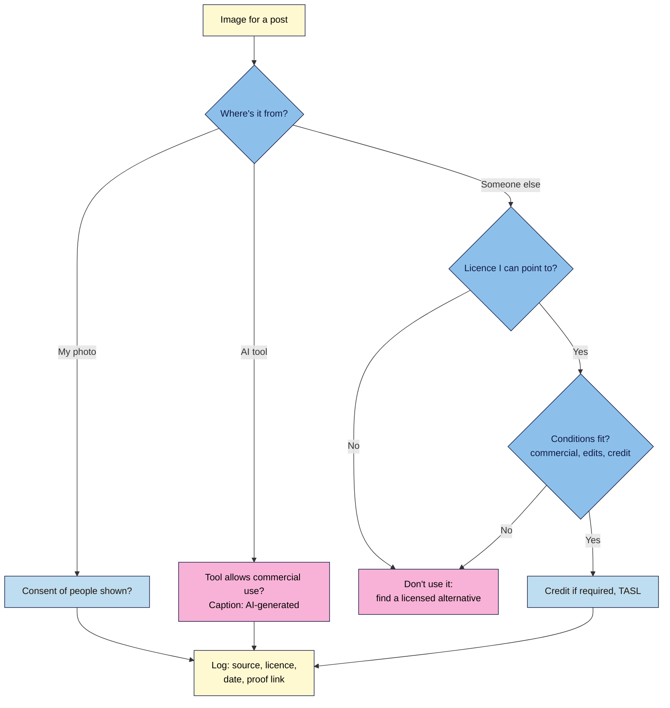

# M08.L05 — Copyright, image licensing and AI-generated content
> After this lesson you can tell which images you're allowed to use and how, you keep a record of the source and licence of every image you publish, and you have a short, honest public statement on how you use AI.

**Time:** ~15 min reading + ~20 min exercise · **Level:** beginner · **Prereqs:** M03 (media library, image sizes, alt text and captions)
**Verified against:** WordPress 7.1.4 (core code: block inserter **Media → Openverse** search limited to public-domain/CC0 images with an automatic attribution caption; attachment pages off by default), Creative Commons licence pages and attribution guidance, Unsplash licence and help centre, US Copyright Office *Copyright and AI, Part 2: Copyrightability* (2025-01-29), *Thaler v. Perlmutter* (cert. denied 2026-03-02), EU AI Act Art. 50 (applies from 2026-08-02) and the Commission's AI-generated content code of practice, UK IPO consultation on copyright and AI, Google Search guidance on generative AI content, all on 2026-11-01

> ⚠️ **Freshness flag:** AI and copyright law is moving fast. US courts and the Copyright Office require human authorship, but how much human input is enough is still being tested (e.g. *Allen v. Perlmutter*). The UK government is still analysing its 2024–25 consultation on copyright and AI. EU AI Act labelling duties started on 2 August 2026, with guidance still being refined. **Not legal advice.** Re-check before relying on any AI rule.

## Learning objectives
1. **Distinguish** public domain, Creative Commons, royalty-free and licensed images.
2. **Record** image sources and licences for every image you publish.
3. **Decide and state** how you disclose AI-assisted text and images.

## Why it matters
Leo grabbed a photo from Google Images for a 2023 post. Two years later an agency's scanner found it and he got a demand for several hundred pounds. Deleting the photo didn't cancel the bill for the time it was online. Nadia used a CC BY photo with no credit, which broke its only condition. Sam publishes AI-written listicles with a fake "chef" persona and no human checking; readers spotted the invented "facts" in the comments. **Every image needs a permission you can point to, and every AI-assisted post needs a human who stands behind it.**

## Core concept
**Plain version:** **everything online is copyrighted by default**, unless the creator gave it away or it's old enough to be out of copyright. "I found it on Google" or "I credited the photographer" is **not** permission. You need **a licence** (permission with conditions) or **public domain** status.

### Four kinds of image you can use
| Type | What it means | Conditions | Example sources |
|---|---|---|---|
| **Public domain** (incl. **CC0**, Public Domain Mark) | No copyright, or the owner waived it | None legally (crediting is still polite) | Openverse (WordPress's built-in search), museum open-access collections, many government works (US federal) |
| **Creative Commons** (CC BY, BY-SA, BY-NC, BY-ND…) | Free licence with conditions | **BY:** credit the creator. **SA:** share your changes under the same licence. **NC:** no commercial use. **ND:** no changes (no cropping with text overlays) | Openverse (full search), Wikimedia Commons, Flickr |
| **Free-to-use platform licences** (Unsplash, Pexels) | The platform's own licence, **not** CC | Free for commercial use, no credit needed, **but** e.g. Unsplash bans selling unaltered copies and building a competing image service; logos, trademarks, recognisable people and artworks in the photo aren't covered by the licence | Unsplash, Pexels |
| **Royalty-free / rights-managed stock** | You **pay** once (royalty-free) or per use (rights-managed) | The licence terms: number of uses, print limits, "editorial use only" | Adobe Stock, Shutterstock, Getty |

**"Royalty-free" doesn't mean free:** it means you pay once and don't pay royalties per use.

**For a monetised creator site:** treat it as **commercial**. Avoid **NC** images (affiliate links and sponsorships make the site commercial), and avoid **ND** images if you crop or add text.

### How to credit (Creative Commons' TASL)
**T**itle · **A**uthor · **S**ource (link) · **L**icence (link). Example caption:
> *"Sourdough loaf" by Jane Doe, via Openverse, CC BY 4.0.* (each part linked)

### Your own photos, screenshots and other people's work
- **Your photos** are yours. People who are recognisable in them, especially children, should agree to being published (and consent can be a privacy issue, M06.L03).
- **Screenshots of software or websites** for a tutorial are common and generally low-risk, but "fair use" (US) and "fair dealing" (UK) are **narrow defences, not permissions**. Don't reuse other creators' photos, illustrations or articles because you "credited" them.
- **Embedding** a YouTube video or social post through WordPress's embed blocks uses the platform's own sharing terms. Downloading and re-uploading it doesn't.

### AI-generated content: three questions
1. **Can you use it?** Check the AI tool's terms (commercial use, ownership of output). Don't prompt for a living artist's style or a brand's characters and logos.
2. **Do you own it?** In the US, the Copyright Office (2025) and the courts (*Thaler v. Perlmutter*; the Supreme Court declined review in March 2026) say **purely AI-generated material isn't protected by copyright**. Your human contribution can be: your own writing, edits, selection and arrangement. So others may be able to reuse a purely AI image of yours. UK law has a "computer-generated works" rule (CDPA s9(3)) that is under review.
3. **Do you have to say so?**
   - **EU AI Act Art. 50** (from 2 August 2026): **deepfakes** (realistic AI images, audio or video of real people, places or events that could be mistaken for real) must be labelled. AI-generated **text published to inform the public on matters of public interest** must be disclosed, **unless** a human reviewed it and someone takes editorial responsibility.
   - **Google:** using AI isn't against its guidelines; **scaled, low-value AI pages** made to rank are spam. Google suggests explaining **how** content was made where readers would reasonably wonder, and warns against **fake personas** (AI headshots, invented credentials).
   - **Readers:** trust. Say what you use AI for, and that a human checks everything.

**Rule of thumb:** label **AI images** (always, in the caption); for text, state your **AI policy** site-wide and add a note to posts where AI did substantial drafting. Never present AI output as your own lived experience or test results.

**Analogy:** an image licence is like a festival wristband. Some are free, some paid, some only for certain areas. Without one, it doesn't matter that you were "just looking". The AI-use statement is the "how we make this" sign on a bakery: most customers don't ask, but trust goes up when it's there.

## How it works

**In words:** for every image, ask where it came from. Your own photos need consent from recognisable people. AI images need a tool that allows commercial use and an "AI-generated" caption. Anyone else's image needs a licence whose conditions (commercial use, edits, credit) fit your use, or you don't use it. Then log the source and licence.

## Hands-on walkthrough

### Part A — Find a licence-safe image inside WordPress (~4 min)
1. In any post, open the **+** inserter → **Media** tab → **Openverse** → **Search Openverse** for your topic (e.g. *sourdough*).
   **Expected:** a grid of images. WordPress only searches **public domain and CC0** images here (checked in WordPress 7.1.4 core), so they're free for commercial use and edits.
2. Click one to insert it.
   **Expected:** the Image block gets an automatic **caption** with title, creator and licence, e.g. *"Sourdough" by Jane Doe/ CC0 1.0*. Keep it. CC0 doesn't require credit, but it's honest and records the source. Write alt text (M03.L03).

   > 🖼️ **Image prompt:** Screenshot of the WordPress 7.1 block inserter, Media tab, Openverse category with a search for "sourdough" showing a grid of results, 1280 × 800. Highlight the Openverse category label with a 3px #F9B2D7 outline; blur any personal details.
   > **Alt text:** Block inserter Media tab with Openverse selected and a grid of sourdough image results.
   > 🖼️ **Image prompt:** Screenshot of an inserted Openverse image in the editor with its automatic caption showing title, creator and CC0 licence links, 1280 × 720. Highlight the caption with a 3px #F9B2D7 outline; blur any personal details.
   > **Alt text:** Image block with an automatic Openverse caption crediting the title, creator and CC0 licence.

### Part B — Audit five posts and start your image log (~10 min)
3. Create an **image log** in your site docs (spreadsheet or table):

   | Post | Image file | Source (URL) | Type | Licence + link | Conditions met? (credit, commercial, edits) | Proof (screenshot/receipt) | Date added |
   |---|---|---|---|---|---|---|---|
   | /sourdough-guide/ | sourdough-first-rise.webp | My own photo | Own | — | Yes | Original RAW on my drive | 2026-10-12 |

4. Pick your **five most-visited posts** (M08.L02) and log every image in them.
5. For each image you **can't** trace to a licence or your own camera: **replace it today** with your own photo, an Openverse/Unsplash/Pexels image, or a paid stock image. Then delete the old file from the Media Library (**Delete permanently**).
6. For licensed images, save **proof**: a screenshot of the licence page or download page with the date, or the stock receipt. Licences on free sites can change, and proof shows what applied when you downloaded it.
7. **Inside WordPress too:** in **Media → Library**, open each image and paste *Source: [URL] · Licence: [name + link] · Downloaded: [date]* into the **Description** field. New WordPress sites don't show public attachment pages by default, so this note stays private. If your site is older and **View Attachment Page** appears, keep the description factual (it may be public).
   **Expected:** five posts with every image logged, nothing untraceable left, and a Description note on each.

### Part C — Write and publish your AI-use statement (~6 min)
8. Decide your policy, then fill in this template:
   > ***How I use AI.*** *I write and test everything here myself. I use AI tools to [brainstorm outlines / check grammar / draft first versions that I rewrite / suggest alt text], and I check every fact and recommendation before publishing. AI-generated images are always labelled "AI-generated" in their caption. I never use AI to invent experiences, test results, reviews or people. Last updated: [date].*
9. Add it as a section of your **"How I make money"** disclosure page (M08.L04) or your About page, and link it from your footer.
10. **AI images:** caption them *"AI-generated image ([tool])"*. Never generate realistic images of real people, or of events that didn't happen, as if they were photos.
11. **AI-assisted text:** on posts where AI drafted a substantial part, add a short note at the end: *"Drafted with help from [tool]; written, checked and tested by [your name]."* Keep your real byline and author box (M02.L02), with no AI-generated author photo or credentials.
    **Expected:** a published AI-use statement linked in the footer, captions on any AI images, and a note on AI-drafted posts.

## When to use / when not to
- **Use your own photos first.** They're original, show real experience (good for readers and for Google's "who, how, why"), and need no licence.
- **Use Openverse in the editor** when you need a quick public-domain image; **Unsplash/Pexels** for lifestyle photos; **paid stock** when you need specific subjects or legal certainty for a brand.
- **Don't use** images from Google Images, Pinterest, other blogs or social media without a licence, even with credit. **Don't use** NC images on a site with affiliate links or sponsors.
- **Use AI images** for illustrations, concepts and abstract headers, labelled. **Don't** use them as fake "proof" (a dish you didn't cook, a product you didn't test).
- **Trade-off:** keeping an image log takes 30 seconds per image; a single unlicensed photo can cost hundreds in a demand letter.

## Use AI for this
**Example prompt:**
> "Here's my AI usage: [what you use AI for, which tools, how you check]. My site is a [niche] blog with affiliate links. Draft a 60–80 word 'How I use AI' statement in plain language, and list which of my post types should get an extra note. Don't promise anything I didn't mention."

**What AI does well:** drafting a clear statement from your facts, and writing TASL captions from a licence page you paste in.
**Where it gets it wrong:** saying images are "royalty-free so free", guessing a licence instead of reading it, and stating AI copyright law as settled.
**How to check:** read the licence on the image's own page and screenshot it; check law against the Copyright Office, EU AI Act text or your national IP office.

## Common mistakes
- **"I credited them, so it's fine."** Credit isn't permission unless the licence says credit is the condition.
- **Missing the CC BY credit,** the one thing that licence requires.
- **Using NC images on a monetised site,** or cropping and adding text to ND images.
- **Assuming "royalty-free" means free.**
- **Deleting an unlicensed image and thinking that settles it.** Replace it promptly, but past use can still be claimed.
- **Unlabelled realistic AI images,** or AI images posing as your own product photos.
- **Fake AI personas** (made-up author names, AI headshots, invented credentials).
- **No record of where images came from,** so you can't answer a demand letter.

## Troubleshooting
| Symptom | Likely cause | Fix |
|---|---|---|
| Openverse tab missing in the inserter | A plugin or host disabled it, or no internet connection | Check on another site/browser; use openverse.org directly and upload the file with its licence noted |
| Openverse image inserted as "external image" | WordPress couldn't upload it to your library | Accept, or download it from the source and upload it yourself so it doesn't vanish later |
| You find an old image with no idea where it came from | No log at the time | Reverse image search (e.g. Google Lens, TinEye) to find the source; if unclear, replace it |
| A demand letter arrives | An agency found an unlicensed image | Don't ignore it; check your log and proof; if you had a valid licence, reply with proof; if not, get advice before paying or arguing |
| Unsplash photo shows a brand logo or a recognisable person | Not covered by the Unsplash licence | Avoid it for commercial or sponsored posts, or pick another photo |

## Exercise
**Task:**
1. Insert one image from **Openverse** through the block inserter and keep its attribution caption.
2. Start your **image log** and complete it for **five posts**; replace any image you can't trace.
3. Add Source/Licence/Date to each image's **Description** in the Media Library.
4. Write and publish your **"How I use AI"** statement (on your disclosure or About page), and label any AI images on your site.

**Expected outcome:** an image log covering five posts with no untraceable images; Description notes in the Media Library; a published AI-use statement linked from your footer; captions on AI images.

**Stretch goal:** for one CC BY image, write a full TASL caption with all four links, and compare it with the Openverse caption WordPress generated.

## Key takeaways
- **Copyrighted by default:** you need a licence or public-domain status, not just credit.
- **Know the four types:** public domain/CC0, Creative Commons (check BY/SA/NC/ND), platform licences (Unsplash, Pexels), paid stock.
- **Log every image** (source, licence, proof, date); Openverse in the editor gives you public-domain images with a ready-made credit.
- **Purely AI-generated material isn't protected by copyright in the US;** your human input is.
- **Label AI images, publish an AI-use statement, and never fake experience or people.**

## Teach it back
Explain to a friend in 3 sentences why "I credited the photographer" doesn't make a Google Images photo safe to use, and what they should use instead.

## Glossary terms added
- Copyright — added to `wordpress-101/glossary.md`
- Public domain / CC0 — added to `wordpress-101/glossary.md`
- Creative Commons licence — added to `wordpress-101/glossary.md`
- Royalty-free — added to `wordpress-101/glossary.md`
- Openverse — added to `wordpress-101/glossary.md`
- Image log — added to `wordpress-101/glossary.md`
- AI-use statement — added to `wordpress-101/glossary.md`

## Further reading
*All checked 2026-11-01. AI and copyright rules are changing; check for updates.*
- Licences — [Creative Commons: about the licences](https://creativecommons.org/licenses/) · [CC: recommended practices for attribution (TASL)](https://wiki.creativecommons.org/wiki/Recommended_practices_for_attribution) · [Unsplash licence](https://unsplash.com/license) · [Unsplash: are there any restrictions?](https://help.unsplash.com/en/articles/6536960-are-there-any-restrictions) · [Pexels licence](https://www.pexels.com/license/) · [Openverse](https://openverse.org/)
- US — [Copyright Office: Copyright and Artificial Intelligence (Parts 1–3)](https://www.copyright.gov/ai/) · [Part 2: Copyrightability (2025)](https://www.copyright.gov/ai/Copyright-and-Artificial-Intelligence-Part-2-Copyrightability-Report.pdf)
- EU — [AI Act, Regulation (EU) 2024/1689 (Art. 50 transparency)](https://eur-lex.europa.eu/eli/reg/2024/1689/oj) · [Commission: code of practice on AI-generated content](https://digital-strategy.ec.europa.eu/en/policies/code-practice-ai-generated-content)
- UK — [Copyright, Designs and Patents Act 1988, s9 (computer-generated works)](https://www.legislation.gov.uk/ukpga/1988/48/section/9) · [Consultation: copyright and artificial intelligence](https://www.gov.uk/government/consultations/copyright-and-artificial-intelligence) (outcome pending)
- Google — [Guidance on generative AI content on your website](https://developers.google.com/search/docs/fundamentals/using-gen-ai-content) · [Creating helpful, reliable, people-first content (who, how, why)](https://developers.google.com/search/docs/fundamentals/creating-helpful-content) · [Spam policies: scaled content abuse](https://developers.google.com/search/docs/essentials/spam-policies)
