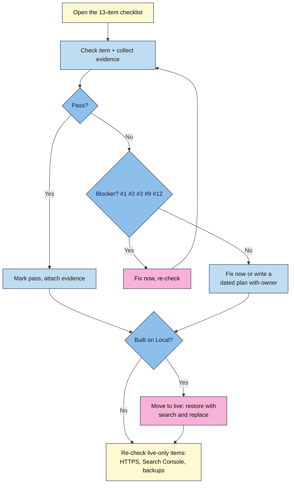

# M09.L01 — Pre-launch checklist: the 13 non-negotiables
> After this lesson you've checked your site against all 13 non-negotiables with evidence for each, fixed what fails (or written a dated plan), and moved your practice site from Local to live hosting if that's where you built it.

**Time:** ~12 min reading + ~45 min exercise (plus ~30 min if you're moving from Local to live) · **Level:** beginner · **Prereqs:** M01–M08 (all module capstones help: their reports are your evidence)
**Verified against:** WordPress 7.1.4 (core code: **Settings → Reading → Search engine visibility → Discourage search engines from indexing this site**; Site Health), UpdraftPlus 1.26.14 (restore to a new site address with **Search and replace site location in the database (migrate)**), and the labels used in M01–M08, all on 2026-11-01

> ⚠️ **Freshness flag:** this checklist points back to lessons checked between 2026-10 and 2026-11. Plugin screens and Google tools change often; if a label doesn't match, use the lesson's own freshness note or the plugin's settings search.

## Learning objectives
1. **Audit** your site against all 13 non-negotiables.
2. **Fix** every failing item, or **record** a dated plan to fix it.
3. **Move** the practice site to live hosting if you built it locally.

## Why it matters
Maya launched on a Friday night. On Monday she found her new site had **Discourage search engines** still ticked from staging, her sign-up form still pointed at a test list, and her backups were set to "Manual" from a restore test. None of these were hard to fix, but she lost a weekend of launch traffic and every reader who tried to subscribe. **A launch checklist turns "I think it's ready" into "here's the proof".**

## Core concept
**Plain version:** the 13 non-negotiables are the minimum a creator site needs before you invite readers. Each one gets a **check** (what to look at), a **pass rule**, and **evidence** (a screenshot or link). An item can be:
- ✅ **Pass:** evidence attached.
- 🛠️ **Fix now:** fails and can be fixed before launch (most items).
- 📅 **Dated plan:** fails, isn't a launch blocker, and has a written fix with an owner and date, e.g. *"Compress the 12 older post images by 2026-11-20."*
- ⛔ **Blocker:** must pass before launch, with no dated plan allowed: **#1 own platform, #2 permalinks, #3 safety net, #9 privacy notice on the form, #12 legal pages.** These protect your content, your URLs, your readers' data and you.

**Live-only items** (Search Console, PageSpeed field data, host backups, HTTPS on your domain) are checked **after** you move to live hosting (Part C). The "launch-day card" items you collected in earlier capstones go here.

**Analogy:** a pilot's pre-flight checklist. Experienced pilots still use it, because it's the one thing that catches what memory misses.

## How it works

**In words:** go through the 13 items one by one, collecting evidence. Blockers must pass, so fix and re-check them. Other failures get fixed now or a dated plan. If you built on Local, move the site to live hosting, then check the items that only work on a live site.

## Hands-on walkthrough

### Part A — Run the checklist (~30 min)
1. Copy this table into your site docs. Work top to bottom. For each row, do the check, mark the status and attach evidence.

| # | Non-negotiable | Check | Pass when | Evidence | Fix in |
|---|---|---|---|---|---|
| 1 ⛔ | **Own your platform** | Self-hosted WordPress (or a plan with plugins + export); your own domain; **Tools → Export** works | Domain in your name; export downloads | Domain registrar screenshot (personal details blurred); export file name | M01.L01–L02, M07.L05 |
| 2 ⛔ | **Permalinks** | **Settings → Permalinks** | **Post name** (or your chosen structure), unchanged since your first post | Screenshot | M01.L04 |
| 3 ⛔ | **Day-one safety net** | Backup plugin schedules; off-site storage; 2FA column on **Users**; restore log | Schedules **not** Manual; off-site; every admin/editor has 2FA; a restore in the last 3 months | Schedule screenshot; Two-Factor column; restore log row | M01.L05, M07.L02–L03 |
| 4 | **Block editor workflow** | You can draft, schedule and reuse patterns | At least one scheduled post; synced CTA and author box exist | **Posts** list showing *Scheduled*; **My patterns** | M02.L01–L04 |
| 5 | **Categories & structure** | **Posts → Categories**; menu | 4–7 categories (one per content pillar), no "Uncategorized" in use, each with a description; menu links to main categories | Categories screenshot; menu | M02.L03, M04.L03 |
| 6 | **Media done right** | Media Library; a typical post's images | Images at your width rule (e.g. ≤1600 px), WebP/AVIF or compressed JPEG, no multi-MB files | One post's image sizes; Media Library sorted by size | M03.L01–L02, M03.L04 |
| 7 | **Accessibility basics** | Alt text, heading order, contrast, link text, keyboard navigation, captions on your 5 key pages | No missing alt (or deliberate empty alt), one H1, no skipped heading levels, contrast 4.5:1 (3:1 for large text), no "click here", every link and button reachable by **Tab** with a visible focus | Accessibility check notes (M04.L05) | M03.L03, M04.L05 |
| 8 | **On-page SEO + one SEO plugin** | One SEO plugin; titles/meta on key pages; sitemap URL; schema | Exactly one SEO plugin; `/sitemap_index.xml` (Yoast) loads; key pages have titles and descriptions | Sitemap screenshot; one snippet preview | M05.L02–L04 (Search Console: Part C) |
| 9 ⛔ | **Email capture + privacy notice** | Sign-up form; consent line; privacy link; double opt-in; real list | Form adds a **confirmed** subscriber to your **real** list; privacy notice next to the form | Test sign-up → confirmed subscriber screenshot | M06.L02–L03 |
| 10 | **Updates + lean plugins** | **Dashboard → Updates**; **Plugins**; Site Health | Latest WordPress; no inactive plugins or spare themes; ≤10–12 active plugins; one per job | Updates screen; plugin count; Site Health | M07.L01, M07.L03 |
| 11 | **Performance** | Lighthouse (Local) or PageSpeed Insights (live), mobile, 3 runs | Homepage: LCP ≤2.5 s, CLS ≤0.1, TBT ≤200 ms (lab) or field data "good" | Middle-run result | M07.L04 |
| 12 ⛔ | **Disclosures & legal pages** | Footer; privacy policy; cookie setup; disclosure page; affiliate posts | Privacy Policy, How I make money (and Cookie Policy if you use a banner) in the footer; cookie Deny test passes or rationale filed; affiliate posts disclose at the top | Footer screenshot; Deny test or rationale; one affiliate post on mobile | M06.L03, M08.L03–L05 |
| 13 | **Analytics you review** | One analytics tool; `/thanks/` counting; dashboard row; review slot | Exactly one tool; a logged-out visit counted; monthly review in the calendar | Analytics screenshot; calendar entry | M08.L01–L02 |

2. **Quick wins first:** run **Tools → Site Health → Status** and fix anything listed under **critical issues** (e.g. outdated PHP, inactive plugins, a failed background update). Note the remaining **recommended improvements**.
   **Expected:** no critical issues. Recommended items either fixed or added to your plan.

   > 🖼️ **Image prompt:** Screenshot of a filled-in pre-launch checklist table in a document, showing rows 1–13 with status icons (pass, fix now, dated plan) and an evidence column with links, 1280 × 900. Highlight the blocker rows (#1, #2, #3, #9, #12) with a 3px #F9B2D7 outline; blur any personal details.
   > **Alt text:** Pre-launch checklist with 13 rows marked pass or dated plan and the five blocker rows highlighted.

### Part B — Fix or plan (~15 min)
3. Fix every **⛔ blocker** that isn't passing, then re-check it.
4. For each other failing item, either fix it now or write a **dated plan**: *"[Fix] on [what] by [date]. Owner: [you]."* Limit yourself to **three** dated plans; more than that means you're not ready to launch yet.
5. **Clean out practice leftovers:** delete *Hello world!*, *Sample Page*, test posts from drills (e.g. the YouTube test post from the M08 capstone), test users, and test subscribers in your email provider. Empty the Trash.
   **Expected:** every row is ✅ or 📅, no ⛔ fails, and no test content is visible on the site.

### Part C — Move from Local to live (only if you built on Local, ~30 min)
6. **Get hosting and a domain** using your M01.L02 shortlist. In the host's panel, install WordPress on your domain with **HTTPS** on (M01.L03).
   **Expected:** `https://yourdomain.com` shows a fresh WordPress site with the padlock.
7. **On Local:** take a fresh **full backup** with UpdraftPlus (**Backup Now**, database + files) and download all its parts (database, plugins, themes, uploads, others) to a dated folder.
8. **On live:** install **UpdraftPlus**, go to **Settings → UpdraftPlus Backups → Existing backups → Upload backup files**, upload all parts, then **Restore** with all five components ticked and **Search and replace site location in the database (migrate)** ticked (M07.L02). Large uploads may hit the host's limit; if so, use your host's free migration service instead (M07.L05).
   **Expected:** **Restore successful!** Log in with your **Local** username and password (and your 2FA app, since Two Factor settings come across in the database).
9. **First five minutes on live:**
   - **Settings → General:** both addresses show `https://yourdomain.com`.
   - **Settings → Permalinks:** check the structure and click **Save Changes** once (this refreshes the rewrite rules on the new server).
   - **Settings → Reading → Search engine visibility:** make sure **Discourage search engines from indexing this site** is **unticked** (*"It is up to search engines to honor this request."*).
   - **Change your password** to a new strong one if you used a simple one on Local.
   - Re-connect anything tied to Local: email provider keys (if needed), Site Kit (needs a live site anyway), and your UpdraftPlus **remote storage** and **schedules** (they may arrive set to Manual from your test restores).
   - **Delete Cache** if you use a page cache (M07.L04).

   > 🖼️ **Image prompt:** Screenshot of WordPress Settings → Reading on a live site, showing the "Search engine visibility" row with "Discourage search engines from indexing this site" unticked, 1280 × 720. Highlight the unticked checkbox with a 3px #F9B2D7 outline; blur any personal details.
   > **Alt text:** Settings → Reading with the Discourage search engines checkbox unticked on the live site.
10. **Now check the live-only items:** HTTPS on every page (no mixed-content warnings), a test sign-up that sends a real confirmation email, PageSpeed Insights on the homepage (#11), host backups (#3), and **Search Console** verification plus sitemap submission (#8, done properly in M09.L03 on launch day).
   **Expected:** live-only rows updated to ✅ with live evidence.

## When to use / when not to
- **Use the full checklist** before any launch, relaunch or redesign, and again every 6 months as a health check.
- **Don't launch with a failing blocker.** A dated plan is fine for a slow older page; it isn't fine for missing backups or a sign-up form without a privacy notice.
- **Don't wait for perfect.** Three or fewer dated plans for non-blockers is a normal launch. Readers can't find a site that never goes live.
- **Trade-off:** moving with a backup restore (Part C) keeps everything exactly as you built it, but it also copies leftovers. That's why you clean up first (step 5) and check settings straight after (step 9).

## Use AI for this
**Example prompt:**
> "Here is my filled-in pre-launch checklist (13 rows with status and evidence notes): [paste]. Which items are launch blockers that I've marked wrongly? For each failing non-blocker, suggest a realistic dated plan for one person working 5 hours a week. Don't mark anything as passing without evidence in my notes."

**What AI does well:** spotting gaps in your evidence, and turning vague notes into specific, dated plans.
**Where it gets it wrong:** marking items as passing because they "sound done", and inventing WordPress settings or plugin menus.
**How to check:** each ✅ must have a screenshot or link you took yourself; check menu names against the lesson listed in **Fix in**.

## Common mistakes
- **"Discourage search engines" left ticked** after moving or staging.
- **Backup schedules left on Manual** after a test restore.
- **Sign-up form still pointing at a test list,** or a test provider account.
- **Practice content left live:** *Hello world!*, *Sample Page*, test posts, test users.
- **Changing permalinks on launch day** "to tidy up", which breaks links you've already shared.
- **Marking items done without evidence.** If you can't screenshot it, it isn't done.
- **More than three dated plans.** That's a backlog, not a launch.

## Troubleshooting
| Symptom | Likely cause | Fix |
|---|---|---|
| Live pages show 404 except the homepage after the move | Rewrite rules not refreshed on the new server | **Settings → Permalinks → Save Changes** |
| Images or links still point to `yoursite.local` | Search-and-replace not ticked, or hard-coded URLs in custom HTML | Re-run the restore with **Search and replace site location** ticked, or use a search-replace plugin carefully (after a backup) |
| Upload of backup files fails | Host upload size limit | Upload parts one at a time, ask the host to raise the limit, or use the host's migration service |
| Padlock missing or "Not secure" on some pages | Mixed content (`http://` images or embeds) | Check the page's images and embeds; re-run search-replace from `http://` to `https://` on your domain, or ask your host |
| Confirmation emails don't arrive on live | Host mail not configured or going to spam | Test with another address; follow your email provider's sending setup; check spam |
| Can't log in after the restore | Using the live install's new password instead of the Local one | Log in with your **Local** username, password and 2FA |

## Exercise
**Task:**
1. Complete the 13-row checklist with a status and evidence for every row.
2. Fix every failing blocker (#1, #2, #3, #9, #12) and write at most three dated plans for other failures.
3. Remove all practice leftovers (posts, pages, users, test subscribers).
4. If you built on Local: move to live (Part C), do the first-five-minutes checks, and update the live-only rows.

**Expected outcome:** a checklist with every row ✅ or 📅 (no failing blockers), evidence for each, at most three dated plans, and, if you moved, a live site at `https://yourdomain.com` with search engines allowed.

**Stretch goal:** ask a friend to sign up, find your disclosure page and read a post on their phone, and note anything that confused them.

## Key takeaways
- **13 items, each with a check, a pass rule and evidence.** No evidence, no pass.
- **Five blockers** (#1, #2, #3, #9, #12) must pass before launch; others can have a dated plan (three at most).
- **Clean out practice content** before going live.
- **Moving from Local:** restore with search and replace, then check addresses, permalinks, search visibility, backups and passwords straight away.
- **Live-only items** get checked on the live site, not assumed.

## Teach it back
Explain to a friend in 3 sentences why "Discourage search engines" and "backups on Manual" are the two settings to check first after moving a site.

## Glossary terms added
- Pre-launch checklist — added to `wordpress-101/glossary.md`
- Launch blocker — added to `wordpress-101/glossary.md`
- Dated plan — added to `wordpress-101/glossary.md`
- Mixed content — already in `wordpress-101/glossary.md` (earlier lesson)

## Further reading
*All checked 2026-11-01.*
- WordPress — [Site Health screen](https://wordpress.org/documentation/article/site-health-screen/) · [Settings Reading screen (search engine visibility)](https://wordpress.org/documentation/article/settings-reading-screen/) · [Moving WordPress](https://developer.wordpress.org/advanced-administration/upgrade/migrating/)
- UpdraftPlus — [How do I migrate to a new site location?](https://updraftplus.com/faqs/how-do-i-migrate-to-a-new-site-location/)
- Google — [Get your website on Google Search (Search Essentials)](https://developers.google.com/search/docs/essentials) · [PageSpeed Insights](https://pagespeed.web.dev/)
- web.dev — [What is mixed content?](https://web.dev/articles/what-is-mixed-content)
- This course: each row's **Fix in** lesson, and your M01–M08 capstone reports.
