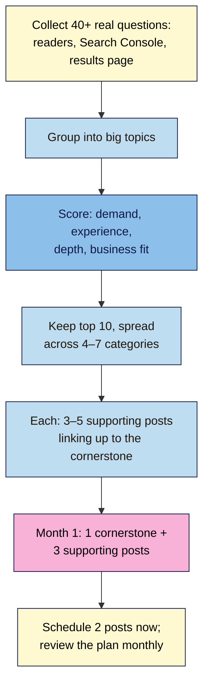

# M09.L02 — Content plan: 10 cornerstone topics mapped to categories
> After this lesson you have 10 cornerstone topics chosen from what your readers actually ask, each mapped to one category and a handful of supporting posts, and your first month of posts on the calendar with two already scheduled.

**Time:** ~13 min reading + ~30 min exercise · **Level:** beginner · **Prereqs:** M02.L03 (categories as content pillars), M05.L03 (search intent), M02.L04 (scheduling)
**Verified against:** WordPress 7.1.4 (scheduling, as in M02.L04), Yoast SEO 28.8 (plugin code: **Cornerstone content → Mark as cornerstone content**), Google Search Central guidance on helpful, people-first content, Google Trends and Search Console help, all on 2026-11-01

> ⚠️ **Freshness flag:** search results now mix classic links, AI Overviews and AI Mode, and the tools that show "what people ask" change their layouts often. The method here (real questions → topics → clusters → calendar) doesn't depend on any one tool.

## Learning objectives
1. **Choose** 10 cornerstone topics from audience questions and search data.
2. **Map** each topic to a category and to supporting posts.
3. **Schedule** the first month of publishing.

## Why it matters
After launch, Tom wrote whatever came to mind: a recipe, a kitchen-tour post, a rant about air fryers, another recipe. Six months and 40 posts later he had no post that ranked, no topic Google or readers saw him as the go-to for, and nothing to link his email sign-ups to. Aisha spent one evening on a plan: 10 big topics her readers kept asking about, each with a few smaller posts linking to it. Her first cornerstone guide brought in a quarter of her sign-ups by month four. **A plan doesn't make you write less freely; it makes each post add to something.**

## Core concept
**Plain version:** a **cornerstone** post is your best, most complete answer to a big question your readers have (e.g. *"How to start sourdough from scratch"*). **Supporting posts** answer the smaller questions around it (*"Why is my starter not rising?"*, *"Best flour for starters"*) and link to the cornerstone. One cornerstone plus its supporting posts is a **topic cluster**. Each cluster lives in **one category** (your content pillars from M02.L03).

**Analogy:** your site is a library. Categories are the shelves, cornerstones are the big guidebooks at the front of each shelf, and supporting posts are the short leaflets that say "for the full guide, see…".

### Where good topics come from
| Source | What you get | How (free) |
|---|---|---|
| **Your readers** | Their exact words and problems | Reply-to-welcome emails, comments, DMs, questions you get asked offline |
| **Search Console** (live sites) | Queries already showing your site | **Performance → Search results → Queries**, last 3 months (M08.L02) |
| **Google's results page** | Autocomplete, **People also ask**, related searches, what an AI Overview covers | Search your topic in a private window and write down the questions (M05.L03) |
| **Google Trends** | Whether interest is rising, falling or seasonal | trends.google.com → compare 2–3 phrasings over 5 years |
| **Communities** | Problems people are stuck on | Forums, Reddit, Facebook groups in your niche (read, don't spam) |
| **Your own experience** | What only you can write | Things you've made, tested, failed at, measured |

### What makes a good cornerstone topic
Score each candidate 1–3 on four questions:
1. **Demand:** do real people ask this (in more than one source)?
2. **Experience:** can you write it from first-hand experience, with your own photos and results? (Google's helpful-content guidance asks *who, how, why*; first-hand experience is what AI summaries can't copy.)
3. **Depth:** is it big enough for a full guide with 3+ supporting posts?
4. **Business fit:** does it lead naturally to your sign-up, product or affiliate links (M06)?

Keep the **10 highest scores**, spread across your 4–7 categories (about 1–3 per category).

## How it works

**In words:** gather real questions from readers and search, group them into big topics, score each topic, and keep the best 10 spread across your categories. Give each one 3–5 supporting posts, plan your first month around one cluster, schedule two posts straight away, and update the plan at each monthly review.

## Hands-on walkthrough

### Part A — Collect and choose (~15 min)
1. Open a blank sheet. Spend 10 minutes collecting **at least 40 questions** from the sources table. Write them in your readers' words, not keywords: *"why is my sourdough so dense"*, not *"dense sourdough"*.
2. Group similar questions under a short **topic** name. Many questions → one topic.
   **Expected:** 12–20 topics, each with several questions under it.
3. Score each topic (Demand, Experience, Depth, Business fit, 1–3 each, max 12). Keep the **top 10**, making sure every category has at least one and none has more than three.

### Part B — Build the content plan (~10 min)
4. Copy this template into your site docs (spreadsheet works best):

   | # | Cornerstone topic (working title) | Category | Intent (M05.L03) | Supporting posts (3–5) | Sign-up / offer it leads to | Status | Publish date |
   |---|---|---|---|---|---|---|---|
   | 1 | The complete beginner's guide to sourdough starter | Bread | Learn (how-to guide) | Why isn't my starter rising? · Best flour for starters · Feeding schedule printable · Starter vs yeast | "7-day starter plan" lead magnet | Planned | 2026-11-11 |

5. For each cornerstone, list **3–5 supporting posts** from the questions in that group. Each supporting post must link **up** to its cornerstone, and the cornerstone links **down** to each supporting post once it's published.
6. Mark any **existing** posts that already fit: change their category if needed (keeping the URL the same, M01.L04) and add them as supporting posts.
7. In Yoast, open each published cornerstone post and, in the **Cornerstone content** section, switch on **Mark as cornerstone content**. (Yoast then checks it more strictly; the internal-linking suggestions are a Premium feature.)
   **Expected:** a 10-row plan with a category, an intent and 3–5 supporting posts for every row.

   > 🖼️ **Image prompt:** Screenshot of a content plan spreadsheet with 10 cornerstone rows, columns for category, intent, supporting posts, offer, status and publish date, colour-coded by category, 1280 × 800. Highlight one complete row with a 3px #F9B2D7 outline; blur any personal details.
   > **Alt text:** Content plan spreadsheet with 10 cornerstone topics, each mapped to a category and supporting posts.

### Part C — Schedule month one (~5 min)
8. Choose a **cadence you can keep**: one post a week is plenty for most creators. Consistency beats volume.
9. Plan month one around **one cluster**: week 1 the cornerstone (or a major update of an existing one), weeks 2–4 three supporting posts that link to it. Put the dates in the plan.
10. Write the next two posts (or finish two drafts you already have), run your pre-publish checklist (M02.L04), and **schedule** them (M02.L04): in the sidebar's **Post** tab, click **Publish** (it says **Immediately**), pick the date and time in your **site's** timezone, then click **Schedule** in the top bar and **Schedule** again to confirm.
    **Expected:** the **Posts** list shows two posts with status **Scheduled** and the dates from your plan.

    > 🖼️ **Image prompt:** Screenshot of the WordPress Posts list showing two posts with the status "Scheduled" and their future publish dates, 1280 × 600. Highlight the "Scheduled" labels with a 3px #F9B2D7 outline; blur any personal details.
    > **Alt text:** Posts list with two posts marked Scheduled for future dates.
11. Add a line to your **monthly review** (M08.L02): *"Update the content plan: mark published posts, add new questions from Search Console and readers, re-score if needed."*

## When to use / when not to
- **Use this plan** from launch onward; revisit it at every monthly review and rebuild it once a year.
- **Use supporting posts** for specific questions; **use the cornerstone** for the full answer. Don't make every post a 4,000-word guide.
- **Don't chase topics you can't write from experience** just because they have search demand; you'll compete with sites (and AI answers) that say it better.
- **Don't plan more than you can publish.** Ten cornerstones may take a year at one post a week. That's fine.
- **Trade-off:** a plan narrows what you write about for a while, in exchange for posts that support each other in search, internal links and email sign-ups.

## Use AI for this
**Example prompt:**
> "Here are 45 questions my readers and Search Console show me, in their own words: [paste]. My categories are [list]. Group them into 12–20 topics, suggest which could be a cornerstone (a full guide) and which are supporting posts, and give each a plain working title. Don't add topics that aren't in my list."

**What AI does well:** grouping lots of messy questions, suggesting supporting-post angles, and drafting working titles.
**Where it gets it wrong:** inventing search volumes, padding the list with generic topics ("10 tips for…") that aren't in your data, and ignoring whether you have the experience to write them.
**How to check:** every topic should trace back to at least one real question in your list; check rising/falling interest yourself in Google Trends; score Experience honestly.

## Common mistakes
- **Choosing topics from keyword tools only,** with no reader questions behind them.
- **Ten cornerstones in one category,** leaving other categories empty.
- **Supporting posts that don't link to the cornerstone** (or the cornerstone never links back).
- **A cadence you can't keep** (daily posts for two weeks, then nothing).
- **Moving posts between categories in a way that changes URLs** after launch (only happens with category-based permalinks).
- **Writing about what others rank for** instead of what you can show from experience.
- **Never updating the plan.**

## Troubleshooting
| Symptom | Likely cause | Fix |
|---|---|---|
| Can't find 40 questions | New site, no readers yet | Lean on the results page (People also ask, autocomplete), communities and your own past questions; ask 5 people in your audience directly |
| Every topic scores the same | Scores are guesses | Use evidence: count how many sources mention it (Demand), whether you have photos/results (Experience) |
| Two topics overlap a lot | They're one cluster | Merge them; one becomes a supporting post |
| Scheduled post shows **Missed schedule** | WordPress's scheduler (WP-Cron) runs on visits; low traffic or a caching/host setting delayed it | Publish it manually; ask your host about a real cron job (M07) |
| Schedule time wrong by hours | Site timezone not set | **Settings → General → Timezone** (M01.L04) |

## Exercise
**Task:**
1. Collect at least 40 real questions, group them into topics and score them.
2. Fill in the content plan template with **10 cornerstone topics**, each with a category, an intent, 3–5 supporting posts and the offer it leads to.
3. Mark any published cornerstone with **Mark as cornerstone content** in Yoast.
4. Plan month one around one cluster and **schedule two posts**.

**Expected outcome:** a 10-row content plan spread across your categories; a month-one schedule; two posts showing **Scheduled** in the Posts list; a plan-review line in your monthly routine.

**Stretch goal:** for your first cornerstone, sketch its internal-link map: the cornerstone in the middle, supporting posts around it, and an arrow for every link you'll add.

## Key takeaways
- **Cornerstone = your best answer to a big question; supporting posts = smaller questions that link to it.**
- **Topics come from real questions** (readers, Search Console, the results page), scored for demand, experience, depth and business fit.
- **Spread 10 cornerstones across your 4–7 categories.**
- **One cluster per month, at a cadence you can keep.**
- **Schedule ahead and update the plan monthly.**

## Teach it back
Explain to a friend in 3 sentences the difference between a cornerstone post and a supporting post, and why the links between them matter.

## Glossary terms added
- Cornerstone post — added to `wordpress-101/glossary.md`
- Supporting post — added to `wordpress-101/glossary.md`
- Topic cluster — added to `wordpress-101/glossary.md`
- Content plan — added to `wordpress-101/glossary.md`
- Publishing cadence — added to `wordpress-101/glossary.md`

## Further reading
*All checked 2026-11-01.*
- Google Search Central — [Creating helpful, reliable, people-first content](https://developers.google.com/search/docs/fundamentals/creating-helpful-content) · [Top ways to ensure your content performs well in Google's AI experiences](https://developers.google.com/search/blog/2025/05/succeeding-in-ai-search)
- Google — [Google Trends](https://trends.google.com/) · [Search Console Performance report](https://support.google.com/webmasters/answer/7576553)
- Yoast — [What is cornerstone content?](https://yoast.com/what-is-cornerstone-content/)
- This course — M02.L04 (scheduling and WP-Cron), M02.L03 (categories as pillars), M05.L03 (search intent)
