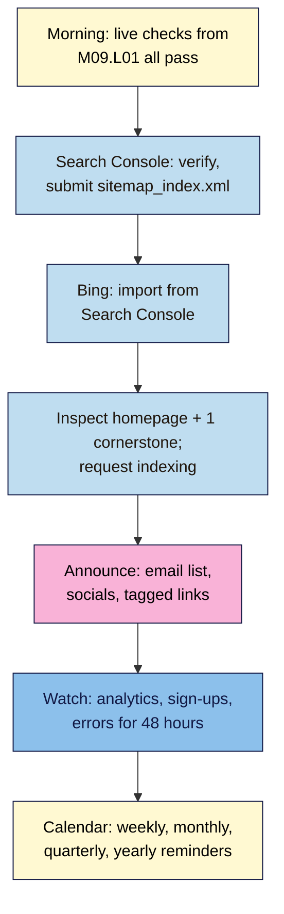

# M09.L03 — Launch day and your 30-day maintenance routine
> After this lesson your site is live and known to Google and Bing, you've told the people who asked to hear from you, and a weekly, monthly, quarterly and yearly routine is in your calendar so the site keeps working without you having to remember it.

**Time:** ~12 min reading + ~30 min exercise · **Level:** beginner · **Prereqs:** M09.L01 (checklist passed, site on live hosting), M09.L02 (content plan, two posts scheduled)
**Verified against:** Search Console Help (Sitemaps report, URL Inspection), Google Search Central (*Ask Google to recrawl your URLs*), Bing Webmaster Tools getting-started guide, GA4 Help (*Collect campaign data with custom URLs*), Google Calendar Help (recurring events), and the routines from M05–M08, all on 2026-11-01

> ⚠️ **Freshness flag:** Search Console and Bing change menu names from time to time (see M05.L05). Indexing a new site can take days to weeks; there's no button that makes it instant.

## Learning objectives
1. **Go live,** submit the sitemap and **announce** to your list and socials.
2. **Follow** a weekly and monthly maintenance routine (updates, backups, analytics review).
3. **Set** calendar reminders so the routine actually happens.

## Why it matters
Ben launched with a big social post and then did nothing for two months. By the time he checked, three plugins had pending security updates, his backups had been failing since week two (full storage), and a broken sign-up form had cost him every subscriber from launch week. Nora's launch was quieter: sitemap submitted, an email to her 40 early sign-ups, one post a week. She also had a 20-minute Monday routine and a monthly review in her calendar. A year later her site is the one still growing. **Launch is one day; the routine is what makes the site last.**

## Core concept
**Plain version:** launch day has three jobs: **tell the search engines** (verify and submit the sitemap), **tell people** (only those who asked, plus your own social accounts), and **check it works** with real visitors. After that, the site needs small, regular care at four rhythms:

| Rhythm | Time | What | From |
|---|---|---|---|
| **Weekly** (e.g. Monday) | 20–30 min | Check last night's backup ran · updates (backup → test high-risk → one at a time → 5-minute check → log) · moderate comments and spam · publish per plan | M07.L01–L02, M06.L04, M09.L02 |
| **Monthly** (first Monday) | 45 min | 30-minute data review → three actions (M08.L02) · update the content plan · Site Health · Search Console **Pages** report · download an offline backup · refresh move-out kit | M08.L02, M09.L02, M05.L05, M07.L02, M07.L05 |
| **Quarterly** | 60 min | Test restore (timed) · user and plugin audit · cookie re-scan · image log spot-check · check affiliate programme terms | M07.L02–L03, M08.L03–L05 |
| **Yearly** | 90 min | Domain and hosting renewals (and renewal prices) · review privacy, cookie and disclosure pages · rebuild the content plan · full pre-launch checklist again | M01.L02, M08, M09.L01–L02 |

**Analogy:** a car. Launch is driving it out of the showroom. Weekly is checking the tyres and fuel, monthly is the dashboard warning lights, quarterly is a service, yearly is the MOT or inspection. Nobody remembers these without reminders.

### Who you can announce to
- **Your email list:** only people who signed up (M06.L03). Don't import your phone contacts, LinkedIn connections or a customer list into your newsletter "just for launch": they didn't consent, and it can break your provider's terms and email laws.
- **Your own social accounts and profiles:** add the site link to your bios.
- **Personal messages** to friends, colleagues and communities you're part of, where self-promotion is allowed.
- **Track it:** add campaign tags to the links you share (`?utm_source=newsletter&utm_medium=email&utm_campaign=launch`) so your analytics can show which announcement worked. GA4 reads these automatically. In cookieless tools, campaign reports may be a paid feature (e.g. Independent Analytics Pro), but the referrer still shows.

## How it works

**In words:** on launch morning, confirm the live checks pass. Verify the site in Search Console, submit your sitemap and import it into Bing. Inspect your homepage and one cornerstone and request indexing. Then announce to the people who asked to hear from you and your own social accounts, using tagged links. Watch for problems for two days, and put the routine in your calendar.

## Hands-on walkthrough

### Part A — Launch morning (~10 min)
1. Re-check the four things most likely to go wrong (M09.L01): **Settings → Reading** with **Discourage search engines from indexing this site** unticked; backup schedules **not** Manual; a logged-out **test sign-up** reaching a confirmed subscriber in your real list; your homepage and one post load over HTTPS with the padlock.
2. If your host has a **"coming soon"** or **maintenance mode** switched on, turn it off. Open the site in a private window to confirm visitors see the real homepage.
   **Expected:** a logged-out visitor sees your site, not a placeholder.

### Part B — Tell the search engines (~10 min)
3. **Search Console:** if you haven't already, verify your site (**Add property** → Domain or URL prefix, M05.L05). Then **Indexing → Sitemaps → Add a new sitemap** → `sitemap_index.xml` → **Submit**.
   **Expected:** a row with **Status: Success** (a *Couldn't fetch* right after submitting often clears within a day).

   > 🖼️ **Image prompt:** Screenshot of Search Console's Sitemaps report showing sitemap_index.xml with Status "Success" and a number of discovered pages, 1280 × 720. Highlight the Success status with a 3px #F9B2D7 outline; blur any personal details.
   > **Alt text:** Search Console Sitemaps report with sitemap_index.xml submitted and Status Success.
4. **Bing Webmaster Tools:** **Import** from Google Search Console (M05.L05).
   **Expected:** your site is listed and verified, with its sitemap.
5. **URL Inspection:** in Search Console, paste your **homepage** URL in the top search bar, then **Request indexing**. Do the same for **one cornerstone post**. Don't do it for every page: the sitemap covers them, and there's a daily limit.
6. If you use GA4 via Site Kit, connect it now (M08.L01) and check **Realtime** with a phone on mobile data.

### Part C — Tell people (~5 min)
7. Write a short launch email to your list (if you have one): what the site is for, the one post to read first (your cornerstone), and how often you'll write. Send it **only** to people who subscribed.
8. Post on your own social accounts and update your bios with the site link. Tag every link: e.g. `https://yoursite.com/start-here/?utm_source=instagram&utm_medium=social&utm_campaign=launch`.
9. For the next **48 hours**, check analytics, sign-ups and comments once in the morning and once in the evening. Fix anything broken straight away (forms, a 404 from a shared link, a slow page).
   **Expected:** launch visits show up in analytics with your campaign or referrer, and at least one real sign-up arrives.

### Part D — Put the routine in your calendar (~5 min)
10. Create **four recurring events** in your calendar app (Google Calendar: **Create → Event → Does not repeat → Custom**):
    | Event | Repeats | Paste into the description |
    |---|---|---|
    | **Site: weekly care** (25 min) | Every week, Monday | Backup ran? · Updates: backup → test high-risk on staging → one at a time → 5-min check → log · Comments/spam · Publish per plan |
    | **Site: monthly review** (45 min) | Monthly, first Monday | Dashboard row + 3 actions · Update content plan · Site Health · GSC Pages report · Offline backup · Move-out kit |
    | **Site: quarterly service** (60 min) | Every 3 months | Timed test restore · User + plugin audit · Cookie re-scan · Image log spot-check · Affiliate terms |
    | **Site: yearly check** (90 min) | Yearly, a month before your domain renews | Renewals + prices · Privacy/cookie/disclosure pages · Rebuild content plan · Full M09.L01 checklist |
11. Add **one-off events** for your first 30 days:
    | Day | Do |
    |---|---|
    | Day 1 | Sitemap still **Success**; any errors in **Pages**? |
    | Day 3 | URL Inspection on the homepage: is it **URL is on Google**? (Often not yet; check again on day 7) |
    | Day 7 | First weekly care session |
    | Day 14 | Halfway check: are scheduled posts publishing? Any sign-ups? |
    | Day 30 | First monthly review: fill dashboard row 1 with live numbers (M08.L02) |

    > 🖼️ **Image prompt:** Screenshot of a calendar month view showing recurring events "Site: weekly care" every Monday and "Site: monthly review" on the first Monday, plus the one-off Day 1, 3, 7, 14 and 30 events, 1280 × 800. Highlight the monthly review event with a 3px #F9B2D7 outline; blur any personal details.
    > **Alt text:** Calendar month with weekly care events every Monday, a monthly review and one-off launch checks.
12. In your site docs, record your **launch date** and link the four routines to the logs they update (plugin log, restore log, security log, dashboard, content plan, image log).

## When to use / when not to
- **Use a quiet launch** (sitemap, list, own socials) for almost every creator site. You can do a bigger push later, once a few posts prove what readers want.
- **Request indexing** for a handful of key URLs; **rely on the sitemap** for the rest.
- **Don't** buy email lists, add contacts who didn't sign up, or spam communities with launch links.
- **Don't** skip the weekly session because "nothing changed". Most plugin security fixes arrive silently.
- **Trade-off:** 25 minutes a week and 45 a month is real time. It's far less than recovering from a hacked site, a lost database or a year of unmeasured posts.

## Use AI for this
**Example prompt:**
> "My site [name, niche] launches on [date]. I have [N] email subscribers who signed up through my form, and accounts on [platforms]. Draft a 120-word launch email and three short social posts that point to my cornerstone post [title, URL]. Add utm tags for each link (source, medium, campaign=launch). Don't make claims about traffic or results."

**What AI does well:** drafting short, friendly announcement copy and building consistent tagged links.
**Where it gets it wrong:** promising readers things you haven't done ("weekly giveaways"), suggesting you email people who didn't subscribe, and inventing "best times to post".
**How to check:** read every claim aloud ("is this true today?"); click each tagged link to make sure it loads; confirm the list you're sending to is your real, consented list.

## Common mistakes
- **Launch with "coming soon" still on,** or with **Discourage search engines** ticked.
- **Requesting indexing for every URL,** instead of submitting the sitemap.
- **Emailing people who never subscribed.**
- **Untagged launch links,** so you can't tell which announcement worked.
- **No calendar reminders:** the routine lives in your head and stops in week three.
- **Expecting Google to index everything in a day,** then changing things in a panic.

## Troubleshooting
| Symptom | Likely cause | Fix |
|---|---|---|
| Sitemap stuck on *Couldn't fetch* for days | Sitemap URL blocked, wrong, or behind a "coming soon" page | Open `/sitemap_index.xml` in a private window; turn off coming-soon mode; resubmit |
| URL Inspection says *URL is not on Google* after a week | New sites take time; or noindex, or the page isn't linked | Check **Page indexing** for the reason; make sure it's linked from your menu or another post; wait |
| **Request indexing** button greyed out or refused | Daily quota reached, or you're a Restricted user | Try tomorrow; use an Owner or Full account |
| Launch visits show as "Direct" in analytics | Untagged links opened in apps that strip the referrer | Use utm tags on every link you share |
| No sign-ups from the launch email | The email linked to a page without a form, or the form broke on live | Test sign-up logged out on mobile; add the form to the linked post |
| Weekly session keeps getting skipped | Event at a bad time, or too long | Move it, shorten to the essentials (backup check + updates), and keep the rest monthly |

## Exercise
**Task:**
1. Launch: complete Part A, turn off any coming-soon mode, and confirm a logged-out visitor sees your site.
2. Submit your sitemap in Search Console, import into Bing, and request indexing for your homepage and one cornerstone.
3. Announce to your list (consented subscribers only) and your own social accounts, with utm-tagged links.
4. Create the four recurring calendar events with their checklists, and the five one-off events for days 1–30.

**Expected outcome:** a live site with **Status: Success** for the sitemap; an import into Bing; a sent launch email and posts with tagged links; four recurring routines and five launch-month checks in your calendar; launch date recorded.

**Stretch goal:** after 30 days, compare traffic sources for your tagged links (GA4 **Traffic acquisition**, or your tool's referrers) and write which announcement brought the most engaged readers.

## Key takeaways
- **Launch day = tell search engines, tell people who asked, check it works.**
- **Sitemap for everything; request indexing for a few key pages only.**
- **Announce only to consented subscribers and your own accounts,** with tagged links.
- **Four rhythms:** weekly care, monthly review, quarterly service, yearly check.
- **If it isn't in the calendar, it won't happen.**

## Teach it back
Explain to a friend in 3 sentences why you submit a sitemap instead of requesting indexing for every page, and why the weekly routine matters even when nothing seems to change.

## Glossary terms added
- Launch day — added to `wordpress-101/glossary.md`
- Campaign tags (UTM parameters) — added to `wordpress-101/glossary.md`
- Maintenance routine — added to `wordpress-101/glossary.md`
- Coming-soon mode — added to `wordpress-101/glossary.md`

## Further reading
*All checked 2026-11-01.*
- Google Search Console Help — [Sitemaps report](https://support.google.com/webmasters/answer/7451001) · [URL Inspection tool](https://support.google.com/webmasters/answer/9012289)
- Google Search Central — [Ask Google to recrawl your URLs](https://developers.google.com/search/docs/crawling-indexing/ask-google-to-recrawl)
- Bing — [Webmaster Tools getting started checklist](https://www.bing.com/webmasters/help/getting-started-checklist-66a806de)
- Google Analytics Help — [Collect campaign data with custom URLs (utm parameters)](https://support.google.com/analytics/answer/10917952)
- Google Calendar Help — [Create a recurring event](https://support.google.com/calendar/answer/37115)
- This course — M05.L05 (Search Console and Bing), M07 cheat sheet (updates, backups, security), M08.L02 (monthly review), M09.L01 (checklist)
